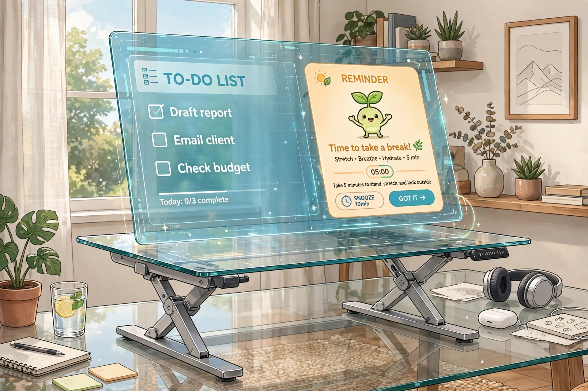
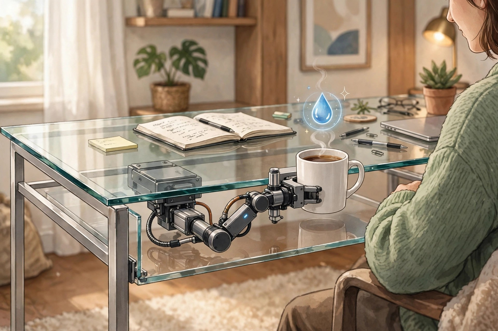

<!-- 본문 시작 -->
Apple gave up on it — someone built it desk-sized: a wireless charging desk whose coil comes to you

Set a phone down on a wireless charger a fraction off-center and nothing happens — that finicky alignment is the technology's oldest annoyance. AirPower, the charging mat Apple unveiled in 2017 and scrapped in 2019, was supposed to fix it once and for all. The desk in this story takes that same ambition and stretches it across an entire desktop, as a do-it-yourself build. This piece is a summary based on published materials.

## So what exactly is this desk?

It goes by the name AirDesk. Its creator is He Shijie, who runs the YouTube channel HTX Studio, and who says he spent nine years waiting for a product like this before deciding to make one himself. The mechanism is refreshingly straightforward. Lay a gadget on the surface and a camera mounted over the desktop works out where it landed; underneath, a lone wireless charging coil then travels to that exact position on its own. In other words, set your phone down anywhere and the coil seeks it out and charging begins. A little animated cat that follows the coil around is displayed on the desktop so you can see the charging status at a glance.

> The short version
>
> ### **You shouldn't have to find the charging spot — the coil should do the moving.**

## What makes it fun

**One: placement stops mattering.** A conventional pad only delivers power when the phone sits squarely in the middle. AirDesk turns the full surface into charging territory. Fixed coils tucked into the corners handle several devices simultaneously, and the maker explains that even a keyboard can top up wirelessly this way.

**Two: the desk pulls its own weight.** A transparent LCD set into the surface presents your to-do list along with animations, and if you have been seated for too long it pops up a nudge telling you to get up and stretch. Motorized legs convert it into a standing desk at the press of a button, and with a Mac mini installed beneath the top, the maker has used the desk itself as a complete workstation.

**Three: it nudges your cup closer so you remember to drink.** Easily the strangest trick this desk performs. Once an hour, a small device gives your cup a gentle push in your direction as a prompt to take in some water.

## The downsides

Wanting one won't help you: there is exactly one of these in the world, it was built as a personal DIY project, and there are no plans to sell it. Construction alone took over two months, so building a copy is hardly a weekend job either. Two practical questions remain unanswered in the available materials — how many watts the charging delivers, and how accurate the position detection actually is. There is also the matter of a camera constantly watching everything on your desk, which may well be a dealbreaker for the privacy-conscious.

## Price and getting one in Korea

| Item | Detail |
| --- | --- |
| Project name | AirDesk |
| Creator | He Shijie (YouTube channel HTX Studio) |
| How it works | Camera over the desktop detects position + a charging coil that moves to it |
| Other features | Transparent LCD to-do display, motorized standing height, pushes your cup every hour |
| Charging output | Not confirmed |
| Price | Not sold (DIY project) |
| Availability in Korea | Not confirmed |

## Our verdict

Asking whether AirDesk is "worth buying" misses the point, because buying one is impossible. What deserves attention is how directly it confronts the everyday irritation of wireless charging. If all you want is a desk with fewer cables, a multi-coil charging pad you can buy today is the sensible stand-in. If you are a maker, though, the core idea — let the coil do the travelling — is a project concept worth stealing. File this one away as an example of technology aimed squarely at a small, familiar frustration.

Sources: Yanko Design (September 27, 2026) and the HTX Studio build video (YouTube). This is an introduction based on published materials, not a hands-on account.
Related posts:
https://blog.naver.com/3700708/224447910718
https://blog.naver.com/3700708/224447909708
<!-- 본문 끝 -->

## Working notes (excluded from upload)

- Sources: Yanko Design / HTX Studio build video / verified 2026-10-18 (Korean manuscript prepared), packaged 2026-10-21
- 3 images (AI-generated illustrations, self-made, usage rights: own), same files as the Korean edition:
  - images/01-hero.jpg / Forget hunting for the sweet spot on a charging pad — the desktop itself is the charging area (illustration)
  - images/02-screen.jpg / Once the desktop doubles as a display, the desk can show your tasks and its charging status all by itself (illustration)
  - images/03-cup.jpg / Hourly, your cup creeps a little nearer (illustration)
- Fact check: charging wattage and position-detection accuracy are not confirmed in the published materials. No sales plans (one-off DIY build).
- Target: English WordPress/Blogger (multi-channel program). English edition content_revision: 2 — rewritten for the 2026-10-21 Naver refresh batch with new wording; confirm against check_distribution before submitting.
- Additional requests: none
