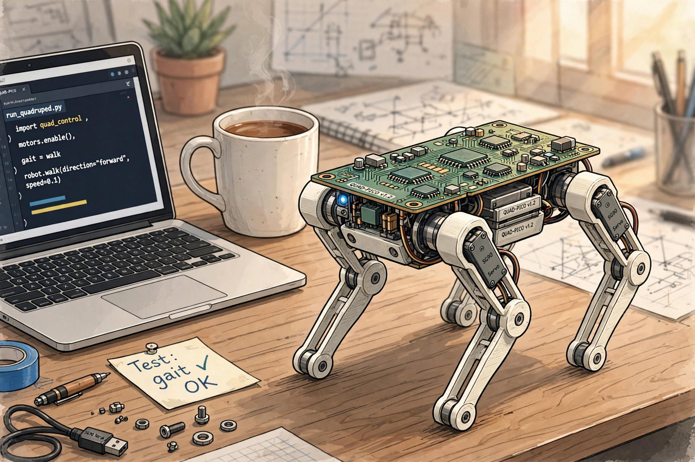
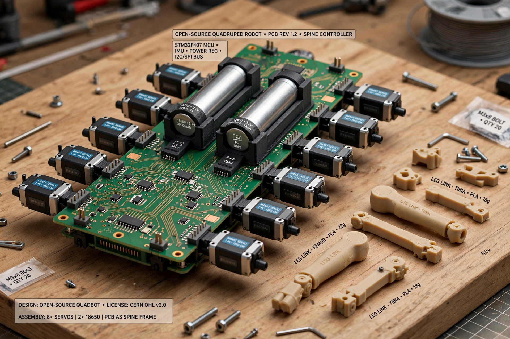
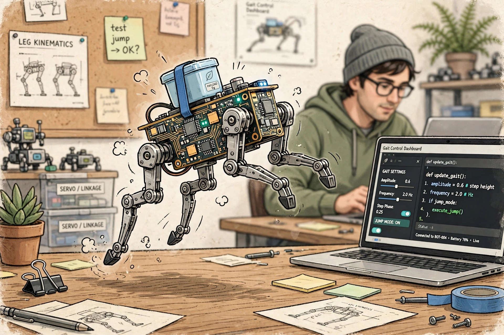

<!-- 본문 시작 -->
손바닥 위에서 점프하는 로봇개 — 전선 없는 오픈소스 Q8botOne

로봇개라고 하면 보통 사람 무릎 높이의 큰 기계를 떠올립니다. 이 로봇은 길이가 12cm밖에 안 됩니다. 책상 위 커피잔과 노트북 사이를 걸어 다니는 크기입니다. 그런데 작다고 장난감은 아닙니다. 이 글은 자료를 바탕으로 소개합니다.

## 전선이 없다는 게 핵심입니다

Q8botOne은 미국 ZeroWire Robotics가 만든 네발 로봇입니다. 보통 로봇을 만들면 모터마다 전선을 연결하느라 내부가 지저분해지기 마련인데, 이 로봇은 회로기판(PCB) 자체가 몸통 뼈대입니다. 모터 8개와 배터리 2개가 기판에 바로 꽂히는 구조라 안에 전선 다발이 없습니다. 이름의 'ZeroWire'가 그 뜻입니다.

> 핵심 한 줄
>
> ### **기판이 몸통이고, 전선이 없다 — 뜯어보고 고치는 게 전제인 로봇이다.**

## 재미있는 점 셋

첫째, 움직임이 작지 않습니다. 개발사에 따르면 걷기와 조깅은 물론 점프까지 하고, 자기 무게(250g)의 두 배까지 실어 나를 수 있습니다. 다리는 평행 링크 구조이고, 걸음걸이 패턴은 펌웨어에서 바꿔가며 실험할 수 있습니다.

둘째, 모터가 똑똑합니다. 관절마다 DYNAMIXEL 스마트 서보 8개가 들어가 위치·속도 피드백을 돌려줍니다. 값싼 취미용 서보와 달리 '지금 다리가 어디 있는지'를 로봇이 아는 셈이라, 걸음 교정 같은 실험이 가능합니다.

셋째, 전부 공개돼 있습니다. 회로 설계 파일, 펌웨어, 3D 모델, 조립 설명서까지 오픈소스로 공개했습니다. 기본형에는 카메라와 센서가 없지만, Qwiic 커넥터와 5V 전원을 내주는 확장 단자가 있어 센서나 카메라, 심지어 라즈베리파이 같은 작은 컴퓨터를 등에 얹을 수도 있습니다.

## 제품 핵심 정보

| 항목 | 내용 |
| --- | --- |
| 제품 | Q8botOne |
| 제조사 | ZeroWire Robotics (미국) |
| 크기·무게 | 120×70×70mm / 250g |
| 구성 | ESP32-C3, DYNAMIXEL 스마트 서보 8개, 중앙 PCB 차체 |
| 가격 | 키트 199달러 (액추에이터 별도) / 완성품 599달러 |
| 판매 단계 | Crowd Supply 펀딩 중 (~2026년 11월 19일) |
| 출하 예정 | 2027년 3월, 전 세계 무료 배송 표기 |
| 국내 이용 | 직구 (한국어 지원 미확인) |

## 아쉬운 점

199달러 키트는 싸 보이지만 함정이 있습니다. 다리를 움직이는 액추에이터 8개가 포함돼 있지 않아 따로 사야 합니다. 결국 가격의 대부분은 그 모터 값입니다. 또 완성품도 지금 살 수 있는 게 아니라 펀딩 상품이라, 실제 출하는 2027년 3월 예정입니다. 점프나 운반 능력 같은 성능 수치는 아직 개발사 주장 단계로, 독립 검증은 이뤄지지 않았습니다.

## 에디터 판단

이 로봇은 반려 로봇이 아니라 교보재에 가깝습니다. 얼굴도, 애교도 없습니다. 대신 속이 다 보이고, 전부 고칠 수 있게 열려 있습니다. 로봇의 걸음걸이가 어떻게 만들어지는지 궁금한 사람, ESP32와 서보 제어를 손으로 익히고 싶은 메이커에게 맞는 물건입니다. 완성된 장난감을 원하는 분이라면 완성품 가격과 출하 일정을 한 번 더 확인하고 결정하는 게 좋겠습니다.

출처: Crowd Supply 공식 캠페인 페이지, Hackster·Yanko Design 보도 (2026년 10월). 가격과 일정은 2026년 10월 21일 확인 기준이며, 직접 사용한 경험이 아닌 자료 기반 소개입니다.
관련 글:
https://blog.naver.com/3700708/224444408193
https://blog.naver.com/3700708/224447910718
<!-- 본문 끝 -->

## 작업용 출처·이미지 정보 (업로드 제외)

- 자료 출처: Crowd Supply 공식 캠페인(https://www.crowdsupply.com/zerowire-robotics/q8botone) / Hackster (2026-10-08) / Yanko Design (2026-10-10) / CNX Software / 확인일 2026-10-21
- 이미지 3점 (AI 생성 일러스트, 사용권: 자작):
  - images/01-hero.jpg / 길이 12cm, 무게 250g — 스마트폰 한 대 크기의 몸에 다리 네 개가 달렸다 (일러스트)
  - images/02-pcb.jpg / 모터와 배터리가 기판에 바로 꽂힌다 — 고장 나면 전선 다발 대신 기판부터 보면 된다 (일러스트)
  - images/03-jump.jpg / 걸음걸이를 코드로 바꾸는 재미 — 이 로봇의 본체는 몸이 아니라 실험 그 자체다 (일러스트)
- 사실 확인: 성능 수치(점프·2배 운반)는 개발사 주장, 독립 검증 없음. 키트 $199는 액추에이터 미포함. 출하 2027년 3월 예정.
- 추가 요청: 없음

## 발행 기록 (업로드 제외)

- 사용자 요청: 2026-10-21 "오늘 자 블로그 2개 생성"
- 처리 결과: GitHub push + MCP submit 예정
