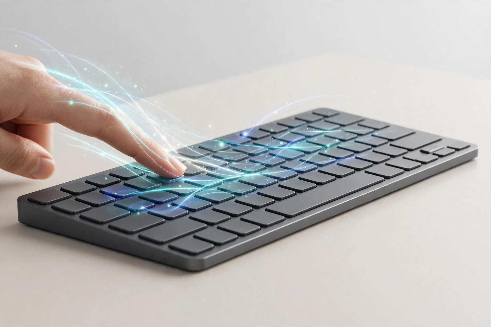

<!-- 본문 시작 -->
손을 키에서 떼지 마세요 — 키 표면이 터치패드인 키보드, 클레베투라 S

타이핑하다 커서를 움직이려고 오른손이 키보드를 떠납니다. 마우스를 잡고, 다시 키보드로 돌아오고. 하루에 수백 번 반복되는 몇 센티미터의 이동입니다. 오늘 소개할 키보드는 그 이동 자체를 없애버렸습니다. 키를 누르면 글자가 찍히고, 키 표면을 문지르면 커서가 움직입니다. 이 글은 자료를 바탕으로 정리한 소개 글입니다.

## 이 키보드는 무엇인가요

제품 이름은 '클레베투라 S(Clevetura S, CLVX S)'. Clevetura의 'TouchOnKeys' 기술을 담은 78키 컴팩트 키보드입니다. 알루미늄 베이스에 시저 스위치(노트북 키보드 방식)를 쓴 로우프로파일 키보드입니다. 핵심은 키 표면 전체가 정전식 터치 센서라는 점입니다. 누르면 입력, 문지르면 제스처. 두 동작을 키보드가 스스로 구분합니다. 제조사에 따르면 AI가 양손의 위치를 인식해 오입력(의도치 않은 터치)을 걸러낸다고 합니다.

> 핵심 한 줄
>
> ### **마우스를 찾으러 손이 떠나지 않는다 — 키보드 위에서 모든 게 끝난다.**

## 왜 재미있나요

**첫째, 키보드에서 손이 떠나지 않습니다.** 커서 이동·스크롤·줌·클릭, macOS 제스처까지 키 표면에서 처리됩니다. 터치 영역은 키보드의 오른쪽·왼쪽 중 편한 쪽으로 조정할 수 있습니다. 문서를 읽다 스크롤하고, 코드에서 커서를 옮기고, 다시 타이핑하는 흐름이 끊기지 않습니다.

**둘째, 제스처 슬라이더가 있습니다.** 키 상단 행을 좌우로 문지르면 볼륨 조절이나 영상 되감기가 됩니다. 제조사 앱에서는 포토샵·피그마·프리미어 같은 앱별 프리셋을 설정할 수 있어, 자주 쓰는 조작을 손가락 한 번에 매핑할 수 있습니다.

**셋째, 들고 다니기 좋습니다.** 무게 430g, 너비 29cm 남짓의 작은 몸에 블루투스 3대 연결과 USB-C를 넣었습니다. 카페나 기차처럼 마우스를 둘 자리가 없을 때 빛을 발합니다. 리뷰 매체들은 "공간이 좁고 타이핑 중간에 스크롤·클릭이 자주 끼어드는 상황에서 가장 빛난다"고 평가했습니다.

## 아쉬운 점도 있습니다

익숙해지는 시간이 필요합니다. 손가락을 홈로우에 얹어두는 습관이 있으면 원치 않는 입력이 들어갈 수 있습니다. 리뷰어들도 "제스처 감도 조절이 중요하다"고 입을 모읍니다. 배터리는 제조사 기준 백라이트 없이 최대 44시간(약 10일 분량)이지만, 실제 리뷰에서는 "기대 이하"라는 평가가 나왔습니다. 정밀한 드로잉이나 장시간 포인터 작업은 여전히 마우스가 낫습니다. 배열은 미국식(ANSI)만 있고, 가격 199달러는 일반 컴팩트 키보드의 두 배를 넘습니다.

## 가격과 국내 이용

| 항목 | 내용 |
| --- | --- |
| 제품명 | Clevetura S (CLVX S) |
| 제조사 | Clevetura |
| 핵심 방식 | TouchOnKeys — 키 표면 정전식 터치 센서 |
| 키 수·스위치 | 78키, 시저 방식, 미국 배열(ANSI) |
| 연결 | 블루투스 3대 + USB-C |
| 배터리 | 1,900mAh, 최대 44시간(백라이트 off, 제조사 기준) |
| 가격 | 화이트 199달러(판매 중), 블랙 189달러(예약, 10월 중하순 출하), Windows판 199달러 |
| 국내 이용 | 미확인 |

## 에디터의 판단

이 키보드는 '마우스를 대체하는' 제품이 아닙니다. 타이핑과 탐색을 오가는 그 짧은 이동이 유난히 잦은 사람 — 문서 작업, 코드 리뷰, 참고 자료 오가며 쓰는 사람 — 에게 어울립니다. 좁은 책상이나 이동 중 작업이 많다면 한 번쯤 써볼 만한 발상입니다. 다만 정밀 작업용 마우스는 그대로 두고, "키보드 위에서 끝낼 수 있는 일"만 맡기는 게 현명해 보입니다. 오작동 걱정이 크다면 감도 조절이 되는지를 먼저 확인해 보세요.

출처: Clevetura 공식 사이트, Cult of Mac 리뷰(2026년 10월 5일), Yanko Design 리뷰(2026년 10월 19일). 직접 사용한 경험이 아닌 자료 기반 소개입니다.
관련 글:
https://blog.naver.com/3700708/224444408193
https://blog.naver.com/3700708/224447910718
<!-- 본문 끝 -->

## 작업용 출처·이미지 정보 (업로드 제외)

- 자료 출처: Clevetura 공식(clevetura.com) / Cult of Mac / Yanko Design / alphaleaders 사양 정리 / 확인일 2026-10-22
- 이미지 3점 (AI 생성 일러스트, 사용권: 자작):
  - images/01-hero.jpg / 키를 누르면 타이핑, 문지르면 커서 이동 — 키보드 위에서 손이 떠나지 않는다 (일러스트)
  - images/02-gesture.jpg / 키 상단을 문지르면 볼륨이 조절된다 — 자주 쓰는 조작을 손가락 한 번에 맡긴다 (일러스트)
  - images/03-desk.jpg / 마우스 둘 자리 없는 좁은 책상에서 키보드 하나로 끝낸다 — 430g의 작은 몸 (일러스트)
- 사실 확인: 가격·사양·리뷰 평가 확인. 한국 배송 미확인. 'AI 오입력 필터링'은 제조사 주장.
- 추가 요청: 없음

## 발행 기록 (업로드 제외)

- 후보: 2026-10-22 소재 발굴 11개 중 10/10 — 생활 연결·차별성·검증 모두 확보
- 처리 결과: GitHub push + MCP submit 예정
