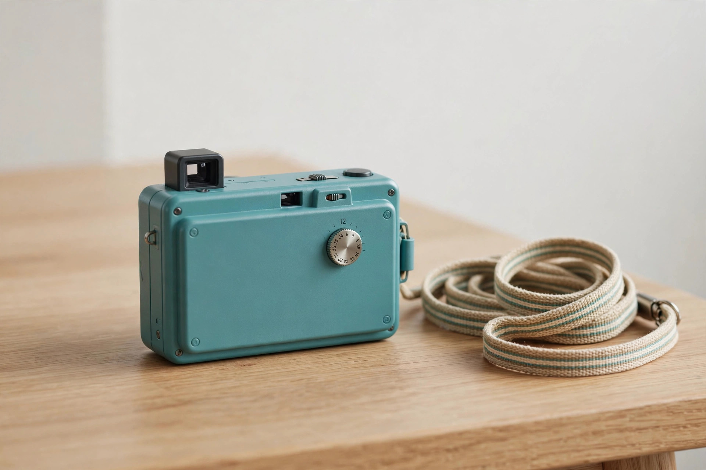
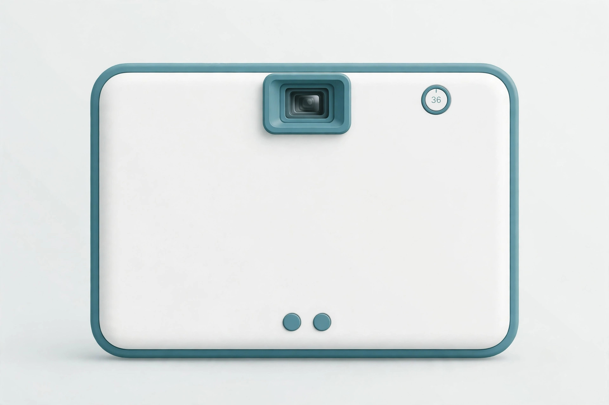

<!-- 본문 시작 -->
찍은 사진은 못 본다 — 24장을 채워야 현상되는 카메라, 어웨이트

스마트폰으로 찍은 사진 수천 장이 갤러리에 쌓여 있지만, 다시 열어보는 사진은 몇 장이나 될까요. 오늘 소개할 카메라는 이 문제를 정면으로 뒤집습니다. 화면이 없습니다. 찍은 사진은 바로 볼 수 없습니다. 24장을 다 채워야 '현상'되고, 실제 인화물이 집으로 배송됩니다. 기다림을 상품으로 파는 카메라입니다. 이 글은 자료를 바탕으로 정리한 소개 글입니다.

## 이 카메라는 무엇인가요

제품 이름은 '어웨이트(Await)'. 스위스 전자기기 회사 롤링 스퀘어(Rolling Square, inCharge 케이블로 알려진 회사)가 2026년 1월 CES에서 공개한 포켓 디지털 카메라입니다. 800만 화소 소니 IMX179 센서에 고정식 f/2.0 렌즈, 광학식 뷰파인더, 크세논 플래시와 10초 셀프타이머를 갖췄습니다. 화면은 없습니다. 본체에 있는 건 남은 촬영 매수를 보여주는 작은 OLED 카운터뿐입니다.

> 핵심 한 줄
>
> ### **찍고, 잊고, 나중에 받는다 — 기다림이 이 카메라의 기능이다.**

## 왜 재미있나요

**첫째, '한 롤 24장'이라는 규칙이 있습니다.** 필름 카메라처럼 24장을 찍어야 한 롤이 완성됩니다. 다 찍으면 앱으로 자동 동기화되고, 빈티지 사진을 연구해 만들었다는 레트로 필터와 주황색 날짜 스탬프가 입혀집니다. 한 롤은 최대 3롤(72장)까지 본체에 보관되고, 동기화하면 비워집니다. 찍을 때마다 확인하고 지우는 습관이 사라지니, 셔터를 누르기 전에 한 번 더 생각하게 됩니다.

**둘째, 진짜 인화물이 집으로 옵니다.** 롤이 완성되면 24장의 6×4인치 실물 사진이 배송됩니다. 자동 모드에서는 완성 후 24시간 유예 기간을 거쳐 롤당 8.99달러+배송비에 인화되고, 수동 모드에서는 원하는 롤만 골라 9.99달러+배송비에 주문합니다. 인화하지 않으면 비용이 들지 않습니다. 필터를 건너뛰고 싶으면 USB-C로 PC에 연결해 원본 파일을 그대로 꺼낼 수도 있습니다.

**셋째, 실제 써본 사람들의 반응이 좋습니다.** 킥스타터 출시 전 시제품을 받아본 리뷰 매체는 "기대했던 것보다 훨씬 잘 작동한다"고 평가했습니다. "찍는 순간과 기억 사이의 틈"이 제품의 전부인데, 그 틈이 실제로 감정을 만든다는 겁니다. 버튼은 두 개(전원 겸 셔터, 플래시·셀프타이머 전환)뿐이라 메뉴에서 길을 잃을 일도 없습니다.

## 아쉬운 점도 있습니다

펀딩 중인 제품이라 아직 정식 출시 전입니다. 출하는 2026년 12월 목표지만, 크라우드펀딩 일정은 지연되기 일쑤입니다. 800만 화소는 요즘 스마트폰 카메라와 비교하면 낮은 편이고, 인화는 롤당 9달러 안팎+배송비의 러닝코스트가 듭니다. 한국 배송 가능 여부와 배송비는 캠페인 페이지에서 별도 확인이 필요합니다. '기다림'이 재미가 될지 불편이 될지는 사람마다 다를 겁니다.

## 가격과 국내 이용

| 항목 | 내용 |
| --- | --- |
| 제품명 | Await (어웨이트) |
| 제조사 | Rolling Square (스위스) |
| 핵심 방식 | 화면 없는 디지털 촬영 + 24장 롤 + 실물 인화 배송 |
| 센서·렌즈 | 소니 IMX179 800만 화소, 고정식 f/2.0 |
| 인화 비용 | 자동 모드 롤당 8.99달러 / 수동 모드 9.99달러 + 배송비 (인화 시에만 과금) |
| 가격 | 129유로(약 146달러), 얼리버드 89유로~, 풀킷 157유로 |
| 판매 단계 | 킥스타터 펀딩 중, 2026년 12월 출하 목표 |
| 국내 이용 | 미확인 |

## 에디터의 판단

이 카메라는 화소 싸움을 하지 않습니다. 필름 카메라 유행이 보여주듯, 요즘 사람들은 '불편함의 감정'을 그리워합니다. 찍고 바로 확인하는 대신, 잊었다가 나중에 받는 경험. 가족 여행이나 아이의 일상을 담아 실물로 받아보고 싶은 사람에게 어울립니다. 다만 인화 비용이 계속 들고, 펀딩 제품 특유의 일정 리스크가 있습니다. 디지털 피로감을 느끼는 사람이라면, 스마트폰 카메라 앱을 지우는 것보다 이런 '느린 카메라' 하나가 더 효과적일지도 모릅니다.

출처: PetaPixel(2026년 9월 29일), Yanko Design(2026년 10월 9일), ByteGizmo 핸즈온 리뷰(2026년 9월 29일). 직접 사용한 경험이 아닌 자료 기반 소개입니다.
관련 글:
https://blog.naver.com/3700708/224444408193
https://blog.naver.com/3700708/224447910718
<!-- 본문 끝 -->

## 작업용 출처·이미지 정보 (업로드 제외)

- 자료 출처: PetaPixel / Yanko Design / ByteGizmo 핸즈온 / 확인일 2026-10-22
- 이미지 3점 (AI 생성 일러스트, 사용권: 자작):
  - images/01-hero.jpg / 화면 없는 작은 카메라 — 찍는 순간과 보는 순간 사이에 일부러 틈을 둔다 (일러스트)
  - images/02-roll.jpg / 24장을 채우면 앱에서 현상되고, 실물 사진 24장이 집으로 배송된다 (일러스트)
  - images/03-prints.jpg / 버튼 두 개, 뷰파인더 하나 — 메뉴에서 길을 잃을 일이 없는 단순함 (일러스트)
- 사실 확인: 스펙·가격·인화 요금·펀딩 단계·출하 목표 확인. 한국 배송 미확인. 핸즈온 리뷰는 시제품 기준.
- 추가 요청: 없음

## 발행 기록 (업로드 제외)

- 후보: 2026-10-22 소재 발굴 11개 중 10/10 — 호기심·생활·차별성·검증·설명 모두 확보
- 처리 결과: GitHub push + MCP submit 예정
