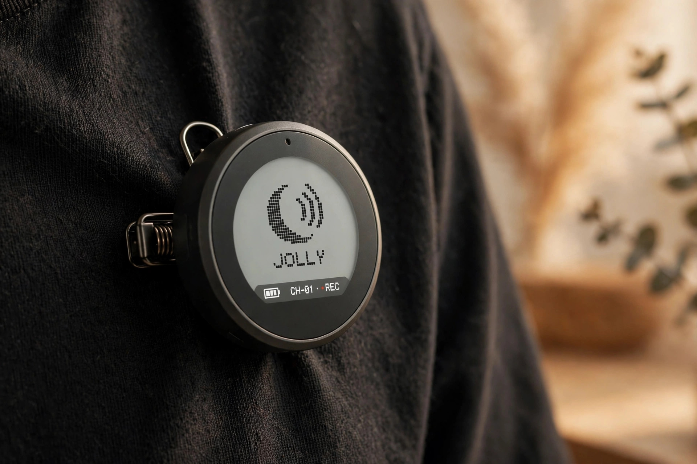
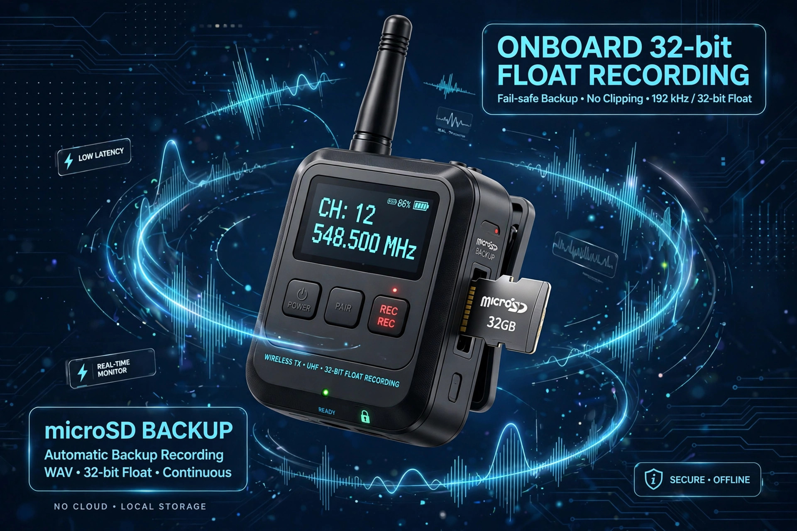

<!-- 본문 시작 -->
마이크에 내 로고가 뜬다 — 화면을 단 무선 마이크, Insta360 Mic

인터뷰 촬영 중 레벨이 튀면 그 테이크는 끝입니다. 너무 크게 말해 음성이 찢어졌거나, 너무 조용해 바닥 소음만 녹음됐다면 다시 찍을 수밖에 없습니다. 어제(10월 22일) 출시된 새 무선 마이크는 그 문제를 장비 안에서 해결하겠다고 나섰습니다. 송신기에 메모리카드를 꽂으면 32비트 플로트 녹음을 따로 저장해 두는 방식입니다. 이 글은 자료를 바탕으로 정리한 소개 글입니다.

## 이 마이크는 무엇인가요

제품 이름은 'Insta360 Mic'. 액션캠으로 유명한 Insta360이 2026년 10월 22일 출시한 무선 마이크입니다. 라인업 안에서의 위치는 고급형 Mic Pro와 입문형 Mic Air의 사이입니다. 가장 눈에 띄는 점은 송신기 정면에 있는 1.22인치 컬러 E-Ink 화면입니다. 앱으로 원하는 이미지를 올려 표시할 수 있어 채널 로고, 이모지, 반려견 사진 등을 마이크에 띄울 수 있습니다. 전자잉크라서 전원을 꺼도 표시가 그대로 남고 햇빛 아래에서도 잘 보입니다.

> 핵심 한 줄
>
> ### **마이크가 녹음 장비이자 채널 간판이 된다 — 화면에 로고를 띄우는 무선 마이크.**

## 왜 재미있나요

**첫째, 송신기 자체가 백업 녹음기입니다.** microSD 카드 슬롯이 있어 카드만 꽂으면 송신기에서 내부 녹음을 시작합니다. 이때 32비트 플로트 형식을 지원하는데, 이는 일반적인 녹음보다 다이나믹 레인지가 넓어 편집 단계에서 너무 크거나 작게 들어간 소리를 복구할 수 있습니다. 전파가 끊기거나 카메라 녹음이 실패해도 송신기 쪽에 파일이 남는 구조라, 결혼식 서약처럼 다시 찍을 수 없는 촬영의 안전망이 됩니다. 리뷰 매체 Engadget은 "Pro의 내장 저장소를 메모리카드 가격으로 확보하는 셈"이라며 이 방식을 호평했습니다.

**둘째, 배터리와 연결 방식이 실용적입니다.** 송신기 배터리는 제조사 기준 1회 충전 최대 13시간, 충전 케이스까지 쓰면 34시간입니다. 5분 충전으로 약 2시간 20분을 쓸 수 있다고 합니다(제조사 테스트 기준). Insta360의 자체 카메라(X6·X5·Luna Ultra·Luna Pro·GO Ultra·Ace Pro 2)에는 블루투스로 수신기 없이 직접 연결되는 'Direct Connect'도 지원합니다.

**셋째, 멀티 마이크 운용이 자유롭습니다.** 하나의 수신기에 송신기를 최대 4개까지 연결할 수 있고, 상위 모델 Mic Pro의 송신기와도 함께 쓸 수 있습니다. 반대로 송신기 2대가 수신기 4대에 동시에 송출하는 것도 가능해, 여러 대의 카메라에 같은 소리를 동기화해 넣는 다중 카메라 촬영에도 대응합니다. AI 칩 기반 노이즈 제거, 자동 게인(클리핑 방지 모드·볼륨 평탄화 모드), 3가지 목소리 톤 프리셋도 들어 있습니다.

## 아쉬운 점도 있습니다

가격이 낮아진 만큼 잘라낸 부분도 있습니다. Mic Pro가 가진 32GB 내장 스토리지가 없어 메모리카드를 별도로 구해야 하고, 방향성 캡슐 3개로 구성됐던 픽업 패턴 선택도 사라져 단일 무지향성 캡슐만 씁니다. 송신기에 3.5mm 입력 단자도 없어 외부 라발리에 마이크를 연결하려면 USB-C-3.5mm 변환 어댑터(5달러)를 별도로 사야 합니다. 수신기 동글도 다소 크다는 지적이 있습니다. 무게는 송신기 19.4g으로 가벼운 편입니다.

## 가격과 국내 이용

| 항목 | 내용 |
| --- | --- |
| 제품명 | Insta360 Mic |
| 제조사 | Insta360 |
| 핵심 방식 | 1.22인치 6컬러 E-Ink 화면(커스텀 이미지 표시) + microSD 슬롯 |
| 녹음 | 32비트 플로트/24비트 내부 녹음(카드 필요), AI 노이즈 제거 |
| 연결 | 2.4GHz 무선, Insta360 카메라 Direct Connect, 수신기당 송신기 최대 4개 |
| 가격 | 송신기 단품 79.99달러, 싱글 키트(송신기+수신기) 139.99달러, 듀얼 키트(송신기 2개+수신기+충전 케이스) 249.99달러 |
| 국내 이용 | 미확인 (10월 22일 글로벌 출시, 공식 스토어·아마존 판매) |

## 에디터의 판단

이 마이크는 '음질 하나만 보고 사는' 장비가 아니라 '촬영 현장 전체를 생각하는' 장비입니다. 1인 촬영 유튜버나 다인 인터뷰를 자주 찍는 사람이라면 E-Ink 커스텀과 32비트 플로트 백업이 체감될 만합니다. 반면 이미 무선 마이크를 가지고 있고 녹음 사고가 거의 없는 사용자라면, 3.5mm 입력 어댑터가 별도라는 점까지 고려해 기존 장비를 계속 쓰는 편이 나을 수 있습니다. 가격(듀얼 키트 249.99달러)은 경쟁 모델 DJI Mic 3와 비슷한 수준이라, E-Ink 커스텀과 확장 저장소가 마음에 드는지가 선택의 갈림길이 됩니다.

출처: Insta360 공식 발표(2026년 10월 22일), Engadget 리뷰(8.2/10, 2026년 10월 22일), Stuff·CGMagazine·DroneXL·Notebookcheck 보도(2026년 10월 22일). 직접 사용한 경험이 아닌 자료 기반 소개입니다.
관련 글:
https://blog.naver.com/3700708/224444408193
https://blog.naver.com/3700708/224447910718
<!-- 본문 끝 -->

## 작업용 출처·이미지 정보 (업로드 제외)

- 자료 출처: Insta360 공식 발표 / Engadget / Stuff / CGMagazine / DroneXL / Notebookcheck / Newsshooter / 확인일 2026-10-23
- 이미지 3점 (AI 생성 일러스트, 사용권: 자작):
  - images/01-hero.jpg / 송신기 앞면의 E-Ink 화면에 채널 로고가 표시된다 — 꺼진 상태에서도 로고가 남는다 (일러스트)
  - images/02-recording.jpg / 메모리카드를 꽂으면 송신기가 32비트 플로트로 따로 녹음한다 — 무선 끊김에도 파일이 남는다 (일러스트)
  - images/03-lineup.jpg / 하나의 수신기에 송신기 4대까지 연결된다 — 다인 인터뷰·멀티 카메라 운용 (일러스트)
- 사실 확인: 가격·스펙·출시일·리뷰 평가 확인. 한국 판매 미확인. 배터리·녹음 시간은 제조사 테스트 기준.
- 추가 요청: 없음

## 발행 기록 (업로드 제외)

- 후보: 2026-10-23 소재 발굴 10개 중 상위 — Insta360 Mic (10/10, 10-22 출시, 판매 중)
- 처리 결과: GitHub push + MCP submit 예정
