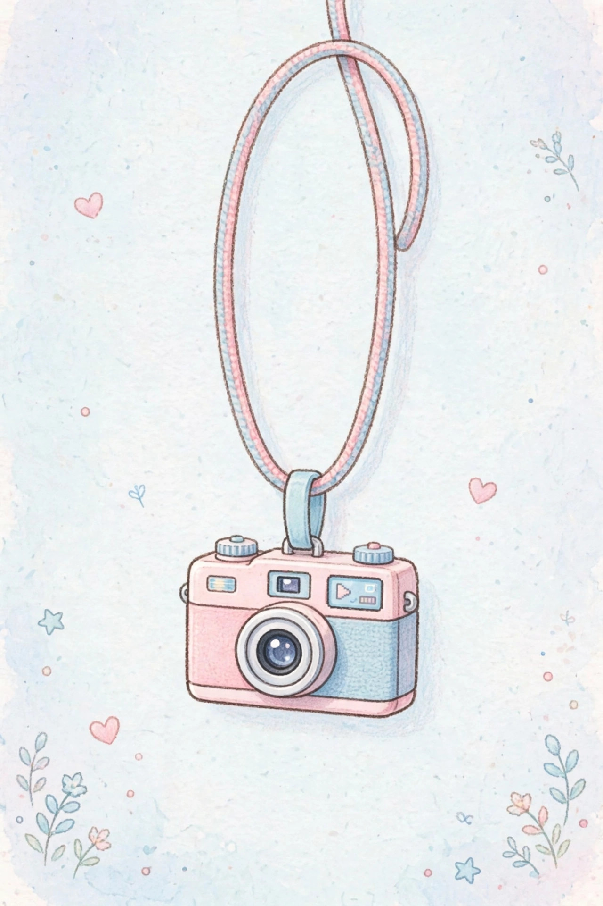
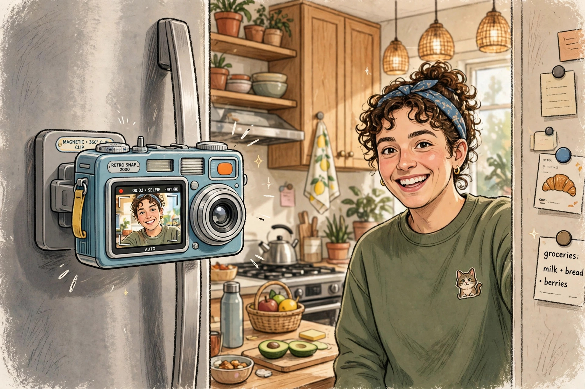

<!-- 본문 시작 -->
찍은 뒤에 뭐가 나왔는지 알게 된다 — 18g 목걸이 카메라, 켄코 피에니 III

스마트폰 카메라가 좋아질수록 사진 찍는 재미는 줄어드는 것 같습니다. 찍자마자 화면으로 확인하고, 마음에 안 들면 삭제하고, 보정 앱에서 만지는 일련의 과정이 너무 능숙해졌기 때문입니다. 일본 렌즈 제조사 켄코 토키나가 10월 9일 출시한 새 카메라는 그 과정을 일부러 끊어버립니다. 화면이 없습니다. 찍은 뒤 스마트폰에 옮기기 전까지는 뭐가 나왔는지 모릅니다. 이 글은 자료를 바탕으로 정리한 소개 글입니다.

## 이 카메라는 무엇인가요

제품 이름은 '켄코 피에니 III(Kenko Pieni III)'. 켄코 토키나가 만든 3세대 초소형 토이 카메라입니다. 무게는 약 18g(메모리카드·액세서리 제외), 크기는 53×35×18mm로 목걸이 스트랩에 달고 다니는 것이 기본 사용법입니다. 몸통은 필름 카메라를 닮았지만 속은 완전한 디지털입니다. 조작은 전원·셔터 버튼 2개와 사진/동영상 전환 스위치가 전부입니다.

> 핵심 한 줄
>
> ### **화면을 없애고 18g으로 만들었다 — 찍는 순간에 집중하는 카메라.**

## 왜 재미있나요

**첫째, '블라인드 촬영'의 재미가 있습니다.** 화면도 뷰파인더도 없어서 피사체를 감으로 담고 나중에 확인합니다. 필름 카메라처럼 찍은 뒤 결과를 기다리는 시간 자체가 재미가 됩니다. 리뷰 매체들은 "사진을 확인하느라 화면만 보는 습관에서 벗어나게 한다"고 평가합니다.

**둘째, 가볍고 작아서 항상 몸에 붙어 있습니다.** 18g은 500원짜리 동전 4개보다 가벼운 무게입니다. 목에 걸거나 선반에 장식품처럼 올려두고, 생각날 때 꺼내 찍으면 됩니다. 뒷면에는 자석이 있어 냉장고나 철제 난간에 붙여 셀프 사진이나 핸즈프리 촬영도 가능합니다. 4가지 색상(Soda·Strawberry·Milk·Black)에 산리오 캐릭터 5종(헬로키티·마이멜로디·쿠로미·시나모롤·한교동) 에디션도 별도로 나옵니다.

**셋째, 요즘 방식대로 연결됩니다.** 전작이 구형 마이크로 USB였던 충전·전송 단자를 3세대에서 USB-C로 바꿔 동봉 케이블 하나로 스마트폰에 직접 사진을 옮길 수 있습니다. 촬영물은 microSDHC 카드(4~32GB, 별도 구매)에 저장됩니다. 뒷면 표시등이 사진 모드에서는 빨간색, 동영상 모드에서는 파란색으로 켜져 현재 모드를 알려줍니다.

## 아쉬운 점도 있습니다

화질을 기대하면 안 됩니다. 센서는 1/10인치 32만 화소로, 사진은 카메라 안에서 보간해 1440×960 JPEG로 저장되지만 실제 디테일은 그보다 적습니다. 제조사가 공개한 샘플을 보면 꽃이 색색의 번짐으로, 잎이 수채화처럼 나오는 식입니다. 동영상은 720×480 30fps에 음성 녹음까지는 되지만 현재 스마트폰 화질과는 거리가 멉니다. 렌즈는 1.8mm F2.8(35mm 환산 42mm 상당) 고정초점으로 30cm보다 가까이는 촬영이 어렵고, ISO 100 고정·셔터 속도 자동이라 노출 조절도 카메라에 맡겨야 합니다. 메모리카드는 별도 구매입니다.

## 가격과 국내 이용

| 항목 | 내용 |
| --- | --- |
| 제품명 | Kenko Pieni III |
| 제조사 | Kenko Tokina |
| 핵심 방식 | 화면·뷰파인더 없는 18g 토이 카메라, 필름 카메라 외형 |
| 촬영 사양 | 1/10인치 32만 화소 센서, 보간 1440×960 JPEG, 720×480 30fps 동영상 |
| 연결 | USB-C(스마트폰 전송·충전), microSDHC 4~32GB(별도), 뒷면 자석 |
| 가격 | 6,600엔(2026년 10월 9일 일본 출시, 미국 언론 환산 약 38~42달러), 산리오 에디션 8,470엔 |
| 국내 이용 | 미확인 (일본 출시, 해외직구·구매대행 이용 사례는 보도에 언급) |

## 에디터의 판단

이 카메라는 '잘 찍는 카메라'가 아니라 '재밌게 찍는 카메라'입니다. 스마트폰 사진이 다 똑같아 지루하다고 느끼는 사람, 가방에 카메라 하나쯤 항상 넣고 싶은 사람, 아이에게 첫 카메라를 쥐여주고 싶은 부모에게 어울립니다. 반대로 여행의 결정적 순간을 확실하게 남겨야 한다면 이 카메라는 보조 수단으로만 두세요. 6,600엔이라는 가격은 장난감 카메라치고는 싸지 않지만, "화면 없는 촬영"이라는 경험을 사본다고 생각하면 납득이 가는 선입니다. 산리오 에디션을 노린다면 가격이 8,470엔으로 오른다는 점도 참고하세요.

출처: 켄코 토키나 공식(일본), PetaPixel·Yanko Design·Notebookcheck·The Gadgeteer·TechEBlog 보도(2026년 10월 19~20일). 직접 사용한 경험이 아닌 자료 기반 소개입니다.
관련 글:
https://blog.naver.com/3700708/224444408193
https://blog.naver.com/3700708/224447910718
<!-- 본문 끝 -->

## 작업용 출처·이미지 정보 (업로드 제외)

- 자료 출처: Kenko Tokina 공식(일본) / PetaPixel / Yanko Design / Notebookcheck / The Gadgeteer / TechEBlog / 확인일 2026-10-23
- 이미지 3점 (AI 생성 일러스트, 사용권: 자작):
  - images/01-hero.jpg / 목에 건 스트랩에 달린 필름 카메라 모양의 작은 카메라 — 18g의 무게로 목걸이처럼 착용한다 (일러스트)
  - images/02-magnet.jpg / 뒷면 자석으로 냉장고에 붙인 카메라 — 핸즈프리 촬영과 셀프 사진을 손쉽게 (일러스트)
  - images/03-usbc.jpg / USB-C 케이블로 스마트폰에 사진을 옮긴다 — 별도 리더기 없이 바로 전송 (일러스트)
- 사실 확인: 가격·스펙·출시일 확인. 한국 판매 미확인. 사진 화질 평가는 보도 매체 샘플 기준.
- 추가 요청: 없음

## 발행 기록 (업로드 제외)

- 후보: 2026-10-23 소재 발굴 10개 중 상위 — Kenko Pieni III (10/10, 10-9 일본 출시, 판매 중)
- 처리 결과: GitHub push + MCP submit 예정
