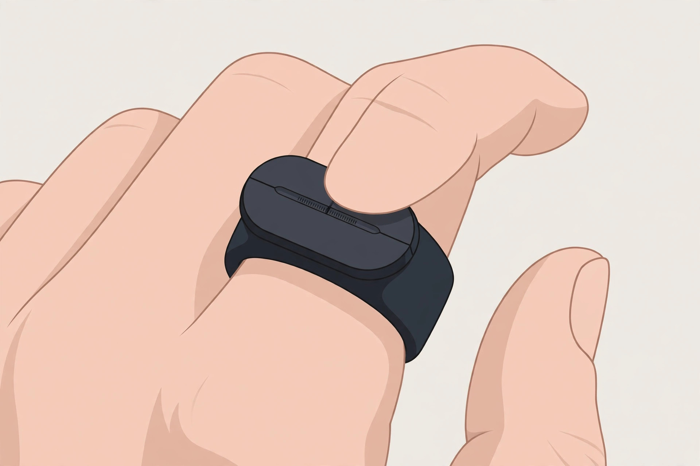
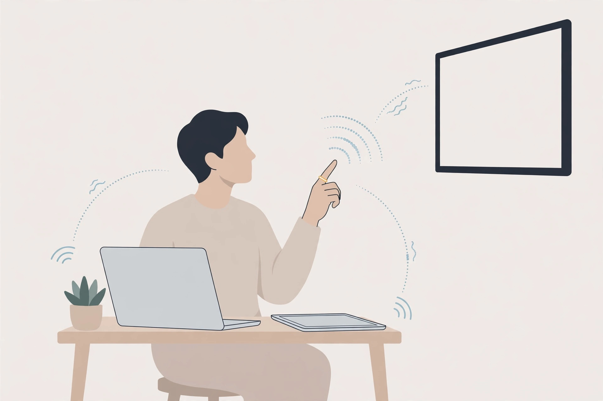
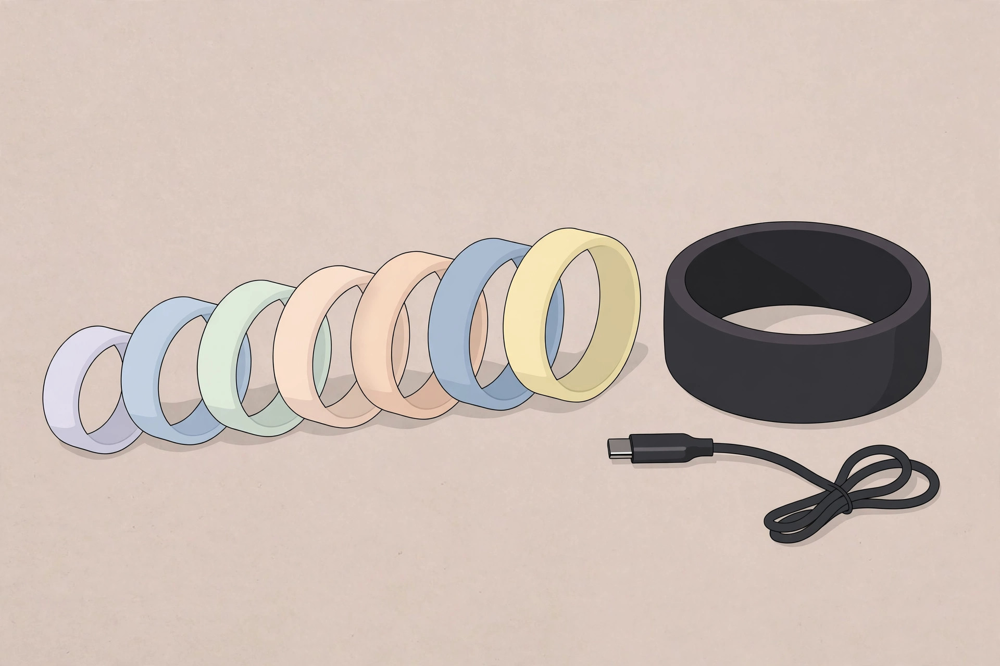

<!-- 본문 시작 -->
마우스를 손가락에 끼웠다 — 검지 위 트랙패드, Prolo Ring

노트북·태블릿·TV를 오가는 하루, 기기를 바꿀 때마다 손에 쥐는 컨트롤러도 바뀝니다. 미국 Prolo의 반지형 컨트롤러 'Prolo Ring'은 그 바꿔 드는 동작 자체를 없애겠다는 발상입니다. 검지에 낀 반지 하나로 PC·태블릿·폰·TV를 오갑니다. 공식 자료 기반 소개 글입니다.

## 이 반지는 무엇인가요

제품 이름은 'Prolo Ring(프로로 링)'. 반지 윗면의 18×30mm 정전식 터치 표면을 엄지로 밀어 커서·클릭·스크롤을 조작합니다. 상단 'Modstrip'으로 커서·내비게이션·터치·에어 4가지 모드를 전환합니다. Standard는 30개 이상 기본 제스처를 바로 쓰는 플러그앤플레이형, Pro는 커스텀·매크로형입니다.

> 핵심 한 줄
>
> ### **마우스를 손가락에 끼웠다 — 기기를 바꿔도 손에 쥔 것은 그대로.**

## 왜 재미있나요

**첫째, 손가락만 한 트랙패드의 한계를 제스처로 풀었습니다.** 18×30mm 면적에서 커서를 화면 끝까지 옮기기는 어렵습니다. 'Joystick Assist'는 가장자리에서 반대쪽으로 밀어 유지하면 커서가 계속 이동합니다. 엄지를 중심에서 멀리 둘수록 빨라지고, 떼면 멈춥니다.

**둘째, 기기 전환이 반지 위에서 끝납니다.** 여러 기기를 등록해 두고 Modstrip에서 탭 후 홀드하면 다음 기기로 넘어갑니다. 표준 Bluetooth HID라 드라이버나 전용 앱 없이 기본 조작이 됩니다. 지원은 Windows·macOS·Linux·iOS·Android·스마트TV·XR입니다. 다만 한 번에 연결되는 기기는 하나라, Yanko Design은 "'즉시 전환'이라는 표현은 다소 과장"이라고 지적합니다.

**셋째, Pro 에디션은 손가락을 프로그래밍합니다.** 40개 이상 제스처에 매크로를 할당하고 에어 제스처로 허공 조작도 됩니다. 푸시투토크로 AI 받아쓰기를 켤 수 있는데, 반지에 마이크는 없어 음성 입력은 연결된 기기가 처리합니다.

## 아쉬운 점도 있습니다

반지라서 생기는 제약이 분명합니다. 밴드 너비 23mm라 일반 반지 호수와 호환되지 않고, 미국 사이즈 7~18 중에서 사이징 키트로 미리 착용해 보고 확정해야 합니다. 방수가 안 돼 샤워·수영 전에는 빼야 합니다. 일부 조작은 양손을 써야 하고 작은 터치 면적에 익숙해지는 기간이 필요합니다. 배터리는 일반 사용 기준 최대 10시간이라 하루 종일 쓰기에는 저녁 충전이 필요합니다.

## 가격과 국내 이용

| 항목 | 내용 |
| --- | --- |
| 제품명 | Prolo Ring |
| 제조사 | Prolo (미국) |
| 핵심 방식 | 검지 착용 웨어러블 컨트롤러 — 18×30mm 터치 + Modstrip |
| 주요 스펙 | 1024×1792, 4.1~5.2g, 23×2.9mm, 최대 10시간, BLE HID, FCC·CE |
| 연결 | Win·macOS·Linux·iOS·Android·스마트TV·XR (드라이버 불필요) |
| 가격 | 149달러부터 (Standard, 2026-10-24 공식 스토어 확인). Pro·Pro Bundle은 상위 에디션 |
| 국내 이용 | 미확인 (공식 스토어 직판, 사이즈 확정 후 10~20영업일 배송) |

## 에디터의 판단

이 반지는 '마우스를 대체하는 제품'이라기보다 '마우스가 닿지 않는 순간을 메우는 제품'입니다. 프레젠테이션 중 슬라이드를 넘기거나, 소파에서 TV를 조작할 때 손을 뻗지 않아도 되는 편리함이 핵심입니다. 149달러는 호기심에 사기엔 부담스럽지만, 여러 기기를 오가는 환경이라면 계산해 볼 만합니다. 사이즈 확정이 번거롭다는 점은 구매 전 꼭 감안하세요.

## 함께 보면 좋은 글

- [찍은 뒤에 뭐가 나왔는지 알게 된다 — 18g 목걸이 카메라, 켄코 피에니 III](https://blog.naver.com/3700708/224450988855) — 화면 없는 18g 토이 카메라
- [마이크에 내 로고가 뜬다 — 화면을 단 무선 마이크, Insta360 Mic](https://blog.naver.com/3700708/224450842962) — 작은 화면을 단 무선 마이크
- [AI가 찾아낸 인터넷의 균열｜전 세계 사이트 70% 비상사태](https://blog.naver.com/3700708/224450991308) — AI 시대 보안 이슈 정리 (AI 뉴스)

출처: Prolo 공식 스토어(proloring.com), Yanko Design 2026-10-22 보도. 직접 사용한 경험이 아닌 자료 기반 소개입니다.
<!-- 본문 끝 -->

## 작업용 출처·이미지 정보 (업로드 제외)

- 자료 출처: Prolo 공식 스토어(proloring.com) / Yanko Design 2026-10-22 / 확인일 2026-10-24
- 이미지 3점 (AI 생성 일러스트, 사용권: 자작):
  - images/01-hero.jpg / 검지에 낀 넓은 밴드의 반지 위를 엄지가 미끄러지듯 조작하는 모습 — 터치 표면은 18×30mm (일러스트)
  - images/02-devices.jpg / 책상에서 노트북·태블릿·벽걸이 TV를 반지 낀 손 하나로 오가며 조작하는 모습 — 기기마다 컨트롤러를 바꿔 들 필요가 없다 (일러스트)
  - images/03-size.jpg / 반지 사이징 키트와 여러 치수의 플라스틱 사이저, 자석 충전 케이블이 책상 위에 놓인 모습 — 넓은 밴드라 착용 전 치수 확정이 필수 (일러스트)
- 사실 확인: 가격(Standard 149달러)·스펙·에디션 구성·배송 조건 확인. 한국 판매 미확인. Pro $179·Bundle $209는 서브에이전트 조사치라 본문에서 '상위 에디션'으로만 표기.
- 추가 요청: 없음

## 발행 기록 (업로드 제외)

- 후보: 2026-10-24 소재 발굴 11개 중 상위 — Prolo Ring (10/10, 판매 중)
- 처리 결과: GitHub push + MCP submit_edition ko/en 예정
