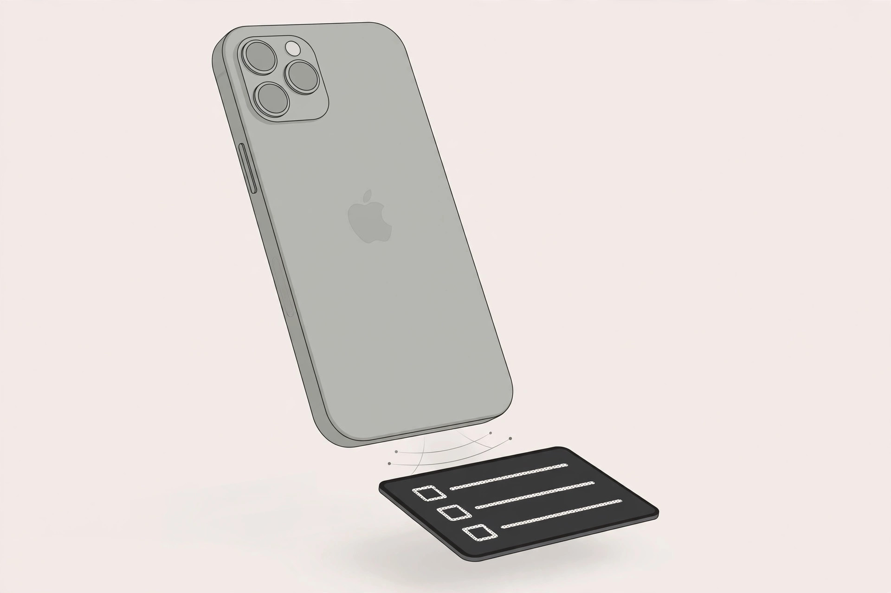
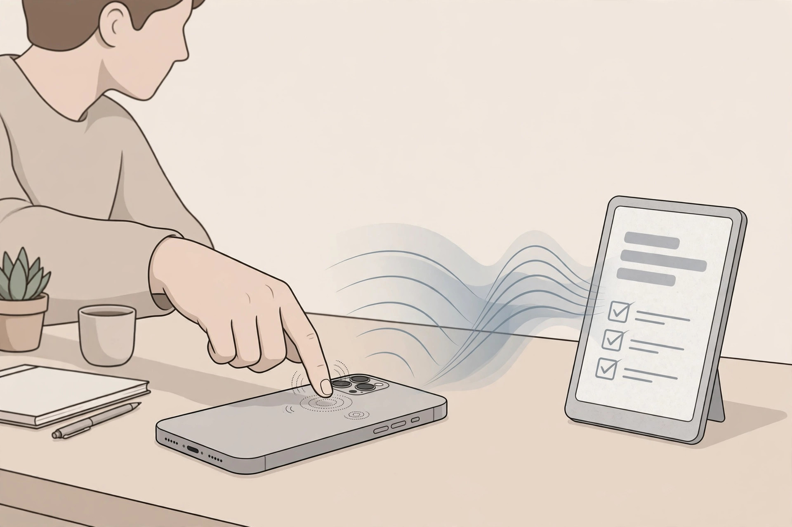

<!-- 본문 시작 -->
A second screen on the back of your iPhone — record, and the summary comes back: REETLE SmartInk I

When a meeting starts you pull out your phone, open the recorder app, and afterward you hunt down the file, listen through it, and type up notes. A new product compresses that whole routine into one tap on a screen on the back of your phone. "SmartInk I" from startup Reetle is a 3.97-inch e-ink hub that snaps magnetically onto the back of an iPhone, handling recording, transcription in 100+ languages, summaries, and to-do extraction. This is a write-up based on official materials and press coverage, not a hands-on review.

## What is this hub?

The product is called "REETLE SmartInk I." The maker says the name blends "read" with "beetle," for the tough shell. It is a standalone hub with a 3.97-inch e-ink touchscreen (480×800), its own battery and storage, that snaps onto and off the back of an iPhone with magnets. During its Kickstarter campaign it was a case; the product now on sale is a detachable hub.

> One line
>
> ### **One tap on the screen on your phone's back starts recording — and the summary comes back.**

## Why is it fun?

**First, it goes from recording to to-dos in one flow.** Tap the e-ink screen to start recording, sync with the app, and it transcribes, summarizes, and extracts action items. The results appear back on the hub's screen, visible without power. In "Private Mode" for sensitive conversations, recordings stay on the device and are never sent to the cloud. Regular recordings are processed in a European data center, and you can delete any recording from the hub or your account at any time.

**Second, it doubles as an e-ink reader.** Move EPUB, PDF, or TXT files over from your phone and read them like a book on the 3.97-inch screen. No backlight means easy eyes and no notifications. You can also park screens you pull up often — QR codes, boarding passes — on it.

**Third, it never touches your phone's battery.** The 1,100 mAh independent battery is officially rated for over a month of standby, 11 hours of continuous use, and 8 hours of continuous recording. At 5.4 mm and 65 g it adds little bulk, and the maker says it passed MIL-STD-810H durability testing. It charges over USB-C and does not charge your phone.

## The downsides

The biggest one: it is iPhone-only. The app is iOS-only, so Android users cannot use it; supported models are the iPhone 14–17 series and the Air. AI features include 3,000 points on activation plus 1,000 a month, and a paid membership is required once they run out. Since recordings go through the cloud, check the Private Mode limits in advance for privacy-sensitive meetings. Press coverage also notes the current product differs from the early Kickstarter specs (case form, 300 mAh). No Korean order cases have been confirmed.

## Price and availability

| Item | Details |
| --- | --- |
| Product | REETLE SmartInk I |
| Maker | Reetle (startup) |
| Concept | Magnetically attached 3.97-inch e-ink hub for iPhone — one-tap recording, AI transcription/summary, reader |
| Key specs | 480×800 235 PPI, 65 g, 105×66×5.4 mm, 1,100 mAh (1+ month standby, 11 h use, 8 h recording), 4 GB, BT 5.0, USB-C |
| Compatibility | iPhone only (iOS app, 14–17 + Air); recordings processed in an EU cloud |
| Price | $149 (confirmed on the official site 2026-10-24, ships in 7–15 days) |
| Availability | Not confirmed for Korea (officially ships worldwide except Japan and sanctioned countries) |

## The editor's call

This product is closer to a "second secretary" than a "second screen." It suits people with frequent meetings who spend time writing up minutes, or anyone whose eyes tire from long phone-screen sessions. But you must accept three conditions: iPhone-only, possible paid AI points, and cloud processing. At $149 it is pricey for a curiosity accessory, so unless you actually record meetings two or three times a week, consider waiting. The fact that it shipped to 700+ Kickstarter backers is a decent trust signal for a young startup's product.

## Recommended reads

- [You only find out what you shot later — the 18-gram necklace camera, Kenko Pieni III](https://aitechnotesen.wordpress.com/2026/10/23/you-only-find-out-what-you-shot-later-the-18gram-necklace-camera-kenko-pieni-iii/) — an 18-gram toy camera
- [Your logo on the mic — Insta360 Mic, a wireless mic with a screen](https://aitechnotesen.wordpress.com/2026/10/23/your-logo-on-the-mic-insta360-mic-a-wireless-mic-with-a-screen/) — a wireless mic with a screen
- [Cracks in the internet found by AI — 70% of the world's websites in emergency](https://blog.naver.com/3700708/224450991308) — AI news (Korean edition)

Sources: Reetle official (reetle.ai), New Atlas and Notebookcheck (October 2026). Based on published materials; not a hands-on review.
<!-- 본문 끝 -->

## Source and image info (not for upload)

- Sources: Reetle official (reetle.ai) / New Atlas / Notebookcheck / verified 2026-10-24
- 3 images (AI-generated illustrations, own creation):
  - images/01-hero.jpg / A thin e-ink hub magnetically attached to the back of an iPhone — a to-do list shown on the screen (illustration)
  - images/02-record.jpg / Tapping the back of the phone to record during a meeting — the voice becomes a summary and to-do list shown on the e-ink screen (illustration)
  - images/03-read.jpg / Reading a book on the e-ink screen — paper-like reading without a backlight (illustration)
- Fact check: price ($149), specs, iPhone-only, shipping terms verified. No Korean order cases confirmed. Body notes the difference from early Kickstarter form (case) to current (magnetic hub).
- Additional requests: none

## Publish record (not for upload)

- Candidate: 2026-10-24 sourcing, top 11 — REETLE SmartInk I (10/10, on sale)
- Status: GitHub push + MCP submit_edition ko/en planned
