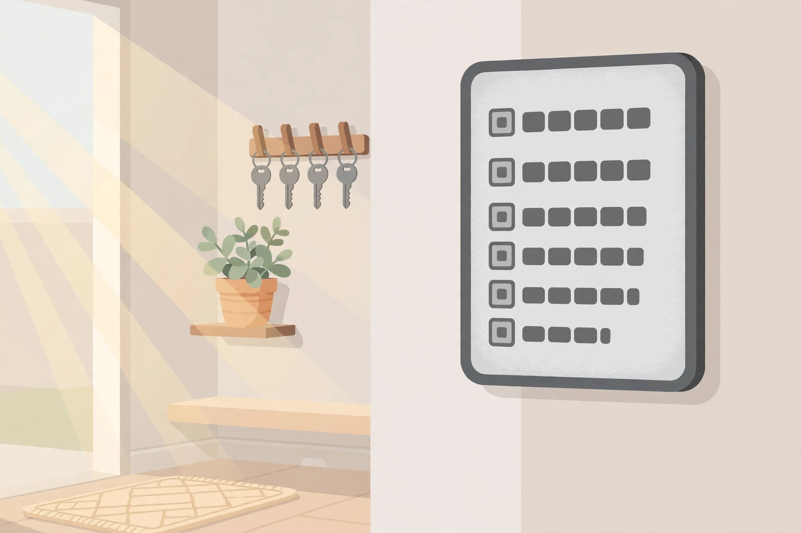

<!-- 본문 시작 -->
날씨·일정·집안 버튼을 전자종이 한 장에 — 1년 가는 SwitchBot E-Ink Home Dashboard

아침에 눈을 뜨자마자 폰을 켜지 않고도 오늘 날씨와 가족 일정을 볼 수 있다면 어떨까요. SwitchBot의 'E-Ink Home Dashboard'는 7.5인치 전자종이 화면에 날씨·실내외 온습도·가족 일정·스마트홈 버튼을 합친 디스플레이입니다. 책상·벽걸이 겸용, 충전 없이 최대 1년까지 쓴다는 설명입니다. 자료 기반 소개 글이며, 직접 사용한 후기가 아닙니다.

## 이 대시보드는 무엇인가요

제품 이름은 'SwitchBot E-Ink Home Dashboard'. 스마트홈 업체 SwitchBot의 올인원 날씨 스테이션 겸 가족 캘린더입니다. 7.5인치 흑백 전자종이 화면(800×480)에 시간·날씨·일정을 카드로 보여주고, 앞면 버튼 4개로 화면 전환·장면 실행을 합니다. 터치가 안 된다는 점이 먼저 확인할 특징입니다.

> 핵심 한 줄
>
> ### **폰을 열지 않아도 날씨·일정·집안 버튼이 한 화면에 뜬다.**

## 왜 재미있나요

**첫째, 날씨 스테이션으로 충실합니다.** 실내외 온습도·5일 예보·공기질·일출일몰을 한 화면에 보여줍니다. 센서 최대 3개로 방별 온습도를 함께 보고, 범위 이탈 시 폰 알림이 갑니다. 화면 테마 6종·전면 조명·날씨 맞춤 AI 제안도 공식 기능으로 안내돼 있습니다.

**둘째, 가족 캘린더가 됩니다.** 구글·아이클라우드·아웃룩·야후와 동기화해 최대 5명 일정을 표시하고, 약 복용·등교·회의 알림을 소리로 알려줍니다. 계정당 최대 30개 일정(Gizmodo 보도). 현관에 걸면 외출 전 확인이 한 번에 됩니다.

**셋째, 버튼 하나로 집안을 움직입니다.** 앞면 버튼 2개는 날씨·캘린더 화면 전환용, 나머지 2개는 조명·에어컨·커튼 같은 장면을 실행하는 스마트홈 버튼입니다. 알람 3개(20·50·80dB)·10분 간격 최대 3번 스누즈도 됩니다.

## 사기 전에 확인할 점

이 화면은 터치가 안 됩니다. 조작은 앞면 버튼으로만 합니다. 또 Matter 대응을 내세우지만, 애플 홈·구글 홈과 연결하려면 SwitchBot 허브가 별도로 필요합니다. 공식 허브 미니 번들은 169.99달러, Gizmodo는 허브 미니 단품을 약 39달러로 전합니다. 실외 미터는 별도 구매이고, '최대 1년' 배터리는 사용 조건에 따라 달라질 수 있습니다. 5,000mAh 내장 배터리라 USB-C로 상시 전원을 연결해 쓸 수도 있습니다. 한국 공식 판매·배송 여부는 확인하지 못했습니다.

## 가격과 국내 이용

| 항목 | 내용 |
| --- | --- |
| 제품명 | SwitchBot E-Ink Home Dashboard |
| 제조사 | SwitchBot |
| 핵심 방식 | 7.5인치 전자종이 올인원 날씨 스테이션·가족 캘린더·장면 버튼 |
| 주요 스펙 | 800×480 흑백 전자종이(터치 없음), 212×146×15mm·310g, 5,000mAh(최대 1년), USB-C, 전면 조명 |
| 연결 | 와이파이·블루투스, 센서 최대 3개, Matter는 허브 별도 필요 |
| 가격 | 109.99달러 (2026-10-25 공식 스토어 확인, 재고 있음) |
| 국내 이용 | 미확인 (한국 판매·배송 조건 확인 안 됨) |

## 에디터의 판단

이 제품은 '폰을 덜 보는 집'을 원하는 사람에게 어울립니다. 현관·주방·책상에서 날씨와 가족 일정을 상시 확인하고, 외출 전 버튼 하나로 집안 장면을 끄는 용도라면 제값을 합니다. 다만 터치 불가·Matter 허브 별도·센서 추가 시 실제 지출이 본체 가격을 넘을 수 있습니다. SwitchBot 집이라면 우선순위가 높고, 새로 꾸미는 집이라면 본체+허브+센서 합계부터 계산하는 것이 좋습니다.

## 함께 보면 좋은 글

- [아이폰 뒷면에 붙는 두 번째 화면 — 녹음하면 요약까지, REETLE SmartInk I](https://blog.naver.com/3700708/224451923845) — 아이폰 뒷면 전자종이 허브
- [마우스를 손가락에 끼웠다 — 검지 위 트랙패드, Prolo Ring](https://blog.naver.com/3700708/224451924080) — 손가락 위 트랙패드
- [AI가 찾아낸 인터넷의 균열｜전 세계 사이트 70% 비상사태](https://blog.naver.com/3700708/224450991308) — AI 뉴스

출처: SwitchBot 공식 스토어(2026-10-25 확인), Gizmodo 2026-06-03 보도. 자료 기반 소개입니다.
<!-- 본문 끝 -->

## 작업용 출처·이미지 정보 (업로드 제외)

- 자료 출처: SwitchBot 공식 스토어(us.switch-bot.com) / Gizmodo 2026-06-03 / 확인일 2026-10-25
- 이미지 3점 (AI 생성 일러스트, 사용권: 자작):
  - images/01-hero.jpg / 책상 위에 세워진 전자종이 대시보드 — 날씨 카드·일정 목록·장면 버튼이 한 화면에 정리돼 있다 (일러스트)
  - images/02-calendar.jpg / 현관 벽에 걸린 전자종이 화면 — 가족 일정이 목록으로 정리돼 있다 (일러스트)
  - images/03-scene.jpg / 벽에 걸린 전자종이 대시보드 — 버튼 하나로 조명·커튼 장면을 실행한다 (일러스트)
- 사실 확인: 가격(109.99달러)·스펙·터치 없음·Matter 허브 필요·한국 판매 미확인. 실외 미터 별도 구매.
- 추가 요청: 없음

## 발행 기록 (업로드 제외)

- 후보: 2026-10-25 소재 발굴 12개 중 상위 — SwitchBot E-Ink Home Dashboard (10점, 판매 중)
- 처리 결과: GitHub push + MCP submit_edition ko/en 예정
