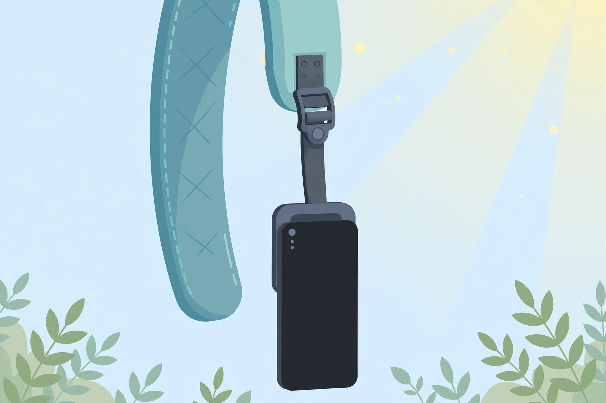
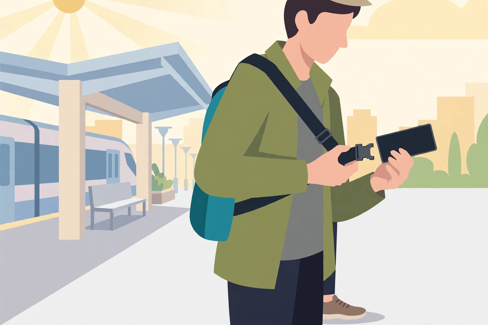
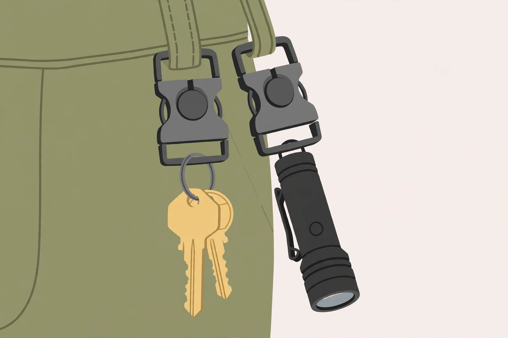

<!-- 본문 시작 -->
가방 속 뒤적이기 끝 — 당기면 분리되고 갖다 대면 붙는 스트랩, MagQuick

외출할 때 스마트폰을 꺼내려다 가방 속을 뒤적여 본 적 있나요. 일본 Active의 'MagQuick'은 자석 버클로 가방·벨트에 스마트폰·열쇠·라이트를 달아 두는 퀵릴리스 스트랩입니다. 가까이 대면 흡착되고, 당기면 분리되는 방식이라 손 닿는 곳에 늘 둘 수 있습니다. 일본 Makuake에서 2026년 11월 15일까지 응원구매 중인 제품으로, 자료 기반 소개 글입니다.

## 이 스트랩은 무엇인가요

제품 이름은 'MagQuick'. 독일 FIDLOCK의 자석 버클 'V-Buckle'을 쓴 퀵릴리스 스트랩입니다. 버클끼리 가까이 대면 자력으로 흡착되고, 흡착 뒤 기계식 잠금이 걸려 자력에만 의존하지 않고 고정됩니다. 쓸 때는 당기면 분리됩니다. 35g, 알루미늄 합금·나일론, 카모·블랙 2종, 스마트폰 홀더 포함입니다.

> 핵심 한 줄
>
> ### **가방을 뒤지지 말고, 손 닿는 곳에 붙여 두세요.**

## 왜 재미있나요

**첫째, 꺼내는 동작이 짧아집니다.** 스마트폰을 백팩 어깨끈에 달아 두면 이동 중 양손이 자유롭고, 사진·결제·개찰구 통과 때 당겨서 바로 씁니다. 스트랩 연결 상태로 쓰기에 손에서 미끄러져도 낙하 방지에 도움이 된다고 공식 설명은 전합니다.

**둘째, 다는 위치가 자유롭습니다.** 백팩 어깨끈·가방·벨트·벨트 고리 어디든 달려 통근·여행·아웃도어까지 같은 방식입니다. 액션카메라·라이트·멀티툴·카드케이스·이어폰 케이스까지 달 수 있다고 합니다.

**셋째, 버클 자체가 믿을 만한 부품입니다.** 내하중 약 15kg이라 스마트폰·열쇠·소형 라이트는 여유 있게 버팁니다. 다만 FIDLOCK 부품은 제품의 일부일 뿐, 스트랩 전체가 독일산이라는 뜻은 아니라고 공식 페이지가 분명히 밝히고 있습니다.

## 사기 전에 확인할 점

크라우드펀딩이라는 점을 먼저 받아들여야 합니다. Makuake All-in형으로, 목표 달성 여부와 관계없이 2026년 11월 15일까지 결제하면 구매가 성립하고, 리턴 배송은 2026년 12월 말 예정이지만 응원 수가 예상을 넘으면 늦어질 수 있습니다. 배송 지연으로 인한 취소는 원칙적으로 안 되며, 배송 예정 월에서 3개월을 넘긴 경우에만 희망자에 한해 취소가 된다고 안내돼 있습니다. 개발 중 제품이라 디자인·사양·색이 일부 바뀔 수 있고, 한국 배송 여부는 확인하지 못했습니다. 가격 표기는 일본 내 배송비 포함·세금 포함입니다.

## 가격과 국내 이용

| 항목 | 내용 |
| --- | --- |
| 제품명 | MagQuick (퀵릴리스 스트랩) |
| 제조사 | Active inc. (일본) |
| 핵심 방식 | FIDLOCK V-Buckle 자석 흡착+기계식 잠금 퀵릴리스 스트랩 |
| 주요 스펙 | 35g, 알루미늄 합금·나일론, 내하중 약 15kg, 카모·블랙, 스마트폰 홀더 포함 |
| 단계 | Makuake 응원구매 중(2026-10-03~11-15), 2026-12-말 배송 예정 |
| 가격 | 3,980엔~(초초조할인)~4,980엔, 2개 세트 7,580엔 (2026-10-25 Makuake 확인, 세금·일본 내 배송비 포함) |
| 국내 이용 | 미확인 (한국 배송 조건 확인 안 됨) |

## 에디터의 판단

이 제품은 '가방 속 뒤적이기'가 일상이 된 사람에게 어울립니다. 특히 백팩을 자주 메고 스마트폰·교통카드를 번갈아 꺼내는 통근자, 액션카메라를 들고 다니는 여행자라면 체감이 큽니다. 다만 펀딩 제품이라 배송 지연·사양 변경 가능성을 감수해야 하고, 한국 배송 미확인이라 일본 내 수령 수단이 없으면 관망이 낫습니다. 펀딩 종료(11월 15일)가 가까우니, 관심 있다면 종료 전에 조건을 확인하세요.

## 함께 보면 좋은 글

- [아이폰 뒷면에 붙는 두 번째 화면 — 녹음하면 요약까지, REETLE SmartInk I](https://blog.naver.com/3700708/224451923845) — 아이폰 뒷면 전자종이 허브
- [마우스를 손가락에 끼웠다 — 검지 위 트랙패드, Prolo Ring](https://blog.naver.com/3700708/224451924080) — 손가락 위 트랙패드
- [AI가 찾아낸 인터넷의 균열｜전 세계 사이트 70% 비상사태](https://blog.naver.com/3700708/224450991308) — AI 뉴스

출처: Makuake MagQuick 프로젝트 페이지·Active PR TIMES 보도자료(2026-10-22), 확인일 2026-10-25. 자료 기반 소개입니다.
<!-- 본문 끝 -->

## 작업용 출처·이미지 정보 (업로드 제외)

- 자료 출처: Makuake MagQuick 프로젝트 페이지 / Active PR TIMES 보도자료 2026-10-22 / 확인일 2026-10-25
- 이미지 3점 (AI 생성 일러스트, 사용권: 자작):
  - images/01-hero.jpg / 백팩 어깨끈에 달린 퀵릴리스 스트랩 — 자석 버클에 스마트폰 홀더가 연결돼 있다 (일러스트)
  - images/02-phone.jpg / 어깨끈에서 당겨 쓰는 스마트폰 — 분리해도 스트랩이 연결돼 낙하를 막는다 (일러스트)
  - images/03-keys.jpg / 벨트 고리에 단 열쇠·라이트 — 손 닿는 위치에 소품을 붙여 둔다 (일러스트)
- 사실 확인: 가격(3,980엔~)·스펙·일정(11-15 종료·12-말 배송)·취소 조건·한국 배송 미확인.
- 추가 요청: 없음

## 발행 기록 (업로드 제외)

- 후보: 2026-10-25 소재 발굴 12개 중 상위 — MagQuick (9점, Makuake 응원구매 중)
- 처리 결과: GitHub push + MCP submit_edition ko/en 예정
