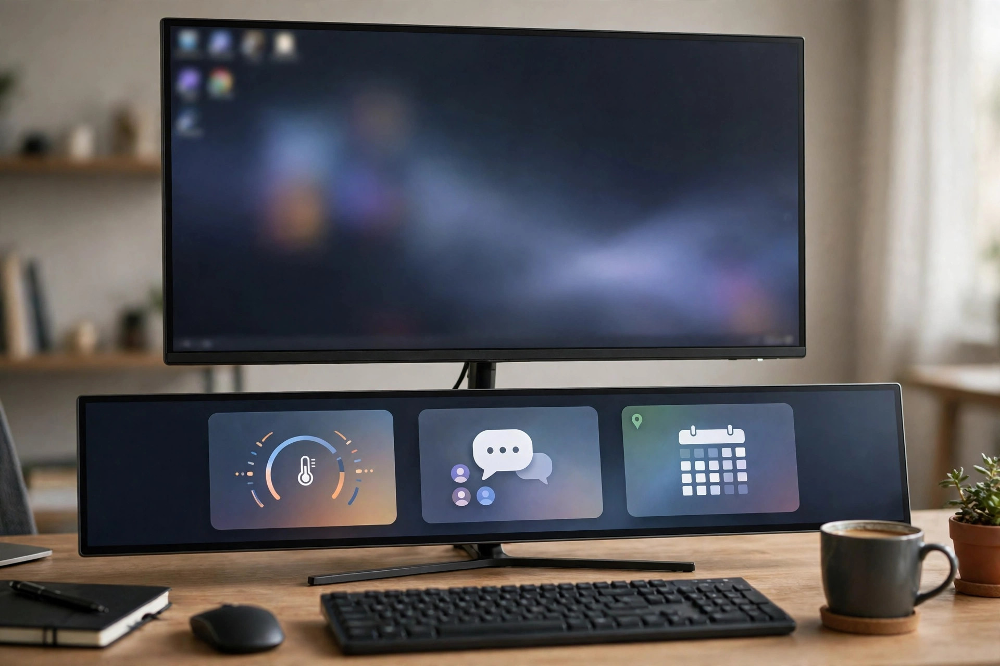
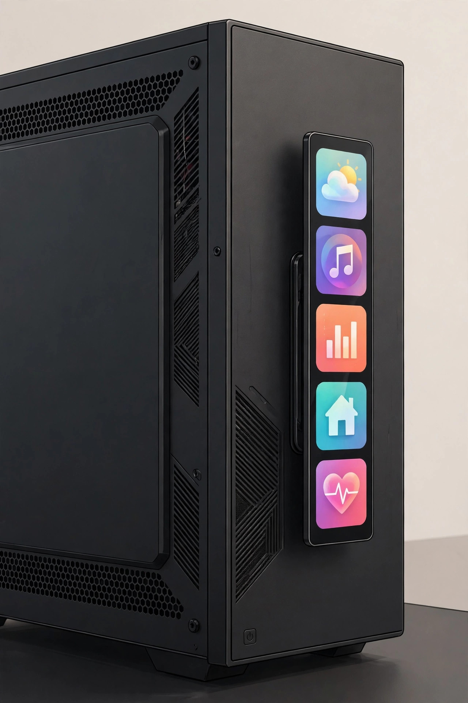
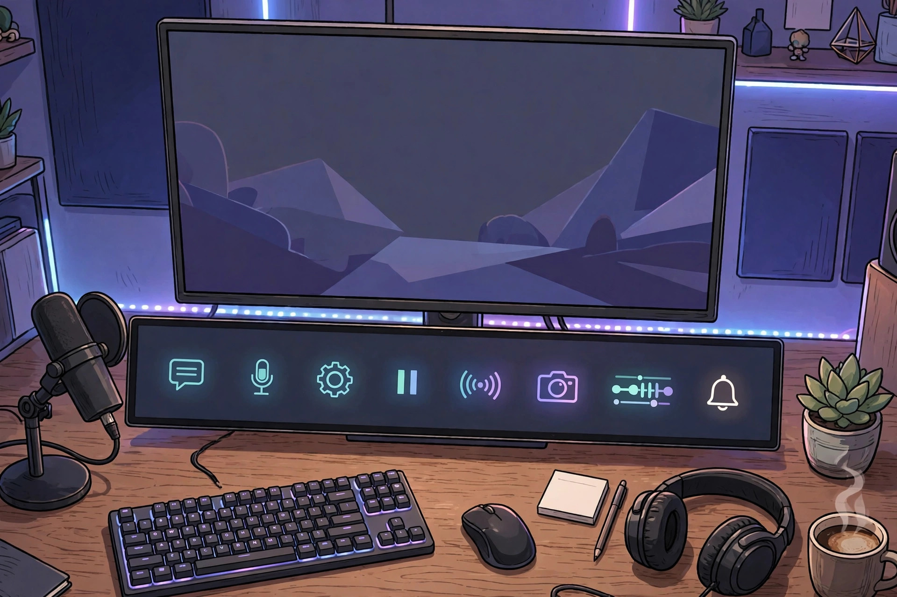

<!-- 본문 시작 -->
A second screen under your main monitor, pressed with a fingertip — Corsair Xeneon Edge

While gaming you want to check CPU temperature; while streaming you want to see chat; while working you want music and a calendar at a glance. Every time you cover the main screen or switch windows, the flow breaks. Corsair's "Xeneon Edge" is a 14.5-inch, wide touchscreen strip that sits under the main monitor and moves that secondary information off to its own screen. This is a write-up based on published materials, not a hands-on review.

## What is this screen?

The product is the "Corsair Xeneon Edge 14.5-inch LCD Touchscreen." It is a 14.5-inch, 2560×720, 32:9 secondary display. Corsair's official page (checked 2026-10-26) describes it as a secondary screen for system monitoring, streaming chat, and quick-access widgets. It supports 5-point capacitive touch, so widgets can be tapped directly, and it runs at 60Hz with up to 350cd/m² brightness on an AHVA panel. Connections are one HDMI 2.0 port and one USB-C port (DP Alt Mode); it weighs 1kg.

> One line
>
> ### **Leave the main screen alone, and check secondary information with a fingertip.**

## Why is it interesting?

**First, the whole screen becomes the button pad.** According to Corsair, it works with the Elgato Virtual Stream Deck, so shortcuts, tools, and app-specific commands can be built as touch buttons. Unlike a 15-key physical pad, the number of buttons grows within the screen, and the layout can be rearranged. That is the manufacturer's description; response speed was not verified from an independent hands-on review.

**Second, it can live almost anywhere.** Fourteen magnets on the back attach it to steel case panels or metal shelves, the included magnetic stand holds it on a desk, and two 1/4-20 threaded points connect it to a camera arm or an Elgato Multi Mount. Notebookcheck reports it can also be mounted inside a PC case in a 360mm radiator slot. Slotting it into the gap under a monitor is the most obvious use.

**Third, it covers gaming, streaming, and work assistance at once.** Connected to Corsair iCUE software, it shows CPU and GPU temperatures, fan speeds, and similar system figures, while streamers can keep live chat, alerts, and stream controls separate. Because the main screen stays clear, there is no need to Alt+Tab out of a game.

## Check before buying

This is a secondary screen. Its wide 2560×720 resolution does not suit a main monitor for documents or video, and 60Hz is not a high-refresh gaming screen. The official driver listing is for Windows, so macOS support is unconfirmed. Mounting it inside a case also needs a separate check of internal space, cable routing, and heat. Official sales and shipping in Korea are unconfirmed.

## Price and availability

| Item | Detail |
| --- | --- |
| Product | Corsair Xeneon Edge 14.5-inch LCD Touchscreen |
| Maker | Corsair |
| What it is | 14.5-inch 32:9 touchscreen secondary display |
| Key specs | 2560×720, 60Hz, 350cd/m², AHVA, 5-point touch, 372mm, 1kg, HDMI 2.0, USB-C (DP Alt Mode) |
| Software and mounting | iCUE, Elgato Virtual Stream Deck, 14 magnets, magnetic stand, two 1/4-20 points |
| Price | $249.99 (Corsair US official store, checked 2026-10-26, in stock) |
| Korea | Unconfirmed (Korean sales and shipping terms not verified) |

## The editor's take

This fits someone who needs a second screen but has no room for another full monitor on the desk. For uses that must keep the main screen clear — streaming, video editing, system monitoring — one strip can replace a separate button pad and a secondary monitor. At $249.99, though, it is expensive for a secondary screen, so it is best recommended only to people who will actually use widgets and shortcuts every day. If the only need is watching one chat window, a regular secondary monitor is cheaper and wider.

## Related reads

- [Stop digging through your bag — MagQuick, a strap that snaps on and pulls off](https://aitechnotesen.wordpress.com/2026/10/25/stop-digging-through-your-bag-magquick-a-strap-that-snaps-on-and-pulls-off/) — a magnetic strap that pulls apart
- [Weather, schedule, and home buttons on one e-ink sheet — SwitchBot E-Ink Home Dashboard, good for a year](https://aitechnotesen.wordpress.com/2026/10/25/weather-schedule-and-home-buttons-on-one-eink-sheet-switchbot-eink-home-dashboard-good-for-a-year/) — an e-ink weather and family schedule dashboard
- [How to hand work to AI without knowing how to code — GPT Codex and Asides setup guide](https://blog.naver.com/3700708/224452773983) — AI news (Korean edition)

Sources: Corsair official product page (checked 2026-10-26), Notebookcheck. Based on published materials; not a hands-on review.
<!-- 본문 끝 -->
