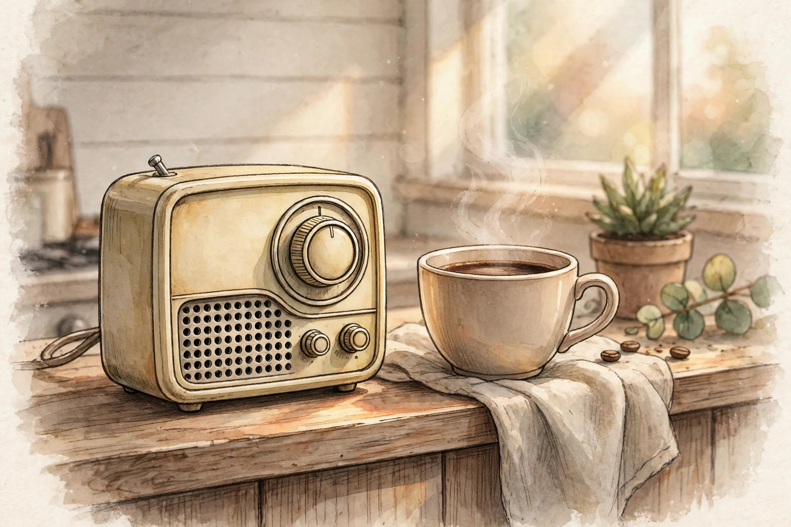
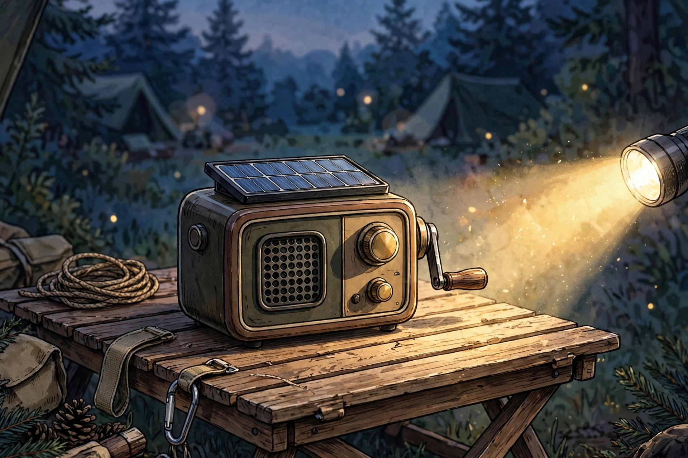
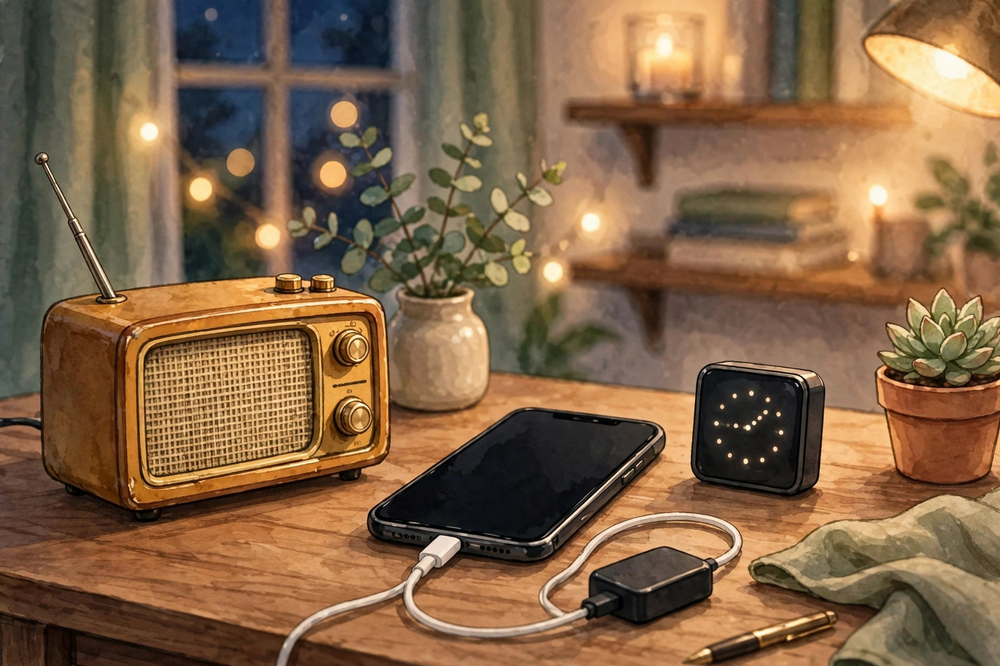

<!-- 본문 시작 -->
Music that does not stop in a blackout — RetroWave 7-in-1 Radio, charged by hand

A phone speaker goes quiet when the internet drops, and stops when the battery runs out. The "RetroWave 7-in-1 Radio" combines an old-style dial radio with a Bluetooth speaker, MP3 playback, a flashlight, a clock, a power bank, and an SOS alarm — seven functions in one radio. The idea is simple: an everyday music box on the kitchen shelf that turns into information, light, and charging when things go wrong. This is a write-up based on published materials, not a hands-on review.

## What is this radio?

The product is the "RetroWave 7-in-1 Radio." According to the Yanko Design shop (YD Select) sales page (checked 2026-10-26), its seven roles are speaker, MP3 player, radio, flashlight, clock, power bank, and SOS alarm, with an AUX input on top of that. Reception bands are listed as FM 76–108MHz, AM 522–1620kHz, and shortwave (SW) 7–16MHz, with Bluetooth, USB, and microSD playback. It measures 12.8×5.7×9.8cm, is made of ABS resin and iron, and has an 8W speaker. The maker is not named on the sales page, so it is unconfirmed.

> One line
>
> ### **It plays without the internet, and keeps going without an outlet.**

## Why is it interesting?

**First, there are three ways to listen.** The dial radio picks up FM, AM, and shortwave without the internet, Bluetooth plays music from a phone, and USB or microSD plays offline music files. Listening by turning a dial, without touching a phone, is the product's charm in itself.

**Second, the emergency design hides inside everyday use.** The 2,000mAh battery is listed at about 20 hours of radio, about 6 hours of LED light, and about 5 hours of Bluetooth (at 75% volume). In a blackout it gives a flashlight, an SOS alarm, and phone charging. USB charging is the primary method, hand-crank charging is for emergencies, and solar is supplementary only. It should not be read as solar-powered; charging over USB in advance is the premise.

**Third, it is small enough to stay out all the time.** At 12.8cm wide it sits on a kitchen shelf, a desk, or in a camping bag, playing music daily, and can be carried straight into a blackout, a camping trip, or a car emergency kit. Not having to pack a separate emergency kit is the practical point.

## Check before buying

A 2,000mAh battery is for emergency top-ups, not for fully charging a phone. Packing seven functions into one body also means no single function is best in class — that is an editorial judgement, not a seller claim. Shortwave reception varies with location, antenna, and time of day, and reception conditions in Korea were not separately verified. No independent hands-on review was confirmed. Yanko Design articles and the shop belong to the same sales ecosystem, so article content is treated as seller material, not independent verification. Sales and shipping in Korea are unconfirmed.

## Price and availability

| Item | Detail |
| --- | --- |
| Product | RetroWave 7-in-1 Radio |
| Maker | Unconfirmed (maker not named on the sales page) |
| What it is | FM/AM/shortwave radio + Bluetooth speaker + MP3 + flashlight + clock + power bank + SOS |
| Key specs | 12.8×5.7×9.8cm, 2,000mAh, 8W speaker, radio about 20 hours, light about 6 hours, Bluetooth about 5 hours |
| Charging | USB primary (3–4 hours), hand crank for emergencies, solar supplementary |
| Price | $89 (YD Select sales page, checked 2026-10-26; limited-edition matte black $99) |
| Korea | Unconfirmed (Korean sales, shipping, and reception terms not verified) |

## The editor's take

This fits someone who wants an everyday object to stay useful in an emergency. Use it first for daily music in the kitchen or at a desk, and get information, light, and charging as a bonus in a blackout or on a camping trip. For pure sound quality alone, a Bluetooth speaker at the same price is better, and for serious emergency use, a larger battery and a dedicated lantern are safer. The $89 is best read as the price of seven roles in one radio.

## Related reads

- [Stop digging through your bag — MagQuick, a strap that snaps on and pulls off](https://aitechnotesen.wordpress.com/2026/10/25/stop-digging-through-your-bag-magquick-a-strap-that-snaps-on-and-pulls-off/) — a magnetic strap that pulls apart
- [Weather, schedule, and home buttons on one e-ink sheet — SwitchBot E-Ink Home Dashboard, good for a year](https://aitechnotesen.wordpress.com/2026/10/25/weather-schedule-and-home-buttons-on-one-eink-sheet-switchbot-eink-home-dashboard-good-for-a-year/) — an e-ink weather and family schedule dashboard
- [How to hand work to AI without knowing how to code — GPT Codex and Asides setup guide](https://blog.naver.com/3700708/224452773983) — AI news (Korean edition)

Sources: YD Select sales page (checked 2026-10-26), Yanko Design articles (seller-ecosystem material). Based on published materials; not a hands-on review.
<!-- 본문 끝 -->
