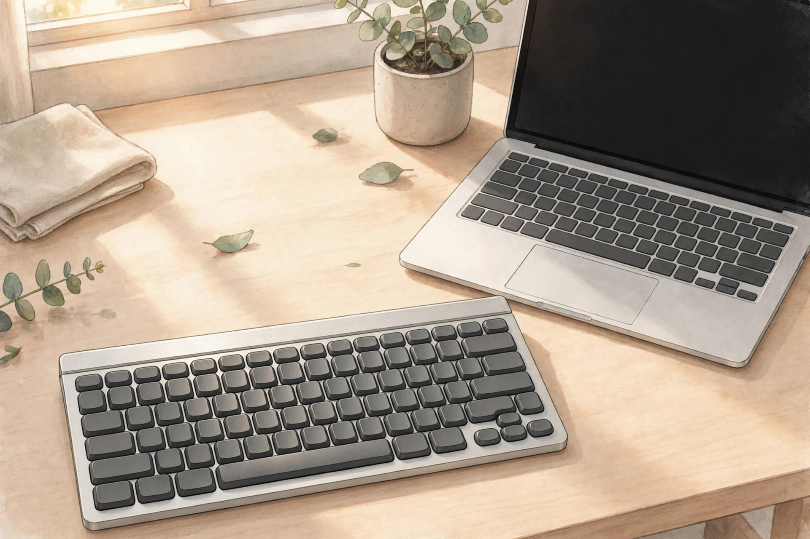
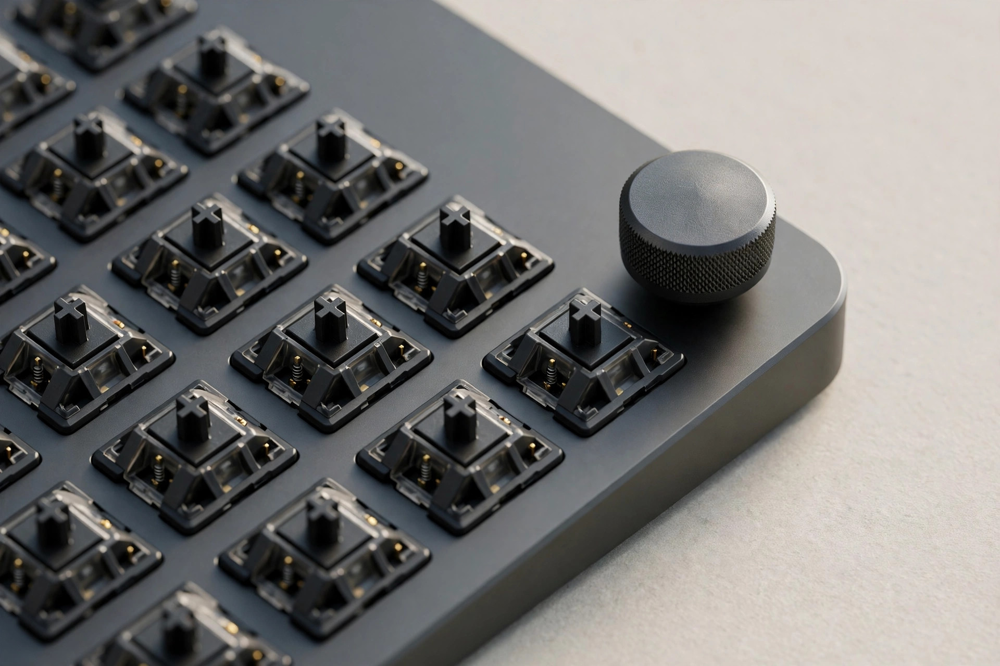

<!-- 본문 시작 -->

In a quiet office, keyboard noise sounds louder than you expect. Laptop keyboards are quiet but feel flat, while mechanical keyboards feel great but sound intrusive. Slim mechanical keyboards try to offer both. Here is how to choose one, using the NuPhy Air75 V3 as the reference.

13.2mm thick — slim enough to carry without much bag burden. (Illustration)

> Key takeaway
>
> ### **Do not give up key feel for thinness. Check the switch, the noise, and the battery first.**

## What is this keyboard?

The NuPhy Air75 V3 is an 84-key, 75% layout wireless low-profile mechanical keyboard. It launched in September 2025 as the third generation of the Air series and remains NuPhy's main slim model (checked 2026-10-27). An aluminum top case and gasket mount are meant to reduce the hollowness of a thin body, according to the maker. This post is based on published materials, not a hands-on review.

Noise is not just about the switch — the case structure matters too. (Illustration)

## Criterion 1: switch noise and key feel

The switches are Gateron Low-Profile 3.0 Nano in three versions: Red linear at 45gf, Brown tactile at 50gf, and Blush silent linear at 42gf (official specifications, checked 2026-10-27). If quiet matters most, Blush is the starting point. Key travel is 3.5mm for Red and Brown. No decibel figure is published, so this cannot be presented as a guaranteed silent product.

## Criterion 2: battery and connectivity

The battery is 4,000mAh. The maker rates it at up to 1,200 hours with lighting off and 60–100 hours with all lighting on, based on lab tests (checked 2026-10-27). Connectivity covers Bluetooth 5.0, a 2.4GHz dongle, and USB-C wired, with up to five devices registered for switching.

The knob can be removed and replaced with a key. (Illustration)

## Criterion 3: weight and customization

The board measures 318.9×128.9×13.2mm and weighs 724g. That is reassuring on a desk but heavy for daily carrying. For comparison, the Lofree Flow84 is 594g and the Keychron K3 Ultra 8K is 566g, according to a comparison article. A detachable knob sits at the top-right corner; remove it and a key can take its place as a navigation key. Key remapping and macros are set in the browser-based NuPhy IO. QMK/VIA is not supported.

## Drawbacks and things to check

Hot-swapping is supported, but only three switch options exist, and Gateron Low-Profile 2.0 switches are not compatible. The keycaps are double-shot PBT and the legends are not shine-through. The price is listed at $139.95 for the ANSI layout (checked 2026-10-27). Official sales, pricing, shipping, and Korean legends in Korea are unconfirmed.

| Item | Details |
|---|---|
| Layout | 75%, 84 keys |
| Size and weight | 318.9×128.9×13.2mm, 724g |
| Switches | Gateron LP 3.0 Nano Red, Brown, Blush |
| Battery | 4,000mAh, up to 1,200 hours with lighting off |
| Connectivity | Bluetooth 5.0, 2.4GHz, USB-C, up to 5 devices |
| Price | $139.95 (ANSI, checked 2026-10-27) |

## Who is it for?

It fits people who type for long hours in a quiet office and missed the key feel of slim keyboards. With Blush switches and lighting off, noise and battery worries drop together. If daily carrying matters most, weigh the 724g first.

## Related reads

- [A second screen under your main monitor, pressed with a fingertip — Corsair Xeneon Edge](https://aitechnotesen.wordpress.com/2026/10/26/a-second-screen-under-your-main-monitor-pressed-with-a-fingertip-corsair-xeneon-edge/) — a secondary screen that clears desk space
- [Music that does not stop in a blackout — RetroWave 7-in-1 Radio, charged by hand](https://aitechnotesen.wordpress.com/2026/10/26/music-that-does-not-stop-in-a-blackout-retrowave-7in1-radio-charged-by-hand/) — a multi-function radio without power worries
- [How to hand work to AI without knowing how to code — GPT Codex and Asides setup guide](https://blog.naver.com/3700708/224452773983) — AI news (Korean edition)

Sources: [sales page](https://www.amazon.com/dp/B0FFFZ7R2K) · [Tom's Guide review](https://www.tomsguide.com/computing/peripherals/nuphy-air75-v3-review) · [Notebookcheck report](http://www.notebookcheck.net/NuPhy-Air75-V3-launches-as-wireless-low-profile-mechanical-keyboard-with-long-travel-switches-1-200-hour-battery-and-gasket-mount.1034008.0.html) · [comparison article](https://toptrustedproducts.com/review/nuphy-air75-v3-review/) (checked 2026-10-27).

This post is based on published materials, not a hands-on review.

<!-- 본문 끝 -->
