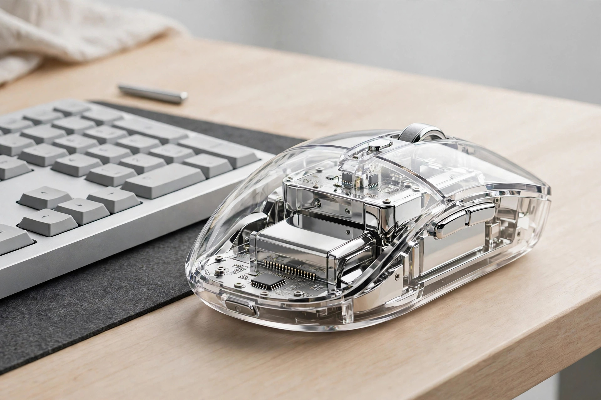
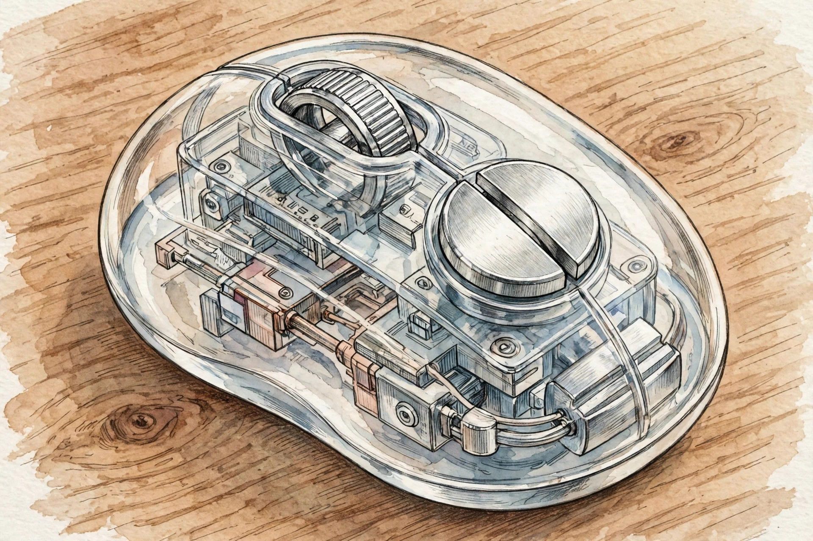

<!-- 본문 시작 -->

마우스는 대개 손바닥 아래에 숨어 있습니다. Lenovo 900 투명 무선 마우스는 그 전제를 뒤집습니다. 투명한 껍질 속에 거울처럼 빛나는 속살을 넣어, 쓰지 않을 때도 책상 위에 두는 물건으로 만들었습니다. 이 글은 공개 자료를 바탕으로 한 소개이며, 직접 사용 후기가 아닙니다.

투명한데 회로가 보이지 않는다 — 비결은 거울 같은 속살이다. (일러스트)

> 핵심 한 줄
>
> ### **투명 마우스의 재미는 회로가 아니라, 빛나는 속살에 있다.**

## 무엇이 다른가요?

겉은 투명한 외피, 속은 거울처럼 반짝이는 내부 하우징입니다. 흔한 투명 기기처럼 칩과 배선을 전시하지 않습니다. 빛이 두 층 사이에서 반사되며 속살이 떠 있는 것처럼 보인다고 Yanko Design은 소개합니다(2026-10-01 기사, 2026-10-27 확인). 몸체는 좌우 대칭의 조약돌 모양이며, 무게는 약 125g으로 가벼운 휴대용 마우스보다는 묵직한 편입니다. 버튼은 분리형 알루미늄 합금 버튼, 스크롤 휠은 금속 재질이며, 버튼 수명은 약 500만 회로 안내되어 있습니다(제조사 안내 기준, 2026-10-27 확인). 투명 외피의 긁힘·황변 내구성에 대한 독립 검증 자료는 확인하지 못했습니다.

## 세 대를 오가는 마우스

연결은 2.4GHz 무선과 블루투스 2채널로, 최대 3대까지 등록해 전환할 수 있습니다. 노트북에서 문서를 마치고 태블릿으로 넘어갈 때 마우스를 바꾸지 않아도 됩니다. 대응 운영체제는 Windows, macOS, Android, Linux, ChromeOS로 안내되어 있습니다(2026-10-27 확인). 센서는 PixArt PAW3222 광학 센서로, 감도는 400~4,000 DPI 사이에서 조절합니다. 넓은 화면을 가로지를 때는 빠르게, 세밀한 작업 때는 느리게 맞출 수 있습니다.

기기 전환은 버튼 하나로. (일러스트)

## 배터리와 가격, 그리고 중국 출시라는 조건

배터리는 내장 300mAh 리튬 배터리입니다. 제조사는 하루 8시간 사용 기준으로 약 90일을 추정치로 안내하며, USB-C 완충에는 약 2시간이 걸린다고 밝힙니다(2026-10-27 확인). 가격은 중국 출시가 399위안(약 59달러)으로 안내되어 있습니다(2026-10-27 확인). 중국 외 판매·가격·한국 배송 조건은 미확인입니다. Tianxi AI 비서 단축키도 들어 있지만, 한국 사용 여부는 미확인입니다.

금속 휠과 알루미늄 버튼 — 투명한 겉모습과 달리 손에 닿는 부분은 금속이다. (일러스트)

| 항목 | 내용 |
|---|---|
| 형태 | 투명 외피 + 거울 내피, 좌우 대칭 조약돌형 |
| 무게 | 약 125g |
| 센서·감도 | PixArt PAW3222, 400~4,000 DPI |
| 연결 | 2.4GHz + 블루투스 2채널, 최대 3대 |
| 배터리 | 300mAh, 약 90일(하루 8시간 기준 추정치) |
| 충전 | USB-C, 완충 약 2시간 |
| 가격 | 399위안(약 59달러, 중국 출시, 2026-10-27 확인) |

## 그래서, 누구에게 어울릴까요?

책상을 정돈된 상태로 유지하면서도 물건 하나쯤은 눈에 띄게 두고 싶은 사람에게 어울립니다. 여러 기기를 오가며 일하는 사람이라면 3대 전환 기능이 실용적입니다. 반대로 가벼운 휴대용 마우스를 찾는 사람에게는 125g이 부담스러울 수 있고, 한국 판매 미확인 상태라 구매 경로 확인이 필요합니다.

## 함께 보면 좋은 글

- [메인 모니터 아래, 손끝으로 누르는 두 번째 화면 — Corsair Xeneon Edge](https://blog.naver.com/3700708/224453677751) — 책상 공간을 비우는 보조 화면
- [정전에도 음악이 멈추지 않는다 — 손으로 돌려 충전하는 RetroWave 7-in-1 Radio](https://blog.naver.com/3700708/224453678802) — 전원 걱정 없는 다기능 라디오
- [코딩 몰라도 AI에게 일을 맡기는 법｜GPT 코덱스·어사이드 설치 활용 총정리](https://blog.naver.com/3700708/224452773983) — AI 뉴스, 코딩 없이 AI 도구 활용 정리

출처: [Yanko Design 소개](https://www.yankodesign.com/2026/10/01/lenovo-finally-made-a-mouse-worth-leaving-out-on-a-tidy-desk/) (2026-10-01 기사) · [Gizmochina 사양 정리](https://www.gizmochina.com/2026/09/30/lenovo-900-transparent-wireless-mouse-launched-specs-price/) (2026-10-27 확인).

<!-- 본문 끝 -->
