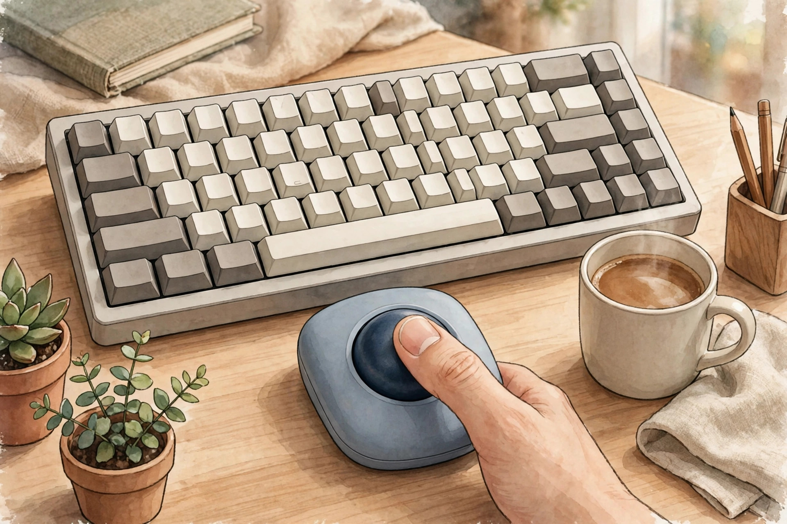
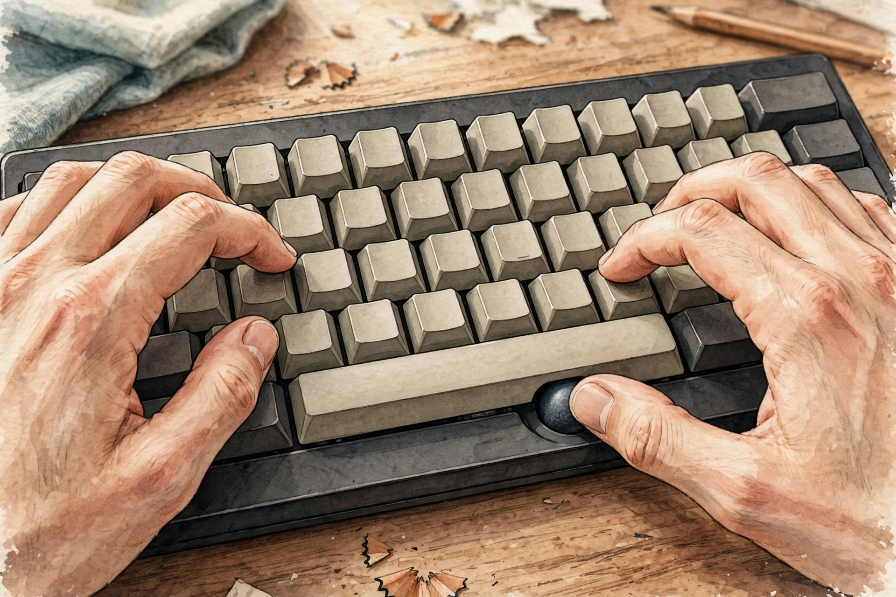
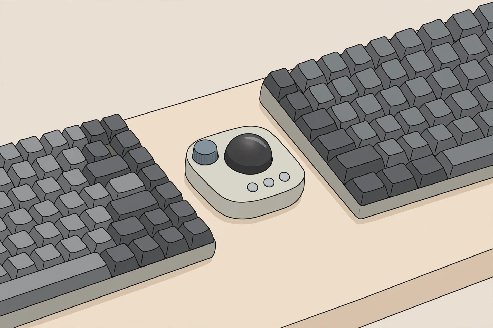

<!-- 본문 시작 -->

타이핑하다가 마우스를 잡으러 손을 옆으로 뻗는 동작, 하루에 몇 번이나 할까. Keychron Nape Pro는 그 동작 자체를 없애 보자는 제품이다. 마우스를 옆에 두는 대신, 키보드 앞 빈 공간에 작은 트랙볼을 두고 엄지로 커서를 움직인다. 이 글은 자료를 바탕으로 정리한 구매 전 확인용 소개로, 직접 사용해 본 후기는 아니다.

> 핵심 한 줄
>
> ### **손을 키보드에서 떼지 않고 커서를 움직이는 것, 그게 이 트랙볼이 바꾸려는 단 한 가지다.**

키보드 스페이스바 아래에 놓인 작은 트랙볼 기기를 그린 일러스트다. (일러스트) 실제 크기는 키보드 앞 여유 공간에 들어갈 정도다.

## 키보드 앞이 입력 공간이 된다

Nape Pro는 키보드 스페이스바 바로 아래에 두도록 설계됐다. 공식 제품 페이지(2026-10-28 확인)에 따르면 25mm 트랙볼, 버튼 6개, 조절 가능한 컨트롤 다이얼을 갖췄고, 8방향으로 기울여 놓을 수 있는 OctaShift 배치를 지원한다. 가로로 눕히는 것은 물론, 분리형 키보드 사이에 세로로 세우거나 대각선으로 두는 것도 가능하다. 왼손잡이도 쓸 수 있도록 좌우 대칭을 염두에 둔 설계다.

연결 방식은 2.4GHz 무선, 블루투스, USB-C 유선 3가지다. 센서는 PixArt 3222, 폴링 속도는 1K다. ZMK 기반이라 Keychron Launcher 웹 앱에서 버튼과 매크로를 바꿀 수 있고, 설정은 기기에 저장돼 다른 컴퓨터에서도 이어진다. 클릭 소리를 줄인 무소음 클릭도 공식 페이지에서 내세우는 점이다.

CES 2026에서 공개된 뒤 The Gadgeteer의 현장 인상 기사(2026-01-20)는 볼이 부드럽게 굴러가고 버튼 촉감이 만족스럽다고 전했다. 다만 이는 전시 현장의 첫인상이며, 오래 써 본 평가가 아니다. 공식 페이지도 "짧은 학습 곡선" 뒤에 익숙해진다고 솔직히 적고 있다. 트랙볼이 처음이라면, 며칠은 어색함을 감수해야 한다.

## 무엇을 더 할 수 있나

버튼 6개에는 클릭뿐 아니라 복사·붙여넣기, 실행 취소, 앱 전환 같은 단축키와 여러 단계를 한 번에 실행하는 매크로를 지정할 수 있다. 다이얼은 스크롤, 확대, 타임라인 이동, 볼륨 조절에 쓸 수 있다. 발표 자료를 넘기거나 영상 편집 타임라인을 오갈 때, 손을 키보드에 둔 채로 처리할 수 있다는 것이 이 제품의 쓰임새다.

타이핑 자세 그대로 엄지로 커서를 움직이는 모습을 그린 일러스트다. (일러스트) 손목 이동이 줄어드는 것이 핵심 장점이다.

다만 게임용으로는 맞지 않는다. The Gadgeteer 기사도 절대적인 정밀도와 높은 폴링 속도가 중요한 게임 상황에는 맞지 않는다고 지적한다. 손목 부담 감소는 설계 의도일 뿐, 검증된 의학적 효과는 아니다.

## 사기 전에 꼭 확인할 것

핵심 정보는 아래 표와 같다.

| 항목 | 내용 |
|---|---|
| 트랙볼 | 25mm, 버튼 6개, 컨트롤 다이얼 1개 |
| 연결 | 2.4GHz 무선, 블루투스, USB-C 유선 |
| 센서 | PixArt 3222, 폴링 1K |
| 커스터마이징 | ZMK, Keychron Launcher 웹 앱 |
| 색상 | 블랙, 화이트 |
| 가격 | 미국 공식 스토어 기준 89.99달러 |
| 재고 | 공식 페이지 표기 품절, 2차 프리오더 배송 중 |
| 한국 판매가·배송 | 미확인 |

분리형 키보드 사이에 세운 트랙볼과 다이얼을 그린 일러스트다. (일러스트) 8방향 배치로 각도를 바꿀 수 있다.

가격과 재고는 반드시 최신 상태로 확인해야 한다. 공식 페이지(2026-10-28 확인)에는 가격이 89.99달러로 표시되지만, 블랙·화이트 두 색상 모두 품절로 나와 있다. 같은 페이지에는 "2차 프리오더 배송 중이며, 10월 말까지 발송 예정"이라는 안내가 함께 있다. 지금 주문하면 바로 받을 수 있는 제품이 아닐 수 있다는 뜻이다. 한국 공식 판매처와 가격, 배송 여부도 확인되지 않았다.

이 제품은 키보드가 일의 중심인 사람에게 어울린다. 글을 쓰고, 자료를 정리하고, 단축키를 자주 쓰는 사람이라면 키보드 앞 공간이 새로운 입력 자리가 된다. 이미 마음에 드는 마우스가 있거나 게임 정밀도가 중요하다면 바꿀 이유가 적다. Keychron의 첫 트랙볼이라, 구매 전에 최신 펌웨어 상태를 확인하는 것이 좋다.

## 함께 보면 좋은 글

- [마우스를 책상 위에 올려두는 이유 — 속이 보이는 Lenovo 900 투명 무선 마우스](https://blog.naver.com/3700708/224454916550) — 책상 위에 두어도 되는 디자인의 입력기기
- [조용한 사무실 키보드, 무엇을 봐야 할까 — NuPhy Air75 V3로 정리하는 슬림 키보드 선택 기준](https://blog.naver.com/3700708/224454916090) — 소음·배터리·무게로 고르는 슬림 키보드 기준
- [코딩 몰라도 AI에게 일을 맡기는 법｜GPT 코덱스·어사이드 설치 활용 총정리](https://blog.naver.com/3700708/224452773983) — AI 뉴스, 코딩 없이 AI에게 일을 맡기는 방법

출처: [Keychron 공식 제품 페이지](https://www.keychron.com/products/keychron-nape-pro-wireless-trackball-mouse) · [The Gadgeteer CES 현장 인상 기사](https://the-gadgeteer.com/2026/01/20/the-trackball-that-wants-to-live-where-your-thumbs-already-are/) (확인일 2026-10-28). 이 글은 공개 자료를 바탕으로 한 소개이며, 직접 사용 후기가 아니다.

<!-- 본문 끝 -->
