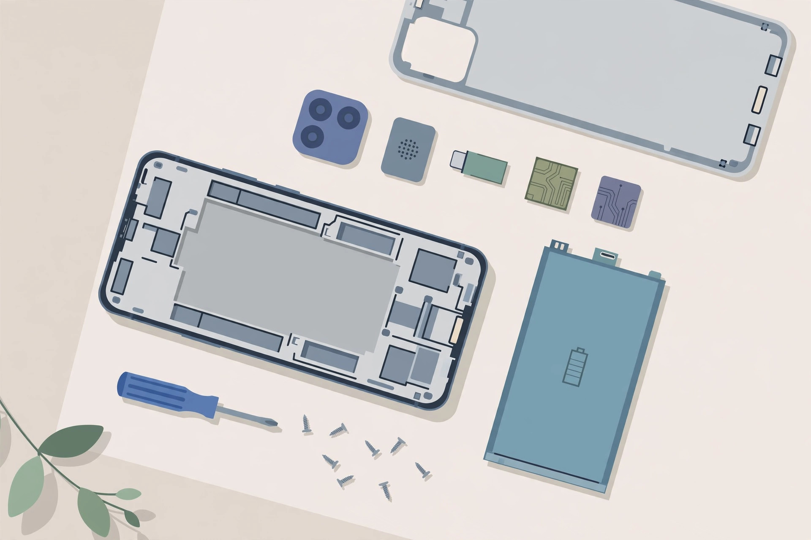
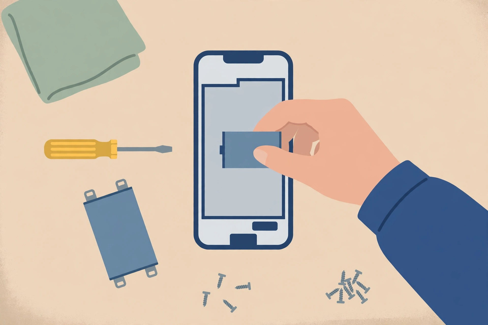
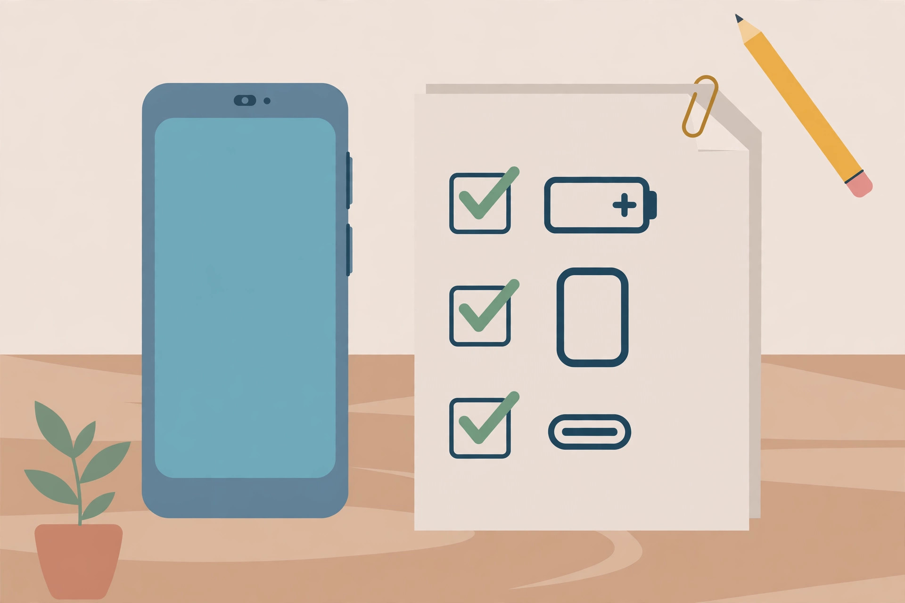

<!-- 본문 시작 -->

폰 배터리가 닳면 보통 폰 자체를 바꾼다. 수리비가 부담스럽고, 맡길 곳을 찾는 일도 귀찮기 때문이다. Fairphone 6는 이 순서를 거꾸로 만든 폰이다. 배터리와 화면, 충전 단자를 사용자가 직접 갈아 끼우도록 설계됐다. 다만 한국에서 쓴다면 사기 전에 따져볼 조건이 분명하다. 이 글은 공개 자료를 바탕으로 한 구매 전 확인용 소개로, 직접 사용해 본 후기가 아니다.

> 핵심 한 줄
>
> ### **배터리가 닳아 폰을 바꾸는 게 아깝다면, 수리 가능한 폰이 답이 될 수 있다 — 단, 국내 사용 조건부터 먼저 확인해야 한다.**

뒷면을 연 모듈형 스마트폰과 교체 부품을 그린 일러스트다. (일러스트) 실제 부품 배치는 제품과 다를 수 있다.

## 무엇이 다른 폰인가?

Fairphone 6는 네덜란드 Fairphone이 만든 안드로이드 폰이다. 공식 스토어(2026-10-29 확인)에 따르면 안드로이드 버전은 599유로, 구글 서비스를 뺀 Murena /e/OS 버전은 649유로, 리퍼비시는 549유로부터 판매 중이다. 저장 공간 256GB, 램 8GB, 안드로이드 15 출고다. 공식 스토어는 8년 OS·보안 업데이트와 5년 보증을 표기한다. 지원 종료 연도는 2033년으로 보도된다.

iFixit 분해 기사에 따르면 이 폰의 수리성은 10점 만점에 10점이다. 뒷면은 T5 나사 2개로 열리고, 배터리는 나사 4개와 케이블 하나로 고정돼 있다. 접착제가 없어 배터리 교체가 종료부터 재부팅까지 약 2분이면 된다고 한다. 화면도 나사 8개만 풀면 분리되는 6.31인치 LTPO OLED(10~120Hz)다. USB-C 단자와 카메라 모듈도 따로 갈아 끼울 수 있다. 단, 메인보드는 사용자 교체 권장 대상이 아니라고 iFixit은 명시한다.

## 오래 쓰려면 무엇을 따져야 할까?

수리 가능한 폰의 가치는 부품값과 지원 기간에서 갈린다. 먼저 배터리다. 요즘 폰은 2~3년이면 배터리가 눈에 띄게 닳는다. 배터리를 직접 바꿀 수 있으면 기기 교체 시점을 몇 년 미룰 수 있다. 다음은 화면과 충전 단자다. 깨진 화면과 헐거워진 충전 단자는 폰 교체의 흔한 이유인데, 두 부품이 모듈로 분리돼 있으면 수리비가 낮아진다.

드라이버로 스마트폰 배터리를 교체하는 모습을 그린 일러스트다. (일러스트) 전작은 무공구 탈착이었으나, 6세대는 나사 방식이다.

다만 타협도 있다. 접착제를 쓰지 않은 설계 탓에 방수·방진 등급은 IP55다. 방진과 분사수 수준이지, 물에 담그는 용도가 아니다. 플래그십 폰의 IP68과 다르다. iFixit은 USB-C가 USB 2 수준이라는 점도 지적한다. 카메라와 고사양 게임 성능은 플래그십보다 약하다는 리뷰 평가가 있다.

| 항목 | 내용 |
|---|---|
| 화면 | 6.31인치 LTPO OLED, 10~120Hz |
| 칩셋·메모리 | Snapdragon 7s Gen 3, 램 8GB, 저장 256GB |
| 배터리 | 4,415mAh, 사용자 교체 가능 (나사 방식) |
| 교체 모듈 | 배터리·화면·USB-C 단자·카메라·스피커 등 |
| 방수·방진 | IP55 |
| 소프트웨어 지원 | 8년 OS·보안 업데이트 (공식 표기) |
| 보증 | 5년 (공식 표기) |
| 한국 판매·배송·AS | 미확인 |

## 한국에서 사도 될까?

여기가 가장 중요한 대목이다. 공식 국내 정식 판매는 확인되지 않았다. Murena 배송 안내의 관세 포함 배송 국가 목록에는 유럽과 미국, 영국, 호주 등이 있지만 한국은 없다. 따라서 국내 통신망 호환과 VoLTE, 전파인증, 국내 AS와 부품 배송 여부는 모두 미확인이다. 해외 직구로 들여온다고 해도, 고장 났을 때 부품을 국내에서 얼마나 빨리 구할 수 있는지는 별도로 따져야 한다.

또 하나, 지금 사는 사람은 후속 모델과 비교해야 한다. Gen. 6+가 2026년 8월에 출시됐다는 보도에 따르면, 칩셋이 Snapdragon 7s Gen 4로 오르고 램이 12GB가 되며, 미국 가격은 649.99달러, 유럽 가격은 649유로다. Gen. 6(599유로)와의 가격 차이가 작다. 그래서 Gen. 6를 고르는 합리적인 조건은 리퍼비시나 할인 가격일 때로 좁혀진다. 정가로 산다면 후속 모델을 먼저 비교하는 편이 낫다.

배터리와 화면, 충전 단자를 점검하는 체크리스트를 그린 일러스트다. (일러스트) 수리 가능성은 부품값과 함께 따져야 한다.

이 폰은 배터리가 닳을 때마다 기기를 바꾸는 순환이 아깝다고 느끼는 사람에게 어울린다. 수리 가능한 폰이라는 아이디어가 마음에 든다면, 이 글의 체크리스트 — 부품 교체 방식, 지원 종료 연도, 국내 사용 조건 — 를 다른 폰을 고를 때도 그대로 써먹을 수 있다.

## 함께 보면 좋은 글

- [마우스를 옆으로 뻗지 않는다 — 키보드 앞 트랙볼, Keychron Nape Pro](https://blog.naver.com/3700708/224456164138) — 손 이동을 줄이는 키보드 앞 입력기기
- [컬러 전자종이에 필기까지 — BOOX Note Air6 C, 사기 전에 따져볼 조건](https://blog.naver.com/3700708/224456162658) — 사기 전에 따져볼 조건 중심의 전자종이 노트 소개
- [코딩 몰라도 AI에게 일을 맡기는 법｜GPT 코덱스·어사이드 설치 활용 총정리](https://blog.naver.com/3700708/224452773983) — AI 뉴스, 코딩 없이 AI에게 일을 맡기는 방법

출처: [Fairphone 공식 스토어](https://www.fairphone.com/shop/buy-the-fairphone-gen-6-1889?color=169&select=172) · [iFixit 분해 기사](https://www.ifixit.com/News/111613/fairphone-6-teardown-proof-phones-dont-have-to-be-disposable) · [Murena 배송 안내](https://murena.com/america/shop/smartphones/brand-new/murena-fairphone-6/) (확인일 2026-10-29). 이 글은 공개 자료를 바탕으로 한 소개이며, 직접 사용 후기가 아니다.

<!-- 본문 끝 -->
