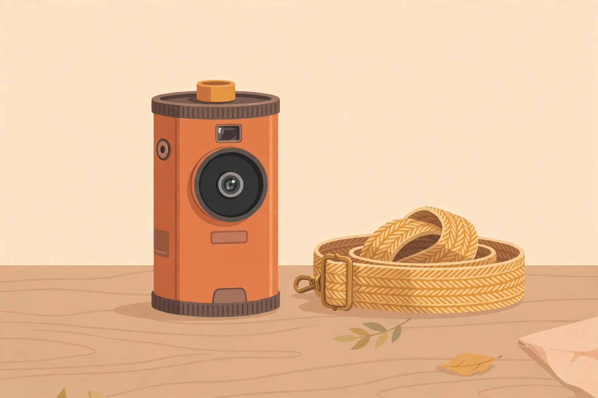
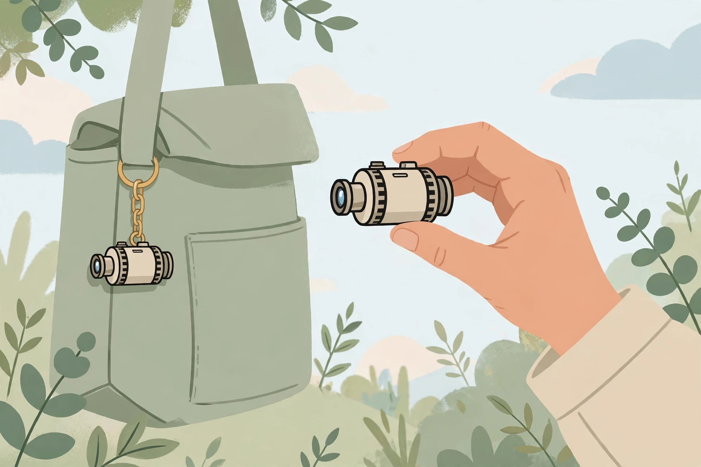

<!-- 본문 시작 -->

책상 위에 필름통 하나가 놓여 있다. 집어 드는 순간, 필름통이 아니라 카메라라는 걸 알게 된다. Analog Capsule Camera는 35mm 필름 롤 모양을 한 디지털 카메라다. 필름을 넣는 대신 microSD에 저장하고, USB-C로 충전한다. 가격은 55달러다. 다만 이 카메라는 사진을 잘 찍기 위한 물건이 아니다. 가볍게 찍는 재미를 사기 위한 물건이다. 이 글은 공개 자료를 바탕으로 한 구매 전 확인용 소개로, 직접 사용해 본 후기가 아니다.

> 핵심 한 줄
>
> ### **필름통을 집어 들었는데 카메라였다 — 25g짜리 로파이 카메라, 잘 찍기 위해서가 아니라 가볍게 찍는 재미를 사는 물건이다.**

책상 위에 놓인 필름통 모양 미니 카메라를 그린 일러스트다. (일러스트) 실제 색상과 질감은 제품 사진과 다를 수 있다.

## 필름통 카메라, 무엇이 들어 있나?

판매 페이지(2026-10-29 확인)에 따르면 이 카메라는 ABS 수지 몸체에 지름 약 4.5cm, 높이 약 4.7cm, 무게 약 25g(microSD 제외)이다. 센서는 100만 화소 CMOS, 렌즈는 3.2mm, 최소 초점 거리는 약 20cm다. 작은 디스플레이는 80×160픽셀이라 촬영 직후 확인용에 가깝다. 사진은 JPEG, 동영상은 1920×1080(30fps) MJPEG AVI로 저장한다. 저장 매체는 microSDHC 최대 32GB(FAT32)다. 배터리는 230mAh 충전식으로, 충전 약 120분, 사용 약 60분(플래시 미사용 기준)이다. 구성품은 USB 케이블과 스트랩, 설명서다.

여기서 한 가지는 꼭 짚어야 한다. 센서는 100만 화소인데 사진 출력 해상도는 3760×2128로 표기돼 있다. 이는 약 800만 화소 상당의 크기로, 보간이나 업스케일 여부는 판매 페이지에 설명이 없어 미확인이다. 즉, 숫자만 보고 화질을 기대하면 안 된다. 판매 페이지가 말하는 미덕은 정반대다. 그레인과 뭉개짐, 하이라이트 날림을 결함이 아니라 아날로그 감성으로 받아들이라는 것이다.

## 어떻게 쓰면 재미있을까?

이 카메라의 쓰임은 무게와 크기에서 나온다. 25g이면 가방에 참처럼 달고 다닐 수 있다. 스트랩이 기본 포함돼 있어, 가방에 매달아 두었다가 눈에 띄는 장면이 있을 때 바로 꺼내 찍는 방식이 어울린다. 필름통 모양 상자까지 포함된 연출 덕분에, 선물로 건넬 때의 놀라움도 상품의 일부다.

가방에 참처럼 매단 작은 카메라를 그린 일러스트다. (일러스트) 25g이라 하루 종일 달고 다녀도 부담이 적다.

다만 한계도 분명하다. 배터리 사용 시간이 약 1시간이라 장시간 촬영에는 맞지 않고, 작은 화면으로는 제대로 된 확인이 어렵다. 플래시 유무와 microSD 포함 여부는 판매 페이지에 명시돼 있지 않아 미확인이다.

| 항목 | 내용 |
|---|---|
| 크기·무게 | 약 4.5×4.7cm, 약 25g (microSD 제외) |
| 센서·렌즈 | 100만 화소 CMOS, 3.2mm 렌즈, 최소 초점 약 20cm |
| 사진·동영상 | JPEG 3760×2128, MJPEG AVI 1920×1080 30fps |
| 저장 | microSDHC 최대 32GB (FAT32) |
| 배터리 | 230mAh, 충전 약 120분 / 사용 약 60분 |
| 가격 | 55달러 (2026-10-29 판매 페이지 기준) |
| 한국 배송·AS | 미확인 |

## 사기 전에 확인할 것

가격은 판매 페이지 기준 55달러로, 두 가지 색상 모두 구매 가능으로 표시됐다. Yanko Design 소개 기사(2026-10-09)에 따르면 이 제품은 Yanko Design의 셀렉트 숍에서 판매된다. 배송 안내에 따르면 도쿄 창고에서 발송하고 국제 주문의 관세와 부가세는 고객 부담이라고만 적혀 있어, 한국 배송 가능 여부와 최종 결제 금액은 체크아웃에서 직접 확인해야 한다. 국내 정식 판매처와 국내 AS, 보증 조건은 확인되지 않았다.

또 하나 솔직한 한계가 있다. 이 제품 자체에 대한 독립 실측 후기는 아직 찾기 어렵다. Yanko 기사와 이를 요약한 외부 매체가 주 근거이며, 이는 독립 실측이 아니다. 비슷한 필름통 카메라에 대한 보도를 이 제품의 후기로 전용해서는 안 된다.

케이블로 노트북에 연결해 사진을 옮기는 모습을 그린 일러스트다. (일러스트) 사진은 microSD와 USB-C로 주고받는다.

이 카메라는 스마트폰보다 좋은 사진을 원하는 사람에게는 맞지 않는다. 반면 필름의 질감을 흉내 낸 가벼운 스냅, 책상 위 소품, 그리고 누군가에게 건넬 때의 놀라움을 원하는 사람에게는 55달러짜리 재미로 어울린다. 살 때는 화질 기대치를 낮추고, microSD 별도 구매 여부와 한국까지의 최종 결제 금액, 보증 조건부터 확인하는 편이 좋다.

## 함께 보면 좋은 글

- [마우스를 옆으로 뻗지 않는다 — 키보드 앞 트랙볼, Keychron Nape Pro](https://blog.naver.com/3700708/224456164138) — 손 이동을 줄이는 키보드 앞 입력기기
- [컬러 전자종이에 필기까지 — BOOX Note Air6 C, 사기 전에 따져볼 조건](https://blog.naver.com/3700708/224456162658) — 사기 전에 따져볼 조건 중심의 전자종이 노트 소개
- [코딩 몰라도 AI에게 일을 맡기는 법｜GPT 코덱스·어사이드 설치 활용 총정리](https://blog.naver.com/3700708/224452773983) — AI 뉴스, 코딩 없이 AI에게 일을 맡기는 방법

출처: [Yanko Design 판매 페이지](https://shop.yankodesign.com/collections/upcoming-drops/products/analog-capsule-camera) · [Yanko Design 소개 기사](https://www.yankodesign.com/2026/10/09/a-55-camera-secretly-disguised-as-a-roll-of-35mm-film/) (확인일 2026-10-29). 이 글은 공개 자료를 바탕으로 한 소개이며, 직접 사용 후기가 아니다.

<!-- 본문 끝 -->
