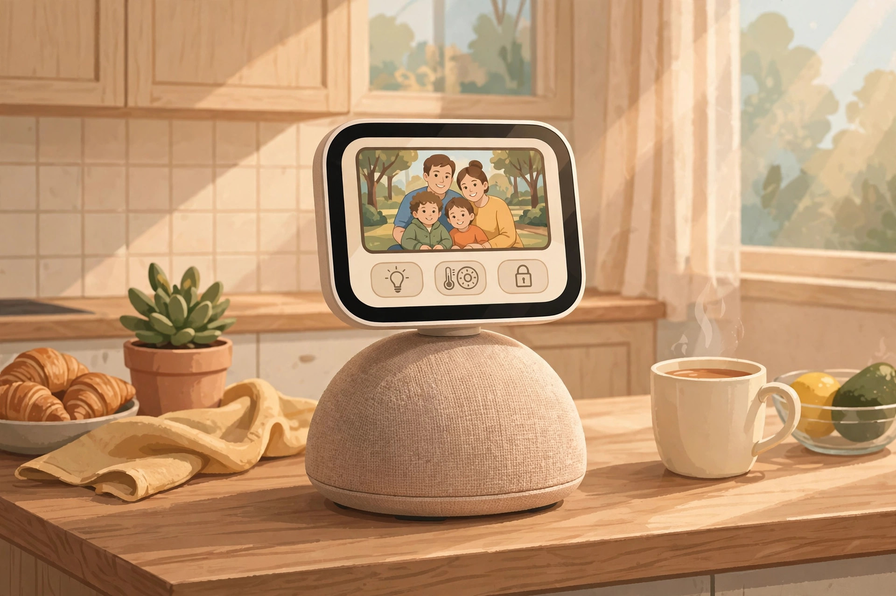
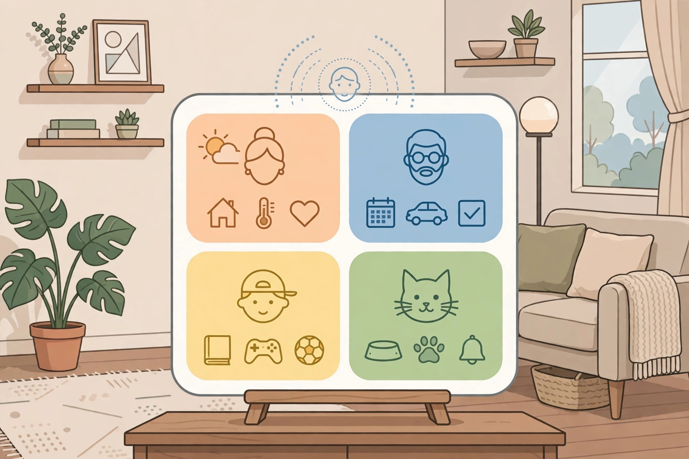
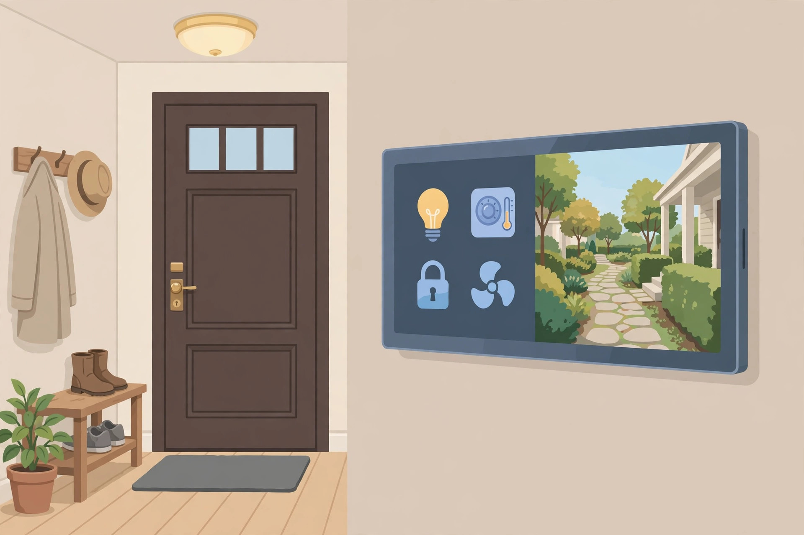

<!-- 본문 시작 -->

Apple has finally put a screen at the center of the home. Announced on October 13, 2026, the Apple HomeView is neither a speaker nor a tablet — it is a smart home display. It sits on a kitchen counter or a nightstand to control home devices, make video calls and play music. The US price is $299, with launch scheduled for November 13, 2026. Because it has not launched yet, this post is a pre-purchase introduction based on published materials, not a hands-on review.

> Key line
>
> ### **If you want to control your home from one screen, HomeView may be the answer — but check the Korean launch and your devices' compatibility first.**

An illustration of a smart display on a speaker base on a kitchen counter. (Illustration) Actual colors and screen layout may differ.

## Why one screen comes with a speaker attached

HomeView pairs a 7-inch Liquid Retina display with a domed speaker base, joined by a stainless steel tilting hinge. Apple says brightness adjusts automatically from 0.3 to 500 nits, so it should not glare at night. The speaker aims for room-filling sound with two full-range drivers, a down-firing woofer and two passive radiators. The screen is distance-aware: detailed information up close, glanceable information from afar. Purpose-built screens cover photos, a motion-reactive face, instant home controls, and up to nine camera feeds at once.

| Item | Detail |
| --- | --- |
| Screen | 7-inch Liquid Retina, True Tone, auto brightness 0.3–500 nits |
| Chip · voice assistant | A18 chip, Siri AI (based on Apple Intelligence) |
| Speaker | Two full-range drivers, down-firing woofer, two passive radiators |
| Face recognition | Up to six people, personal Home Screen per person |
| Camera | FaceTime camera built in, up to nine feeds at once |
| Connectivity | Matter · Thread support |
| Price (US) | $299 (tabletop and wall-mounted alike); wall mounts $59–$129, sold separately |
| Launch | November 13, 2026 planned; Korean launch date and price not confirmed |

## A screen that recognizes six faces in the family

HomeView's biggest differentiator is face recognition. It recognizes up to six people and switches from a shared household screen to each person's own Home Screen. Apple says shared photo albums and music stay communal, while personal items such as messages and schedules stay visible only to their owner. Video calls run over FaceTime, and several units can work like an intercom. Still, face recognition accuracy and behavior in edge cases — dark rooms, children's faces — must wait for independent verification after launch. Whether the privacy design works as announced should also be treated as unconfirmed until real-world reviews appear.

An illustration of different personal screens for different family members. (Illustration) Actual personal screen layout may differ.

## Three conditions to weigh before buying

First, the Korean launch. Reports of the first launch wave do not confirm Korea, and no Korean price is confirmed. If you import one, check Korean Siri behavior, local service integration and warranty terms separately. Second, the real cost of the wall-mounted version. The body costs the same $299, but its box contains no mount, cable or adapter. Mounts run $59 to $129 separately, so the total cost changes for wall use. Third, device compatibility at home. Matter and Thread support is announced, but whether each device you already own actually connects must be checked device by device. The launch date of the Apple Home Collection devices, made with LG and Schneider, is also not yet announced.

An illustration of a smart display mounted on an entryway wall. (Illustration) Mounts and cables are sold separately.

For a household already built around Apple devices, HomeView could become the most natural central screen in the home. For an Android- or other-assistant-centered home, or if you can wait for the official Korean launch, deciding after the November 13 launch — once real reviews and Korean launch news arrive — is not too late. As a pre-launch product, keep this checklist in hand: Korean launch, total wall-mount cost, and home device compatibility.

## Related reads

- [No reaching sideways for the mouse — Keychron Nape Pro, a trackball in front of the keyboard](https://aitechnotesen.wordpress.com/2026/10/28/no-reaching-sideways-for-the-mouse-keychron-nape-pro-a-trackball-in-front-of-the-keyboard/) — an input device that reduces hand travel
- [Color e-paper you can write on — BOOX Note Air6 C, and what to check before buying](https://aitechnotesen.wordpress.com/2026/10/28/color-epaper-you-can-write-on-boox-note-air6-c-and-what-to-check-before-buying/) — a color e-paper notebook, judged by pre-purchase conditions
- [How to hand work to AI without knowing how to code — GPT Codex and Asides setup guide](https://blog.naver.com/3700708/224452773983) — AI news (Korean edition)

Sources: [MacRumors announcement](https://www.macrumors.com/2026/10/13/apple-announces-homeview-smart-home-hub/) · [Gizmodo announcement](https://gizmodo.com/homeview-apple-smart-home-hub-2000824152) · [USA Today roundup](https://www.usatoday.com/story/tech/2026/10/13/apple-homeview-features-colors-price-and-availability/92230013007/) (checked 2026-10-30). This post is based on published materials, not a hands-on review.

<!-- 본문 끝 -->
