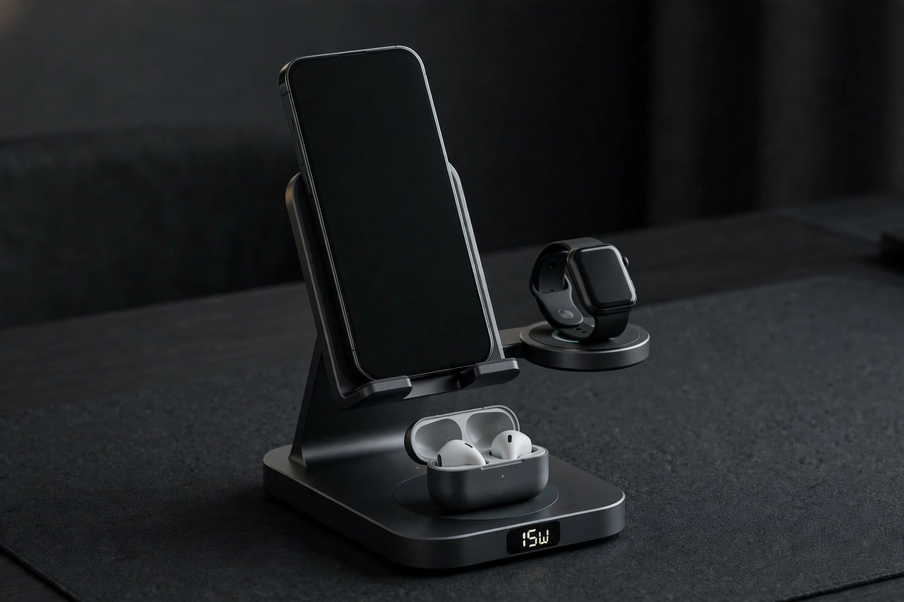
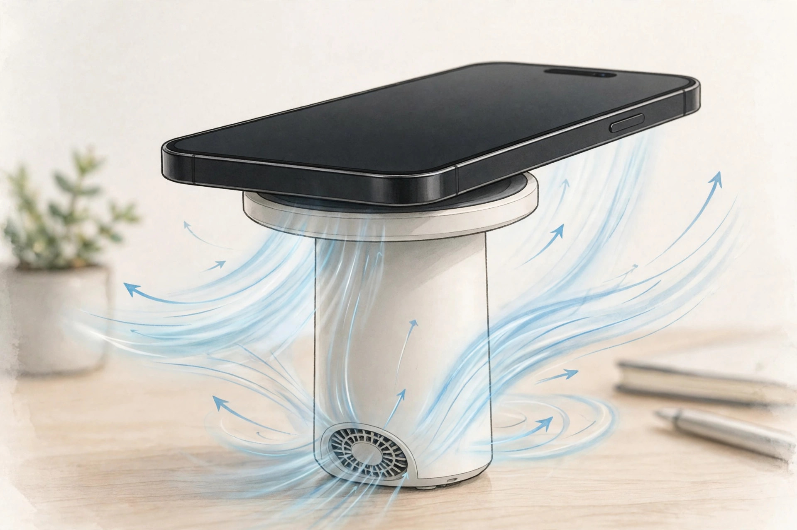
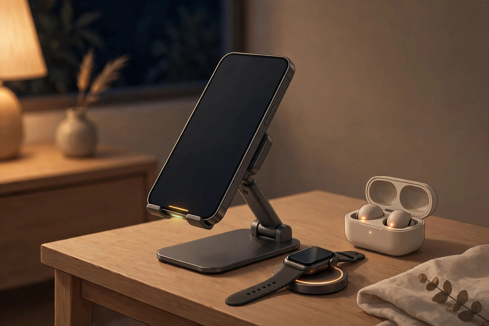

<!-- 본문 시작 -->

If you want to clear three cables off your desk, a 3-in-1 charging stand looks tempting — until one number catches your eye. 25W. But whether that 25W applies to your phone needs a separate check. The UGREEN MagFlow Pro 3-in-1 is a product where those conditions are especially clear: a Qi2.2 charging stand unveiled at IFA 2026.

> 핵심 한 줄
>
> ### **25W is a number that only appears when device, software version, and adapter all line up**

Charging three devices from one stand is where this product starts. (Illustration)

## What it is

The MagFlow Pro is a stand-style wireless charger that holds an iPhone magnetically upright, with an iPhone pad, a watch module, and an earbuds space on a single stand. The stand tilts up to 90 degrees and rotates 360 degrees for video calls while charging, and the manufacturer says it uses 16 N48H magnets for MagSafe-level hold.

## 25W is not 25W for everyone

The first condition to check is whether your iPhone qualifies for 25W. According to the official product page, 25W charging works with the iPhone 17 series and the iPhone 16 series running iOS 26 or later. The iPhone Air tops out at 20W, and the iPhone 12–15 series at 15W.

The second condition is the adapter. The official page says a 45W or higher adapter is needed to use 25W charging and the cooling fan at the same time. But inclusion varies by seller: the official Middle East store page lists the adapter as not included, while some review units came with a 45W adapter. Check the box contents before ordering, and treat a low-input-power alert on the display as a sign the adapter is short.

## Cooling that handles the heat

Higher output brings more heat, and the MagFlow Pro answers with the CryoPulse system, which combines a TEC semiconductor cooler with a fan. In manufacturer testing, the center of the magnetic pad cooled to about 11°C, and fan noise is rated at 15dB or below. When cooling is not needed, a double press of the button turns the fan off.

That figure is still a manufacturer test result. Real-world temperatures will vary with ambient temperature and case thickness, and cases up to 3mm thick that are MagSafe-compatible are recommended.

A fan rated at 15dB or below is the figure to judge bedroom use by. (Illustration)

## A display that shows charging as it happens

The smart display shows charging wattage, temperature, cooling mode, and watch and earbuds charging status in real time, and a side switch changes the cooling mode and display page. If you plan to use it in a bedroom, also check whether brightness can be adjusted and the display turned off.

## What to check before buying

First, 25W applies only to some iPhone 17 and 16 models; older iPhones, Galaxy, and Pixel phones top out at 15W. Second, a configuration with a separate 45W or higher adapter can push total spending above the stand price. Third, the iPhone 17 Pro Max 0–50% in 26 minutes claim is a manufacturer claim, and independent verification under the same conditions has not been confirmed yet. Fourth, official domestic pricing and sales configuration in Korea are unconfirmed.

| Item | Details |
|---|---|
| Product | UGREEN MagFlow Pro 3-in-1 Magnetic Wireless Charging Stand 25W |
| Spec | Qi2.2, iPhone up to 25W, watch 5W, earbuds 5W, up to 32.5W combined |
| 25W condition | iPhone 17 series, iPhone 16 series on iOS 26 or later |
| Other output | iPhone Air up to 20W, iPhone 12–15 up to 15W |
| Cooling | TEC semiconductor + fan, fan noise 15dB or below (manufacturer rating) |
| Adapter | 45W or higher required, inclusion varies by seller |
| Price | US $129.99, Europe €139.99 / UK £119.99 reported, Korea price unconfirmed |

## Price and availability

Reported prices are US $129.99, Europe €139.99, and UK £119.99 (checked October 31, 2026). Official launch status and pricing in Korea are unconfirmed, so for overseas orders, add the adapter configuration, shipping, and customs duties to the total.

In a bedroom, display brightness and fan noise become hidden deciding factors. (Illustration)

## My take

This stand fits people using an iPhone 17 or an iPhone 16 on iOS 26 or later who want to tidy a watch and earbuds onto one stand, and who like checking heat and speed as numbers. If you use an iPhone 12–15 or need to buy an adapter separately, the 25W advantage shrinks, so compare the stand plus adapter cost together.

## 함께 보면 좋은 글

[Apple's first smart home screen — will Apple HomeView become the center of the home?](https://aitechnotesen.wordpress.com/2026/10/30/apples-first-smart-home-screen-will-apple-homeview-become-the-center-of-the-home/)
A look at what role Apple's first smart home screen could play in the home.

[Before buying a color e-reader — Kobo Libra Colour vs Kindle Colorsoft](https://aitechnotesen.wordpress.com/2026/10/30/before-buying-a-color-ereader-kobo-libra-colour-vs-kindle-colorsoft/)
A condition-first comparison of two color e-readers before buying.

[Stop digging through your bag — MagQuick, a strap that snaps on and pulls off](https://aitechnotesen.wordpress.com/2026/10/25/stop-digging-through-your-bag-magquick-a-strap-that-snaps-on-and-pulls-off/)
A strap that detaches with a pull and attaches on contact, for bag organization.

## Sources

- [UGREEN MagFlow Pro official product page](https://www.ugreen.com/en-ae/products/ae-75724)
- [Notebookcheck, Ugreen MagFlow series at IFA 2026](https://www.notebookcheck.net/Ugreen-unveils-two-new-magnetic-wireless-chargers-with-Qi2-certification.1387270.0.html)
- [ThinkComputers, UGREEN MagFlow Pro review](https://thinkcomputers.org/ugreen-magflow-pro-3-in-1-magnetic-wireless-charger-review/)
- [FoneArena, MagFlow lineup pricing](https://www.fonearena.com/blog/491616/ugreen-magflow-magnetic-power-bank-magnetic-wireless-charger-price-features.html)

<!-- 본문 끝 -->
