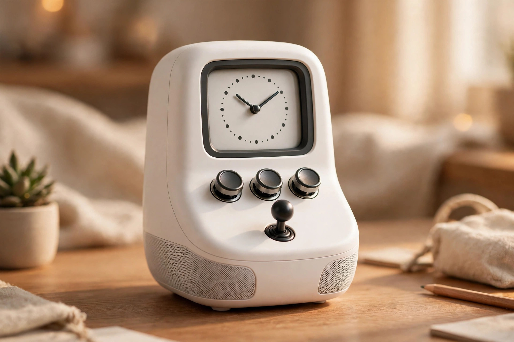
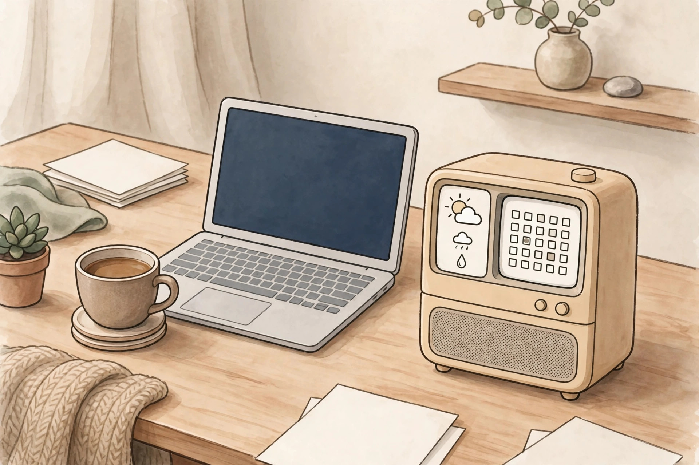

<!-- 본문 시작 -->

A tiny old computer sits on a desk. Its screen shows a clock, and below it are mechanical keys and a joystick. But this object is not a computer — it is a speaker. The Divoom Astrotoo is a desk speaker that combines a retro terminal look with a 20W speaker, a 3.95-inch screen, and widget display. It was covered by Notebookcheck and Yanko Design on October 12, 2026.

> 핵심 한 줄
>
> ### **A speaker that still has a job for its screen after the music stops**

The small terminal look makes the first impression. The body itself is a speaker. (Illustration)

## What it is

The Astrotoo is a desk speaker from Divoom. The front holds a 3.95-inch IPS display (480×480), three mechanical keys, a joystick, and an orange Back button. The speaker is a single full-range driver with a 20W amplifier, firing upward. According to the manufacturer, it is tuned for near-desk listening, sounding most balanced at about 0.6–1 meter.

It connects over Bluetooth 6.0 and Wi-Fi, and can also play music from a microSD card without a phone connected. The screen is set up through the free Divoom app. Beyond playback info, it can show photos, clock faces, and widgets such as calendar, weather, and stock prices.

## Why it is interesting: a speaker with a screen

An ordinary speaker becomes just an object when the music stops. The Astrotoo keeps its screen working in that time — as a clock, a weather and schedule display, or a photo frame. Pressing mechanical keys and a joystick to control playback, volume, and screen functions adds to the fun. It suits someone who wants one desk object to handle music and a small information board together.

It measures about 106×108×135mm and weighs 640g. That is larger and heavier than a typical speaker, but it does not need the space of a full computer. Colors are white, green, and pink.

## What to check before buying

First, sound quality. A 20W rating alone cannot tell you how balanced the tone is, and Yanko Design makes the same point. As a just-launched product, independent sound reviews have not been confirmed yet. Second, battery: manufacturer-rated use is up to 6 hours, with USB-C charging of about 3.5 hours, so keeping a cable connected is more realistic for all-day desk use. Third, widget usefulness: whether calendar, weather, and stock widgets prove useful in daily life varies by person, and it is worth checking what account linking and screen settings they depend on.

Whether the widget screen works as a small desk information board is the deciding question. (Illustration)

## Price and availability

The US official store price is $199.99 with free shipping (checked October 31, 2026). Official pricing and availability in Korea are unconfirmed. For overseas orders, check shipping, customs duties, and after-sales terms together, as stock may also vary by color and seller.

| Item | Details |
|---|---|
| Product | Divoom Astrotoo desk speaker |
| Speaker | 20W, single full-range driver, upward firing, near-field listening |
| Screen | 3.95-inch IPS, 480×480, widgets, photos, clock display |
| Controls | 3 mechanical keys, joystick, Back button, Divoom app |
| Connectivity | Bluetooth 6.0, Wi-Fi, microSD playback |
| Size and weight | About 106×108×135mm, 640g |
| Battery | Up to 6 hours (manufacturer rating), charging about 3.5 hours |
| Price | US $199.99, Korea price and availability unconfirmed |

White, green, and pink add the fun of choosing by desk mood. (Illustration)

## My take

This product fits someone who wants one desk object to cover both music and a small information board, and who enjoys the retro look and the feel of pressing mechanical keys. If sound quality is the top priority, or if all-day wireless use matters most, the 20W speaker and 6-hour battery may disappoint. Decide first whether you are buying a speaker or a small desk terminal, then choose.

## 함께 보면 좋은 글

[Apple's first smart home screen — will Apple HomeView become the center of the home?](https://aitechnotesen.wordpress.com/2026/10/30/apples-first-smart-home-screen-will-apple-homeview-become-the-center-of-the-home/)
A look at what role Apple's first smart home screen could play in the home.

[Before buying a color e-reader — Kobo Libra Colour vs Kindle Colorsoft](https://aitechnotesen.wordpress.com/2026/10/30/before-buying-a-color-ereader-kobo-libra-colour-vs-kindle-colorsoft/)
A condition-first comparison of two color e-readers before buying.

[Stop digging through your bag — MagQuick, a strap that snaps on and pulls off](https://aitechnotesen.wordpress.com/2026/10/25/stop-digging-through-your-bag-magquick-a-strap-that-snaps-on-and-pulls-off/)
A strap that detaches with a pull and attaches on contact, for bag organization.

## Sources

- [Notebookcheck, Astrotoo coverage](https://www.notebookcheck.net/Astrotoo-packs-display-and-mechanical-keys-into-retro-speaker.1421976.0.html)
- [Yanko Design, Astrotoo introduction](https://www.yankodesign.com/2026/10/12/divoom-astrotoo-is-a-desktop-speaker-dressed-as-a-retro-computer/)

<!-- 본문 끝 -->
