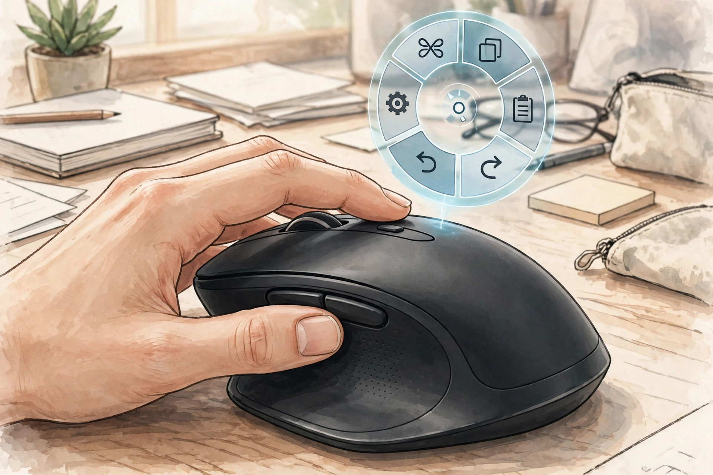
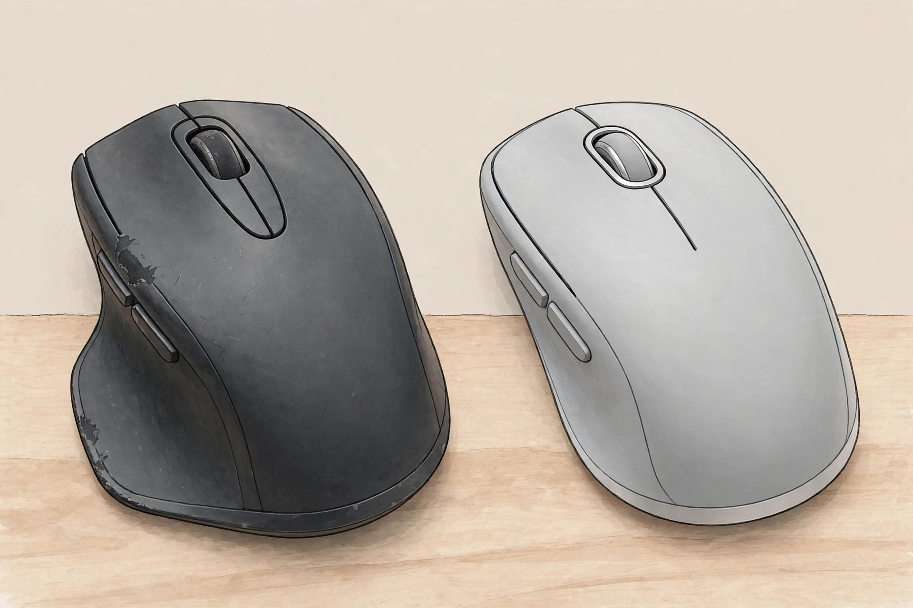

<!-- 본문 시작 -->

For someone who holds a mouse all day at a desk, the MX Master 3S has long been close to the default answer. Then came its successor, the MX Master 4. The sensor, the battery, and the scroll wheel are unchanged, and the price is 119.99 USD on the official US store — the same as the 3S at launch (checked 2026-11-01). So the question becomes simple. What changed, and is that change worth opening your wallet for?

> 핵심 한 줄
>
> ### **The value of the MX Master 4 is not in its sensor, but in the haptic panel and Actions Ring under your thumb**

The images in this post are AI illustrations, not actual product photos. (Illustration)

## What it is

The MX Master 4 is Logitech's flagship wireless mouse for office work. It combines a large sculpted right-handed shape with an 8,000 DPI Darkfield sensor, a MagSpeed wheel that scrolls up to 1,000 lines per second, and a battery rated for up to 70 days. It connects to up to three devices via Bluetooth and a USB-C Logi Bolt receiver, and the manufacturer says one minute of charging gives up to three hours of use (checked 2026-11-01, based on Logitech's official pages).

## Exactly two things changed: haptics and the Actions Ring

The first is the new Haptic Sense Panel under the thumb. It gives vibration feedback for specific actions, shortcuts, and notifications, with intensity and behavior set in the Logi Options+ app (Windows and macOS). The manufacturer claims that using the panel and the Actions Ring can cut mouse-action time by up to 33% and repetitive movement by up to 63%. That is a Logitech Ergo Lab result measured with 37 people across eight actions, so it should not be read as a promise that applies to every user.

The second is the Actions Ring. Pressing the panel opens a circular shortcut menu beside the cursor, so you can reach favorite tools and filters without hunting through menus. It can be set differently per app, which is the point. Independent reviews note, however, that few apps support haptics yet, so day-to-day feel is close to the 3S. Haptics do not automatically become productivity.

## What did not change: sensor, scroll, battery

The comparison table below says almost everything. The 8,000 DPI sensor, the MagSpeed wheel, the up-to-70-day battery, and tracking on glass are the same as the 3S. The Master 4 weighs about 150 g, roughly 9 g more than the 3S. So if you already own a 3S, the reason to buy new has to be the extras — haptics, shortcuts, and the USB-C receiver — not better core performance.

| Item | MX Master 4 | MX Master 3S |
| --- | --- | --- |
| Sensor | 8,000 DPI Darkfield, tracks on glass | 8,000 DPI Darkfield, tracks on glass |
| Scroll wheel | MagSpeed, up to 1,000 lines per second | MagSpeed, up to 1,000 lines per second |
| Battery | Up to 70 days, 1-minute charge for up to 3 hours | Up to 70 days |
| Weight | About 150 g | About 141 g |
| Receiver | USB-C Logi Bolt | USB-A Logi Bolt |
| New additions | Haptic Sense Panel, Actions Ring | None |
| US price | Official 119.99 USD | 119.99 USD at launch; current price unconfirmed |

The value of the haptic panel depends on how many apps support it. (Illustration)

## Four conditions to check before buying

First, your hand. The MX Master 4 is right-handed only. Left-handed users are out of this lineup entirely, and the large 150 g body can feel heavy for smaller hands.

Second, your computer environment. Haptics and the Actions Ring need Logi Options+. On a locked-down work PC where software installs are blocked, customization may not work. Reviews also note that settings are not stored on the mouse itself, so it falls back to defaults until the app loads.

Third, your ports. The Master 4's receiver is USB-C. That suits a laptop with only USB-C ports, but an environment with only USB-A ports needs an adapter check. And you cannot simply keep using the 3S's USB-A receiver.

Fourth, the box contents. Reviews note that the Master 4 has no storage slot for the dongle and that a USB-C cable is not always included. Check whether you already own a charging cable, and where you will keep the dongle.

## Price and availability

The US official price is 119.99 USD, in stock (checked 2026-11-01). Pricing and launch details for Korea are unconfirmed, so local store prices need a separate check. If the 3S is heavily discounted, it remains the sensible choice for anyone who does not specifically need haptics.

With the same sensor and battery, the choice comes down to the price gap and how much you will use haptics. (Illustration)

## My judgment

The MX Master 4 fits someone buying a new mouse who will use the shortcut menu often in apps like Photoshop or Lightroom, or who uses only a USB-C laptop. If you already own a 3S, the case for switching is weak. If the discounted 3S undercuts the full-price Master 4 by more than the haptics and Actions Ring are worth to you, the 3S wins that gap. If the price gap is small, buying the 4 is the right call.

## 함께 보면 좋은 글

[It looked like a mini computer, but it is a speaker — Divoom Astrotoo, a small terminal for your desk](https://aitechnotesen.wordpress.com/2026/10/31/it-looked-like-a-mini-computer-but-it-is-a-speaker-divoom-astrotoo-a-small-terminal-for-your-desk/)
A speaker that looks like a small desk terminal, explained.

[Will 25W wireless charging work with my iPhone? — What to check before buying the UGREEN MagFlow Pro](https://aitechnotesen.wordpress.com/2026/10/31/will-25w-wireless-charging-work-with-my-iphone-what-to-check-before-buying-the-ugreen-magflow-pro/)
The charging conditions you miss if you buy on the number alone.

[Stop digging through your bag — MagQuick, a strap that snaps on and pulls off](https://aitechnotesen.wordpress.com/2026/10/25/stop-digging-through-your-bag-magquick-a-strap-that-snaps-on-and-pulls-off/)
A strap that detaches with a pull and attaches with a touch, explained.

## Sources

- [Logitech MX Master 4 for Business official page](https://www.logitech.com/en-us/business/shop/p/mx-master-4-business)
- [Logitech MX Master 4 Special Edition official page](https://www.logitech.com/en-us/shop/p/mx-master-4-special-edition.910-008018)
- [Fitonear, MX Master 4 vs MX Master 3S comparison](https://fitonear.com/mx-master-4-vs-mx-master-3s/)
- [GamepadSquire, Logitech MX Master 4 review](https://gamepadsquire.com/mice/logitech-mx-master-4/)

<!-- 본문 끝 -->
