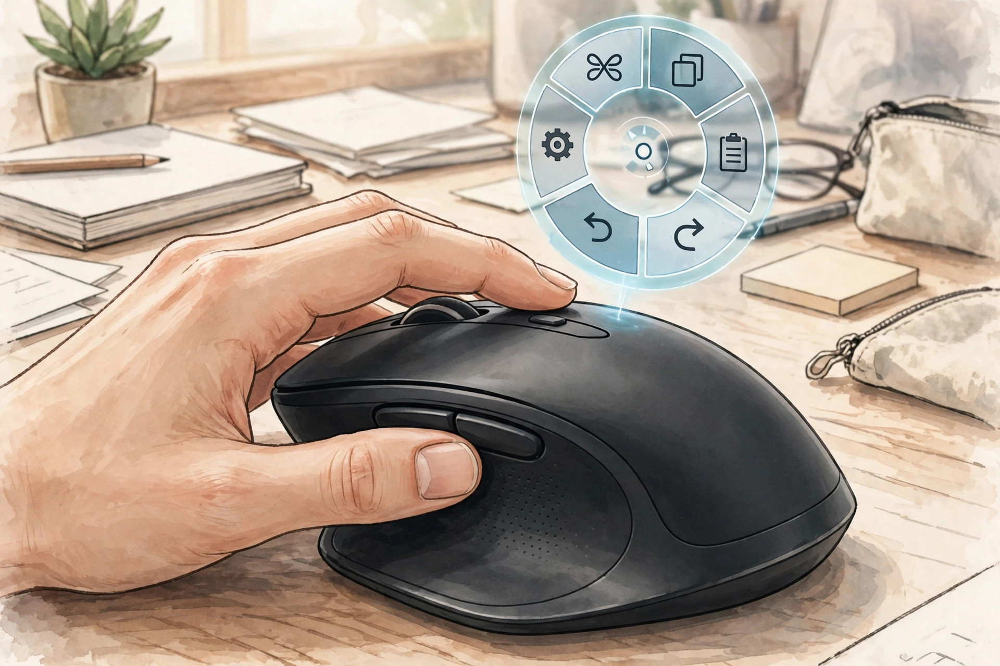
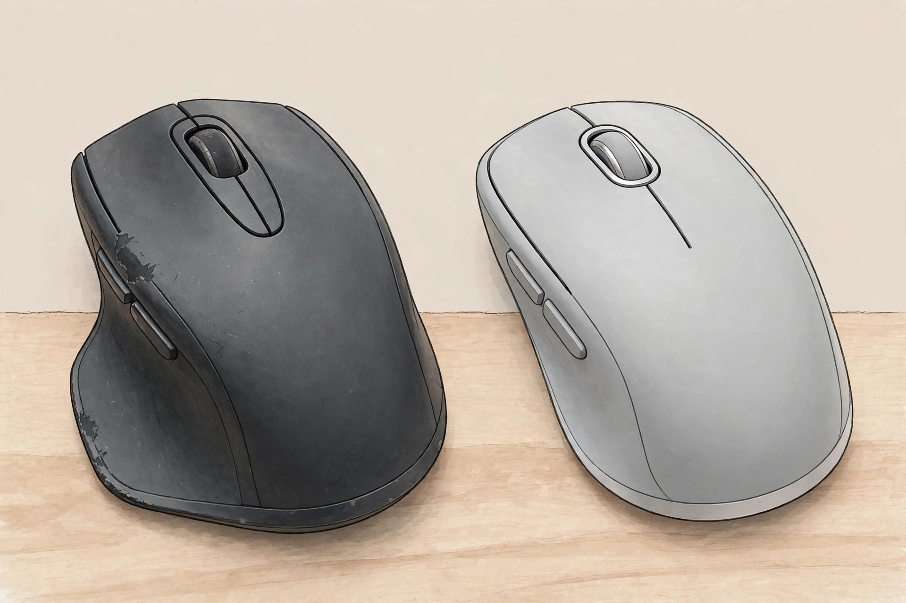

<!-- 본문 시작 -->

하루 종일 마우스를 쥐고 일하는 사람에게 MX Master 3S는 오랫동안 정답에 가까운 마우스였습니다. 후속작 MX Master 4는 센서·배터리·스크롤이 그대로이고, 미국 공식 가격은 119.99달러로 전작 출시가와 같습니다(확인일 2026년 11월 1일). 무엇이 달라졌고, 그 값이 지갑을 열 만한지가 이 글의 질문입니다.

> 핵심 한 줄
>
> ### **MX Master 4의 값어치는 센서가 아니라 엄지 아래 햅틱 패널과 Actions Ring에 달렸다**

이 글의 이미지는 실제 제품 사진이 아니라 AI 일러스트입니다. (일러스트)

## 이 제품은 무엇인가

MX Master 4는 로지텍의 플래그십 사무용 무선 마우스입니다. 오른손 전용 형태에 8,000 DPI 다크필드 센서, 초당 최대 1,000줄 MagSpeed 휠, 최대 70일 배터리를 담았습니다. 블루투스와 USB-C Logi Bolt 수신기로 최대 3대 기기에 연결할 수 있습니다(확인일 2026년 11월 1일, 로지텍 공식 페이지 기준).

## 달라진 건 딱 두 가지, 햅틱과 Actions Ring

첫 번째는 엄지 아래의 햅틱 센스 패널입니다. 동작·알림에 진동 피드백을 주며, 강도와 동작은 Logi Options+ 앱(Windows·macOS)에서 설정합니다. 제조사는 이를 쓰면 마우스 동작 시간을 최대 33% 줄일 수 있다고 주장하지만, 37명 대상의 제조사 연구 결과라 모든 사용자에게 그대로 적용된다고 보기는 어렵습니다.

두 번째는 Actions Ring입니다. 패널을 누르면 커서 옆에 원형 단축키 메뉴가 떠서 자주 쓰는 도구·필터를 바로 고를 수 있고, 앱마다 다르게 설정할 수 있습니다. 다만 독립 리뷰에서는 아직 햅틱을 지원하는 앱이 적어 일상에서는 전작과 느낌이 비슷하다는 지적도 나옵니다. 햅틱이 곧바로 생산성이 되는 것은 아닙니다.

## 안 달라진 것: 센서·스크롤·배터리

아래 비교표가 결론을 거의 다 말해줍니다. 센서 8,000 DPI, MagSpeed 휠, 최대 70일 배터리, 유리 위 트래킹까지 핵심 성능은 3S와 같습니다. 무게는 4가 약 150g으로 3S보다 약 9g 무겁습니다. 3S를 이미 쓰고 있다면, 새로 사는 이유는 성능 향상이 아니라 햅틱·단축키·USB-C 수신기 같은 부가 요소여야 합니다.

| 항목 | MX Master 4 | MX Master 3S |
| --- | --- | --- |
| 센서 | 8,000 DPI 다크필드, 유리 위 가능 | 8,000 DPI 다크필드, 유리 위 가능 |
| 스크롤 휠 | MagSpeed, 초당 최대 1,000줄 | MagSpeed, 초당 최대 1,000줄 |
| 배터리 | 최대 70일, 1분 충전 시 최대 3시간 | 최대 70일 |
| 무게 | 약 150g | 약 141g |
| 수신기 | USB-C Logi Bolt | USB-A Logi Bolt |
| 새로 추가된 것 | 햅틱 센스 패널, Actions Ring | 없음 |
| 미국 가격 | 공식 119.99달러 | 출시 당시 119.99달러, 현재가는 미확인 |

햅틱의 값은 앱 지원 범위에 따라 달라진다. (일러스트)

## 사기 전에 확인할 조건 네 가지

첫째, 손입니다. MX Master 4는 오른손 전용이라 왼손잡이라면 이 라인업 자체가 선택지에서 빠집니다. 손이 작은 사람에게도 150g의 큰 본체가 부담이 될 수 있습니다.

둘째, 컴퓨터 환경입니다. 햅틱과 Actions Ring 설정에는 Logi Options+가 필요합니다. 회사 PC처럼 소프트웨어 설치가 막힌 환경에서는 커스텀이 안 될 수 있고, 설정이 본체에 저장되지 않아 앱이 로딩되기 전에는 기본값으로 돌아간다는 리뷰 지적도 있습니다.

셋째, 포트입니다. 4의 수신기는 USB-C라 USB-C만 있는 노트북에는 편하지만, USB-A 포트만 있는 환경에서는 어댑터를 따로 확인해야 합니다. 3S의 USB-A 수신기를 그대로 쓰는 계획은 통하지 않습니다.

넷째, 구성품입니다. 리뷰에 따르면 4의 상자에는 동글 수납 공간이 없고 USB-C 케이블이 포함되지 않은 경우도 있습니다. 충전 케이블 보유 여부와 동글 보관 장소를 미리 생각해 두는 것이 좋습니다.

## 가격과 국내 이용

미국 공식 가격은 119.99달러, 재고 있음으로 확인됐습니다(확인일 2026년 11월 1일). 국내 정식 가격과 출시 일정은 미확인이라 국내 판매처 가격은 따로 확인해야 합니다. 3S 할인 폭이 크다면, 햅틱을 꼭 쓰지 않는 사람에게는 3S가 여전히 합리적입니다.

같은 센서·배터리라면 기준은 가격 차이와 햅틱 활용도다. (일러스트)

## 나의 판단

MX Master 4가 어울리는 사람은 새로 마우스를 사면서 포토샵·라이트룸 같은 앱에서 단축키 메뉴를 자주 쓸 사람, USB-C 노트북만 쓰는 사람입니다. 이미 3S를 쓰고 있다면 급하게 갈아탈 이유는 약합니다. 할인된 3S와 정가 4의 가격 차이가 햅틱·Actions Ring의 값보다 크다면 3S 쪽이 이기고, 가격 차이가 거의 없다면 새로 사는 김에 4를 고르는 것이 맞습니다.

## 함께 보면 좋은 글

[미니 컴퓨터인 줄 알았는데 스피커였다 — Divoom Astrotoo, 책상 위 작은 단말기](https://blog.naver.com/3700708/224459774397)
책상 위 작은 단말기처럼 보이는 스피커를 정리한 글입니다.

[25W 무선 충전, 내 아이폰은 될까 — UGREEN MagFlow Pro 사기 전에 확인할 조건](https://blog.naver.com/3700708/224459774053)
숫자만 보고 사면 놓치는 충전 조건을 정리한 글입니다.

[코딩 몰라도 AI에게 일을 맡기는 법｜GPT 코덱스·어사이드 설치 활용 총정리](https://blog.naver.com/3700708/224452773983)
코딩 없이 AI 도구를 설치해 일을 맡기는 방법을 정리한 AI 뉴스 글입니다.

## 출처

- [로지텍 MX Master 4 for Business 공식 페이지](https://www.logitech.com/en-us/business/shop/p/mx-master-4-business)
- [로지텍 MX Master 4 Special Edition 공식 페이지](https://www.logitech.com/en-us/shop/p/mx-master-4-special-edition.910-008018)
- [Fitonear, MX Master 4 vs MX Master 3S 비교](https://fitonear.com/mx-master-4-vs-mx-master-3s/)
- [GamepadSquire, Logitech MX Master 4 리뷰](https://gamepadsquire.com/mice/logitech-mx-master-4/)

<!-- 본문 끝 -->
