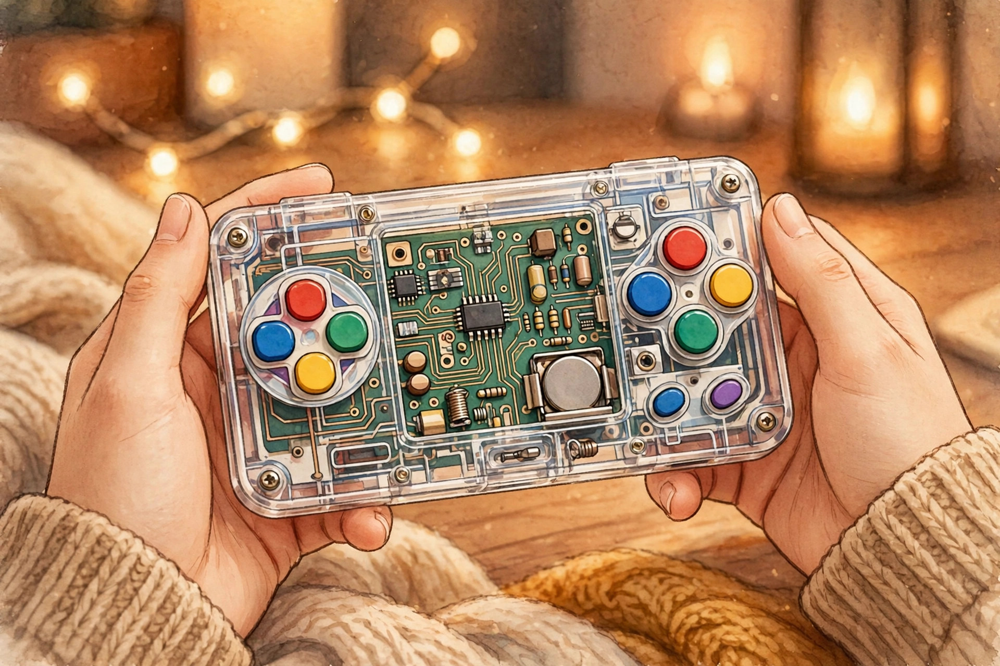
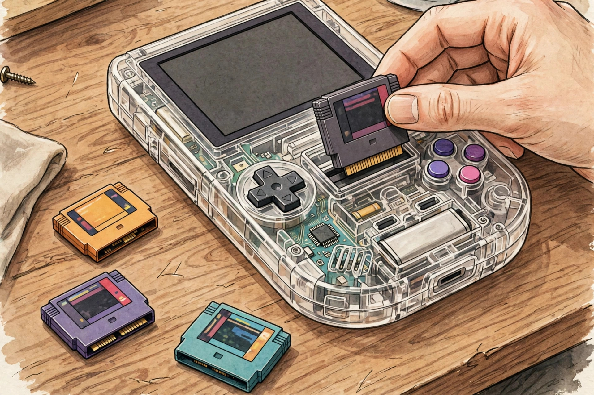
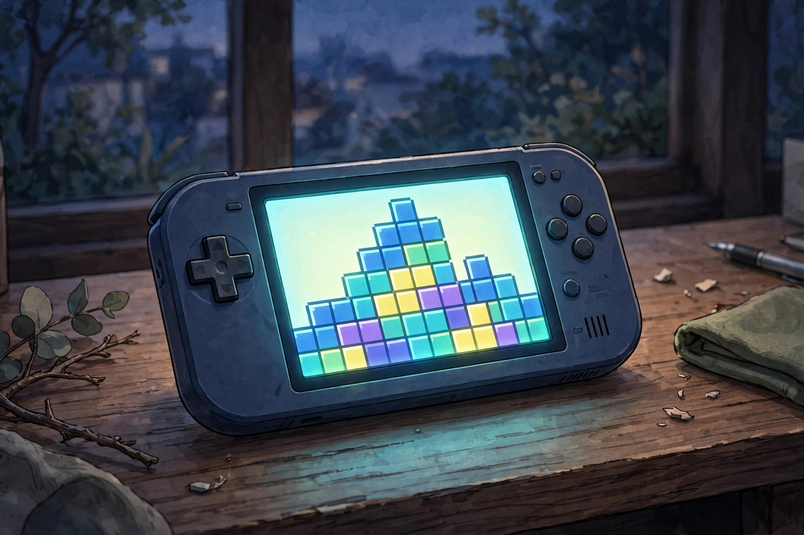

<!-- 본문 시작 -->

If you still own Game Boy cartridges in a drawer, this handheld is hard to ignore. The ModRetro Chromatic Transparent Edition, released on 2026-10-08, is a portable game console you can see through. It costs 149.99 USD, 50 USD less than the magnesium-body version (checked 2026-11-01). What became transparent is not just the shell, but the price barrier as well.

> 핵심 한 줄
>
> ### **A console you load with cartridges — what became transparent is the shell, and the price too**

The images in this post are AI illustrations, not actual product photos. (Illustration)

## What it is

The Chromatic is a handheld that plays original Game Boy and Game Boy Color cartridges as they are. It does not use software emulation; it recreates the old hardware's behavior with FPGA hardware. In simple terms, it runs old games in a way close to how they were made to run. The screen is a 2.56-inch IPS backlit LCD at 160×144 — the same resolution as the original — so old games appear at their original proportions, neither stretched nor squashed.

The Transparent Edition changes only the shell material. Transparent plastic replaces the magnesium alloy, so the circuit board shows through and the unit is lighter. It comes in four colors — Smoke, Green, Purple, and Red — with a Tetris cartridge and three AA batteries in the box (checked 2026-11-01, based on independent reviews).

## What stayed the same, and what changed

The screen, buttons, cartridge compatibility, and USB-C video output are the same as the existing version. What changed is the material, the price, and the character of its durability. Reviews judge the transparent plastic as more scratch-prone and less durable long-term than magnesium, but lighter and more comfortable to hold for long sessions. The transparent case is also designed to come apart, which adds to the tinkering appeal.

| Item | Transparent Edition | Magnesium-body version |
| --- | --- | --- |
| Price | 149.99 USD | 199.99 USD for the bundle |
| Shell material | Transparent plastic | Magnesium alloy |
| Screen | 2.56-inch IPS backlit LCD, 160×144 | Same |
| Cartridges | Game Boy, Game Boy Color, Chromatic | Same |
| Power | 3 AA batteries; rechargeable pack sold separately | Same |
| Size and weight | 5.2×3×1.2 inches, about 6.2 oz | Same size, heavier |
| In the box | Tetris cartridge, 3 AA batteries | Tetris cartridge included |

## Three conditions to check before buying

First, the cartridges. This console is for Game Boy and Game Boy Color cartridges only. Game Boy Advance cartridges do not fit. If your collection is Advance cartridges, this is not the console for you. New games cost extra too: ModRetro's new cartridges start at 39.99 USD on the official store.

Second, power. The default power source is three AA batteries. A rechargeable pack is sold separately, so avoiding disposable batteries means extra cost. The USB-C port also handles video output to a PC or Mac and firmware updates.

Third, expectations. This is not a download console. The point is collecting cartridges and the feel of sliding one in. If you buy it expecting to carry thousands of games at once like a phone emulator, you will be disappointed. If you want to replay cartridges you already own at their original screen proportions, that simplicity is the advantage.

Without a cartridge there is no game. That simplicity is this product's condition. (Illustration)

## Price and availability

The price is confirmed at 149.99 USD in the US and 139.99 GBP in the UK (checked 2026-11-01). Official availability and pricing for Korea are unconfirmed, so overseas buyers should factor in shipping and customs. If you already own the magnesium version, reviews advise that there is little reason to buy again unless the transparent colors themselves are the goal. For a first-time buyer, the 50 USD lower entry price is the biggest change.

The screen keeps the original resolution, so old games are not stretched. (Illustration)

## My judgment

The Chromatic Transparent Edition fits someone who wants to pull Game Boy cartridges out of a drawer again, or who wants to enjoy old games on real cartridges rather than an emulator. The transparent shell is a pleasure to look at, but the purchase still comes down to cartridges and the quality of the FPGA recreation. If you own no cartridges, start with the included Tetris and budget for the next cartridge's price as part of the total.

## 함께 보면 좋은 글

[It looked like a mini computer, but it is a speaker — Divoom Astrotoo, a small terminal for your desk](https://aitechnotesen.wordpress.com/2026/10/31/it-looked-like-a-mini-computer-but-it-is-a-speaker-divoom-astrotoo-a-small-terminal-for-your-desk/)
A speaker that looks like a small desk terminal, explained.

[Will 25W wireless charging work with my iPhone? — What to check before buying the UGREEN MagFlow Pro](https://aitechnotesen.wordpress.com/2026/10/31/will-25w-wireless-charging-work-with-my-iphone-what-to-check-before-buying-the-ugreen-magflow-pro/)
The charging conditions you miss if you buy on the number alone.

[Stop digging through your bag — MagQuick, a strap that snaps on and pulls off](https://aitechnotesen.wordpress.com/2026/10/25/stop-digging-through-your-bag-magquick-a-strap-that-snaps-on-and-pulls-off/)
A strap that detaches with a pull and attaches with a touch, explained.

## Sources

- [ModRetro official site](https://modretro.com/)
- [TechRadar, two weeks with the ModRetro Chromatic Transparent](https://www.techradar.com/gaming/two-weeks-with-the-new-modretro-chromatic-transparent-im-loving-this-slick-modern-way-to-play-classic-game-boy-games)
- [The Shortcut, ModRetro Chromatic Transparent review](https://www.theshortcut.com/p/modretro-chromatic-transparent-review)
- [Yanko Design, ModRetro's transparent Chromatic](https://www.yankodesign.com/2026/10/09/modretros-149-handheld-has-nothing-to-hide-including-its-circuits/)

<!-- 본문 끝 -->
