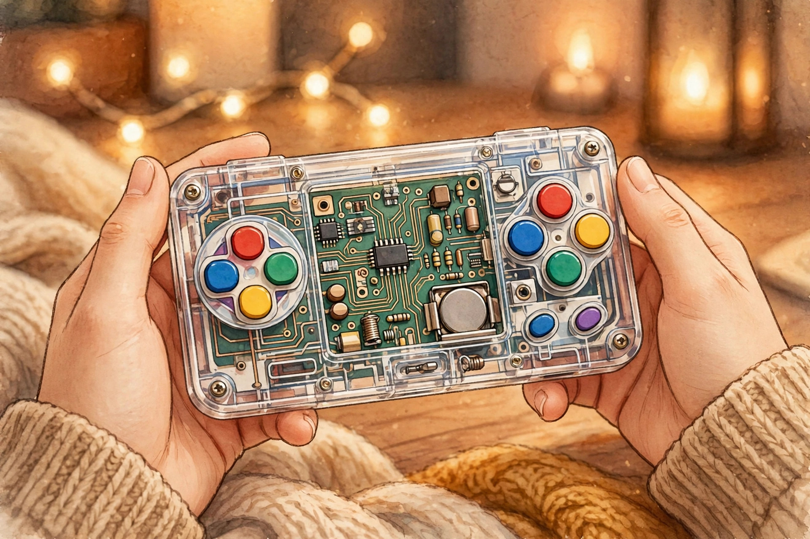
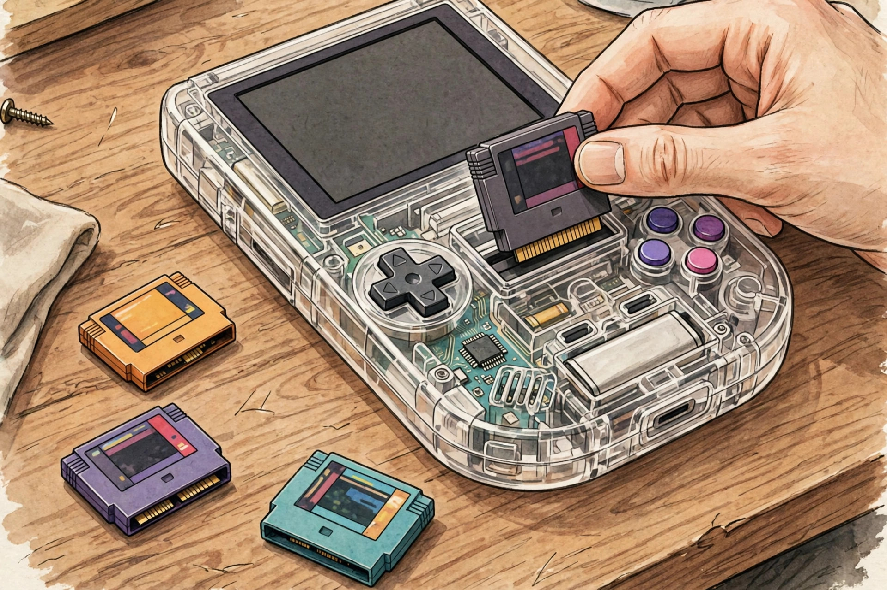
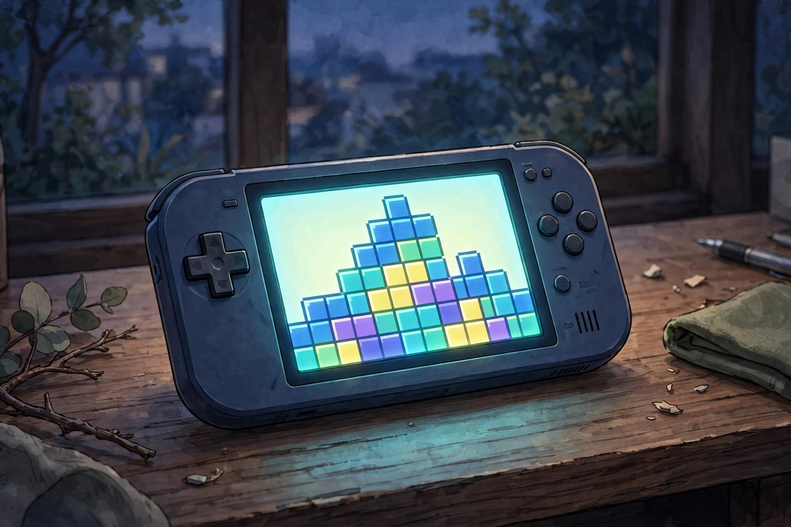

<!-- 본문 시작 -->

서랍 속 게임보이 카트리지를 아직 갖고 있다면, 이 게임기는 눈에 들어올 수밖에 없습니다. ModRetro Chromatic 투명 에디션은 2026년 10월 8일에 나온, 속이 훤히 보이는 휴대용 게임기입니다. 가격은 149.99달러로, 마그네슘 본체 버전보다 50달러 저렴합니다(확인일 2026년 11월 1일). 겉만 투명한 것이 아니라, 가격 장벽까지 낮춘 버전입니다.

> 핵심 한 줄
>
> ### **카트리지를 꽂는 게임기, 투명해진 건 껍데기뿐 아니라 가격도 마찬가지다**

이 글의 이미지는 실제 제품 사진이 아니라 AI 일러스트입니다. (일러스트)

## 이 제품은 무엇인가

Chromatic은 게임보이와 게임보이 컬러 카트리지를 그대로 꽂아 즐기는 휴대용 게임기입니다. 에뮬레이션(소프트웨어 모방)이 아니라 FPGA라는 하드웨어 방식으로 옛 게임기의 동작을 재현합니다. 쉽게 말하면, 옛날 게임이 만들어진 방식에 가깝게 돌리는 것입니다. 화면은 원본과 같은 160×144 해상도의 2.56인치 IPS 백라이트 LCD라서, 옛날 게임이 늘어나거나 뭉개지지 않고 원래 비율로 보입니다.

투명 에디션은 본체 소재만 바꿨습니다. 마그네슘 합금 대신 투명 플라스틱을 써서 회로 기판이 보이고, 무게도 가벼워졌습니다. 색상은 스모크·그린·퍼플·레드 네 가지이고, 테트리스 카트리지와 AA 배터리 3개가 함께 들어 있습니다(확인일 2026년 11월 1일, 독립 리뷰 기준).

## 무엇이 같고, 무엇이 달라졌나

화면·버튼·카트리지 호환·USB-C 영상 출력은 기존 버전과 같습니다. 달라진 것은 소재와 가격, 그리고 내구성의 성격입니다. 리뷰에서는 투명 플라스틱이 마그네슘보다 긁힘에 약하고 장기 내구성은 떨어지지만, 가벼워서 오래 들고 하기 편하다고 평가합니다. 투명 케이스가 분해가 가능하게 설계돼 있어 부품을 바꾸는 재미도 있다고 합니다.

| 항목 | 투명 에디션 | 마그네슘 본체 버전 |
| --- | --- | --- |
| 가격 | 149.99달러 | 번들 기준 199.99달러 |
| 본체 소재 | 투명 플라스틱 | 마그네슘 합금 |
| 화면 | 2.56인치 IPS 백라이트 LCD, 160×144 | 동일 |
| 카트리지 | 게임보이·게임보이 컬러·Chromatic | 동일 |
| 전원 | AA 배터리 3개, 충전 팩 별도 | 동일 |
| 크기·무게 | 5.2×3×1.2인치, 약 6.2oz | 동일 크기, 더 무겁다 |
| 구성품 | 테트리스 카트리지, AA 배터리 3개 | 테트리스 카트리지 포함 |

## 사기 전에 확인할 조건 세 가지

첫째, 카트리지입니다. 이 게임기는 게임보이와 게임보이 컬러 카트리지 전용입니다. 게임보이 어드밴스 카트리지는 꽂을 수 없습니다. 갖고 있는 카트리지가 어드밴스용이라면 이 게임기는 선택지가 아닙니다. 새로 살 게임도 별도 비용입니다. ModRetro의 신규 카트리지는 공식 페이지 기준 39.99달러부터 팔리고 있습니다.

둘째, 전원입니다. 기본 전원은 AA 배터리 3개입니다. 충전식 팩은 별도 구매품이라, 건전지 생활을 피하려면 추가 비용을 계산해야 합니다. USB-C 포트는 충전뿐 아니라 PC·Mac으로의 영상 출력과 펌웨어 업데이트에도 쓰입니다.

셋째, 기대치입니다. 이 게임기는 다운로드 게임기가 아닙니다. 게임을 사 모으는 재미, 카트리지를 꽂는 감각이 본질입니다. 스마트폰 에뮬레이터처럼 수천 개 게임을 한 번에 담는 용도로 산다면 실망할 수 있습니다. 반대로 이미 카트리지를 갖고 있거나, 옛날 게임을 원래 화면 비율로 즐기고 싶은 사람에게는 이 단순함이 장점입니다.

카트리지가 있어야 게임이 시작된다. 그 단순함이 이 제품의 조건이다. (일러스트)

## 가격과 국내 이용

가격은 미국 기준 149.99달러, 영국 기준 139.99파운드로 확인됐습니다(확인일 2026년 11월 1일). 국내 정식 판매 여부와 가격은 미확인이라, 해외 구매 시 배송비와 관세를 함께 따져야 합니다. 이미 마그네슘 버전을 갖고 있다면, 리뷰의 조언대로 투명 색상 자체가 목적이 아니라면 새로 살 이유는 약합니다. 처음 사는 사람에게는 50달러 낮아진 진입 가격이 가장 큰 변화입니다.

화면은 원본 해상도 그대로라 옛 게임이 늘어나지 않는다. (일러스트)

## 나의 판단

Chromatic 투명 에디션이 어울리는 사람은 서랍 속 게임보이 카트리지를 다시 꺼내고 싶은 사람, 에뮬레이터가 아니라 실물 카트리지로 옛 게임을 즐기고 싶은 사람입니다. 투명한 껍데기는 그 자체로 구경거리지만, 구매의 본질은 여전히 카트리지와 FPGA 방식의 재현 품질에 있습니다. 카트리지가 하나도 없다면 테트리스 하나로 시작해, 다음 카트리지를 살 때의 가격까지 포함해 예산을 잡는 것이 좋습니다.

## 함께 보면 좋은 글

[미니 컴퓨터인 줄 알았는데 스피커였다 — Divoom Astrotoo, 책상 위 작은 단말기](https://blog.naver.com/3700708/224459774397)
책상 위 작은 단말기처럼 보이는 스피커를 정리한 글입니다.

[25W 무선 충전, 내 아이폰은 될까 — UGREEN MagFlow Pro 사기 전에 확인할 조건](https://blog.naver.com/3700708/224459774053)
숫자만 보고 사면 놓치는 충전 조건을 정리한 글입니다.

[코딩 몰라도 AI에게 일을 맡기는 법｜GPT 코덱스·어사이드 설치 활용 총정리](https://blog.naver.com/3700708/224452773983)
코딩 없이 AI 도구를 설치해 일을 맡기는 방법을 정리한 AI 뉴스 글입니다.

## 출처

- [ModRetro 공식 사이트](https://modretro.com/)
- [TechRadar, ModRetro Chromatic Transparent 2주 사용기](https://www.techradar.com/gaming/two-weeks-with-the-new-modretro-chromatic-transparent-im-loving-this-slick-modern-way-to-play-classic-game-boy-games)
- [The Shortcut, ModRetro Chromatic Transparent 리뷰](https://www.theshortcut.com/p/modretro-chromatic-transparent-review)
- [Yanko Design, ModRetro 투명 Chromatic 소개](https://www.yankodesign.com/2026/10/09/modretros-149-handheld-has-nothing-to-hide-including-its-circuits/)

<!-- 본문 끝 -->
