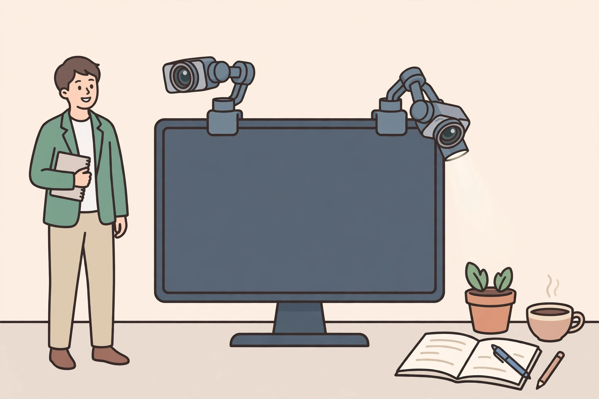

<!-- 본문 시작 -->

움직이는 나를 따라오는 웹캠 — Insta360 Link 2 vs OBSBOT Tiny 2, 사기 전에 확인할 조건

가만히 앉아 있지 않는 사람에게 고정 웹캠은 답답하다. 서서 설명하거나 방 안을 오가며 보여줄 때 카메라는 따라와야 한다. Insta360 Link 2와 OBSBOT Tiny 2, Tiny 2 Lite는 모두 짐벌 4K 웹캠이다. 센서·가격·소프트웨어 조건이 달라 확인할 조건도 다르다. 직접 후기가 아닌 자료 대조 글이다.

## 두 제품의 정체

공식 스펙 기준(2026-11-02 확인)으로 Link 2는 1/2인치 CMOS, Tiny 2는 더 큰 1/1.5인치 CMOS이며 둘 다 4K 30fps·1080p 60fps다. 제조사에 따르면 Tiny 2의 큰 센서는 더 넓은 다이내믹 레인지와 자연스러운 색을 노린다. Lite는 Link 2와 같은 1/2인치 CMOS다.

관찰 포인트는 렌즈가 사람을 따라 돌아가는 범위다. (일러스트)

## 흥미로운 특징 세 가지

첫째, 추적 방식이다. Link 2는 추적 범위 펜스, 화이트보드 보정 모드, 데스크뷰를 갖췄다. Tiny 2는 추적 중 줌을 자동 조절하고 손·구역 추적을 지원한다.

둘째, 프라이버시다. Link 2는 무활동 10초 뒤 렌즈가 숙여지고, OBSBOT 계열은 슬립 모드로 화면을 가린다.

셋째, 소프트웨어다. 고급 기능은 Link 2의 Link Controller, Tiny 2 계열의 OBSBOT Center에서 설정한다. 기본 웹캠은 꽂기만 해도 되지만 추적·제스처·배경 효과에는 설치가 필수다. 요구 사양은 Link 2가 Win 10·macOS 10.13 이상, Tiny 2 계열이 Win 10·macOS 11 이상이다. 계정 필수 여부는 미확인이다.

> 사기 전에 센서 크기보다 먼저 물을 것
>
> ### **4K 해상도는 같아도, 내 회의 앱이 4K를 쓸 수 있는지가 먼저다**

## 아쉬운 점과 확인할 점

독립 리뷰들은 AI 기능이 늘 일정하지 않다고 공통적으로 지적한다. Link 2 리뷰는 추적과 자동 화이트밸런스·노출이 간헐적으로 불안정하다고 전했고, Tiny 2 Lite 리뷰는 제스처 인식이 느리고 간헐적으로 빗나간다고 전했다. 대부분 회의 앱은 1080p까지만 지원해 4K는 녹화·방송용으로 남는 경우가 많다. Link 2는 USB-C 2.0, Tiny 2는 USB 3.0, Lite의 USB 버전은 공식 스펙 발췌에서 확인하지 못했다. Tiny 2의 4K 뷰티·배경 효과에는 Win RTX 2060 이상 또는 Mac M1 이상이 필요하다.

관찰 포인트는 추적 범위와 보드 보정 여부다. (일러스트)

## 제품 핵심 정보표

| 항목 | 확인 내용 |
|---|---|
| 센서·해상도 | Link 2·Lite: 1/2인치. Tiny 2: 1/1.5인치. 모두 4K 30fps / 1080p 60fps |
| 추적·기능 | 모두 2축 짐벌. Link 2: 펜스·화이트보드·데스크뷰. Tiny 2: 자동 줌·손·구역 추적. Lite: 자동 줌·제스처 2.0 |
| 연결·소프트웨어 | Link 2: USB-C 2.0, Link Controller. Tiny 2: USB 3.0, OBSBOT Center. Lite: USB-C(USB 버전 미확인), OBSBOT Center. 계정 여부는 미확인 |
| 가격(2026-11-02) | Link 2: 199.99달러. Tiny 2: 299달러. Lite: 159달러. 국내 공식가는 미확인 |

## 가격과 국내 이용

Link 2는 미국 판매처 기준 199.99달러, Tiny 2는 공식 스토어 기준 299달러, Lite는 공식 스토어 기준 159달러다. 지역·프로모션에 따라 달라지므로 결제 전 최종 가격을 다시 확인해야 한다. 국내에서는 Tiny 2 Lite의 쿠팡 판매가 확인되고 기사 기준 최저가는 269,000원이다. Link 2의 국내 공식 가격과 Tiny 2(비 Lite)의 국내 판매가는 확인되지 않았고, 직구 대행 사례로 Link 2가 관세·세금 포함 527,290원에 표기됐다. 국내 A/S 조건도 미확인이다. 2026년 발표된 Link 2 Pro·Link 2C Pro는 별개 신모델이다.

관찰 포인트는 센서보다 먼저 확인할 조건이다. (일러스트)

## 판단

화이트보드를 자주 쓴다면 Link 2가, 이동이 많은 방송이라면 Tiny 2의 자동 줌과 큰 센서가, 예산을 낮추면서 짐벌 추적을 원한다면 Tiny 2 Lite가 먼저 후보에 오른다. 앉아서만 회의하고 4K 녹화를 하지 않는다면 세 제품 모두 과하다. 사기 전 목록은 회의 앱 해상도, 컴퓨터 사양, USB 포트·조명, 국내 판매·A/S 조건이다.

## 출처

- Insta360 Link 2 스펙·가격: [B&H Link 2 제품 페이지](https://www.bhphotovideo.com/c/product/1935560-REG/insta360_cinsabnb_link210_link_2_standard_edition.html)
- Insta360 Link 2 공식 스토어·Link Controller 안내: [Insta360 공식 스토어 Link 2](https://store.insta360.com/product/link-2?c=6241&freelist=meta)
- OBSBOT Tiny 2 공식 스펙: [OBSBOT Tiny 2 Tech Specs](https://www.obsbot.com/obsbot-tiny-2-4k-webcam/specs)
- OBSBOT Tiny 2 Lite 공식 스펙: [OBSBOT Tiny 2 Lite Tech Specs](https://www.OBSBOT.com/obsbot-tiny-2-lite-4k-webcam/specs)
- OBSBOT Tiny 2 Lite 독립 리뷰: [PC Gamer Tiny 2 Lite 리뷰](http://pcgamer.com/hardware/webcams/obsbot-tiny-2-lite-review/)
- Link 2 독립 리뷰: [Windows Central Link 2 리뷰](https://www.windowscentral.com/accessories/insta360-link-2-review)
- Tiny 2 Lite 국내 판매·가격 기사: [재경일보 화상회의 카메라 추천](https://news.jkn.co.kr/post/1021185)

## 함께 보면 좋은 글

- [속이 보이는 게임기 — 투명 플라스틱 ModRetro Chromatic, 사기 전에 확인할 조건](https://blog.naver.com/3700708/224460771791) — 투명 플라스틱 게임기의 조건을 정리한 글.
- [3S가 있는데 굳이 갈아탈까 — MX Master 4 사기 전에 확인할 조건](https://blog.naver.com/3700708/224460771424) — 전작 사용자를 위한 교체 판단 기준 글.
- [AI 브라우저 티어표로 고르기｜읽어주는 브라우저와 대신 클릭하는 브라우저는 다르다](https://blog.naver.com/3700708/224460771206) — AI 브라우저를 용도별로 가르는 기준 글.

<!-- 본문 끝 -->
