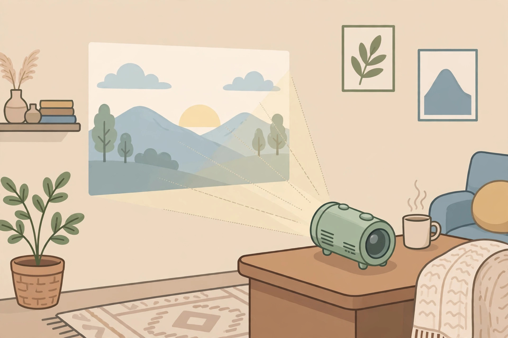
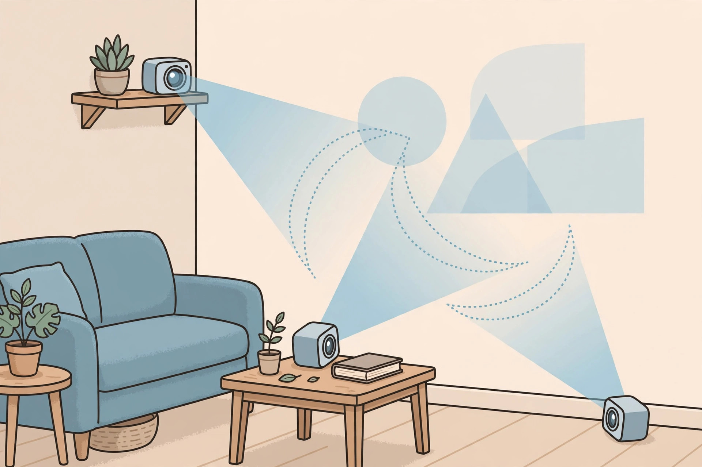
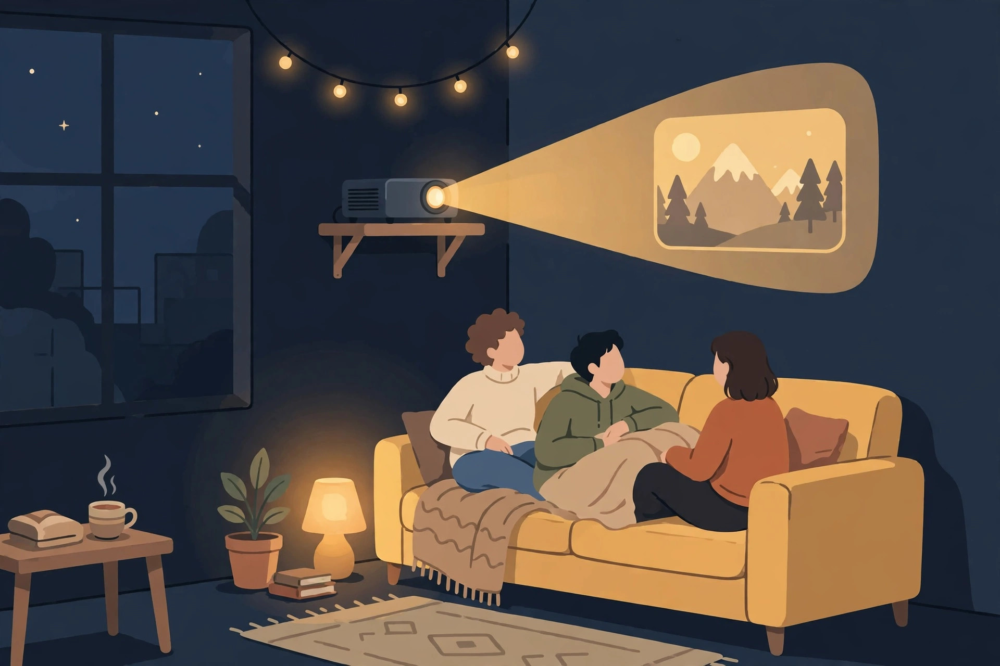

<!-- 본문 시작 -->

A tumbler on your desk becomes a 120-inch screen — what to check before buying the XGIMI MoGo 4

No room for a TV, but sometimes you want a movie filling the wall. The tumbler-sized XGIMI MoGo 4 catches the eye in that moment. This is not a hands-on review; it is a pre-purchase check comparing official materials with independent reviews.

Brightness varies greatly by mode, so decide which mode you will watch in first. (Illustration)

## Tumbler size, but not a TV

The MoGo 4 is an LED DLP projector. According to the manufacturer, it offers 1920×1080 resolution, 450 ISO lumens, and a 40–200-inch screen (60–120 inches recommended) (official product page, checked 2026-11-02). At 207.6×96.5×96.5mm and 1.31kg, it is bag-sized, not pocket-sized.

> The test of portability is not size, but power
>
> ### **With a battery, any room can become that day's cinema**

The battery is 71.28Wh. According to the manufacturer, it lasts up to 2.5 hours for video in Eco mode and up to 6 hours for music (official product page, checked 2026-11-02). One long film is tight, and combined with the separately sold PowerBase stand it reaches up to 5 hours.

## Three interesting points

First, you can watch as soon as you turn it on. Built-in Google TV and licensed Netflix support mean no extra stick is needed, and it has HDMI (ARC), USB, USB-C, Wi-Fi 5, and Bluetooth 5.1. Second, setup is easy, with auto focus, auto keystone correction, and a 360-degree stand. Third, with 2×6W Harman Kardon speakers, a Sunset filter, and Ambient mode, it doubles as a mood light and speaker when no film is playing.

Decide viewing distance and screen size before the angle. (Illustration)

## Drawbacks: check before buying

Brightness comes first. The 450 ISO lumens figure is an official lab, Performance-mode value. ProjectorCentral measured about 400 lumens in Performance mode, about 258 lumens in Standard, and about 151 lumens in Eco. In a bright room sharpness may fall short, so a dark room and nighttime viewing are the premise. Second, mirroring. The same review reported pixelation and skipped frames when mirroring document and image screens. For work use, treat a wired HDMI connection as the default. Third, do not confuse the models. The MoGo 4 Laser is a different product with triple lasers and 550 ISO lumens, so check whether yours is the LED base model.

| Item | Details |
|---|---|
| Light source, resolution | LED DLP, 1920×1080 |
| Brightness | 450 ISO lumens (manufacturer measurement) |
| Battery | 71.28Wh, video up to 2.5 hours (Eco), music up to 6 hours |
| Speakers, OS | 2×6W Harman Kardon, Google TV |
| Connectivity | HDMI (ARC), USB, USB-C, Wi-Fi 5, Bluetooth 5.1 |
| Size, weight | 207.6×96.5×96.5mm, 1.31kg |
| Official price and sales in Korea | Not confirmed |

## Price and buying in Korea

Prices vary by region and timing. As checked on 2026-11-02, the official US page listed the single unit at $399 and the official EU page at €539. Launch prices were reported at about $499 in the US and €599 in Europe. Compare the final price at checkout and what is included, rather than the list price. The official price and warranty terms in Korea were not confirmed in this research, so they are marked 'Not confirmed'. Check official distribution, warranty, and return routes first, and for direct overseas purchase, compare the total cost including customs, shipping, and voltage.

For nighttime viewing, blackout curtains and viewing distance come before screen size. (Illustration)

## Verdict

This product is persuasive not as a 'TV replacement' but as a 'second screen, a screen you carry'. It is worth considering for a nighttime film in a small room, a camping screening, or a mood light and speaker. It does not fit daily TV-style use in a bright living room or mirroring for work. If a dark room, one film's worth of battery, the LED base model, and a warranty route in Korea are all 'yes', it is likely to earn its place on your desk.

## Sources

- [XGIMI MoGo 4 official page (US)](https://us.xgimi.com/products/mogo-4) (2026-11-02)
- [XGIMI MoGo 4 official page (EU)](https://eu.xgimi.com/products/mogo-4) (2026-11-02)
- [ProjectorCentral MoGo 4 review](https://www.projectorcentral.com/xgimi-mogo-4-1080p-smart-portable-projector-review.htm) (2026-11-02)
- [Root-Nation MoGo 4 review](https://root-nation.com/en/pc-en/pc-accessories-en/en-xgimi-mogo-4-exclusive-review/) (2026-11-02)

## You may also like

- [It looked like a mini computer but it is a speaker — Divoom Astrotoo, a small terminal for your desk](https://aitechnotesen.wordpress.com/2026/10/31/it-looked-like-a-mini-computer-but-it-is-a-speaker-divoom-astrotoo-a-small-terminal-for-your-desk/) — A desk gadget that looks like a mini computer but works as a speaker.
- [Will 25W wireless charging work with my iPhone — what to check before buying the UGREEN MagFlow Pro](https://aitechnotesen.wordpress.com/2026/10/31/will-25w-wireless-charging-work-with-my-iphone-what-to-check-before-buying-the-ugreen-magflow-pro/) — The compatibility checks to run before buying a 25W wireless charger.
- [Stop digging through your bag — MagQuick, a strap that snaps on and pulls off](https://aitechnotesen.wordpress.com/2026/10/25/stop-digging-through-your-bag-magquick-a-strap-that-snaps-on-and-pulls-off/) — A strap idea for grabbing what you need without digging through a bag.

<!-- 본문 끝 -->
