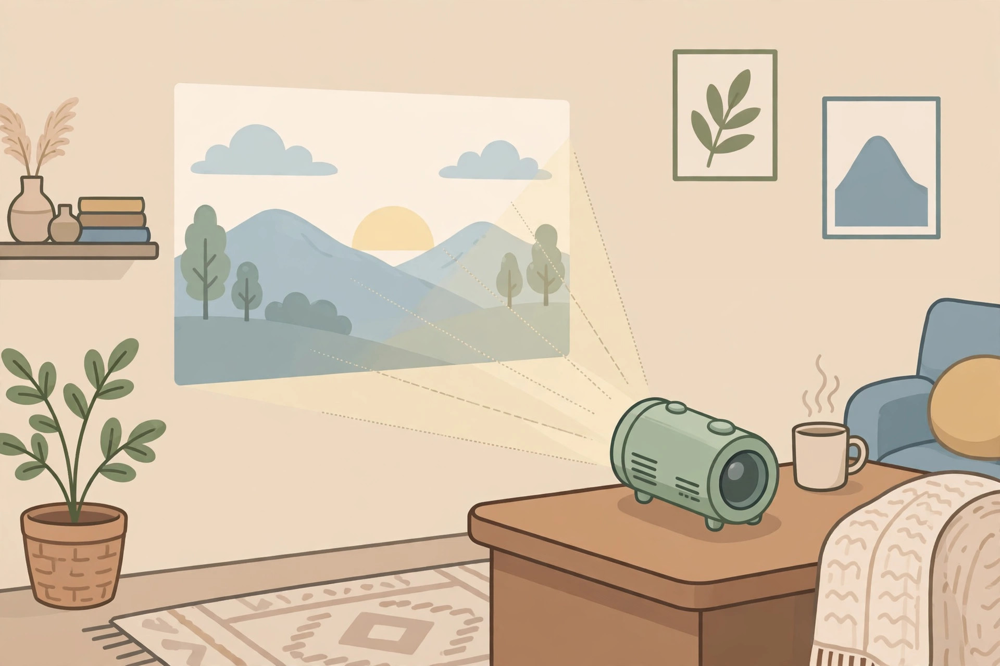
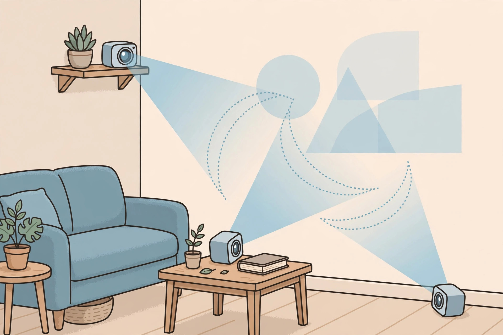
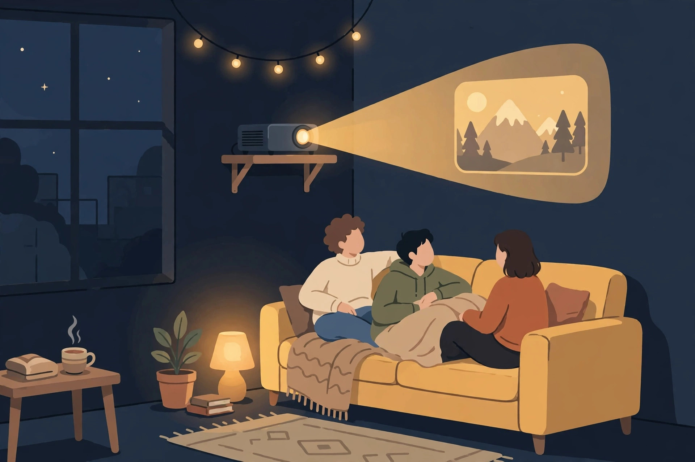

post_id: "2026-11-02-202"
muse_account: "muse-02"
title: "책상 위 텀블러가 120인치 화면이 된다 — XGIMI MoGo 4 사기 전에 확인할 조건"
language: ko
revision: 1
status: ready
action: publish
visibility: public
blog_url: "https://blog.naver.com/3700708"
category: "새로 나온 테크"
tags: ["XGIMI", "MoGo 4", "미니 프로젝터", "휴대용 프로젝터", "빔프로젝터", "구글 TV", "홈시네마", "캠핑", "가성비 가전", "구매 가이드"]
targets: ["naver-ko", "wordpress-ko", "blogger-ko", "tistory-ko"]
cover_image: images/01-hero.jpg
---

<!-- 본문 시작 -->

책상 위 텀블러가 120인치 화면이 된다 — XGIMI MoGo 4 사기 전에 확인할 조건

TV 자리는 없는데 가끔 벽 가득 영화를 보고 싶다면, 텀블러만 한 XGIMI MoGo 4가 눈에 들어온다. 사용 후기가 아니라 공식 자료와 독립 리뷰를 대조한 구매 전 확인 글이다.

밝기는 모드마다 크게 다르니, 볼 모드부터 정하자. (일러스트)

## 텀블러 크기, 그러나 TV는 아니다

MoGo 4는 LED 광원 DLP 프로젝터다. 제조사에 따르면 1920×1080, 450 ISO 루멘, 화면 40~200인치(권장 60~120인치)다(공식 페이지, 2026-11-02 확인). 207.6×96.5×96.5mm, 1.31kg으로 가방용 크기다.

> 휴대용의 기준은 크기가 아니라 전원이다
>
> ### **배터리가 있으면, 그날의 상영관은 어디든 될 수 있다**

배터리는 71.28Wh다. 제조사에 따르면 에코 모드 영상 최대 2.5시간, 음악 최대 6시간이다(공식 페이지, 2026-11-02 확인). 영화 한 편은 간당간당하고, 별도 PowerBase 스탠드와 합치면 최대 5시간까지 늘어난다.

## 흥미로운 점 세 가지

첫째, 구글 TV 내장·라이선스 넷플릭스 지원으로 켜자마자 볼 수 있고, HDMI(ARC)·USB·USB-C·와이파이 5·블루투스 5.1을 갖췄다. 둘째, 자동 초점·키스톤 보정과 360도 스탠드로 설치 부담이 작다. 셋째, 2×6W 하만카돈 스피커와 선셋 필터, 앰비언트 모드로 영화 외 시간에도 무드등 겸 스피커가 된다.

각도보다 시청 거리와 화면 크기를 먼저 정하자. (일러스트)

## 아쉬운 점, 사기 전에 확인할 점

밝기가 첫 번째다. 450 ISO 루멘은 공식 실험실·성능 모드 기준이다. ProjectorCentral 실측은 성능 모드 약 400루멘, 스탠더드 약 258루멘, 에코 약 151루멘이었다. 밝은 방에선 선명도가 떨어질 수 있어 어두운 방·밤 상영이 전제다. 둘째, 미러링이다. 같은 리뷰는 문서·이미지 미러링에서 픽셀화와 프레임 건너뜀이 있었다고 했다. 작업용은 HDMI 유선을 기본으로 삼자. 셋째, MoGo 4 Laser는 트리플 레이저·550 ISO 루멘으로 다른 제품이니 LED 기본형인지 광원을 대조하자.

| 항목 | 내용 |
|---|---|
| 광원·해상도 | LED DLP, 1920×1080 |
| 밝기 | 450 ISO 루멘(제조사 측정값) |
| 배터리 | 71.28Wh, 영상 최대 2.5시간(에코)·음악 최대 6시간 |
| 스피커·OS | 2×6W 하만카돈, 구글 TV |
| 연결 | HDMI(ARC), USB, USB-C, 와이파이 5, 블루투스 5.1 |
| 크기·무게 | 207.6×96.5×96.5mm, 1.31kg |
| 국내 정가·공식 판매 | 미확인 |

## 가격과 국내 이용

가격은 지역·시점에 따라 다르다. 2026-11-02 확인 기준 미국 공식 단품 399달러, 유럽 공식 단품 539유로였다. 출시 정가는 미국 499달러, 유럽 599유로 수준으로 보도됐다. 정가보다 결제 시점 가격과 포함 구성으로 비교하자. 국내 공식 정가·보증은 확인하지 못해 '미확인'이다. 정식 유통·보증·반품 경로를 먼저 확인하고, 직구라면 관세·배송·전압 포함 총비용으로 따지자.

밤 상영이라면 암막 커튼과 시청 거리 확보가 먼저다. (일러스트)

## 판단

이 제품은 'TV 대신'이 아니라 '두 번째 화면, 들고 다니는 화면'으로 볼 때 설득력이 있다. 작은 방 밤 영화, 캠핑 상영회, 무드등 겸 스피커가 목적이라면 후보에 둘 만하다. 밝은 거실에서 매일 TV처럼 쓰거나 미러링 작업용으로는 맞지 않는다. 어두운 방, 영화 한 편 분량 배터리, LED 기본형 여부, 국내 보증 경로가 모두 '예'라면 제 몫을 할 가능성이 크다.

## 출처

- [XGIMI MoGo 4 공식 페이지(미국)](https://us.xgimi.com/products/mogo-4) (2026-11-02)
- [XGIMI MoGo 4 공식 페이지(유럽)](https://eu.xgimi.com/products/mogo-4) (2026-11-02)
- [ProjectorCentral MoGo 4 리뷰](https://www.projectorcentral.com/xgimi-mogo-4-1080p-smart-portable-projector-review.htm) (2026-11-02)
- [Root-Nation MoGo 4 리뷰](https://root-nation.com/en/pc-en/pc-accessories-en/en-xgimi-mogo-4-exclusive-review/) (2026-11-02)

## 함께 보면 좋은 글

- [속이 보이는 게임기 — 투명 플라스틱 ModRetro Chromatic, 사기 전에 확인할 조건](https://blog.naver.com/3700708/224460771791) — 투명 플라스틱 게임기의 조건을 정리한 글.
- [3S가 있는데 굳이 갈아탈까 — MX Master 4 사기 전에 확인할 조건](https://blog.naver.com/3700708/224460771424) — 전작 사용자를 위한 교체 판단 기준 글.
- [AI 브라우저 티어표로 고르기｜읽어주는 브라우저와 대신 클릭하는 브라우저는 다르다](https://blog.naver.com/3700708/224460771206) — AI 브라우저를 용도별로 가르는 기준 글.

<!-- 본문 끝 -->
