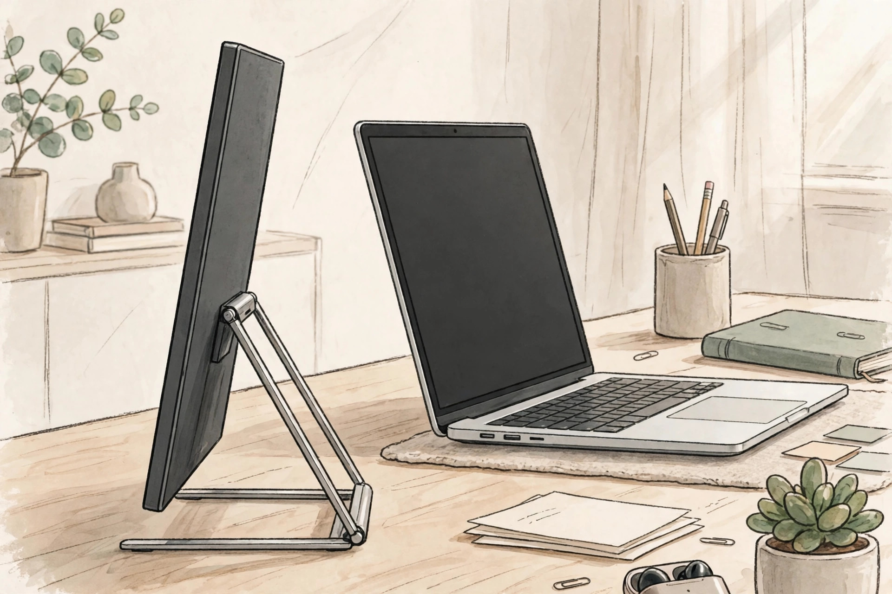
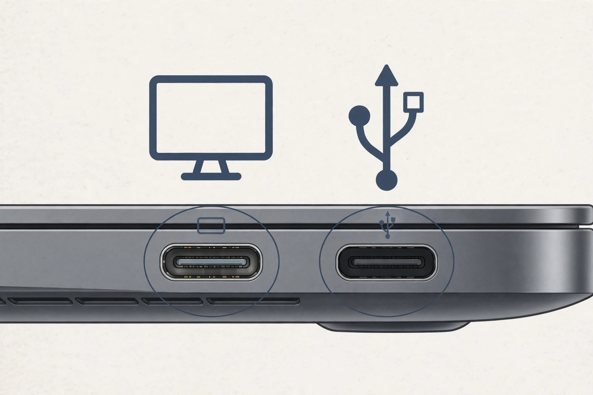
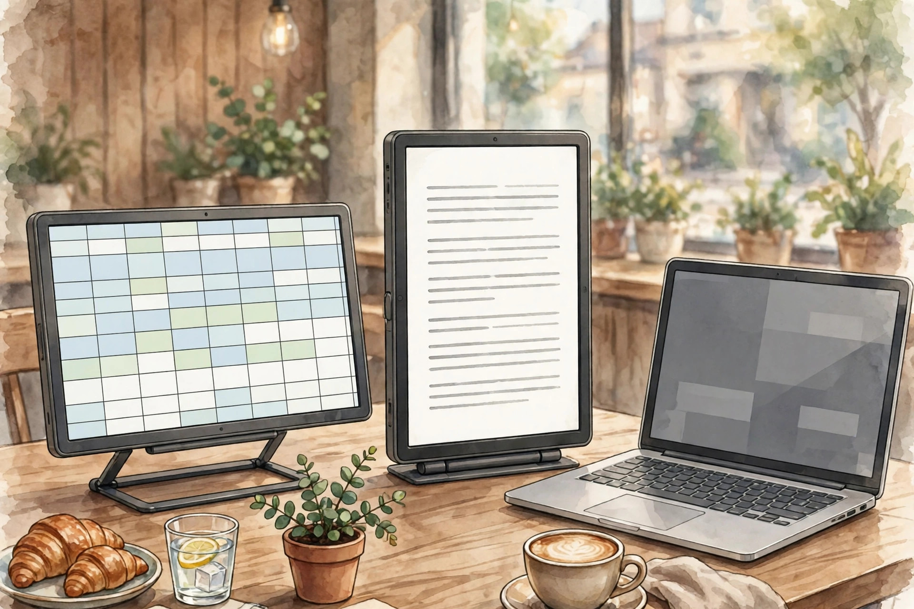

<!-- 본문 시작 -->

One USB-C Cable Is Not Enough? What to Check Before Buying the ASUS ZenScreen MB16AHV

In a cafe or on a business trip, one laptop screen is not enough for moving between documents and reference material. A portable monitor is a second screen that fits in a bag, but it is not a product that works with just any single cable, so the port conditions must be checked before buying. This is not a hands-on review; it is a pre-purchase check based on official materials.

## What This Product Is

The ASUS ZenScreen MB16AHV is a 15.6-inch FHD IPS portable monitor. According to official specifications (checked 2026-11-03), the resolution is 1920×1080, brightness 250 cd/m², contrast ratio 800:1, response time 5 ms (GTG), and refresh rate 60 Hz. It weighs 0.9 kg and is 1.0 cm thick, so it can go into a laptop sleeve, and it stands on a fold-out kickstand. There is no speaker and no height adjustment. Tilt is +15° to +35°, with a 1/4-inch tripod socket.

The observation point is the 1.0 cm thickness and the kickstand. Bag weight matters less than whether it stands stably on a desk. (Illustration)

## Three Interesting Features

First, the single-cable premise and how to test it. The product has two USB-C ports (DP Alt Mode) and one mini HDMI port. If the laptop USB-C port supports video output, one USB-C cable can carry both video and power. But not every USB-C port supports video output. Ports marked with Thunderbolt or DP support video, while ports marked only USB or SS may be data-only. Checking the marking on your own laptop port is the first step in buying this product.

Second, the power condition. When connected by HDMI, power must be supplied through another USB-C port with a power adapter. In other words, plugging in HDMI alone is not enough. Power consumption is listed as under 15 W, and there is no battery item on the official spec sheet, so it is safest to assume an external power source or host charging. The listed accessories are a sleeve, a USB-C cable, a power adapter, and a mini HDMI-to-HDMI adapter, but the domestic configuration is unconfirmed.

Third, its position in comparison. The higher model in the same ZenScreen line, the MB16QHG, offers 2560×1600 resolution, 120 Hz, DisplayHDR 400, and 100% DCI-P3. The MB16AHV is instead the practical choice for documents, spreadsheets, and video viewing. The 262K color figure is not 16.7M, so color-work expectations should be kept low.

> Ask about the port before the cable
>
> ### **Even if USB-C ports look the same, check first whether yours is a video-output port**

## Drawbacks and Things to Check

Auto-rotation switches between landscape and portrait through software called DisplayWidget Center. The official product page note lists both Windows and macOS as supported, but some secondary sources say Windows only, so the markings conflict. The condition that software installation is required is clear. The ion-silver antibacterial treatment on the bezel and back is a manufacturer claim of 99.9% suppression in a third-party test under ISO 22196; since the original test report was not read, it should not be treated as a proven effect. TÜV low-blue-light and flicker-free markings are listed, but the original certificates are unconfirmed.

The observation point is the small marking beside the port. One marking decides whether the screen turns on. (Illustration)

## Price and Availability in Korea

The US ASUS store reference price was 149 USD, shown as InStock as of 2026-11-03. The UK store, however, showed 139 GBP with an OutOfStock marking, so stock and price differ by region. The Korean price, domestic accessories, and domestic warranty and service conditions are unconfirmed. The official spec page also carries a note to check availability conditions with the supplier by region.

| Item | Details |
|---|---|
| Display | 15.6-inch IPS, 1920×1080, 60 Hz |
| Brightness · Color | 250 cd/m², 262K colors |
| Connections | USB-C ×2 (DP Alt Mode), mini HDMI ×1 |
| Size · Weight | 35.8 × 22.5 × 1.0 cm, 0.9 kg |
| Speaker · Height adjustment | None |
| Power | Under 15 W, built-in battery unconfirmed |
| US reference price | 149 USD (checked 2026-11-03; Korean price unconfirmed) |

## The Editor's Judgment

This product suits remote or traveling workers who use documents, spreadsheets, and video calls on a laptop and need a light second screen. It does not suit high-refresh-rate gaming, photo and video work that needs color accuracy, or anyone who wants a built-in speaker. Checking just three things avoids most "it won't turn on" failures: whether the laptop USB-C port supports video, the power plan when using HDMI, and the domestic seller's accessories and warranty conditions.

The observation point is that orientation switching comes with a software condition. Portrait mode is not a plug-and-play feature. (Illustration)

## Related Posts

- [A Tumbler on Your Desk Becomes a 120-Inch Screen — What to Check Before Buying the XGIMI MoGo 4](https://aitechnotesen.wordpress.com/2026/11/02/a-tumbler-on-your-desk-becomes-a-120inch-screen-what-to-check-before-buying-the-xgimi-mogo-4/) — A projector that makes a big screen from a small body, with its brightness and throw conditions explained.
- [A Webcam That Follows You — Insta360 Link 2 vs OBSBOT Tiny 2, What to Check Before Buying](https://aitechnotesen.wordpress.com/2026/11/02/a-webcam-that-follows-you-insta360-link-2-vs-obsbot-tiny-2-what-to-check-before-buying/) — A comparison showing that video-call gear must also be judged by use conditions before specs.
- [Stop Digging Through Your Bag — MagQuick, a Strap That Snaps On and Pulls Off](https://aitechnotesen.wordpress.com/2026/10/25/stop-digging-through-your-bag-magquick-a-strap-that-snaps-on-and-pulls-off/) — A small desk-and-bag gadget judged by how it actually attaches and detaches.

## Sources

- [ASUS ZenScreen MB16AHV Official Specifications](https://www.asus.com/us/displays-desktops/monitors/zenscreen/asus-zenscreen-mb16ahv/techspec/)
- [ASUS ZenScreen MB16AHV Official Product Page](https://www.asus.com/ie/displays-desktops/monitors/zenscreen/asus-zenscreen-mb16ahv/)
- [ASUS ZenScreen MB16QHG Official Product Page](https://www.asus.com/displays-desktops/monitors/zenscreen/asus-zenscreen-mb16qhg/)

<!-- 본문 끝 -->
