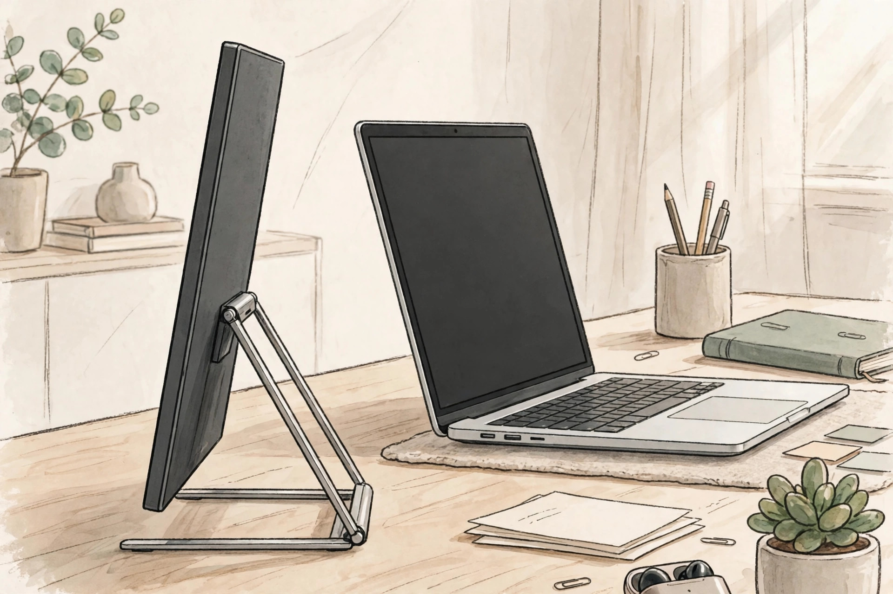
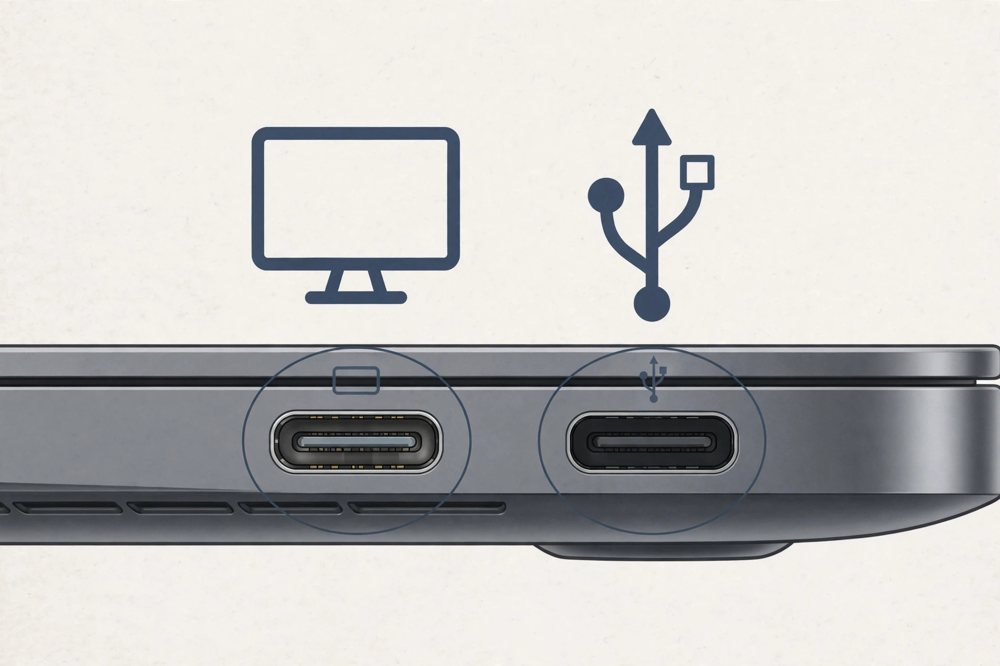
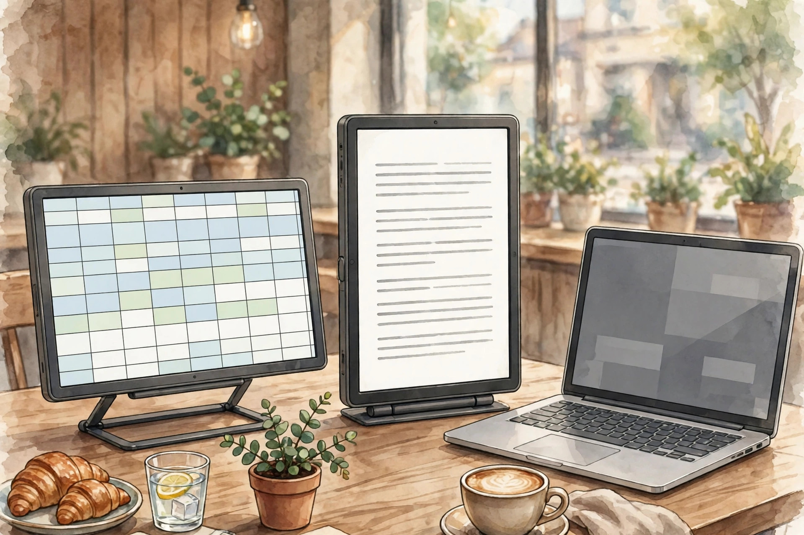

<!-- 본문 시작 -->

USB-C 하나면 다 된다고? ASUS ZenScreen MB16AHV 사기 전에 확인할 조건

카페나 출장지에서 노트북 화면 하나로는 문서와 자료를 오가기 답답하다. 휴대용 모니터는 가방에 들어가는 두 번째 화면이지만, 케이블 하나만으로 다 되는 제품은 아니어서 사기 전에 포트 조건부터 확인해야 한다. 이 글은 직접 사용 후기가 아니라 공식 자료를 대조한 구매 전 확인 글이다.

## 제품의 정체

ASUS ZenScreen MB16AHV는 15.6인치 FHD IPS 휴대용 모니터다. 공식 스펙(2026-11-03 확인) 기준 해상도는 1920×1080, 밝기 250cd/㎡, 명암비 800:1, 응답 속도 5ms(GTG), 주사율 60Hz다. 무게 0.9kg, 두께 1.0cm로 노트북 파우치에 함께 넣을 수 있는 크기이며, 접이식 킥스탠드로 세워 쓴다. 스피커와 높이 조절은 없고, 틸트 +15°~+35°와 삼각대 소켓이 있다.

관찰 포인트는 두께 1.0cm와 킥스탠드 거치 방식이다. 가방 무게보다 책상에서 얼마나 안정적으로 서는지가 실사용을 가른다. (일러스트)

## 흥미로운 특징 세 가지

첫째, 한 케이블 전제와 판별법이다. 이 제품은 USB-C 포트 2개(DP Alt Mode)와 미니 HDMI 포트 1개를 갖췄다. 노트북 USB-C 포트가 영상 출력을 지원하면 USB-C 케이블 하나로 영상과 전원을 함께 보낼 수 있다. 다만 모든 USB-C 포트가 영상 출력을 지원하는 것은 아니다. 썬더볼트나 DP 표시가 있는 포트가 영상 지원 포트이고, USB나 SS 표시만 있는 포트는 데이터 전용일 수 있다. 내 노트북 포트 표시를 먼저 확인하는 것이 이 제품 구매의 첫 번째 관문이다.

둘째, 전원 조건이다. HDMI로 연결할 때는 다른 USB-C 포트에 전원 어댑터를 연결해 전원을 공급해야 한다. 즉 HDMI만 꽂으면 화면이 뜬다고 생각하면 안 된다. 소비전력은 15W 미만으로 표기돼 있고, 내장 배터리 항목은 공식 스펙표에 없어 외부 전원이나 호스트 급전을 전제로 보는 것이 안전하다. 구성품에는 슬리브와 케이블, 전원 어댑터, 미니 HDMI 어댑터가 포함된다고 안내돼 있으나 국내 구성은 미확인이다.

셋째, 비교로 보는 위치다. 같은 ZenScreen 라인업의 MB16QHG는 2560×1600 해상도에 120Hz, DisplayHDR 400, 100% DCI-P3를 갖춘 상위 모델이다. MB16AHV는 그 대신 문서와 스프레드시트, 영상 시청 중심의 실용형 자리다. 262K 색상 표기는 16.7M이 아니므로 색 작업 기대는 낮춰야 한다.

> 사기 전에 케이블부터 물을 것
>
> ### **USB-C 포트 모양이 같아도, 영상 출력 포트인지부터 확인하라**

## 아쉬운 점과 확인할 점

자동 회전은 DisplayWidget Center라는 소프트웨어로 가로와 세로를 전환한다. 공식 제품 페이지 주석은 Windows와 macOS 모두 지원으로 표기하지만, 일부 2차 자료는 Windows 전용으로 적어 표기가 엇갈린다. 소프트웨어 설치가 필요하다는 조건 자체는 분명하므로, 설치 없이 세로 모드를 기대하면 안 된다. 베젤과 후면의 이온 실버 항균 처리는 ISO 22196 기준 제3자 시험 99.9% 억제라는 제조사 주장으로만 받아들인다. TÜV 저블루라이트와 플리커프리 표기가 있으나 인증서 원문은 미확인이다.

관찰 포인트는 포트 옆 작은 표시다. 표시 하나가 화면이 뜨는지 마는지 가른다. (일러스트)

## 가격과 국내 이용

미국 ASUS 스토어 참고가는 149 USD로 2026-11-03 확인 기준 InStock 표기였다. 영국 스토어에서는 139 GBP·OutOfStock 표기가 공존한다. 한국 판매가와 국내 구성품, 국내 보증과 AS 조건은 미확인이다. 공식 스펙 페이지에도 지역별 제공 조건 확인 주석이 있다.

| 항목 | 내용 |
|---|---|
| 화면 | 15.6인치 IPS, 1920×1080, 60Hz |
| 밝기·색상 | 250cd/㎡, 262K 색상 |
| 연결 | USB-C×2(DP Alt Mode), 미니 HDMI×1 |
| 크기·무게 | 35.8×22.5×1.0cm, 0.9kg |
| 스피커·높이 조절 | 없음 |
| 전원 | 15W 미만, 내장 배터리 미확인 |
| 미국 참고가 | 149 USD (2026-11-03 확인, 한국 가격 미확인) |

## 에디터의 판단

이 제품은 노트북으로 문서와 표, 화상회의를 많이 하고 가벼운 두 번째 화면이 필요한 재택이나 출장 근무자에게 맞는다. 반대로 고주사율 게임이나 색 정확도가 중요한 작업, 스피커 내장 일체형을 원하는 사람에게는 맞지 않는다. 포트 영상 지원 여부, HDMI 사용 시 전원 계획, 국내 판매처의 구성품과 보증 조건만 확인해도 "안 뜬다"는 실패의 대부분은 피할 수 있다.

관찰 포인트는 방향 전환이 소프트웨어 조건과 함께 이뤄진다는 점이다. 세로 모드는 꽂기만 해서 되는 기능이 아니다. (일러스트)

## 함께 보면 좋은 글

- [책상 위 텀블러가 120인치 화면이 된다 — XGIMI MoGo 4 사기 전에 확인할 조건](https://blog.naver.com/3700708/224461782781) — 작은 본체로 큰 화면을 만드는 프로젝터의 밝기·투사 조건을 정리한 글이다.
- [움직이는 나를 따라오는 웹캠 — Insta360 Link 2 vs OBSBOT Tiny 2, 사기 전에 확인할 조건](https://blog.naver.com/3700708/224461782434) — 화상회의 장비도 스펙보다 사용 조건부터 따져야 한다는 비교 글이다.
- [AI 브라우저 티어표로 고르기｜읽어주는 브라우저와 대신 클릭하는 브라우저는 다르다](https://blog.naver.com/3700708/224460771206) — 같은 이름이라도 실제로 하는 일이 다른 도구를 구분하는 기준을 정리한 글이다.

## 출처

- [ASUS ZenScreen MB16AHV 공식 스펙](https://www.asus.com/us/displays-desktops/monitors/zenscreen/asus-zenscreen-mb16ahv/techspec/)
- [ASUS ZenScreen MB16AHV 공식 제품 페이지](https://www.asus.com/ie/displays-desktops/monitors/zenscreen/asus-zenscreen-mb16ahv/)
- [ASUS ZenScreen MB16QHG 공식 제품 페이지](https://www.asus.com/displays-desktops/monitors/zenscreen/asus-zenscreen-mb16qhg/)

<!-- 본문 끝 -->
