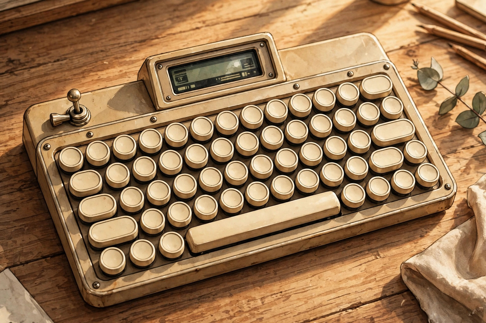
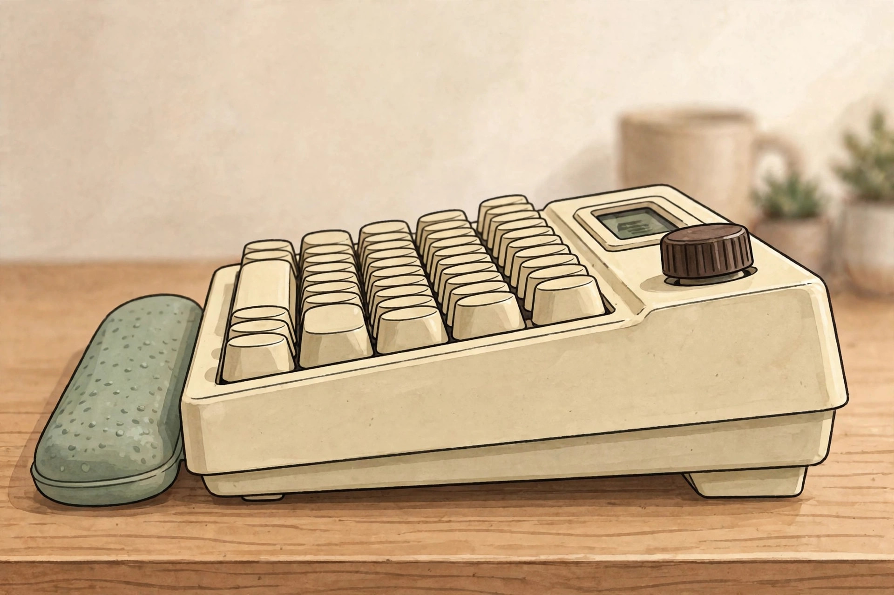

<!-- 본문 시작 -->

A Keyboard Where Lifting a Typewriter Lever Presses Enter — Epomaker Glyph, What to Check Before Buying

The keyboard in the photo has round keycaps and even a typewriter return lever. Yet plug in a cable and it becomes a wireless keyboard, and its display and knob adjust volume and indicators. This is not a hands-on review; it is a pre-purchase check comparing official materials and independent reviews.

## What This Product Is

The Epomaker Glyph is a 75% ANSI US layout mechanical keyboard with 83 keys. According to the official product page (checked 2026-11-03), its 83 vintage round PBT keycaps have a uniform height and a concave shape. The most visible device is the typewriter return lever on the left: lifting it up enters Enter, pressing it down enters Backspace. Unlike the traditional lever, which was on the right, this one sits on the left, so your hand may miss at first. The top TFT screen shows status, time, and RGB controls, and according to the manufacturer it can also show GIFs you make yourself. The knob works with the FN key to switch media and screen navigation.

The observation point is that round keycaps, a lever, and a display are all in one product. The first question is whether the lever is decoration or an input device. (Illustration)

## Three Interesting Features

First, lever input. The lever is not decoration but a real input device. Pressing Enter and Backspace with a hand movement rather than a fingertip is this product's identity. Independent reviews, however, note that the left-side placement feels different from the traditional typewriter feel and call it the least convincing element. Buying it because it looks nice is different from using it every day, so first judge whether you will actually use the lever often.

Second, the typing-feel design. The switches are Epomaker Wisteria V2 linear switches with factory lubrication, listed in the official specifications at 32.8 gf ± 5 gf actuation force, 45 gf ± 5 gf bottom-out force, and 3.6 ± 0.4 mm total travel. Some reviews list 38 gf instead, so this article follows the official figures. The five-layer sound-absorbing structure is a manufacturer claim. How good it sounds cannot be concluded from documents alone, and 3-pin and 5-pin MX-style hot-swap sockets allow switch replacement.

Third, the display, knob, and tri-mode connection. Connections are 2.4 GHz, Bluetooth, and USB-C wired. The spec sheet lists Mac, Windows, and Android compatibility; the introductory copy also mentions iOS, but since it is absent from the spec sheet, iOS compatibility is not stated as confirmed. The remapping software, EPOMAKER 3.0, is marked "Free," but the absence of a subscription fee is unconfirmed.

> Ask about the lever before anything else
>
> ### **Decide first whether the lever is pretty decoration or an input device you will press every day**

## Drawbacks and Things to Check

Weight and size come first. By official figures it is 34.7 × 20.7 × 5.7 cm and 1,178.8 g, a large footprint for a small desk. Some reviews list 365 × 151 mm instead, so the official figures are used here. Battery capacity is listed as 8,000 mAh, but actual battery life is not on the official page, so it is unconfirmed. Reviews also note that keeping the display on may drain the battery faster. Software reviews are mixed: one review judged the Glyph driver as less than ideal. The official page rating is 3.9 out of 5, based on 10 reviews. A top mounting slot is introduced in some press coverage and reviews, but since the wording was not found on the official page, it is not treated as an official feature.

The observation point is that the lever itself is an input device. The upward lift being Enter is this product's core idea. (Illustration)

## Price and Availability in Korea

The official store price was 118.15 USD as of 2026-11-03, with a list price of 139 USD. The discount end date is unconfirmed. This is a product on regular sale, not a crowdfunding project or a concept. The official FAQ says it ships to most countries worldwide, with standard shipping in 2–3 weeks and express shipping in 3–10 days, and notes that customs duties and taxes may apply by country. Korea-specific shipping costs, domestic distribution, and Korean keycap availability are unconfirmed. With a US layout, the Korean input environment needs separate checking, and the final amount including shipping and duties should not be stated as a fixed figure.

| Item | Details |
|---|---|
| Layout | 75% ANSI US, 83 keys, round PBT keycaps |
| Switches | Wisteria V2 linear, factory lubricated, hot-swap |
| Connections | 2.4 GHz · Bluetooth · USB-C, Mac / Windows / Android |
| Battery | 8,000 mAh, actual battery life unconfirmed |
| Size · Weight | 34.7 × 20.7 × 5.7 cm, 1,178.8 g |
| Official store price | 118.15 USD (checked 2026-11-03; discount end date unconfirmed) |
| Korean conditions | Shipping cost · domestic distribution · Korean keycaps unconfirmed |

## The Editor's Judgment

This product suits people who type every day for writing or office work, want a keyboard with presence on the desk, and can accept the weight and size. People who want a light and small keyboard, quiet office use as the top priority, or confirmed Korean keycaps should hold off. The box is listed as including a silicone wrist rest, a cable, a 2.4 GHz receiver, and three spare switches. Still, whether you will press the lever every day and whether you will accept 1.18 kg should be decided separately from how pretty it looks in a photo.

The observation point is the height, thickness, and desk footprint. The part that is hard to judge from a photo is what you feel first in actual use. (Illustration)

## Related Posts

- [A Tumbler on Your Desk Becomes a 120-Inch Screen — What to Check Before Buying the XGIMI MoGo 4](https://aitechnotesen.wordpress.com/2026/11/02/a-tumbler-on-your-desk-becomes-a-120inch-screen-what-to-check-before-buying-the-xgimi-mogo-4/) — A projector that makes a big screen from a small body, with its brightness and throw conditions explained.
- [A Webcam That Follows You — Insta360 Link 2 vs OBSBOT Tiny 2, What to Check Before Buying](https://aitechnotesen.wordpress.com/2026/11/02/a-webcam-that-follows-you-insta360-link-2-vs-obsbot-tiny-2-what-to-check-before-buying/) — A comparison showing that video-call gear must also be judged by use conditions before specs.
- [Stop Digging Through Your Bag — MagQuick, a Strap That Snaps On and Pulls Off](https://aitechnotesen.wordpress.com/2026/10/25/stop-digging-through-your-bag-magquick-a-strap-that-snaps-on-and-pulls-off/) — A small desk-and-bag gadget judged by how it actually attaches and detaches.

## Sources

- [Epomaker Glyph Official Product Page](https://epomaker.com/products/epomaker-glyph)
- [Epomaker Glyph Launch Press Release](https://digitalmedianet.com/retro-revival-the-epomaker-glyph-mechanical-keyboard/)
- [KBD.news Epomaker Glyph Review](https://kbd.news/Epomaker-Glyph-review-2862.html)
- [Serious Insights Epomaker Glyph Review](https://www.seriousinsights.net/epomaker-glyph-keyboard-review/)
