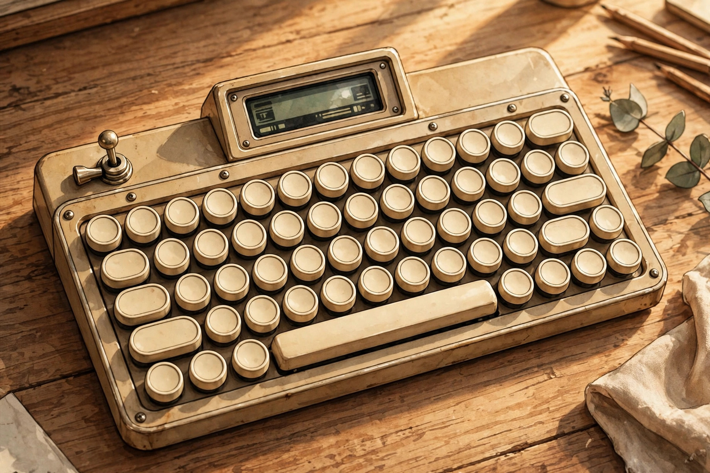
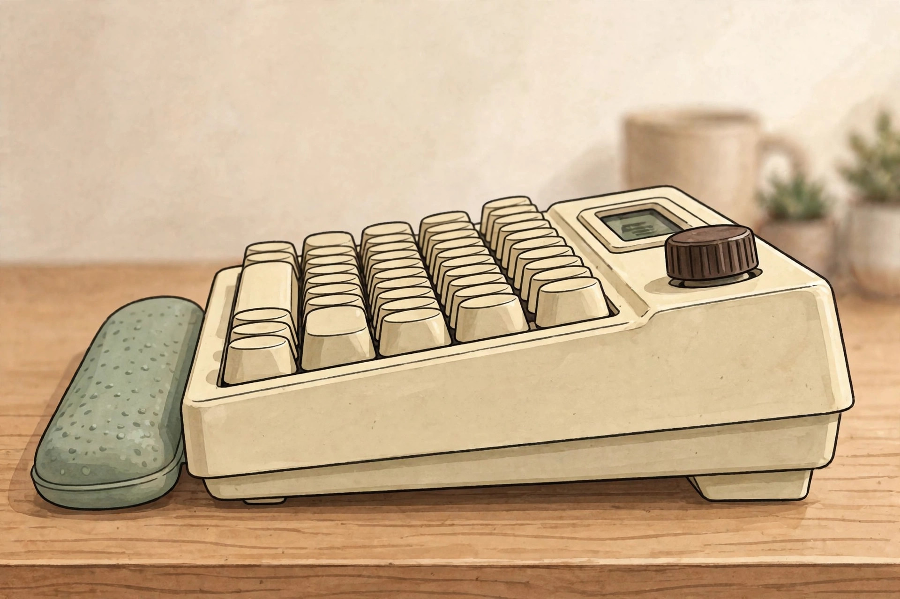

<!-- 본문 시작 -->

타자기 레버를 올리면 엔터가 눌리는 키보드 — Epomaker Glyph, 사기 전에 확인할 조건

사진 속 키보드는 둥근 자판에 타자기 리턴 레버까지 달려 있다. 그런데 케이블을 꽂으면 무선 키보드로 바뀌고, 화면과 노브로 볼륨과 표시까지 조절한다. 이 글은 직접 사용 후기가 아니라 공식 자료와 독립 리뷰를 대조한 구매 전 확인 글이다.

## 제품의 정체

Epomaker Glyph는 75% ANSI US 레이아웃, 83키의 기계식 키보드다. 공식 제품 페이지(2026-11-03 확인) 기준 83개 빈티지 라운드 PBT 키캡은 균일한 높이에 오목한 형태다. 가장 눈에 띄는 장치는 왼쪽에 달린 타자기 리턴 레버로, 위로 올리면 Enter, 아래로 누르면 Backspace가 입력된다. 전통 레버가 오른쪽이었던 것과 달라 처음에는 손이 헛돌 수 있다. 상단 TFT 스크린은 상태와 시간, RGB 제어를 표시하고 직접 만든 GIF도 표시할 수 있다고 제조사는 안내한다. 노브는 FN 키와 함께 미디어와 화면 탐색을 전환한다.

관찰 포인트는 둥근 키캡 배열과 레버, 화면이 한 제품에 같이 있다는 점이다. 장식인지 입력 장치인지가 이 제품의 첫 질문이다. (일러스트)

## 흥미로운 특징 세 가지

첫째, 레버 입력이다. 레버는 장식이 아니라 실제 입력 장치다. Enter와 Backspace를 손가락 끝이 아니라 손 움직임으로 누른다는 점이 이 제품의 정체다. 독립 리뷰에서는 왼쪽 배치 때문에 전통 타자기 감각과 다르고, 가장 덜 설득력 있는 요소라는 지적도 나왔다. 예뻐서 사는 것과 매일 쓰는 것은 다르므로 레버를 자주 쓸지 먼저 가늠해야 한다.

둘째, 타건감 설계다. 스위치는 Epomaker Wisteria V2 리니어에 공장 윤활이 적용됐고, 작동력은 32.8gf±5gf, 바텀아웃은 45gf±5gf, 총 이동거리는 3.6±0.4mm로 공식 스펙에 표기돼 있다. 일부 리뷰의 38gf 표기와 달라 본문은 공식 수치를 우선한다. 5단 흡음 구조는 제조사 주장으로 구분한다. 소리가 좋다는 단정은 자료만으로 내릴 수 없으며, 3핀·5핀 MX 스타일 스위치 핫스왑으로 교체는 가능하다.

셋째, 화면과 노브, 트라이모드 연결이다. 연결은 2.4GHz·Bluetooth·USB-C 유선 세 가지다. 스펙표 호환은 Mac·Windows·Android이며, 소개 문구의 iOS 언급은 스펙표에 없어 확정 표현으로 쓰지 않는다. 리매핑 소프트웨어 EPOMAKER 3.0은 'Free' 표기가 있으나 구독료 없음 단정은 미확인으로 둔다.

> 사기 전에 레버부터 물을 것
>
> ### **레버가 예쁜 장식인지, 매일 누를 입력 장치인지 먼저 정하라**

## 아쉬운 점과 확인할 점

무게와 크기가 먼저다. 공식 수치 기준 34.7×20.7×5.7cm에 1,178.8g으로, 작은 책상에서는 자리 차지가 크다. 일부 리뷰의 365×151mm 표기와 달라 공식 수치를 우선한다. 배터리 용량은 8,000mAh이나 실제 사용 시간은 공식 페이지에 없어 미확인이다. 화면을 켜두면 배터리를 더 소모할 수 있다는 리뷰 지적도 있다. 소프트웨어 평가가 엇갈리고 공식 페이지 평점은 3.9/5점(리뷰 10개)이다. 상단 거치 슬롯은 보도·리뷰에서만 소개돼 공식 기능으로 단정하지 않는다.

관찰 포인트는 레버 자체가 입력 장치라는 점이다. 위로 올리는 동작이 Enter라는 사실이 이 제품의 핵심이다. (일러스트)

## 가격과 국내 이용

공식 스토어 가격은 118.15 USD로 2026-11-03 확인 기준이며 정가는 139 USD로 표기돼 있다. 할인 종료일은 미확인이다. 정식 판매 중 제품으로 펀딩이나 콘셉트가 아니다. 공식 FAQ에는 대부분 국가로 전 세계 배송을 하며 표준 배송 2~3주, 특급 배송 3~10일이 안내돼 있고 국가별 관세와 세금 적용 가능성이 적혀 있다. 한국 전용 배송비·국내 유통·한글 각인은 미확인이다. US 배열이라 한글 입력 환경은 별도 확인이 필요하며, 최종 금액을 확정 금액처럼 쓰지 않는다.

| 항목 | 내용 |
|---|---|
| 레이아웃 | 75% ANSI US, 83키, 라운드 PBT 키캡 |
| 스위치 | Wisteria V2 리니어, 공장 윤활, 핫스왑 |
| 연결 | 2.4GHz·Bluetooth·USB-C, Mac/Windows/Android |
| 배터리 | 8,000mAh, 실제 사용 시간 미확인 |
| 크기·무게 | 34.7×20.7×5.7cm, 1,178.8g |
| 공식 스토어 가격 | 118.15 USD (2026-11-03 확인, 할인 종료일 미확인) |
| 국내 조건 | 배송비·국내 유통·한글 각인 미확인 |

## 에디터의 판단

이 제품은 매일 타이핑하는 글쓰기나 사무용 사용자 중 책상 위 존재감이 있는 키보드를 원하고 무게와 크기를 감수할 수 있는 사람에게 맞는다. 반대로 가볍고 작은 키보드, 조용한 사무실용 저소음 최우선, 한글 각인 확정 필요 사용자는 보류하는 것이 낫다. 상자에는 실리콘 손목 받침대와 케이블, 2.4GHz 수신기, 여분 스위치 3개가 포함된다고 안내돼 있다. 다만 레버를 매일 쓸지와 1.18kg을 받아들일지는 사진의 예쁨과 분리해 먼저 정해야 한다.

관찰 포인트는 높이와 두께감, 책상 차지 면적이다. 사진으로는 가늠하기 어려운 부분이 실제 사용에서는 가장 먼저 체감된다. (일러스트)

## 함께 보면 좋은 글

- [책상 위 텀블러가 120인치 화면이 된다 — XGIMI MoGo 4 사기 전에 확인할 조건](https://blog.naver.com/3700708/224461782781) — 작은 본체로 큰 화면을 만드는 프로젝터의 밝기·투사 조건을 정리한 글이다.
- [움직이는 나를 따라오는 웹캠 — Insta360 Link 2 vs OBSBOT Tiny 2, 사기 전에 확인할 조건](https://blog.naver.com/3700708/224461782434) — 화상회의 장비도 스펙보다 사용 조건부터 따져야 한다는 비교 글이다.
- [AI 브라우저 티어표로 고르기｜읽어주는 브라우저와 대신 클릭하는 브라우저는 다르다](https://blog.naver.com/3700708/224460771206) — 같은 이름이라도 실제로 하는 일이 다른 도구를 구분하는 기준을 정리한 글이다.

## 출처

- [Epomaker Glyph 공식 제품 페이지](https://epomaker.com/products/epomaker-glyph)
- [Epomaker Glyph 출시 보도자료](https://digitalmedianet.com/retro-revival-the-epomaker-glyph-mechanical-keyboard/)
- [KBD.news Epomaker Glyph 리뷰](https://kbd.news/Epomaker-Glyph-review-2862.html)
- [Serious Insights Epomaker Glyph 리뷰](https://www.seriousinsights.net/epomaker-glyph-keyboard-review/)

<!-- 본문 끝 -->
