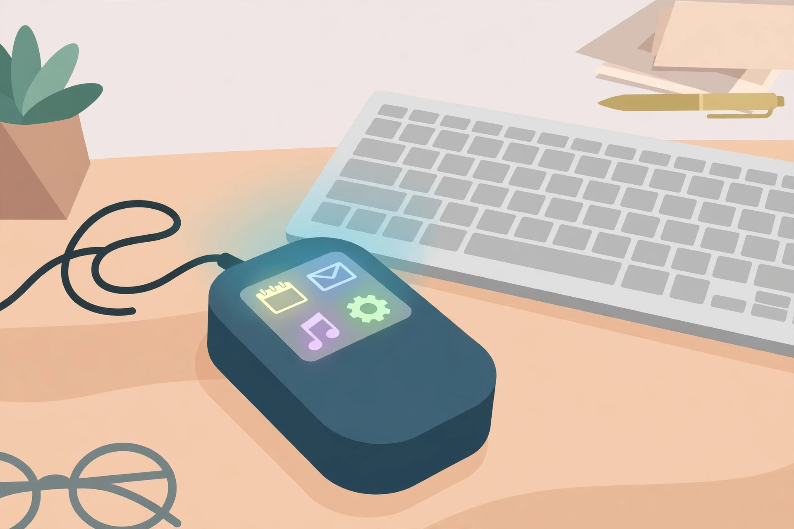
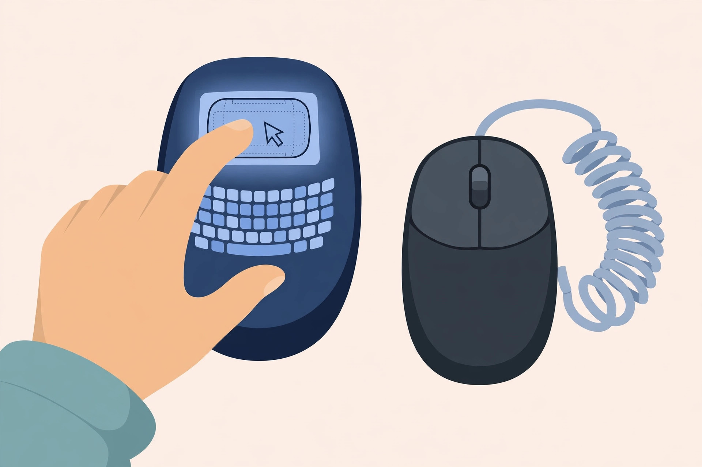
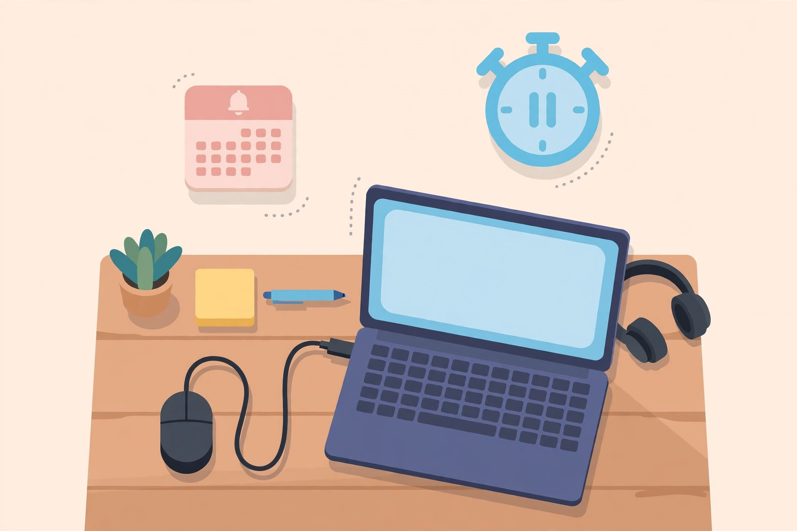

<!-- 본문 시작 -->

A Screen on Top of the Mouse — What to Check Before Backing the Super Mouse

For people who tap the keyboard for shortcuts, buy a macro pad to widen their desk, or keep a separate touchpad, a product has arrived that puts a screen on the mouse itself. The Super Mouse (model AFSM2601) from Arctic Fox Technologies is a wired mouse with a 3.1-inch touchscreen on top. This is not a hands-on review; it is a pre-backing check comparing the Kickstarter campaign materials, which began on 2026-10-27, with press coverage.

## What This Product Is

The Super Mouse puts a 720×720-pixel color touchscreen where the palm rests. It measures 109×91×29 mm and weighs 95 g, wider and flatter than an ordinary mouse. The screen sits ahead of the left and right buttons and the scroll wheel, with two programmable Hyper Keys beside it. The key idea is that the screen layout changes with the program in use. The maker says video-editing software shows editing and playback shortcuts, while design software shows its own working shortcuts. The colors are yellow, white, and gray.

The observation point is that the screen sits where the palm rests. Whether you must lift your hand to tap a shortcut, or can reach it without moving, will decide how it feels in use. (Illustration)

## Three Interesting Features

First, one screen becomes five tools. The home screen, called the Control Panel, holds up to 16 shortcuts, macros, or app launchers. Double-tapping the screen turns it into a trackpad for scrolling, zooming, and gestures, and a swipe keyboard can enter short text. Slider mode adjusts volume and brightness, and calendar mode shows Google Calendar reminders. The biggest appeal is clearing a separate macro pad and touchpad off the desk.

Second, buttons and sensors work together. The two Hyper Keys can hold frequently used shortcuts or multi-step macros. Settings are made in Flow, a companion app for Windows and macOS. A gyroscope lets you tilt the mouse to scan a large spreadsheet or move through slides and video. Gestures are also listed: drawing a circle undoes an action, and drawing a triangle saves progress.

Third, voice input is claimed to be processed locally. A built-in microphone supports dictation in more than 90 languages, according to the maker. The maker says the audio is processed on the user's own computer rather than in the cloud, but this is a manufacturer claim, and dictation accuracy and response speed have no independent verification yet. Until reviews or measurements appear, it should be taken only as a claim.

> Ask first about the screen sitting where the palm rests
>
> ### **Can you press a shortcut without lifting your hand?**

## Drawbacks and Things to Check

The biggest condition is that it is wired only. It connects only by USB-C cable, with no wireless mode and no battery. Anyone who insists on a wireless mouse should rule it out from the start. Power is supplied at USB 5 V / 2 A. The shape itself is also unproven: some coverage notes that the angular form is not presented as an ergonomic product. Wrist strain over long use is unconfirmed until hands-on reviews appear.

The second condition is dependence on the app. Shortcuts, macros, and per-app layouts are all set through the Flow app. If app support ends, or the shortcut layout for your program differs from expectations, the screen loses much of its value. The schedule is also a condition, since this is a crowdfunding product. The maker estimates shipping in February 2027 but warns that component supply or technical problems could delay it. Backing a campaign is supporting production, not buying a finished product.

The observation point is how modes switch. Whether double-tapping into trackpad mode breaks your workflow is the point to watch. (Illustration)

## Price and Availability in Korea

The Kickstarter early-bird price is 199 USD, and the maker-stated retail price is 249 USD. Shipping is billed separately after the campaign ends, so 199 USD is not the final amount paid. As of 2026-11-04, an official Korean seller, Korean shipping cost, customs and tax, and domestic warranty and service conditions are unconfirmed. It is also unconfirmed whether the maker's stated one-year replacement warranty applies unchanged to buyers in Korea.

| Item | Details |
|---|---|
| Display | 3.1-inch touchscreen, 720×720 |
| Connection | USB-C wired only, no wireless |
| Size · Weight | 109×91×29 mm, 95 g |
| Operating systems | Windows, macOS (Flow app required) |
| Main features | 16 shortcuts, trackpad, swipe keyboard, gyroscope, voice dictation |
| Colors | Yellow, white, gray |
| Campaign price | Early bird 199 USD, retail 249 USD (shipping separate) |
| Estimated shipping | February 2027 (maker estimate, delays possible) |
| Korean sales · Service | Unconfirmed |

## The Editor's Judgment

This product suits people who use program-specific shortcuts often, for video and photo editing or design, and who have no desk space for a separate macro pad. It does not suit people who insist on a wireless mouse, people worried about wrist strain, or people who cannot tolerate a crowdfunding delay. Checking just three things before backing greatly lowers the chance of regret: whether wired use is acceptable, whether the Flow app groups your program's shortcuts the way you want, and what the total amount including shipping will be.

The observation point is the cable. Whether you can accept that it is not wireless is the first gate in choosing this product. (Illustration)

## Related Posts

- [A Keyboard Where Lifting a Typewriter Lever Presses Enter — Epomaker Glyph, What to Check Before Buying](https://aitechnotesen.wordpress.com/2026/11/03/a-keyboard-where-lifting-a-typewriter-lever-presses-enter-epomaker-glyph-what-to-check-before-buying/) — An unusual input device that must also be judged by real typing conditions before its looks.
- [One USB-C Cable Is Not Enough? What to Check Before Buying the ASUS ZenScreen MB16AHV](https://aitechnotesen.wordpress.com/2026/11/03/one-usbc-cable-is-not-enough-what-to-check-before-buying-the-asus-zenscreen-mb16ahv/) — A condition guide showing that a port must be checked for video output even when it looks the same.
- [Stop Digging Through Your Bag — MagQuick, a Strap That Snaps On and Pulls Off](https://aitechnotesen.wordpress.com/2026/10/25/stop-digging-through-your-bag-magquick-a-strap-that-snaps-on-and-pulls-off/) — A small desk-and-bag gadget judged by how it actually attaches and detaches.

## Sources

- [Arctic Fox Super Mouse — New Atlas coverage](https://newatlas.com/computers/super-mouse-touchscreen/)
- [Super Mouse Kickstarter coverage — BigGo](https://finance.biggo.com/news/c45b9f16-b59b-4a8e-9bd6-9608c8919caa)
- [Super Mouse specifications — Basic Tutorials](https://basic-tutorials.com/news/super-mouse-this-kickstarter-mouse-features-a-touchscreen-hyper-keys-and-an-ai-dictation-feature/)

<!-- 본문 끝 -->
