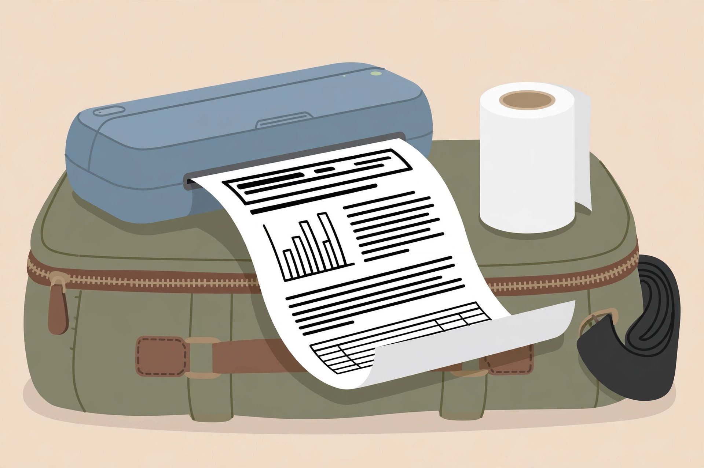
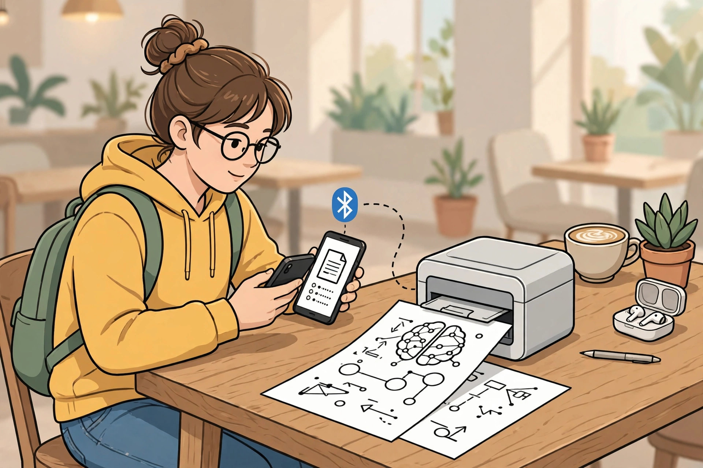
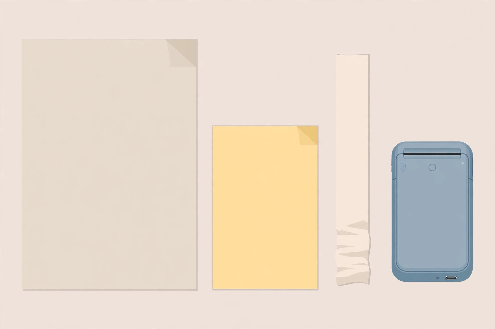

<!-- 본문 시작 -->

A Printer Without Ink — What to Check Before Buying the PeriPage A40

A home printer always seems to have dried-up ink when you need it, cartridges are expensive, and nozzle cleaning eats your time. The PeriPage A40 is a portable A4 thermal printer that uses no ink, toner, or ribbon at all. The only consumable is thermal paper. This is not a hands-on review; it is a pre-purchase check comparing the official store guide with manual materials.

## What This Product Is

The PeriPage A40 is a slim, pencil-case-shaped portable printer. It measures 265×80×45 mm and weighs about 662 g, made to go in a bag and print A4 documents. Thermal printing applies heat to the paper to form text and images, so there is no ink cartridge, and the output is black and white. Color printing is not this product's job. It connects to phones by Bluetooth and to computers by USB-C; mobile printing uses a companion app, and computer printing requires driver installation. Android, iOS, Windows, and macOS are listed as supported.

The observation point is the pencil-case shape. How comfortably a printer as wide as A4 fits in a bag is the real test of its portability. (Illustration)

## Three Interesting Features

First, the consumable structure is simple. With no ink, there are no clogged nozzles and no cartridge replacements; the only thing to buy is thermal paper. The official store guide (2026-11-03) presents it in the under-150 USD range, and some seller listings show around 129 USD. But that is the printer price only; thermal paper and shipping are separate. Paper costs add up over time, so judging it cheap from the printer price alone would be a mistake.

Second, paper width can change. Besides A4 width at 210 mm, it supports 107 mm, 77 mm, and 56 mm paper. The same printer can print an A4 document, then switch to a narrower width for receipts, memos, or labels. The manual says both roll paper and folded paper are supported. A4 suits study and work documents, while narrower widths suit household accounts or labels.

Third, it runs on battery. The official guide and the manual both state up to 360 A4 sheets on a full charge. But the battery figures conflict between sources: the official store guide lists a built-in 2600 mAh battery, while the manual lists two 2600 mAh batteries. The 360-sheet figure is the same in both, but the differing battery capacity is a point to check before buying. Standby time is listed as about 90 days in the manual.

> Instead of ink costs, ask about paper costs
>
> ### **The price of one roll of thermal paper, not the printer price, is this printer's real running cost**

## Drawbacks and Things to Check

The first thing to check is that it is black-and-white only. Thermal printing cannot print color. Color materials or photos will disappoint; photos come out in black-and-white tones only. Resolution also differs by model, at 203 dpi or 304 dpi according to the manual, so the resolution of the model being ordered must be checked. Because thermal prints can fade with long exposure to heat or light, it does not suit originals or proof documents that must be kept long term. It is safest to see it as a tool for temporary materials, study notes, and work drafts.

Second is the connection condition. Bluetooth printing assumes the mobile app, and computer printing assumes driver installation. Whether the app and drivers work with your device and operating-system version, and whether updates continue, should be checked before buying. As of 2026-11-04, the Korean price, domestic shipping cost, customs and tax, and domestic warranty and service conditions are unconfirmed. Whether the official store ships to Korea is also unconfirmed.

The observation point is the printing process. Whether a document prints straight from the app, or driver installation is needed, decides how often you will actually use it. (Illustration)

## Price and Availability in Korea

The official store guide (2026-11-03) presents it under 150 USD, and some seller listings show around 129 USD. The Korean price is unconfirmed, and shipping and tax should be treated as excluded from those figures. Thermal paper prices and replacement intervals differ by seller, so calculating the printer together with paper rolls is the starting point for comparing running costs.

| Item | Details |
|---|---|
| Printing method | Thermal printing, black-and-white only |
| Paper widths | 210 mm (A4) · 107 mm · 77 mm · 56 mm |
| Size · Weight | 265×80×45 mm, about 662 g |
| Connections | Bluetooth, USB-C |
| Supported devices | Android · iOS · Windows · macOS (app and drivers required) |
| Battery | Up to 360 sheets on a full charge (capacity figures conflict between sources) |
| Resolution | 203 dpi or 304 dpi, depending on model |
| Reference price | Under 150 USD (2026-11-03 official guide; Korean price unconfirmed) |

## The Editor's Judgment

This product suits people tired of ink management, people who often print study or work documents in black and white, and people who carry a printer in a bag and print on the spot. It does not suit people who need color printing, people printing originals for long-term storage, or people who find app and driver installation a burden. Checking just three things greatly lowers the chance of failure: whether black-and-white only is acceptable, whether the app and drivers work on your device, and what the total running cost including thermal paper will be.

The observation point is paper width. Even with the same printer, running costs differ between someone who uses only A4 and someone who also uses narrow widths. (Illustration)

## Related Posts

- [A Keyboard Where Lifting a Typewriter Lever Presses Enter — Epomaker Glyph, What to Check Before Buying](https://aitechnotesen.wordpress.com/2026/11/03/a-keyboard-where-lifting-a-typewriter-lever-presses-enter-epomaker-glyph-what-to-check-before-buying/) — A small desk gadget that must also be judged by real use conditions before its looks.
- [One USB-C Cable Is Not Enough? What to Check Before Buying the ASUS ZenScreen MB16AHV](https://aitechnotesen.wordpress.com/2026/11/03/one-usbc-cable-is-not-enough-what-to-check-before-buying-the-asus-zenscreen-mb16ahv/) — A lesson in checking connection conditions, or the screen will not turn on.
- [Stop Digging Through Your Bag — MagQuick, a Strap That Snaps On and Pulls Off](https://aitechnotesen.wordpress.com/2026/10/25/stop-digging-through-your-bag-magquick-a-strap-that-snaps-on-and-pulls-off/) — A small desk-and-bag gadget judged by how it actually attaches and detaches.

## Sources

- [PeriPage A40 Official Store Guide](https://www.peripageglobal.com/blogs/news/2026-holiday-gift-guide-peripage-a40-portable-printer)
- [PeriPage A40 User Manual](https://manuals.plus/ae/1005006563268111)
- [PeriPage A40 Specification Sheet](https://p.globalsources.com/IMAGES/PDT/SPEC/607/K1216263607.pdf?ver=5884181328)

<!-- 본문 끝 -->
