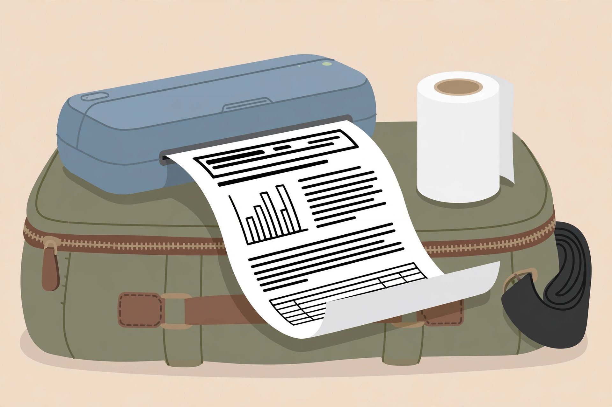
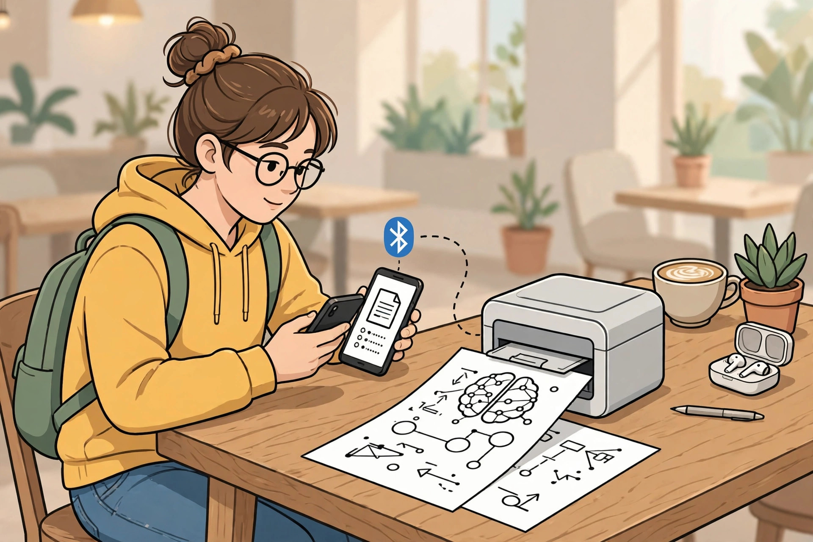
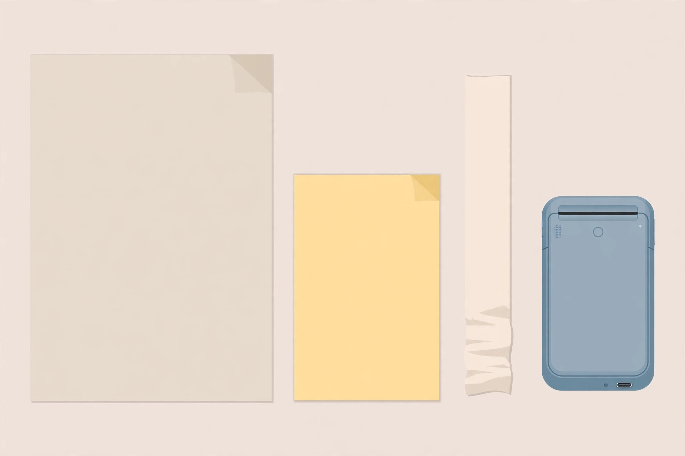

<!-- 본문 시작 -->

잉크가 없는 프린터 — PeriPage A40, 사기 전에 확인할 조건

집 프린터는 쓸 때마다 잉크가 말라 있고 카트리지는 비싸다. PeriPage A40은 잉크·토너·리본을 아예 쓰지 않는 휴대용 A4 감열 프린터로, 소모품은 감열지 하나뿐이다. 이 글은 직접 사용 후기가 아니라 공식 스토어 안내와 설명서 자료를 대조한 구매 전 확인 글이다.

## 제품의 정체

PeriPage A40은 길쭉한 필통 모양의 휴대용 프린터다. 크기 265×80×45mm, 무게 약 662g으로 가방에 넣고 다니며 A4 문서를 출력하는 용도다. 감열 인쇄 방식이라 잉크 카트리지가 없고, 종이에 열을 가해 글자와 그림을 찍는다. 그래서 출력물은 흑백이다. 컬러 인쇄는 이 제품의 역할이 아니다. 스마트폰은 블루투스로, 컴퓨터는 USB-C로 연결되며, 모바일은 전용 앱, 컴퓨터는 드라이버 설치가 전제다. 안드로이드·iOS·윈도우·macOS 지원으로 안내돼 있다.

관찰 포인트는 필통 같은 형태다. A4 폭 프린터가 가방에 얼마나 부담 없이 들어가는지가 휴대성의 실체다. (일러스트)

## 흥미로운 특징 세 가지

첫째, 소모품 구조가 단순하다. 잉크가 없으니 노즐 막힘이나 카트리지 교체가 없고, 사는 것은 감열지뿐이다. 공식 스토어 안내(2026-11-03)에서는 150 USD 미만 가격대로 소개하고 있으며, 일부 판매처 표기는 129 USD 수준이다. 다만 본체 가격일 뿐, 감열지 가격과 배송비는 별도다. 감열지를 오래 쓰면 단가가 쌓이므로 본체 가격만 보고 싸다고 판단하면 안 된다.

둘째, 종이 폭을 바꿔 쓸 수 있다. A4 폭 210mm뿐 아니라 107mm·77mm·56mm 종이도 지원한다. 같은 프린터로 A4 문서를 뽑다가, 폭을 좁혀 영수증이나 메모, 라벨처럼 쓸 수 있다. 롤지와 접이식 용지를 모두 지원한다고 설명서에는 안내돼 있다. 공부·업무 문서에는 A4가, 가계부·라벨에는 좁은 폭이 각각 맞는다.

셋째, 배터리로 움직인다. 완충 시 최대 360장 출력은 공식 안내와 설명서가 같이 밝힌다. 다만 배터리 표기는 엇갈린다. 공식 안내에는 2600mAh 내장 배터리로, 설명서에는 2600mAh 배터리 2개로 적혀 있다. 대기 시간은 설명서 기준 약 90일이다.

> 잉크값을 없애는 대신, 종이값을 물을 것
>
> ### **본체 가격보다 감열지 한 롤 가격이 이 프린터의 진짜 유지비다**

## 아쉬운 점과 확인할 점

가장 먼저 확인할 점은 흑백 전용이라는 사실이다. 감열 인쇄는 색을 찍지 못한다. 컬러 자료나 사진 출력을 기대하면 실망한다. 사진도 흑백 명암으로만 나온다. 해상도도 모델에 따라 203dpi와 304dpi로 나뉜다고 설명서는 밝히고 있어, 주문하는 모델의 해상도를 확인해야 한다. 감열 인쇄물은 열·빛에 오래 노출되면 흐려질 수 있으므로, 장기 보관 원본이나 증빙 서류용으로는 맞지 않는다. 임시 자료·학습 자료·업무 초안 용도로 보는 것이 안전하다.

두 번째는 연결 조건이다. 블루투스 연결은 모바일 앱이 전제이고, 컴퓨터 연결은 드라이버 설치가 전제다. 앱과 드라이버가 내 기기와 운영체제 버전에서 동작하는지, 업데이트가 계속되는지는 구매 전에 확인할 일이다. 한국 판매가와 국내 배송비, 관세·부가세, 국내 보증·AS 조건은 2026-11-04 확인 기준 미확인이다. 공식 스토어의 한국 배송 가능 여부도 확인되지 않았다.

관찰 포인트는 출력 과정이다. 앱에서 바로 뽑히는지, 드라이버 설치가 필요한지가 사용 빈도를 가른다. (일러스트)

## 가격과 국내 이용

공식 스토어 안내(2026-11-03)는 150 USD 미만으로 소개하고, 일부 판매처 표기는 129 USD 수준이다. 한국 가격은 미확인이며, 배송비와 세금은 포함되지 않은 가격으로 봐야 한다. 감열지 가격·교체 주기는 판매처마다 다르므로, 본체와 감열지 롤을 함께 계산하는 것이 유지비 비교의 출발점이다.

| 항목 | 내용 |
|---|---|
| 인쇄 방식 | 감열 인쇄, 흑백 전용 |
| 용지 폭 | 210mm(A4)·107mm·77mm·56mm |
| 크기·무게 | 265×80×45mm, 약 662g |
| 연결 | 블루투스, USB-C |
| 지원 기기 | 안드로이드·iOS·윈도우·macOS (앱·드라이버 필요) |
| 배터리 | 완충 시 최대 360장 (용량 표기는 자료마다 엇갈림) |
| 해상도 | 203dpi·304dpi 모델별 상이 |
| 참고가 | 150 USD 미만 (2026-11-03 공식 안내, 한국 가격 미확인) |

## 에디터의 판단

이 제품은 잉크 관리에 지친 사람, 공부 자료나 업무 문서를 흑백으로 자주 뽑는 사람, 가방에 넣고 다니며 그때그때 출력하는 사람에게 맞는다. 반대로 컬러 출력이 필요한 사람, 장기 보관 원본을 뽑는 사람, 앱·드라이버 설치를 번거로워하는 사람에게는 맞지 않는다. 흑백 전용인지, 내 기기에서 앱·드라이버가 동작하는지, 감열지를 포함한 총 유지비가 얼마인지 세 가지만 확인하면 이 프린터의 실패 확률은 크게 줄어든다.

관찰 포인트는 용지 폭이다. A4만 쓰는 사람과 좁은 폭까지 쓰는 사람의 유지비는 같은 프린터에서도 달라진다. (일러스트)

## 함께 보면 좋은 글

- [타자기 레버를 올리면 엔터가 눌리는 키보드 — Epomaker Glyph, 사기 전에 확인할 조건](https://blog.naver.com/3700708/224463006773) — 책상 위 작은 기기도 생김새보다 실제 사용 조건부터 따져야 한다는 글이다.
- [USB-C 하나면 다 된다고? ASUS ZenScreen MB16AHV 사기 전에 확인할 조건](https://blog.naver.com/3700708/224463006120) — 연결 조건을 확인하지 않으면 화면이 뜨지 않는다는 교훈을 정리한 글이다.
- [AI 브라우저 티어표로 고르기｜읽어주는 브라우저와 대신 클릭하는 브라우저는 다르다](https://blog.naver.com/3700708/224460771206) — 같은 이름이라도 실제로 하는 일이 다른 도구를 구분하는 기준을 정리한 글이다.

## 출처

- [PeriPage A40 공식 스토어 안내](https://www.peripageglobal.com/blogs/news/2026-holiday-gift-guide-peripage-a40-portable-printer)
- [PeriPage A40 사용 설명서](https://manuals.plus/ae/1005006563268111)
- [PeriPage A40 사양 자료](https://p.globalsources.com/IMAGES/PDT/SPEC/607/K1216263607.pdf?ver=5884181328)

<!-- 본문 끝 -->
