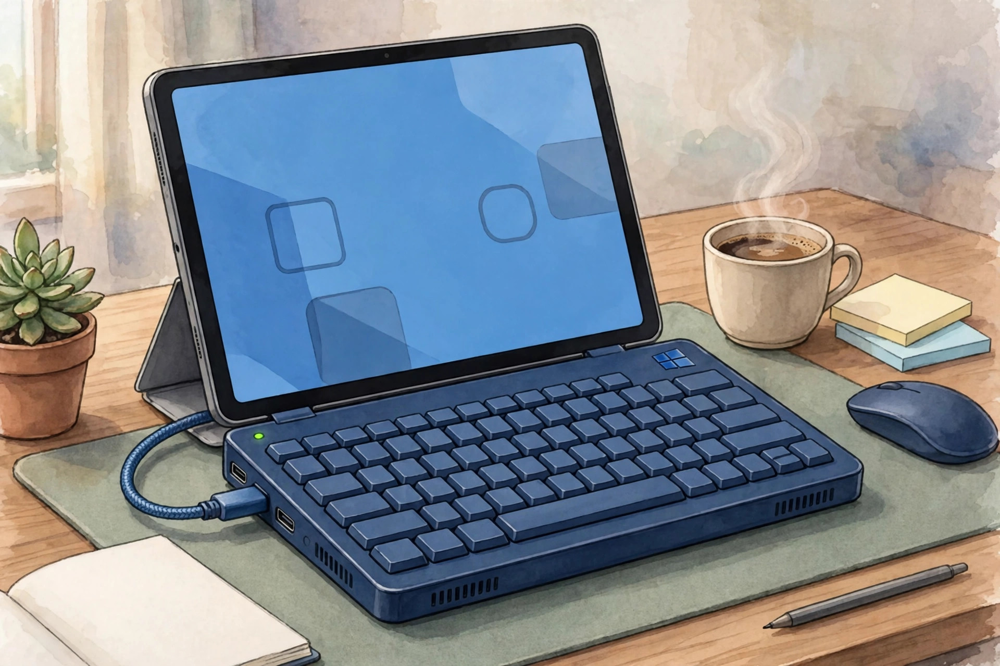
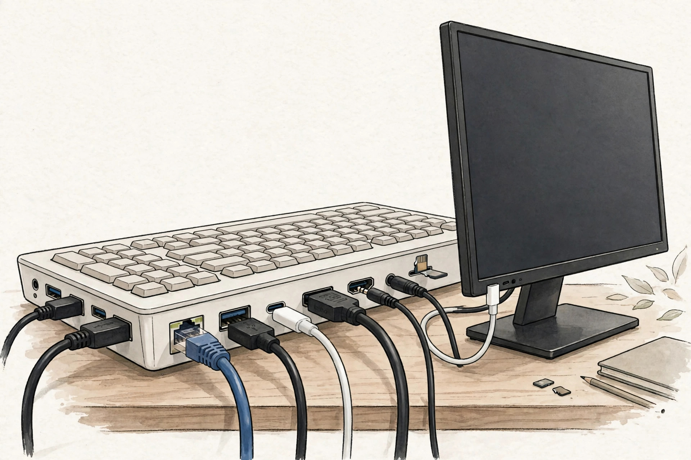

<!-- 본문 시작 -->

You like your tablet because it is light, but you still pack a laptop for one Windows program. Hero Keyboard proposes a different trade: instead of buying another screen, borrow a screen you already own. It is a Windows PC built into a keyboard.

From the outside, it looks like a laptop with its screen removed. The aluminum body holds a keyboard and a trackpad, measures 11.8 mm thick, and weighs 720 g. According to the official product page, it has an Intel Core Ultra 5 125H, 16 GB of memory, a 512 GB SSD, and a fully licensed copy of Windows 11. The keyboard itself is the PC, not an emulator.

A setup that borrows a tablet as its screen. (Illustration)

The appeal is the freedom to change screens. Use a monitor at home, a tablet on the move, and a TV or AR glasses when needed, while the same PC continues. Switch Windows off and it becomes a Bluetooth keyboard for the tablet. The SSD can be replaced, and it supports up to two external displays at 4K 60 Hz, according to the maker.

A connection to check against your own monitor's input specifications. (Illustration)

But there are several conditions to check before buying. First, you must supply the screen yourself. The Hero App targets iPadOS 17 or later and Android 7 or later, and it does not yet support iPhone, so iPhone users need a third-party app. Second, Windows on a small screen feels different. The official page recommends 200–250% scaling on an 11-inch-class screen. Third, total weight matters. The 720 g body plus a tablet and other items comes to about 1.2 kg in the combination described by the maker, and the claimed up to 9 hours of battery life is a manufacturer claim.

| Item | Details |
|---|---|
| Product | Hero Keyboard Founders Edition |
| Specifications | Core Ultra 5 125H · 16 GB · 512 GB SSD |
| Operating system | Fully licensed Windows 11 |
| Size and weight | 255×190 mm · 11.8 mm · 720 g |
| Battery | Up to 9 hours (manufacturer claim) · 100 W charger |
| Screen connection | Tablet, monitor, TV, AR glasses; iPhone needs a third-party app |
| Price and launch | US$999, Q4 2026 launch in the US and Canada |

Price and availability in Korea also need checking. As of the official product page check on November 5, 2026, the Founders Edition costs US$999, with the first batch headed to the US and Canada. The Korean launch schedule and price are unconfirmed. The keyboard layout is a US layout, so Korean input should be checked separately. A US$50 reservation is fully refundable if cancelled before shipping, according to the maker, but shipping costs, customs duties, and Korean return terms are unconfirmed.

> Do not buy a screen. Borrow the screen you already own.
>
> ### **Not a US$999 keyboard, but a laptop without a screen**

Comparison clarifies its position. HP's EliteBoard G1a is a similar keyboard PC, but it is business-oriented and more expensive. Keeping an existing laptop or using only a screen-sharing app for a tablet is much cheaper. Hero makes sense in a narrower case: you already own a good tablet, you truly need Windows-only software, and you do not want to buy another screen.

Judge the total weight you will carry together, not the body weight alone. (Illustration)

The verdict is conditional. If you already own a screen and truly need Windows, it is an interesting and reasonable alternative. If you also need to buy a screen, or you only own an iPhone, there is no reason to rush. It is safer to wait for first-batch deliveries and the official companion app, then check hands-on reports before deciding. This is not a hands-on review; it is a pre-purchase checklist based on official materials.

## Related Posts

- [A Keyboard Where Lifting a Typewriter Lever Presses Enter — Epomaker Glyph, What to Check Before Buying](https://aitechnotesen.wordpress.com/2026/11/03/a-keyboard-where-lifting-a-typewriter-lever-presses-enter-epomaker-glyph-what-to-check-before-buying/) — An unusual input device that must also be judged by real typing conditions before its looks.
- [One USB-C Cable Is Not Enough? What to Check Before Buying the ASUS ZenScreen MB16AHV](https://aitechnotesen.wordpress.com/2026/11/03/one-usbc-cable-is-not-enough-what-to-check-before-buying-the-asus-zenscreen-mb16ahv/) — A condition guide showing that a port must be checked for video output even when it looks the same.
- [Stop Digging Through Your Bag — MagQuick, a Strap That Snaps On and Pulls Off](https://aitechnotesen.wordpress.com/2026/10/25/stop-digging-through-your-bag-magquick-a-strap-that-snaps-on-and-pulls-off/) — A small desk-and-bag gadget judged by how it actually attaches and detaches.

## Sources

- [Hero Devices official product page](https://herodevices.com/)
- [Yanko Design](https://www.yankodesign.com/2026/11/02/hero-keyboard-packs-a-windows-11-pc-and-borrows-your-tablets-screen/)
- [New Atlas](https://newatlas.com/consumer-tech/hero-keyboard-windows-11-computer/)
- [Notebookcheck](https://www.notebookcheck.net/Hero-Keyboard-turns-Apple-iPhone-Duo-iPad-and-more-into-Windows-11-laptop.1435175.0.html)

<!-- 본문 끝 -->
