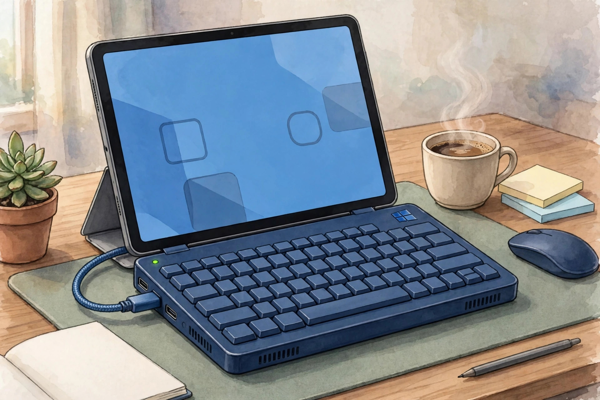
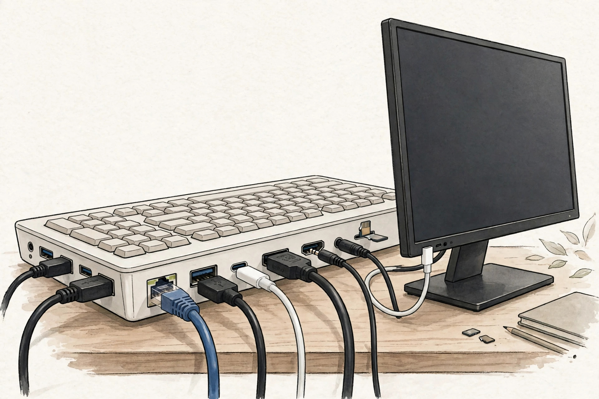

<!-- 본문 시작 -->

태블릿은 가벼운데 윈도우 프로그램 때문에 노트북까지 챙긴 적 있나. Hero Keyboard는 화면을 더 사는 대신 이미 가진 화면을 빌려 쓰자고 제안하는, 키보드 안의 윈도우 PC다.

겉모습은 화면만 떼어낸 노트북이다. 알루미늄 본체에 키보드와 트랙패드가 있고, 두께 11.8mm, 무게 720g이다. 공식 페이지에 따르면 코어 울트라 5 125H, 16GB, 512GB SSD에 정식 윈도우 11이 들어간다. 키보드 자체가 PC다.

태블릿을 화면으로 빌리는 구성이다. (일러스트)

매력은 화면을 바꾸는 자유다. 집에서는 모니터, 이동 중에는 태블릿, 필요하면 TV나 AR 글라스까지 같은 PC가 이어진다. 윈도우를 끄면 블루투스 키보드로 바뀌고, SSD 교체가 가능하며 외부 화면은 4K 60Hz 두 대까지 지원한다고 한다.

모니터 규격과 대조해야 할 연결이다. (일러스트)

그러나 확인 조건이 많다. 첫째, 화면은 직접 준비해야 한다. Hero App은 아이패드OS 17 이상과 안드로이드 7 이상이 대상이고, 아이폰은 아직 지원하지 않아 타사 앱이 필요하다. 둘째, 작은 화면 감각이다. 공식 페이지는 11인치급에서 배율 200~250%를 권한다. 셋째, 합산 무게다. 본체 720g에 태블릿 등을 더하면 약 1.2kg이며, 배터리 최대 9시간은 제조사 주장이다.

| 항목 | 내용 |
|---|---|
| 제품 | Hero Keyboard Founders Edition |
| 사양 | 코어 울트라 5 125H · 16GB · 512GB SSD |
| 운영체제 | 윈도우 11 정식 라이선스 |
| 크기·무게 | 255×190mm · 11.8mm · 720g |
| 배터리 | 최대 9시간(제조사 주장) · 100W 충전기 |
| 화면 연결 | 태블릿·모니터·TV·AR 글라스, 아이폰은 타사 앱 |
| 가격·출시 | 999달러, 2026년 4분기 미국·캐나다 선행 출시 |

가격과 국내 조건도 따져야 한다. 공식 페이지 확인일 2026년 11월 5일 기준 999달러이며, 첫 배치는 미국과 캐나다로 안내된다. 국내 일정·가격은 미확인이고, 미국 레이아웃이라 한글 입력 방식도 확인해야 한다. 예약금 50달러는 출하 전 취소 시 전액 환불이 가능하다고 안내되지만, 배송비·관세·국내 반품 적용은 미확인이다.

> 화면을 사는 게 아니라, 이미 가진 화면을 빌리는 컴퓨터
>
> ### **999달러짜리 키보드가 아니라, 화면 없는 노트북이다**

비교하면 위치가 분명하다. HP EliteBoard G1a는 같은 키보드형 PC지만 기업용이고 더 비싸다. 기존 노트북이나 화면 공유 앱만 쓰는 방법은 훨씬 저렴하다. Hero가 설득력 있는 경우는 이미 좋은 태블릿이 있고 윈도우 전용 프로그램이 꼭 필요할 때로 좁다.

함께 들고 다닐 전체 무게를 가늠해야 한다. (일러스트)

판단은 조건부다. 화면을 이미 갖고 있고 윈도우가 꼭 필요하면 합리적인 대안이다. 화면도 새로 사야 하거나 아이폰만 있다면 서두를 이유가 없다. 첫 배치 배송과 동반 앱 정식 출시 뒤 후기를 확인하고 결정하자. 직접 사용 후기가 아니라 공식 자료 정리다.

## 함께 보면 좋은 글

- [잉크가 없는 프린터 — PeriPage A40, 사기 전에 확인할 조건](https://blog.naver.com/3700708/224464225085)
  소모품과 연결 조건을 먼저 본다.
- [마우스 위에 화면이 있다 — Super Mouse, 후원 전에 확인할 조건](https://blog.naver.com/3700708/224464224804)
  화면 내장 발상의 후원 전 조건이다.
- [AI 브라우저 티어표로 고르기｜읽어주는 브라우저와 대신 클릭하는 브라우저는 다르다](https://blog.naver.com/3700708/224460771206)
  비슷해도 동작이 다른 제품을 구분하는 기준이다.

## 출처

- [Hero Devices 공식 제품 페이지](https://herodevices.com/)
- [Yanko Design](https://www.yankodesign.com/2026/11/02/hero-keyboard-packs-a-windows-11-pc-and-borrows-your-tablets-screen/)
- [New Atlas](https://newatlas.com/consumer-tech/hero-keyboard-windows-11-computer/)
- [Notebookcheck](https://www.notebookcheck.net/Hero-Keyboard-turns-Apple-iPhone-Duo-iPad-and-more-into-Windows-11-laptop.1435175.0.html)

<!-- 본문 끝 -->
