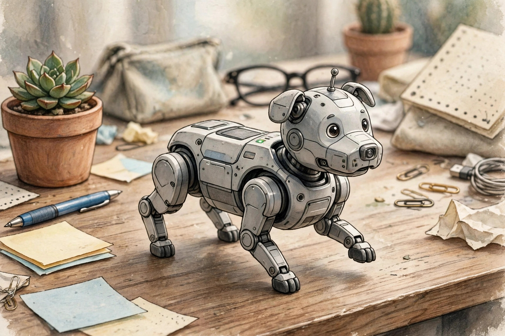
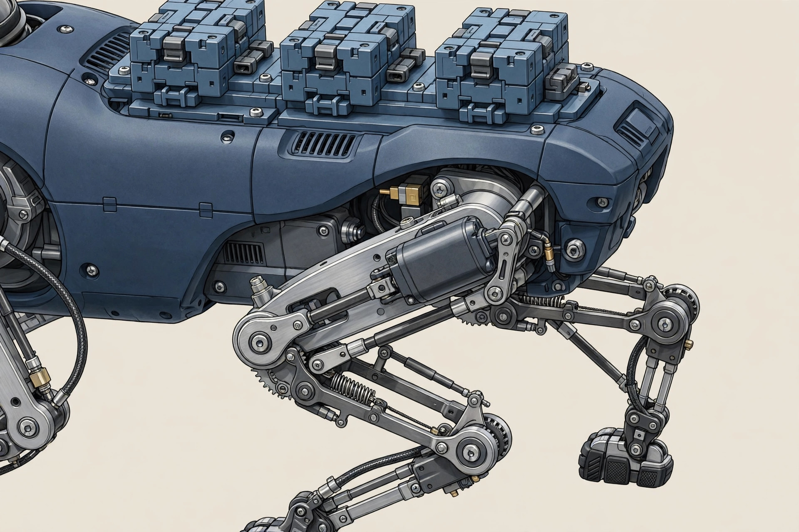

<!-- 본문 시작 -->
A Robot Dog That Walks Across Your Palm — Petoi Quaddle, What to Check Before You Back It

If a puppy walked across your desk, the first thing you would feel is cuteness. Petoi Quaddle adds assembly and coding to that cuteness: a desk-sized quadruped robot kit. It walks on legs, sidesteps, and spins in place.

Quaddle is Petoi's open-source quadruped robot dog. It uses just one servo motor per leg, four in total. According to the maker, a spring and a four-bar linkage take care of the knee as well. Builder and Buddy measure 11×7×7cm, while Scout measures 11×7×11cm.

First, the thrift of its legs. Most quadruped robots use several motors per leg, but Quaddle uses one motor per leg and lets the linkage complete the motion. That makes it smaller and cheaper, and the maker says it can be assembled without soldering.

Second, teaching it by hand. Buddy and Scout offer Learn & Replay: hold a leg, guide a movement, record it, and play it back. There is no need to start with code. When you do start coding, the same robot stretches from block coding to Python, C++, and ROS.

Its back takes LEGO-compatible blocks, and 3D-printed shells can be attached too, although load-bearing joints must stay as injection-molded parts.

| Item | Detail |
|---|---|
| Product | Petoi Quaddle, 4-servo quadruped robot dog kit |
| Size and weight | 11×7×7cm, 170–180g / Scout 11×7×11cm, 198g |
| Battery | Swappable BL-10C 1,800mAh, 1–1.5 hours |
| Coding | Blocks → Python → C++ → ROS, OpenCat |
| Price (as of 2026-11-05) | Late pledge from $154 / MSRP from $179 |
| Korea purchase and Korean support | Unconfirmed |

> A desk puppy starts with cuteness, then stays as a teaching tool you guide by hand and reshape with code.
> ### **The choice to walk on four motors sets both this robot's price and its character.**

Its palm-sized feel is the point. Check the motor count and the linkage together, not just its looks. (illustration)

The spring and linkage creating the knee motion are the design point. Customizing is about ownership, not performance. (illustration)

Teaching by hand is available on Buddy and Scout only. It is the branching point from a no-code start toward Python. (illustration)

The drawbacks are clear too. Battery life is 1 to 1.5 hours depending on the model. AI conversation and voice are limited to Buddy and Scout, and Korean-language support is unconfirmed. No independent hands-on measurements of noise or floor-by-floor driving were found. Above all, this is a crowdfunding late-pledge product, and whether the December 2026 shipping target still holds at the current stage is unconfirmed.

Prices on the official page as of 2026-11-05 are $154 for Builder+, $189 for Buddy, and $229 for Scout as late pledges, with MSRPs of $179, $219, and $269 respectively. Do not confuse these with the early-bird prices (from $99). Korea shipping availability, shipping cost, and whether customs duties are included are unconfirmed, so check the shipping country and extra costs before pledging.

The editor's verdict is this. It is worth a look for a household that wants to build with a child, teach motions by hand, and later expand into code. If you want a finished companion robot you can switch on and play with for a long time, the short battery life and the crowdfunding conditions come first. If you buy, Buddy is the branching point, so settle the model first.

## Related Posts

- [A Keyboard Where Lifting a Typewriter Lever Presses Enter — Epomaker Glyph, What to Check Before Buying](https://aitechnotesen.wordpress.com/2026/11/03/a-keyboard-where-lifting-a-typewriter-lever-presses-enter-epomaker-glyph-what-to-check-before-buying/) — An unusual input device that must also be judged by real typing conditions before its looks.
- [One USB-C Cable Is Not Enough? What to Check Before Buying the ASUS ZenScreen MB16AHV](https://aitechnotesen.wordpress.com/2026/11/03/one-usbc-cable-is-not-enough-what-to-check-before-buying-the-asus-zenscreen-mb16ahv/) — A condition guide showing that a port must be checked for video output even when it looks the same.
- [Stop Digging Through Your Bag — MagQuick, a Strap That Snaps On and Pulls Off](https://aitechnotesen.wordpress.com/2026/10/25/stop-digging-through-your-bag-magquick-a-strap-that-snaps-on-and-pulls-off/) — A small desk-and-bag gadget judged by how it actually attaches and detaches.

Sources: [Petoi Quaddle official product page](https://www.petoi.com/pages/quaddle-educational-robot-kit), [CNX Software Quaddle report](https://www.cnx-software.com/2026/09/04/petoi-quaddle-a-mini-robot-dog-for-physical-ai-experimentation/), [Yanko Design Quaddle report](https://www.yankodesign.com/2026/10/28/this-palm-sized-robot-dog-has-a-nokia-battery-and-a-customizable-lego-compatible-back/amp/) — all checked 2026-11-05.
<!-- 본문 끝 -->
