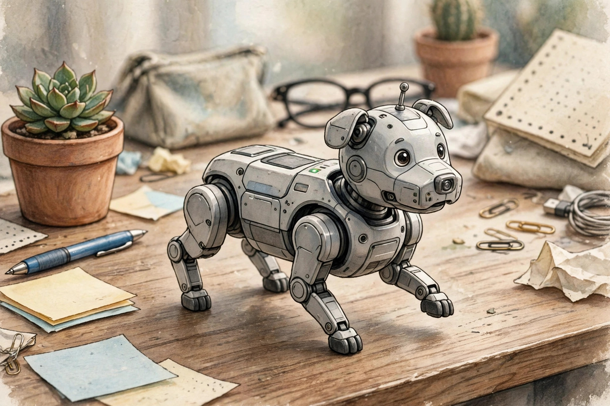
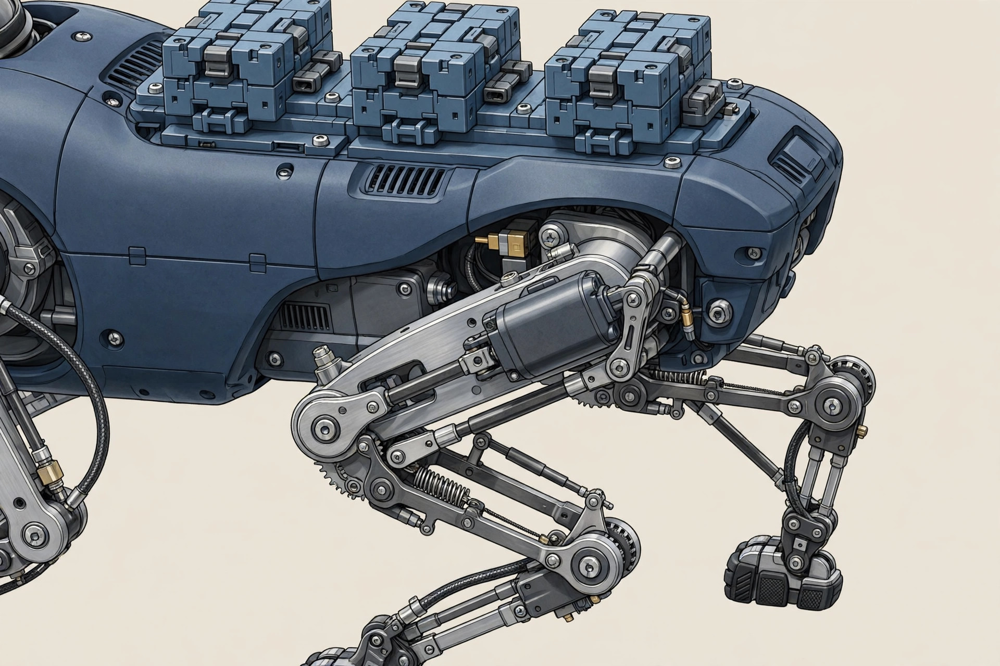

<!-- 본문 시작 -->
손바닥 위를 걷는 로봇 개 — Petoi Quaddle, 사기 전에 확인할 조건

책상 위에 강아지 한 마리가 걷는다면, 먼저 떠오르는 건 귀여움이다. Petoi Quaddle은 귀여움에 조립과 코딩을 얹은 책상용 4족 로봇 키트다. 다리로 걷고 옆으로 비켜 걸으며 제자리에서 돈다.

Quaddle은 Petoi의 오픈소스 4족 로봇 개다. 다리 1개당 서보 모터 1개, 모두 4개만 쓴다. 스프링과 4절 링크가 무릎까지 맡는다는 것이 제조사의 설명이다.

첫째, 다리의 절약이다. 보통 4족 로봇은 다리마다 모터를 여러 개 쓰는데, Quaddle은 한 다리에 모터 하나만 두고 링크로 움직임을 보완한다. 덕분에 작고 저렴해졌고, 납땜 없는 조립이 가능하다고 한다.

둘째, 손으로 가르치는 방식이다. Buddy와 Scout의 Learn & Replay는 다리를 손으로 잡아 움직임을 만들고 기록한 뒤 다시 재생하는 식이다. 코딩은 블록부터 Python, C++, ROS까지 같은 로봇으로 넓어진다.

등에는 LEGO 호환 블록과 3D 프린터 외장을 붙일 수 있으나, 하중 관절은 사출 부품을 그대로 써야 한다.

| 항목 | 내용 |
|---|---|
| 제품 | Petoi Quaddle, 4서보 4족 로봇 개 키트 |
| 크기·무게 | 11×7×7cm, 170~180g / Scout 11×7×11cm, 198g |
| 배터리 | 교체식 BL-10C 1,800mAh, 1~1.5시간 |
| 코딩 | 블록 → Python → C++ → ROS, OpenCat |
| 가격(2026-11-05 기준) | 늦은 후원가 154달러부터 / 정가 179달러부터 |
| 국내 구매·한국어 지원 | 미확인 |

> 책상 위 강아지는 귀여움으로 시작해, 손으로 가르치고 코드로 고치는 교구로 남는다.
> ### **모터 4개로 걷는 선택이, 이 로봇의 가격과 성격을 함께 정한다.**

손바닥 크기가 체감의 핵심이다. 모터 수와 링크 방식을 함께 보자. (일러스트)

스프링과 링크가 무릎을 만드는 원리가 설계 포인트다. 꾸미기는 성능 장치가 아니다. (일러스트)

손 가르치기는 Buddy와 Scout에만 있다. 코드 없이 시작해 파이썬으로 넓어지는 분기점이다. (일러스트)

아쉬운 점도 분명하다. 배터리 시간은 모델별로 1~1.5시간으로 짧다. AI 대화와 음성은 Buddy와 Scout에만 있고, 한국어 지원 여부는 확인되지 않았다. 실사용 실측은 찾지 못했다. 무엇보다 크라우드펀딩 늦은 후원 단계 상품이고, 배송 목표 2026년 12월이 현 단계에서도 유지되는지는 미확인이다.

가격은 2026-11-05 공식 페이지 기준으로 늦은 후원가 Builder+ 154달러, Buddy 189달러, Scout 229달러이며, 정가는 각각 179달러, 219달러, 269달러이다. 초기 얼리버드 가격(99달러부터)과 혼동하지 말아야 한다. 한국 배송·배송비·관세 포함 여부는 미확인이라, 후원 전에 배송 국가와 추가 비용을 직접 확인해야 한다.

에디터 판단은 이렇다. 아이와 조립하고 가르친 뒤 코드로 넓히고 싶은 집이라면 들여다볼 만하다. 완제품 반려 로봇을 원한다면 배터리 시간과 후원 조건이 먼저 걸린다. 산다면 Buddy가 분기점이다.

## 함께 보면 좋은 글

- [잉크가 없는 프린터 — PeriPage A40, 사기 전에 확인할 조건](https://blog.naver.com/3700708/224464225085) — 생활 기기 구매 조건을 비교한 글이다.
- [마우스 위에 화면이 있다 — Super Mouse, 후원 전에 확인할 조건](https://blog.naver.com/3700708/224464224804) — 후원 상품 확인 순서를 정리한 글이다.
- [AI 브라우저 티어표로 고르기｜읽어주는 브라우저와 대신 클릭하는 브라우저는 다르다](https://blog.naver.com/3700708/224460771206) — AI 도구를 목적별로 나누어 고르는 글이다.

출처: [Petoi 공식](https://www.petoi.com/pages/quaddle-educational-robot-kit), [CNX Software](https://www.cnx-software.com/2026/09/04/petoi-quaddle-a-mini-robot-dog-for-physical-ai-experimentation/), [Yanko Design](https://www.yankodesign.com/2026/10/28/this-palm-sized-robot-dog-has-a-nokia-battery-and-a-customizable-lego-compatible-back/amp/) (이상 확인일 2026-11-05)
<!-- 본문 끝 -->
