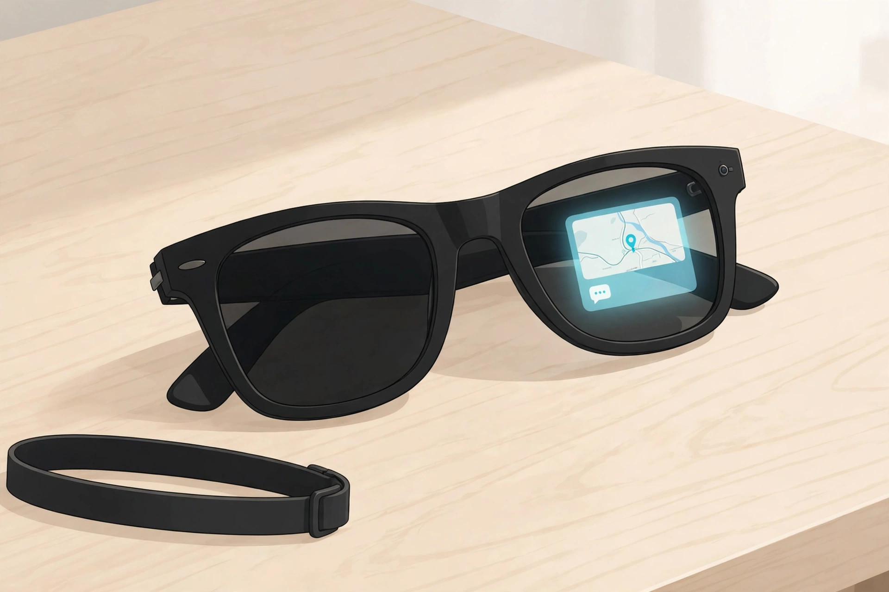
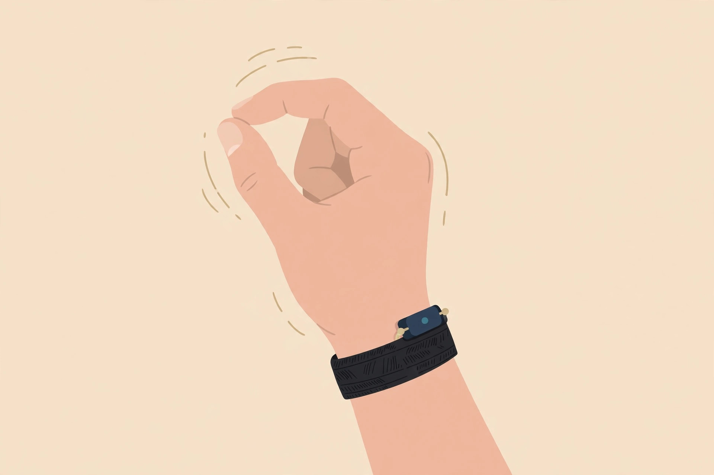
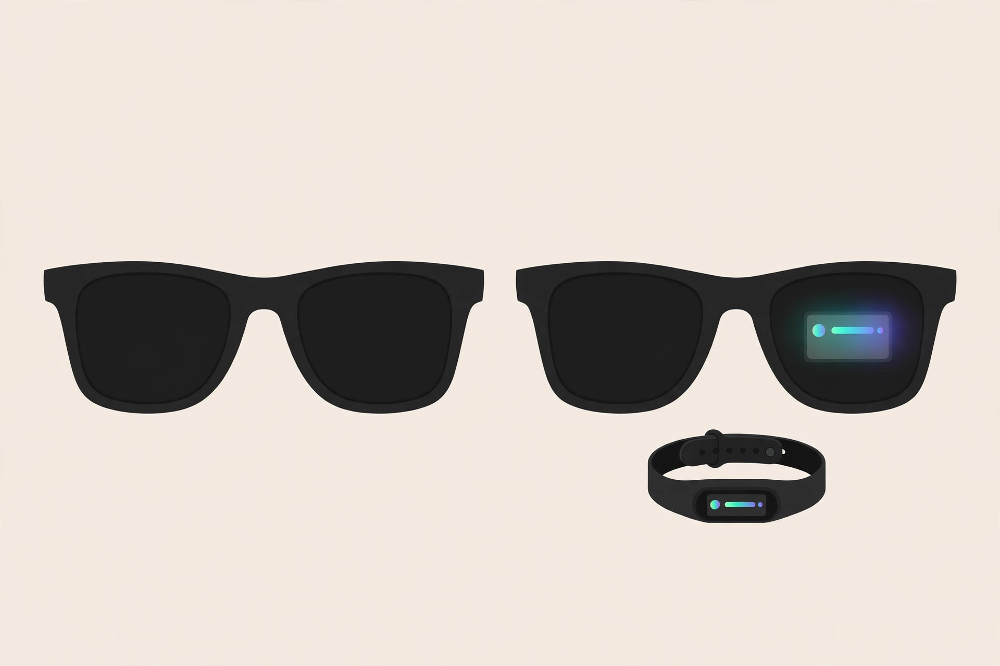

<!-- 본문 시작 -->

How much easier would a walk be if you could check a message without taking out your phone? Meta Ray-Ban Display puts that idea directly into a pair of glasses. A small color screen sits inside the right lens, and you control it with a band worn on your wrist. It was announced on September 17, 2025 at Meta Connect 2025, and went on sale in the United States on September 30 of the same year.

From the outside, it looks almost like an ordinary pair of Ray-Ban Wayfarer sunglasses. It comes in two colors, Black and Sand, and two sizes, Standard and Large. The lenses are Transitions lenses that darken outdoors and clear up indoors. The screen appears only in the right lens; nothing is shown in the left one. The included Meta Neural Band reads the tiny signals from the muscles in your wrist, so you can scroll through the screen and select items with small finger movements.

The screen appears only in a small area of the right lens. (Illustration)

The screen is small but bright. According to the official specifications, it has a 600×600 resolution, a 20-degree field of view, and a peak brightness of 5,000 nits. It is meant for messages, alerts, walking directions, live captions, translations, and photo previews. It is a screen for glancing at and moving on, not for reading long text. It has a 12 MP camera with 3x digital zoom, and the Meta AI voice assistant handles calls, music, and photos. The band lasts up to 18 hours on a charge and carries an IPX7 water resistance rating.

Without the band, controlling the screen is heavily limited. (Illustration)

But there are several conditions to check before buying. First, prescription lenses. Only single-vision lenses are available, within a total power of -4.00 to +4.00, with astigmatism up to 4.00. Progressive lenses are not offered, and prescription lenses must be ordered together with the glasses at the time of purchase. Adding prescription lenses brings the price to US$999. Second, battery life. The glasses last up to six hours according to the manufacturer, and independent reviews report that heavy screen use can bring that down to around two hours. Total time including charging from the case varies between 24 and 30 hours across Meta's own guidance pages, so it needs checking. Third, availability. As of November 6, 2026, the glasses are sold in only six countries — the United States, the United Kingdom, Canada, France, Germany, and Italy — and a Korean launch is unconfirmed. Whether Meta AI supports Korean is also unconfirmed.

| Item | Details |
|---|---|
| Product | Meta Ray-Ban Display + Meta Neural Band |
| Display | Right lens only · 600×600 · 20° field of view · up to 5,000 nits |
| Battery | Glasses up to 6 hours (manufacturer claim) · band up to 18 hours · total with case varies 24–30 hours by guidance page |
| Camera | 12 MP · 3x digital zoom · video specs unconfirmed |
| Prescription lenses | Single vision only · -4.00 to +4.00 · no progressives · order at purchase |
| Colors and weight | Black · Sand · Standard/Large · 69 g |
| Price and availability | US$799 (US$999 with prescription lenses) · sold in 6 countries · Korea unconfirmed |

The price is US$799 in the United States, or US$999 with prescription lenses. The display-free Ray-Ban Meta Gen 2 starts at US$379, lasts up to eight hours on a charge, and weighs 51 g. If you do not need a screen, the Gen 2 is lighter, lasts longer, and costs much less. If you truly need a screen, there is almost no other choice besides the Display.

The same Wayfarer shape, but the screen changes the price and the weight. (Illustration)

> Glasses that mean taking out your phone less often
>
> ### **US$799 is not the price of glasses, but of a screen and a wristband bought together**

The verdict is conditional. If your prescription fits the range, you have a clear use for glanceable information, and you can buy directly in a country where it is sold, it is an interesting choice. If your prescription falls outside the range, or you expect an official Korean launch and local support, there is no reason to rush. Wait until the Korean launch and Korean-language Meta AI support are confirmed, then decide again. This is not a hands-on review; it is a pre-purchase checklist based on official materials and independent reviews.

## Related Posts

- [A Keyboard Where Lifting a Typewriter Lever Presses Enter — Epomaker Glyph, What to Check Before Buying](https://aitechnotesen.wordpress.com/2026/11/03/a-keyboard-where-lifting-a-typewriter-lever-presses-enter-epomaker-glyph-what-to-check-before-buying/) — An unusual input device that must also be judged by real typing conditions before its looks.
- [One USB-C Cable Is Not Enough? What to Check Before Buying the ASUS ZenScreen MB16AHV](https://aitechnotesen.wordpress.com/2026/11/03/one-usbc-cable-is-not-enough-what-to-check-before-buying-the-asus-zenscreen-mb16ahv/) — A condition guide showing that a port must be checked for video output even when it looks the same.
- [Stop Digging Through Your Bag — MagQuick, a Strap That Snaps On and Pulls Off](https://aitechnotesen.wordpress.com/2026/10/25/stop-digging-through-your-bag-magquick-a-strap-that-snaps-on-and-pulls-off/) — A small desk-and-bag gadget judged by how it actually attaches and detaches.

## Sources

- [Meta official product page](https://www.meta.com/ai-glasses/meta-ray-ban-display/)
- [TechCrunch — Meta Connect 2025 announcement roundup](https://techcrunch.com/2025/09/19/meta-connect-2025-what-to-expect-and-how-to-watch/)
- [OXIVUE — Meta Ray-Ban Display price, specs and Neural Band guide](https://oxivue.com/guides/meta-ray-ban-display)
- [Pogwire — price and launch countries](https://pogwire.com/tech/meta-ray-ban-display-price-release-date)
- [Frames and Features — sales countries and prescription lens conditions](https://www.framesandfeatures.com/devices/meta-ray-ban-display/)
- [heytalaya — roundup of six reviews](https://heytalaya.com/2026/10/meta-ray-ban-display-reviews/)

<!-- 본문 끝 -->
