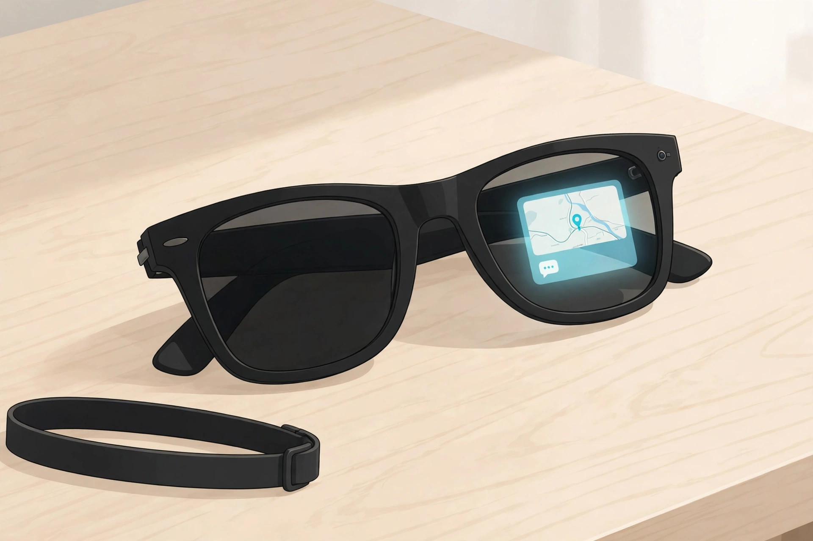
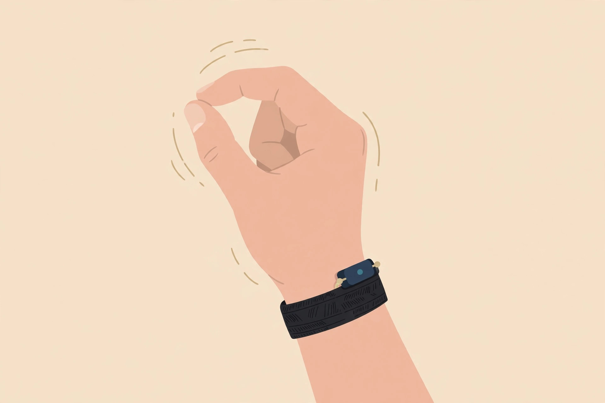
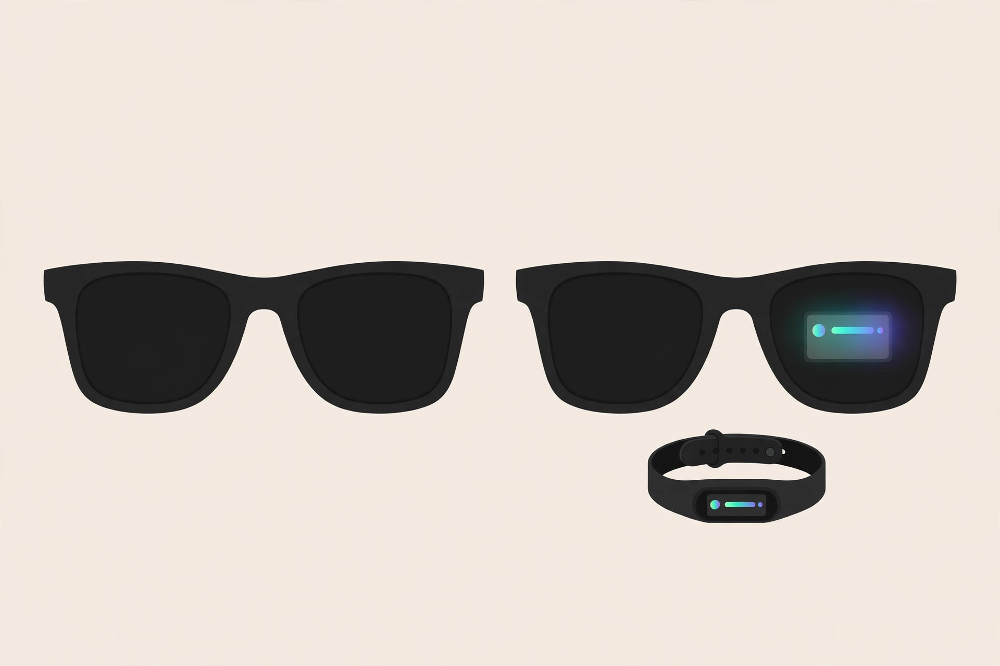

<!-- 본문 시작 -->

길을 걸으며 폰을 꺼내지 않고 메시지를 확인하면 얼마나 편할까. Meta Ray-Ban Display는 그 생각을 안경에 그대로 얹은 제품이다. 오른쪽 렌즈 안에 작은 컬러 화면이 들어 있고, 손목에 찬 밴드로 조종한다. 2025년 9월 17일 Meta Connect 2025에서 발표됐고, 같은 해 9월 30일 미국에서 판매를 시작했다.

겉모습은 레이밴 웨이페어러 선글라스와 거의 같다. 검은색과 모래색 두 가지, 스탠더드와 라지 두 가지 크기다. 렌즈는 실내외에서 색이 변하는 트랜지션스 렌즈가 기본이다. 화면은 오른쪽 렌즈에만 있고, 왼쪽 렌즈에는 아무것도 뜨지 않는다. 함께 제공되는 Meta Neural Band는 손목 근육의 미세한 신호를 읽어, 손가락을 까딱이는 동작으로 화면을 넘기고 선택하게 한다.

화면은 오른쪽 렌즈의 작은 영역에만 뜬다. (일러스트)

화면은 작지만 밝다. 공식 사양 기준 600×600 해상도, 시야각 20도, 최대 밝기 5,000니트다. 메시지·알림·길안내·실시간 자막·번역·사진 미리보기를 띄우는 용도다. 긴 글을 읽는 화면이 아니라 흘끗 보고 넘기는 화면에 가깝다. 12MP 카메라에 3배 디지털 줌이 달렸고, Meta AI 음성 비서로 전화·음악·촬영을 조작한다. 밴드는 한 번 충전으로 최대 18시간, IPX7 방수 등급이다.

밴드 없이는 화면 조작이 크게 제한된다. (일러스트)

그러나 사기 전에 확인할 조건이 많다. 첫째, 도수다. 도수 렌즈는 단초점만 가능하고 합산 도수 -4.00~+4.00 범위, 난시 최대 4.00까지만 지원한다. 누진 렌즈는 제공되지 않고, 도수는 구매할 때 함께 주문해야 한다. 도수 렌즈를 더하면 가격은 999달러가 된다. 둘째, 배터리다. 안경은 최대 6시간이 제조사 주장이고, 화면을 자주 쓰면 독립 리뷰에서는 2시간 수준까지 줄어든다는 보고도 있다. 케이스 충전까지 합친 총 사용 시간은 안내 페이지마다 24~30시간으로 달라 확인이 필요하다. 셋째, 판매 국가다. 2026년 11월 6일 기준 미국·영국·캐나다·프랑스·독일·이탈리아 6개국에서만 팔리고, 한국 출시는 미확인이다. Meta AI 한국어 지원 여부도 미확인이다.

| 항목 | 내용 |
|---|---|
| 제품 | Meta Ray-Ban Display + Meta Neural Band |
| 디스플레이 | 오른쪽 렌즈만 · 600×600 · 시야각 20° · 최대 5,000니트 |
| 배터리 | 안경 최대 6시간(제조사 주장) · 밴드 최대 18시간 · 케이스 포함 총 시간은 안내별 24~30시간 |
| 카메라 | 12MP · 3배 디지털 줌 · 동영상 스펙 미확인 |
| 도수 렌즈 | 단초점만 · -4.00~+4.00 · 누진 미제공 · 구매 시 주문 |
| 크기·무게 | Black·Sand · 스탠더드/라지 · 69g |
| 가격·판매 | 799달러(도수 렌즈 포함 999달러) · 6개국 판매 · 한국 미확인 |

가격은 미국 기준 799달러, 도수 렌즈를 더하면 999달러다. 화면이 없는 Ray-Ban Meta Gen 2는 379달러부터 시작하고 배터리는 최대 8시간, 무게는 51g이다. 화면이 필요 없으면 Gen 2가 가볍고 오래 가고 훨씬 싸다. 반대로 화면이 꼭 필요하면 Display 외에 선택지가 거의 없다.

같은 웨이페어러라도 화면 유무가 가격과 무게를 가른다. (일러스트)

> 안경을 쓰면 폰을 꺼낼 일이 줄어든다
>
> ### **799달러는 안경값이 아니라, 화면과 손목 밴드를 함께 사는 값이다**

판단은 조건부다. 도수 범위에 들고, 화면을 흘끗 보는 용도가 분명하고, 판매 국가에서 직접 살 수 있다면 흥미로운 선택이다. 도수가 범위를 벗어나거나, 한국에서 정식 구매와 AS를 기대한다면 지금은 서두를 이유가 없다. 한국 출시와 Meta AI 한국어 지원이 확인된 뒤에 다시 따져보자. 직접 사용 후기가 아니라 공식 자료와 독립 리뷰 정리다.

## 함께 보면 좋은 글

- [손바닥 위를 걷는 로봇 개 — Petoi Quaddle, 사기 전에 확인할 조건](https://blog.naver.com/3700708/224465464756)
  책상 위에서 움직이는 기기, 사기 전 조건을 따지는 글이다.
- [화면 없는 노트북 — Hero Keyboard, 사기 전에 확인할 조건](https://blog.naver.com/3700708/224465464467)
  화면을 빌려 쓰는 발상의 구매 전 조건이다.
- [AI 브라우저 티어표로 고르기｜읽어주는 브라우저와 대신 클릭하는 브라우저는 다르다](https://blog.naver.com/3700708/224460771206)
  비슷해 보여도 동작이 다른 제품을 구분하는 기준이다.

## 출처

- [Meta 공식 제품 페이지](https://www.meta.com/ai-glasses/meta-ray-ban-display/)
- [TechCrunch — Meta Connect 2025 발표 정리](https://techcrunch.com/2025/09/19/meta-connect-2025-what-to-expect-and-how-to-watch/)
- [OXIVUE — Meta Ray-Ban Display 가격·스펙·뉴럴 밴드 가이드](https://oxivue.com/guides/meta-ray-ban-display)
- [Pogwire — 가격·출시 국가 정리](https://pogwire.com/tech/meta-ray-ban-display-price-release-date)
- [Frames and Features — 판매 국가·도수 렌즈 조건](https://www.framesandfeatures.com/devices/meta-ray-ban-display/)
- [heytalaya — 6개 리뷰 종합](https://heytalaya.com/2026/10/meta-ray-ban-display-reviews/)

<!-- 본문 끝 -->
