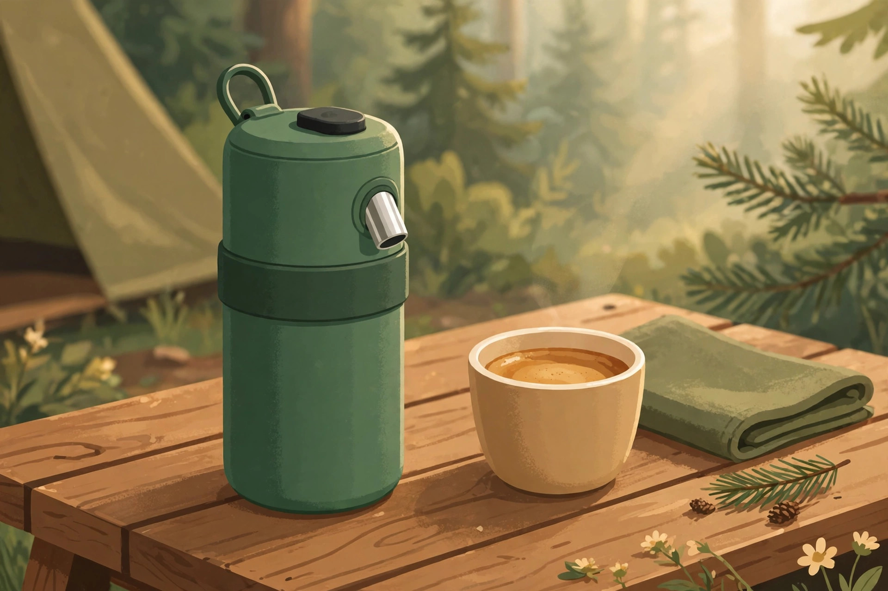
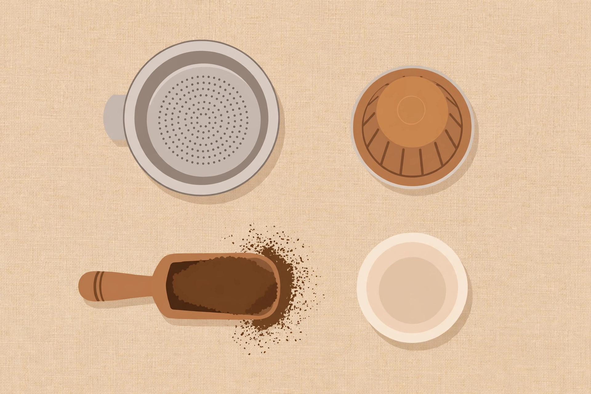

<!-- 본문 시작 -->
Cold Water In, Espresso Out — Outin Nano, What to Check Before Buying

A campsite morning, a hotel room with no kettle, a rest stop on the road. There are moments when you want coffee and there is nowhere to get hot water. The Outin Nano is a water-bottle-sized espresso machine built for exactly that gap. Pour in cold water, press one button, and it heats the water itself and pulls a shot.

The Nano is a portable espresso machine from Outin, a company headquartered in Denver, Colorado, launched in January 2023 (launch timing based on review-media reporting). Its identity is a cylinder the size of a water bottle holding a heater, a pump, and a battery together. It needs no power outlet and no kettle; one button carries it through to extraction.

First, it heats its own water. According to the maker, 50ml of room-temperature water (25°C) is heated to 92°C in about 200 seconds, then extracted at up to 20 bar of pressure (based on OutIn Lab internal testing, checked on the official page on 2026-11-06). That is the opposite of most pump-style portable brewers, which need you to prepare hot water separately.

Second, it takes both ground coffee and capsules. A basket for ground coffee and an adapter for Nespresso Original-compatible capsules come in the box. There is no need to insist on beans, and no reason to use capsules only. However, the stock basket holds only 7–8g, so independent reviews agree that the separately sold Basket Plus ($39.90, up to 18g) is effectively essential for anyone who cares about taste (Coffee Review, Coffee Chronicler).

Third, the battery budget decides how you use it. The maker states up to 5 shots per charge from cold water, or over 200 shots if you fill it with hot water (checked on the official page on 2026-11-06). Charging is over USB-C and needs a charger of 10W or more; the official guidance says a low-power charger such as a 5W one will not charge it. A hands-on review reports that a full recharge takes a few hours, so charging overnight is the better plan (Nest Nomad & Beyond, July 2026).

| Item | Detail |
|---|---|
| Product | Outin Nano, self-heating portable espresso machine |
| Weight and size | 670g, a water-bottle-sized cylinder (about 22.4cm tall, as stated by review media) |
| Extraction | Up to 20 bar, 92°C, 50–80ml water tank |
| Battery | 2,500mAh 3S, 5 shots with cold water / over 200 with hot water (official figures) |
| Price (as of 2026-11-06) | $149.99 (official store) |
| Korea purchase and Korean support | Unconfirmed |

> The moment cold water becomes espresso, this machine's value is decided by the places where there is no kettle.
> ### **Only for someone who accepts the five-shot battery budget first does this bottle become a barista.**

670g, the size of a water bottle — whether it fits in a bag's bottle pocket is the first test of its portability. (illustration)

The 200-second heating is the point. The five-shot battery budget is a cold-water figure, and that has to be read together with it. (illustration)

The stock basket holds 7–8g; the separately sold Basket Plus holds up to 18g. The difference in taste starts here. (illustration)

The drawbacks are clear too. Each brew is a short 50–80ml shot, not a full mug of coffee. Reviews also disagree on extraction quality. CNN Underscored's tester found the shots light and watery with underwhelming crema (as cited in the Coffee Lab Advisor comparison guide), while Coffee Chronicler reports a professional-level 20% extraction yield with the Basket Plus, but notes the lower brewing temperature can work against light-roast beans. Official guidance also says the device cannot be used in flight and may only be carried on. Owner reports cited by review media also point to battery capacity fading after long-term use (Coffee Nestiq).

The price is $149.99 at the official store as of 2026-11-06. Adding the Basket Plus at $39.90 brings it to $189.89. The official FAQ lists a general shipping time of 7–10 working days, but whether shipping to Korea is available, and what shipping fees, customs duties, and the local price would be, are unconfirmed and should be checked directly before buying.

The editor's verdict is this. It is worth a look if you drink a cup a day in places with no kettle — camping, car camping, or business trips. If you only drink at home, a countertop machine is the better use of the same money. If you buy, judge the price with the Basket Plus included from the start.

## Related Posts

- [A Keyboard Where Lifting a Typewriter Lever Presses Enter — Epomaker Glyph, What to Check Before Buying](https://aitechnotesen.wordpress.com/2026/11/03/a-keyboard-where-lifting-a-typewriter-lever-presses-enter-epomaker-glyph-what-to-check-before-buying/) — An unusual input device that must also be judged by real typing conditions before its looks.
- [One USB-C Cable Is Not Enough? What to Check Before Buying the ASUS ZenScreen MB16AHV](https://aitechnotesen.wordpress.com/2026/11/03/one-usbc-cable-is-not-enough-what-to-check-before-buying-the-asus-zenscreen-mb16ahv/) — A condition guide showing that a port must be checked for video output even when it looks the same.
- [Stop Digging Through Your Bag — MagQuick, a Strap That Snaps On and Pulls Off](https://aitechnotesen.wordpress.com/2026/10/25/stop-digging-through-your-bag-magquick-a-strap-that-snaps-on-and-pulls-off/) — A small desk-and-bag gadget judged by how it actually attaches and detaches.

Sources: [Outin official product page](https://outin.com/products/nano-portable-espresso-machine-forest-green?srsltid=AfmBOor2Hpto8rD_Bf9kfrDThqEHgaPT2MRYTeSLzWGOSGz4E6BhUu3d), [Coffee Review equipment review](https://www.coffeereview.com/equipment-review-outin-nano-portable-espresso-maker/), [Nest Nomad & Beyond hands-on review](https://www.nestnomadandbeyond.co.uk/post/outin-nano-review), [Coffee Chronicler review](https://coffeechronicler.com/outin-nano-review/), [Coffee Lab Advisor comparison guide](https://www.coffeelabadvisor.com/guides/best-portable-espresso-maker) — all checked 2026-11-06.
<!-- 본문 끝 -->
