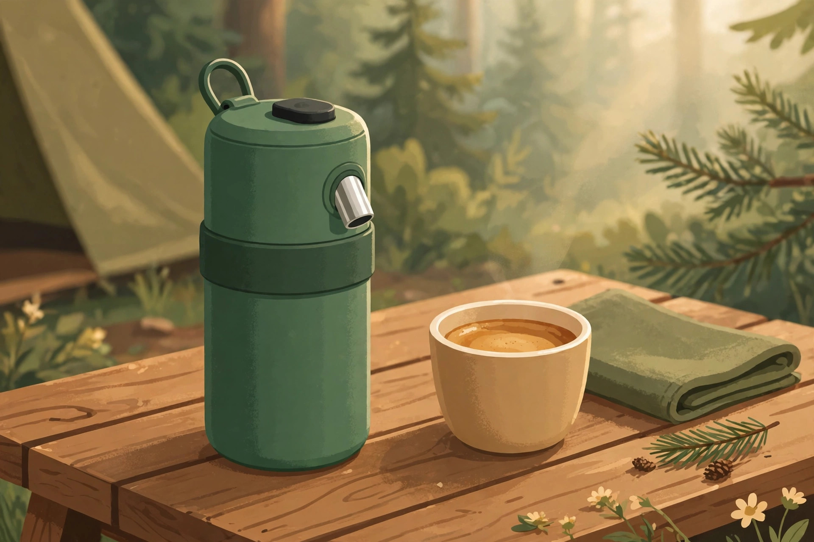
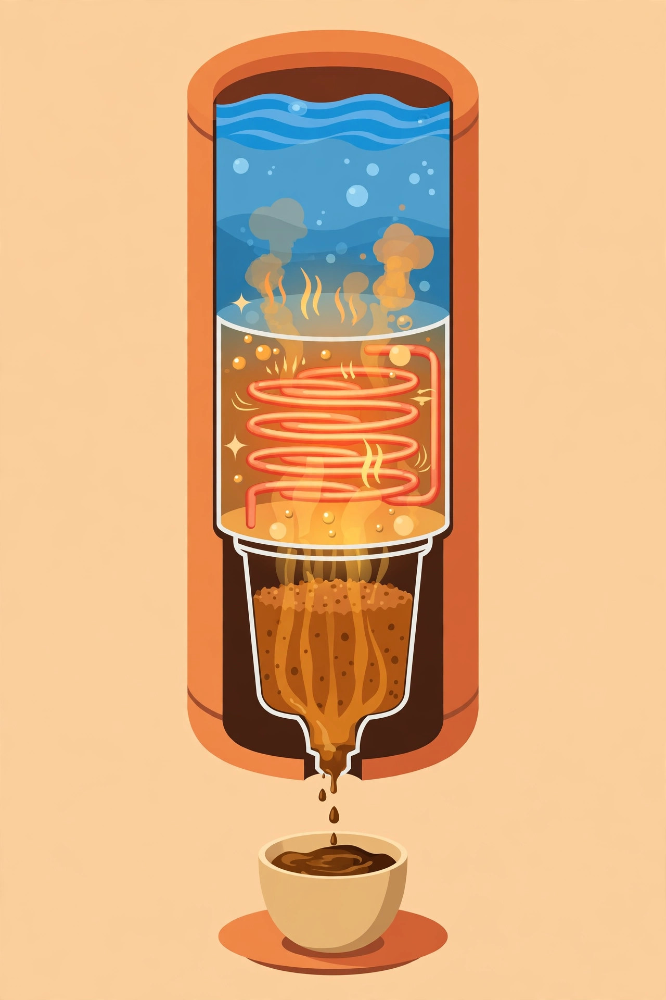
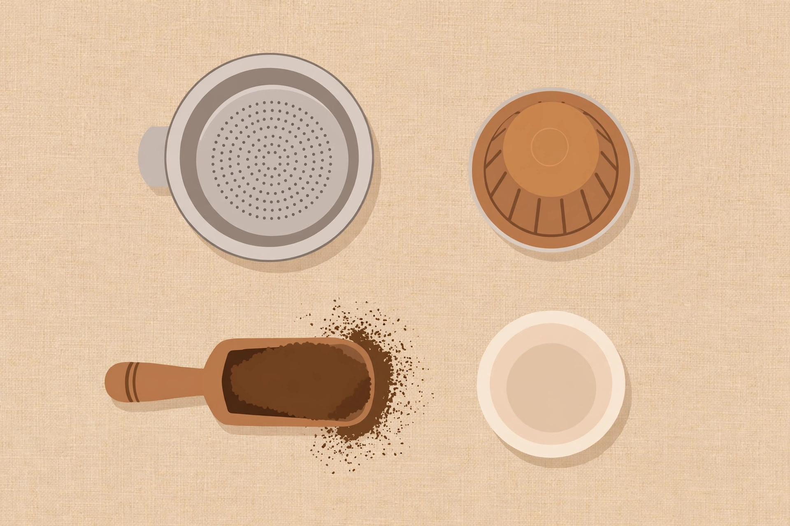

<!-- 본문 시작 -->
찬물만 넣으면 에스프레소가 된다 — Outin Nano, 사기 전에 확인할 조건

캠핑장 아침, 주전자가 없는 호텔 방, 차 안 휴게소. 커피가 마시고 싶은데 뜨거운 물을 구할 곳이 없을 때가 있다. Outin Nano는 그 틈을 노리는 물병만 한 에스프레소 머신이다. 찬물을 넣고 버튼 하나만 누르면 스스로 데워 에스프레소를 뽑는다.

Nano는 미국 덴버에 본사를 둔 Outin의 휴대용 에스프레소 머신으로, 2023년 1월에 출시됐다(출시 시점은 리뷰 매체 보도 기준). 물병만 한 원통 안에 히터와 펌프, 배터리를 함께 넣은 것이 정체다. 전원도 주전자도 필요 없고, 버튼 하나로 추출까지 이어진다.

첫째, 스스로 데운다. 50ml의 실온 물(25°C)을 약 200초 만에 92°C까지 데운 뒤 최대 20bar 압력으로 추출한다는 것이 제조사의 설명이다(OutIn Lab 내부 테스트 기준, 2026-11-06 공식 페이지 확인). 펌프식 휴대 머신 대부분이 뜨거운 물을 따로 준비해야 하는 것과 정반대 지점이다.

둘째, 원두와 캡슐을 둘 다 쓴다. 분쇄 원두용 바스켓과 네스프레소 오리지널 호환 캡슐 어댑터가 함께 들어 있다. 원두를 고집할 필요도, 캡슐만 써야 할 이유도 없다. 다만 기본 바스켓은 7~8g만 담기는 작은 크기라, 맛을 따지는 사용자에게는 별매 Basket Plus(39.90달러, 18g까지)가 사실상 필수라는 것이 독립 리뷰들의 공통 지적이다(Coffee Review, Coffee Chronicler).

셋째, 배터리 예산이 사용 방식을 정한다. 1회 충전으로 찬물 기준 최대 5잔, 뜨거운 물을 넣으면 200잔 이상을 뽑을 수 있다고 제조사는 안내한다(2026-11-06 공식 페이지 확인). 충전은 USB-C이며 10W 이상 충전기가 필요하고, 5W 같은 저전력 충전기로는 충전이 안 된다는 공식 안내가 있다. 실사용 리뷰에서는 완충에 몇 시간이 걸려 밤새 충전하는 편이 낫다고 전한다(Nest Nomad & Beyond, 2026년 7월).

| 항목 | 내용 |
|---|---|
| 제품 | Outin Nano, 자가 가열 휴대용 에스프레소 머신 |
| 무게·크기 | 670g, 물병만 한 원통형(높이 약 22.4cm, 리뷰 매체 표기) |
| 추출 | 최대 20bar, 92°C, 물탱크 50~80ml |
| 배터리 | 2,500mAh 3S, 찬물 5잔 / 뜨거운 물 200잔 이상(공식) |
| 가격(2026-11-06 기준) | 149.99달러(공식 스토어) |
| 국내 구매·한국어 지원 | 미확인 |

> 찬물이 에스프레소가 되는 순간, 이 기계의 가치는 주전자가 없는 장소에서 정해진다.
> ### **배터리 5잔이라는 예산을 먼저 받아들일 수 있는 사람에게만, 이 물병은 바리스타가 된다.**

670g, 물병만 한 크기 — 가방 물병 주머니에 들어가는지가 휴대성의 첫 관문이다. (일러스트)

200초 가열이 핵심이다. 배터리 5잔이라는 예산은 찬물 기준이라는 점을 함께 봐야 한다. (일러스트)

기본 바스켓은 7~8g, 별매 Basket Plus는 18g까지 담는다. 맛의 차이는 여기서 갈린다. (일러스트)

아쉬운 점도 분명하다. 한 번에 나오는 양은 50~80ml의 짧은 샷이라 머그잔 가득한 커피가 아니다. 추출 품질에 대한 평가도 갈린다. CNN Underscored의 테스터는 가볍고 묽은 추출에 크레마가 아쉽다고 평했고(Coffee Lab Advisor 비교 가이드 인용), Coffee Chronicler는 Basket Plus를 쓰면 전문 추출 수율 20%에 이른다고 전하면서도, 낮은 추출 온도가 밝은 로스팅 원두에는 불리할 수 있다고 지적했다. 기내에서는 사용할 수 없고 기내 반입만 가능하다는 공식 안내도 있다. 장기 사용 후 배터리 용량 저하를 지적한 소유자 후기도 리뷰 매체에 있다(Coffee Nestiq).

가격은 2026-11-06 공식 스토어 기준 149.99달러다. Basket Plus 39.90달러를 더하면 189.89달러가 된다. 일반 배송 기간은 7~10영업일이라고 공식 FAQ에 안내돼 있으나, 한국 배송 가능 여부와 배송비·관세 포함 여부, 원화 가격은 미확인이라 구매 전에 직접 확인해야 한다.

에디터 판단은 이렇다. 캠핑·차박·출장처럼 주전자가 없는 곳에서 매일 한 잔씩 마시는 사람이라면 들여다볼 만하다. 집에서만 마신다면 같은 돈으로 카운터용 머신이 낫다. 산다면 Basket Plus 예산을 처음부터 포함한 가격으로 따져보는 것이 좋다.

## 함께 보면 좋은 글

- [손바닥 위를 걷는 로봇 개 — Petoi Quaddle, 사기 전에 확인할 조건](https://blog.naver.com/3700708/224465464756) — 책상 위에서 즐기는 작은 기기의 구매 조건을 정리한 글이다.
- [화면 없는 노트북 — Hero Keyboard, 사기 전에 확인할 조건](https://blog.naver.com/3700708/224465464467) — 독특한 입력 기기의 구매 조건을 정리한 글이다.
- [AI 브라우저 티어표로 고르기｜읽어주는 브라우저와 대신 클릭하는 브라우저는 다르다](https://blog.naver.com/3700708/224460771206) — AI 도구를 목적별로 나누어 고르는 글이다.

출처: [Outin 공식 제품 페이지](https://outin.com/products/nano-portable-espresso-machine-forest-green?srsltid=AfmBOor2Hpto8rD_Bf9kfrDThqEHgaPT2MRYTeSLzWGOSGz4E6BhUu3d), [Coffee Review 장비 리뷰](https://www.coffeereview.com/equipment-review-outin-nano-portable-espresso-maker/), [Nest Nomad & Beyond 실사용 리뷰](https://www.nestnomadandbeyond.co.uk/post/outin-nano-review), [Coffee Chronicler 리뷰](https://coffeechronicler.com/outin-nano-review/), [Coffee Lab Advisor 비교 가이드](https://www.coffeelabadvisor.com/guides/best-portable-espresso-maker) (이상 확인일 2026-11-06)
<!-- 본문 끝 -->
