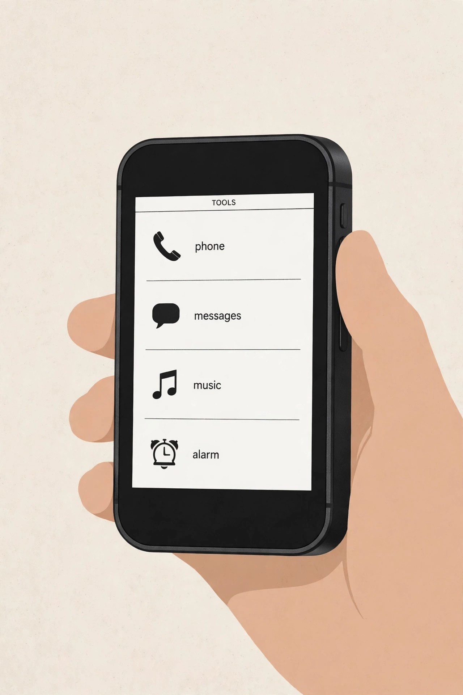
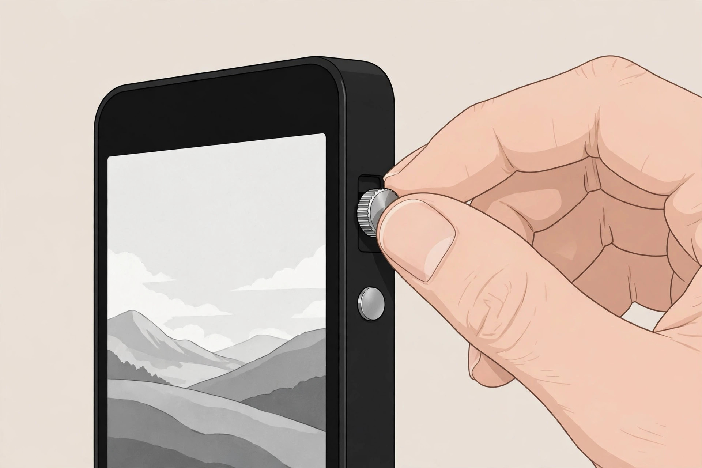
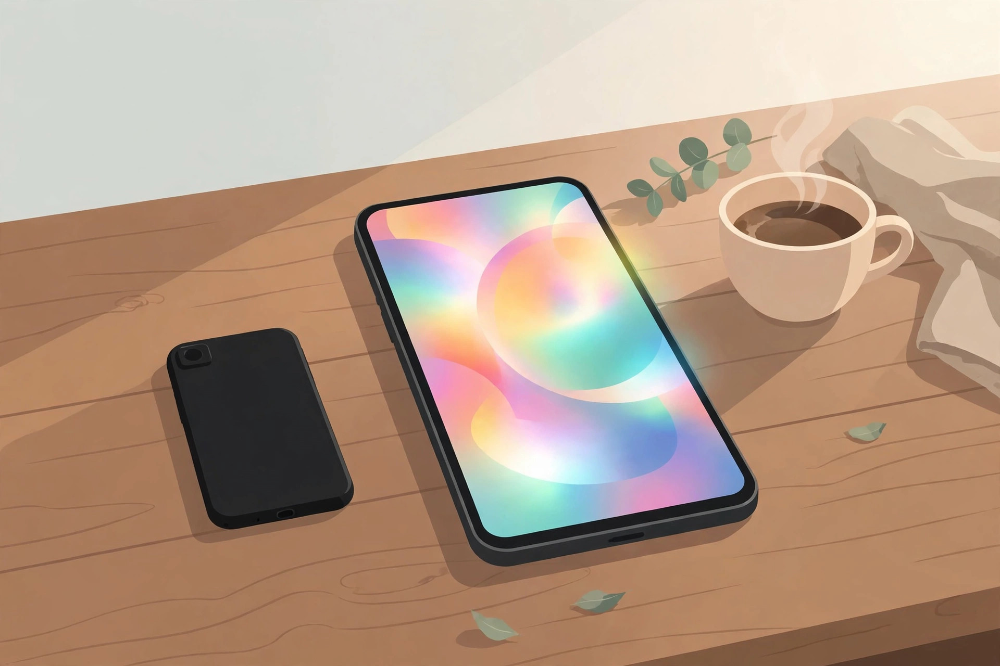

<!-- 본문 시작 -->

I want to use my phone less. But I cannot live without a phone. The Light Phone III sits right in that gap. It is a 5G phone with no apps, no social media, and no browser. The price is $899. That is the price confirmed at the maker's store in October 2026 (checked 2026-11-07). I went through the conditions to check before buying, starting with why a phone with fewer features costs this much.

The Light Phone III was announced in June 2024, and shipping to the earliest pre-order customers began in March 2025. It is the third minimalist phone from Light, a Brooklyn startup. The maker's philosophy is a phone "designed to be used as little as possible." Its operating system, LightOS, is based on Android but has no Google services, and it removes the web browser, email, social media, the app store, news, and ads entirely. According to the maker, those five things will "never" be supported. What is left is only phone calls, messages, alarm, calculator, calendar, camera, directions, contacts, hotspot, music, notes, podcasts, and album.

The list on the screen is all there is. (Illustration)

The screen changed first. The previous model used a slow E Ink display, but this one has a 3.92-inch black-and-white AMOLED panel. The resolution is 1080×1240, and the maker says the matte glass stays readable in sunlight. It is still black and white, not color. Photos are taken in color but shown in black and white on the screen. The design refuses to tempt you with color.

It also has a camera for the first time. The rear 50MP sensor takes 12MP photos, and there is an 8MP front camera. A dedicated shutter button lets you shoot like a film camera, with a half-press and a full press. The previous model had no camera at all, so you had to carry another device to take photos. That inconvenience is gone now.

The parts you touch got attention too. A side scroll wheel moves through lists, a fingerprint sensor unlocks the phone, and the aluminum frame weighs 124g. Open the screw-fastened back cover and you can replace the 1,800mAh battery yourself. It charges over USB-C, supports 5G and LTE, and takes both an eSIM and a nano SIM.

The feel of turning the wheel to move through lists defines most of how this phone is used. (Illustration)

The downsides are clear. Engadget's review headline calls it "minimalism stretched to the point of frustration." There is no autocorrect, no swipe typing, and no WhatsApp. KakaoTalk cannot be installed either, because of how the phone is built, so messaging is the biggest wall if you want to use it as your main phone in Korea. The LightOS SDK was announced on April 30, 2026, and the maker says vetted third-party "tools" will open up, with a Signal tool in development — but none of that is usable yet.

| Item | Details |
|---|---|
| Price | $899 (maker's store, October 2026) |
| Display | 3.92-inch black-and-white AMOLED, 1080×1240 |
| Processor and memory | Snapdragon 4 Gen 2, 6GB RAM, 128GB |
| Camera | Rear 50MP (12MP output), front 8MP |
| Battery | 1,800mAh, user-replaceable |
| Connectivity | 5G and LTE, eSIM + nano SIM |
| Use in Korea | Carrier compatibility, shipping, and after-sales support unconfirmed |

The price keeps rising. The early pre-order price was $399, then $599, then $699 in the summer of 2026, and $899 in October 2026. The retail price was announced as $799, but it has climbed above that. New orders are expected to ship in late December 2026. International shipping is available, but shipping and import fees are separate. Whether it works with Korean carriers, and what shipping, import fees, and after-sales support cost in Korea, is unconfirmed. In the US, it is confirmed to work on AT&T and T-Mobile, while Verizon certification is still in progress.

The moment you put the phone down is everything this product is selling. (Illustration)

> It removes apps, and leaves only what a phone has to do.
> ### **What costs so much is not what it does, but what it refuses to do.**

My take is this. If you are sure you want to use your phone less, and you can move messaging to a second device, this is a meaningful option. But as a main phone in Korea, you first have to accept that KakaoTalk does not work, that the price is rising and delivery is slow, and that the conditions for using it in Korea are unconfirmed. If you want it as a second phone, there is no need to rush before the price drops. A long shipping wait also means you cannot use it right away even if you buy it now.

## Related Posts

- [Cold Water In, Espresso Out — Outin Nano, What to Check Before Buying](https://aitechnotesen.wordpress.com/2026/11/06/cold-water-in-espresso-out-outin-nano-what-to-check-before-buying/) — A portable espresso machine that brews with cold water and coffee grounds, with the conditions to check before buying.
- [A Screen Inside Your Glasses — Meta Ray-Ban Display, What to Check Before Buying](https://aitechnotesen.wordpress.com/2026/11/06/a-screen-inside-your-glasses-meta-rayban-display-what-to-check-before-buying/) — Smart glasses with a display inside the lens, with prescription lenses and Korean availability checked.
- [A Keyboard Where Lifting a Typewriter Lever Presses Enter — Epomaker Glyph, What to Check Before Buying](https://aitechnotesen.wordpress.com/2026/11/03/a-keyboard-where-lifting-a-typewriter-lever-presses-enter-epomaker-glyph-what-to-check-before-buying/) — A keyboard with a typewriter lever, with the conditions to check before buying.

## Sources

- [Wikipedia — Light Phone III](https://en.wikipedia.org/wiki/Light_Phone_III)
- [Consumer Reports — Light Phone III Review](https://www.consumerreports.org/electronics-computers/cell-phones/light-phone-3-review-a1105801271/)
- [takemy.money — Best Minimalist Phones 2026](https://takemy.money/the-best-minimalist-phones)
- [The Gadgeteer — Best Dumb Phones 2026](https://the-gadgeteer.com/2026/06/30/best-dumb-phones-2026-how-to-pick-the-right-one/)
- [Notebookcheck — Light Phone 3 Launch](https://www.notebookcheck.net/Light-Phone-3-launches-with-50-discount-monochrome-OLED-and-minimalist-design.847078.0.html)
- [Engadget — Light Phone III Now Available for Purchase](https://www.engadget.com/mobile/smartphones/the-minimalist-light-phone-iii-is-officially-available-for-purchase-150056138.html)
- [Phone Scoop — Light Phone III / Light Flip News](https://www.phonescoop.com/phones/news.php?p=7252)

<!-- 본문 끝 -->
