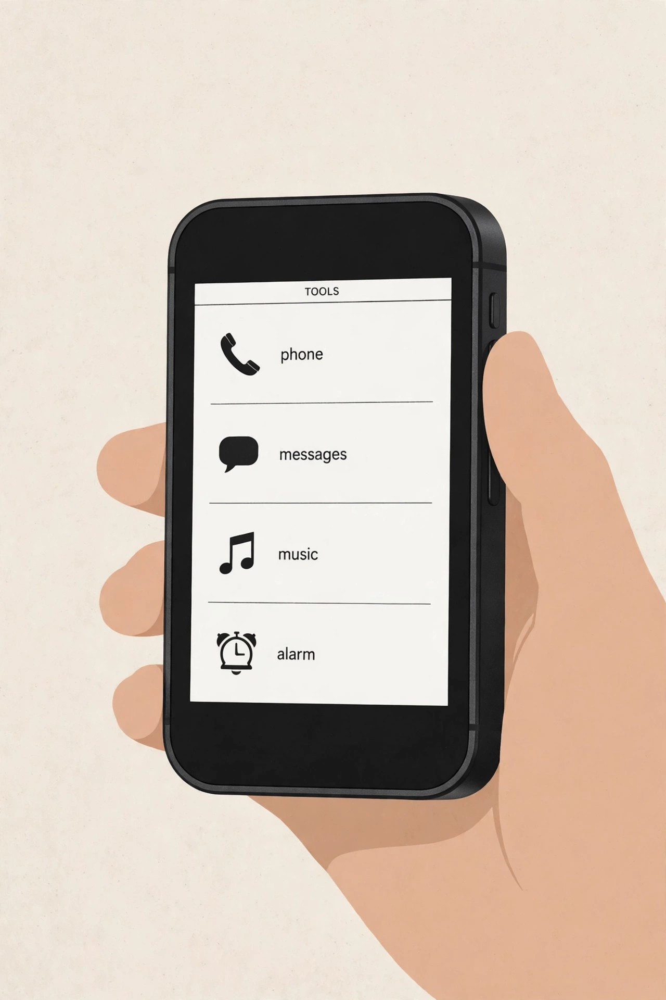
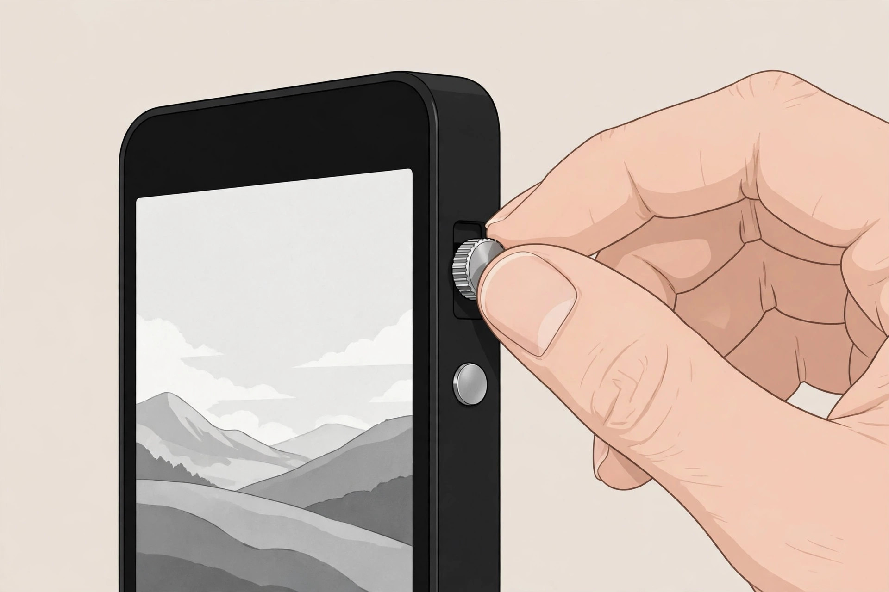
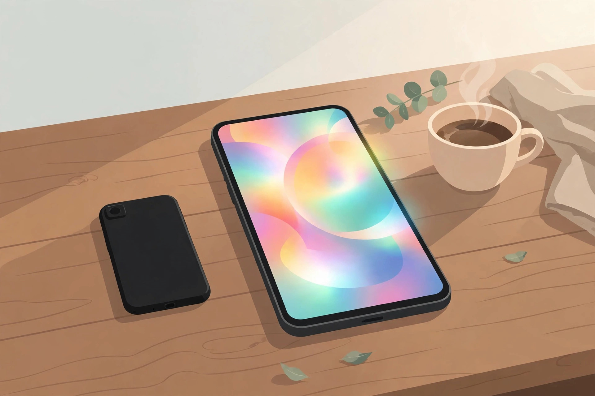

<!-- 본문 시작 -->

폰을 덜 쓰고 싶다. 그런데 폰 없이 살 수는 없다. Light Phone III는 그 사이를 파고든 제품이다. 앱도, SNS도, 브라우저도 없는 5G 폰이다. 가격은 899달러. 2026년 10월 제조사 스토어에서 확인된 가격이다(2026-11-07 확인). 기능을 뺀 폰이 왜 이렇게 비싼지, 사기 전에 따져볼 조건을 정리했다.

Light Phone III는 2024년 6월 발표됐고, 2025년 3월부터 초기 예약자에게 배송되기 시작했다. 브루클린 스타트업 Light의 세 번째 미니멀 폰이다. 제조사의 철학은 "가능한 한 적게 쓰도록 설계된 폰"이다. 운영체제 LightOS는 안드로이드 기반이지만 구글 서비스가 없고, 브라우저·이메일·SNS·앱스토어·뉴스·광고를 아예 빼버렸다. 제조사에 따르면 이 다섯 가지는 "절대" 지원하지 않는다고 한다. 대신 전화·문자·알람·계산기·캘린더·카메라·길안내·연락처·핫스팟·음악·메모·팟캐스트·앨범만 남겼다.

화면에 보이는 목록이 전부다. (일러스트)

화면이 먼저 달라졌다. 전작은 느린 전자종이였지만, 이번에는 3.92인치 흑백 AMOLED다. 해상도는 1080×1240, 매트 유리라 햇빛 아래에서도 읽힌다고 제조사는 설명한다. 컬러가 아니라 흑백인 점은 그대로다. 사진은 컬러로 찍히지만 화면에서는 흑백으로 보인다. 색으로 유혹하지 않겠다는 설계다.

카메라도 처음 달렸다. 후면 50MP 센서로 12MP 사진을 찍고, 전면 8MP 카메라가 있다. 전용 셔터 버튼이 있어 필름 카메라처럼 반셔터·전셔터로 찍는다. 전작에는 카메라가 아예 없어서 사진을 찍으려면 다른 기기를 들고 다녀야 했다. 이번에는 그 불편이 사라졌다.

손으로 만지는 부분도 신경 썼다. 측면 스크롤 휠로 목록을 넘기고, 지문 인식으로 잠금을 풀고, 알루미늄 프레임에 무게 124g이다. 나사로 고정된 후면 커버를 열면 1,800mAh 배터리를 직접 교체할 수 있다. USB-C 충전, 5G·LTE, eSIM과 나노 SIM을 함께 쓴다.

휠을 돌려 목록을 넘기는 감각이 이 폰의 사용감 대부분을 결정한다. (일러스트)

아쉬운 점은 분명하다. Engadget 리뷰는 제목부터 "좌절할 정도로 미니멀"이라고 했다. 자동완성이 없고, 스와이프 입력이 없고, 왓츠앱이 없다. 카카오톡도 설치할 수 없는 구조라, 한국에서 주력 폰으로 쓰기에는 메신저가 가장 큰 벽이다. 2026년 4월 30일 LightOS SDK가 발표돼 검증된 서드파티 '도구'가 열릴 예정이고, Signal 도구도 개발 중이라고 제조사는 밝혔지만, 아직 쓸 수 있는 상태가 아니다.

| 항목 | 내용 |
|---|---|
| 가격 | 899달러 (2026-10 제조사 스토어 기준) |
| 화면 | 3.92인치 흑백 AMOLED, 1080×1240 |
| 프로세서·메모리 | Snapdragon 4 Gen 2, 6GB RAM, 128GB |
| 카메라 | 후면 50MP(12MP 출력)·전면 8MP |
| 배터리 | 1,800mAh, 사용자 교체 가능 |
| 통신 | 5G·LTE, eSIM + 나노 SIM |
| 한국 이용 | 통신사 호환·배송비·AS 미확인 |

가격은 오르는 중이다. 초기 예약가는 399달러였고, 이후 599달러, 2026년 여름 699달러를 거쳐 2026년 10월에는 899달러가 됐다. 정가는 799달러로 안내됐으나 그 위로 올랐다. 신규 주문은 2026년 12월 말 배송이 예상된다. 국제 배송은 가능하지만 배송비·관세는 별도다. 한국 통신사 호환 여부와 한국 배송비·관세·AS는 미확인이다. 미국에서는 AT&T·T-Mobile에서 동작이 확인됐고, Verizon은 인증이 진행 중이다.

폰을 내려놓는 순간이 이 제품이 파는 전부다. (일러스트)

> 핵심 한 줄
>
> ### **앱을 빼는 대신, 폰이 해야 할 일만 남겼다.**

에디터의 판단은 이렇다. 폰을 덜 쓰고 싶은 마음이 확실하고, 메신저를 두 번째 기기로 분리할 수 있는 사람에게는 의미 있는 선택지다. 다만 한국에서 주력 폰으로 쓰기에는 카카오톡이 안 된다는 점, 가격이 오르고 배송이 늦다는 점, 한국 이용 조건이 미확인이라는 점을 먼저 받아들여야 한다. 서브 폰으로 두고 싶은 사람이라면, 가격이 내리기 전에 서두를 필요는 없다. 배송 대기가 길다는 건 곧 지금 사도 바로 쓸 수 없다는 뜻이기도 하다.

## 함께 보면 좋은 글

- [찬물만 넣으면 에스프레소가 된다 — Outin Nano, 사기 전에 확인할 조건](https://blog.naver.com/3700708/224467570385) — 찬물과 커피 가루만으로 에스프레소를 뽑는 휴대용 머신, 사기 전에 확인할 조건을 정리했다.
- [안경에 화면이 들어갔다 — Meta Ray-Ban Display, 사기 전에 확인할 조건](https://blog.naver.com/3700708/224467569779) — 렌즈 안에 화면을 넣은 스마트글라스, 도수 렌즈와 한국 판매 여부를 확인했다.
- [AI 브라우저 티어표로 고르기｜읽어주는 브라우저와 대신 클릭하는 브라우저는 다르다](https://blog.naver.com/3700708/224460771206) — AI 브라우저를 목적별로 나눠 고르는 기준을 정리했다.

## 출처

- [Wikipedia — Light Phone III](https://en.wikipedia.org/wiki/Light_Phone_III)
- [Consumer Reports — Light Phone III 리뷰](https://www.consumerreports.org/electronics-computers/cell-phones/light-phone-3-review-a1105801271/)
- [takemy.money — 2026년 미니멀 폰 비교](https://takemy.money/the-best-minimalist-phones)
- [The Gadgeteer — 2026년 최고의 덤폰 고르기](https://the-gadgeteer.com/2026/06/30/best-dumb-phones-2026-how-to-pick-the-right-one/)
- [Notebookcheck — Light Phone 3 출시 정리](https://www.notebookcheck.net/Light-Phone-3-launches-with-50-discount-monochrome-OLED-and-minimalist-design.847078.0.html)
- [Engadget — Light Phone III 정식 판매 시작](https://www.engadget.com/mobile/smartphones/the-minimalist-light-phone-iii-is-officially-available-for-purchase-150056138.html)
- [Phone Scoop — Light Phone III / Light Flip 소식](https://www.phonescoop.com/phones/news.php?p=7252)

<!-- 본문 끝 -->
