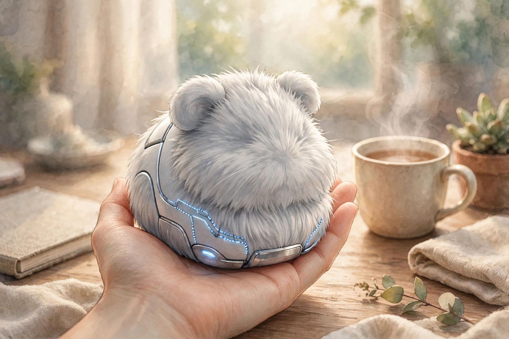

<!-- 본문 시작 -->

It cannot talk, it cannot walk, and it cannot do chores. Yet this ball of fur sells in the United States for $429 — Casio's AI companion robot, Moflin. Reports say it sold out quickly after its November 2024 launch in Japan (checked 2026-11-07). What makes this robot special is that it remembers the hand that pets it and grows a personality.

## What Is Moflin?

Moflin is a palm-sized AI companion robot from Casio. It looks like a guinea pig, covered in soft fur, with no face and no limbs. According to the official specifications (checked 2026-11-07), it measures about 130 × 90 × 180 mm and weighs about 260 g. It turns its head, wriggles its body, and responds with small sounds. It has no camera and no Wi-Fi, and it does not understand or record speech. Casio explains that voice features are converted into data that cannot identify a person and processed only on the device.

A fluffy robot on an open palm (illustration) — at about 260 g, it fits lightly in one hand.

## A Personality That Changes as You Pet It

Moflin's headline feature is its "emotional AI." According to the manufacturer, as interactions pile up — petting, holding, speaking softly — its range of emotional expression widens and its personality develops. Casio claims more than 4 million possible emotional combinations, but that is the manufacturer's claim and has not been independently verified. The official growth stages are limited emotions on day 1, attachment beginning on day 25, and clear emotional expression on day 50. Japanese user reviews also report that it takes about 50 days for a personality to settle in.

The personality falls into four types. According to the manufacturer, a cheerful Moflin bobs its head as if singing, while an affectionate one loves to be held. Which personality yours develops depends on how you treat it. The idea is that the same product becomes a different robot for every owner.

## Wordless Communication, and Privacy

Moflin does not hold conversations. Instead of understanding words, it tells voices apart. It remembers a frequently heard voice as its owner. Because of this, everyday interaction works without an internet connection. The smartphone app "MofLife" connects over Bluetooth and shows its current mood and interaction history, but it is only a companion tool — the robot works on its own without the app.

It charges in a dedicated bed. Placed in the bed, it fully charges in about 3.5 hours and runs for about 5 hours (at 25°C under typical use, per the official specifications). It keeps responding while charging in the bed.

Resting in its charging bed (illustration) — about 3.5 hours to charge, about 5 hours of use.

## Drawbacks and Things to Check

For $429, what you get is comfort and presence, not practical functions such as moving, talking, or doing chores. One independent review puts it plainly: Moflin is "intentionally low-functionality."

The battery is not generous either. About 5 hours of use against about 3.5 hours of charging means you need to put it back in its bed regularly to keep it with you all day. User reviews also mention the app diary updating slowly, Bluetooth connections dropping, and chirps loud enough at night to need volume adjustment. The fur needs care too. Casio advises brushing it lightly with a soft brush.

> Key line
>
> ### **It cannot talk, but it remembers me**

## Price and Availability in Korea

| Item | Details |
|---|---|
| Product | Casio Moflin |
| Price | US $429, UK £369 (checked 2026-11-07) |
| Size and weight | About 130 × 90 × 180 mm, about 260 g |
| Battery | About 5 hours of use, about 3.5 hours to charge (at 25°C) |
| Connectivity and app | No camera or Wi-Fi, app is free |
| Availability in Korea | No official sale in Korea confirmed |

Availability in Korea is the biggest obstacle. The countries Casio lists as official sales markets are Japan, the United States, the United Kingdom, and China — Korea is not among them. To buy one in Korea, you would need to consider direct purchase or a forwarding service through the US Casio store or Amazon, and whether shipping to Korea is possible and whether the warranty applies in Korea has not been confirmed. Shipping and customs duties may be added to the $429 price, so check the final amount before ordering. Colors are silver, gold, and pink (launched October 2026), all at the same price.

Small enough to fit in two hands (illustration) — easy to hold on your lap and pet.

## The Editor's Take

Judged by what it can do, Moflin is an expensive toy; judged by simply being there, it is a surprisingly persuasive robot. It may suit people who want a pet but hesitate because of allergies, housing rules, or the burden of care. On the other hand, if you expect an AI assistant to talk with or a pet robot that follows you around, you are likely to be disappointed. Three things to check before buying: whether $429 is a price you accept for presence rather than function, whether the rhythm of 5 hours of use and 3.5 hours of charging fits your life, and whether you are ready to handle direct purchase and warranty yourself, since there is no official sale in Korea.

## Related Posts

- [Cold Water In, Espresso Out — Outin Nano, What to Check Before Buying](https://aitechnotesen.wordpress.com/2026/11/06/cold-water-in-espresso-out-outin-nano-what-to-check-before-buying/) — A pocket-sized portable espresso machine, with the conditions for cold-water extraction explained.
- [A Screen Inside Your Glasses — Meta Ray-Ban Display, What to Check Before Buying](https://aitechnotesen.wordpress.com/2026/11/06/a-screen-inside-your-glasses-meta-rayban-display-what-to-check-before-buying/) — When a screen in the lens meets wrist-band control, glasses change.
- [A Keyboard Where Lifting a Typewriter Lever Presses Enter — Epomaker Glyph, What to Check Before Buying](https://aitechnotesen.wordpress.com/2026/11/03/a-keyboard-where-lifting-a-typewriter-lever-presses-enter-epomaker-glyph-what-to-check-before-buying/) — A typewriter lever that works as an Enter key, and what that means for everyday typing.

## Sources

- [Casio US official product page — Moflin specifications and FAQ](https://www.casio.com/us/moflin/)
- [Notebookcheck — Casio brings Moflin to the US and UK](https://www.notebookcheck.net/Casio-brings-its-Moflin-furry-robot-to-more-markets-including-the-US-for-429.1117319.0.html)
- [Anton Robots — CASIO Moflin Review 2026](https://antonrobots.com/casio-moflin-review/)
- [KeyiRobot — Casio Moflin Review](https://keyirobot.com/en-us/blogs/buying-guide/casio-moflin-ai-pet-review)
- [mia-cat — Moflin Review (Japanese user reviews)](https://mia-cat.com/en/pet-robot/moflin-review/)
- [MyBabe — AI Companion Toys and Robot Pets in 2026](https://mybabe.app/blog/ai-companion-toys-2026)

<!-- 본문 끝 -->
