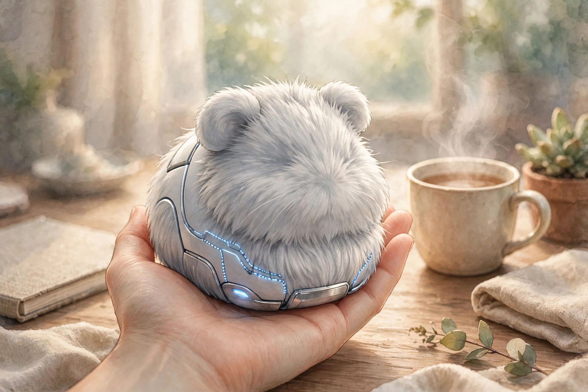
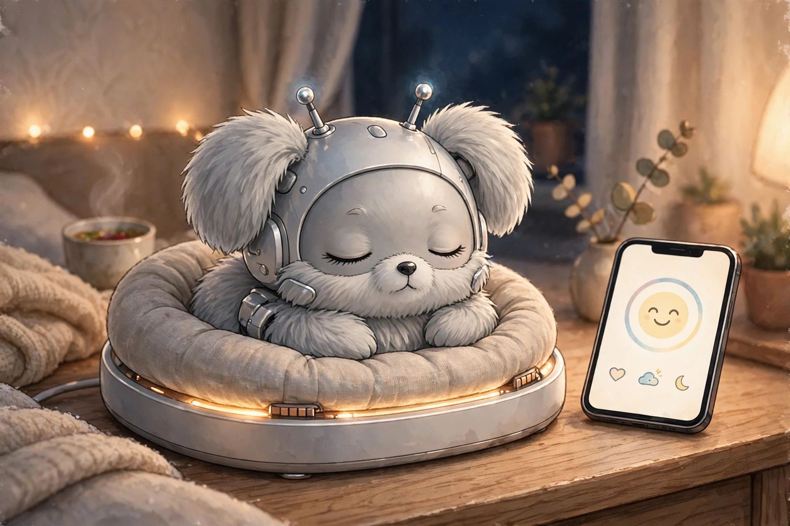
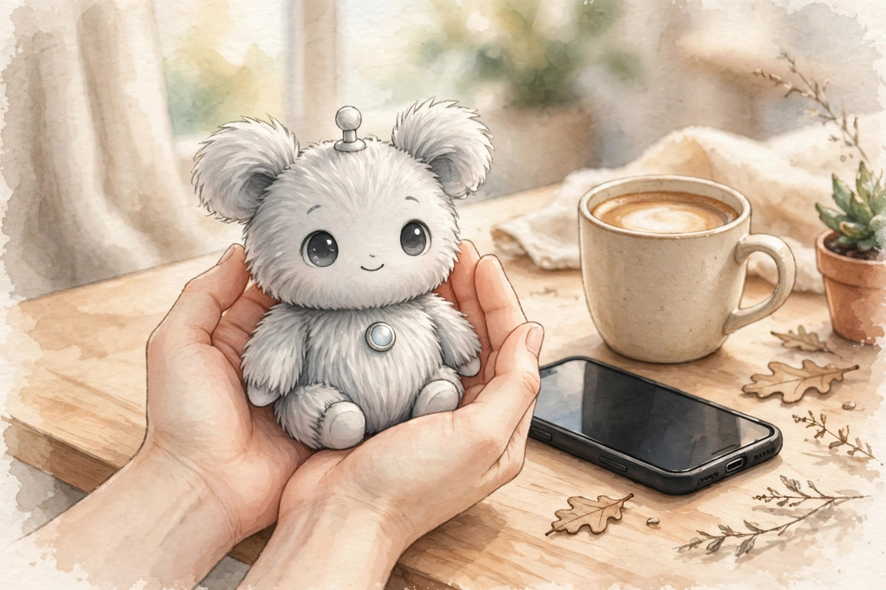

<!-- 본문 시작 -->

말을 못 하고, 걷지도 못하고, 집안일도 못 합니다. 그런데 이 털뭉치는 미국에서 429달러에 팔리는 카시오의 AI 반려 로봇, 모플린입니다. 일본에서는 2024년 11월 출시 직후 빠르게 품절됐다는 보도가 있습니다(2026-11-07 확인). 쓰다듬는 손길을 기억해 성격이 자란다는 것, 그게 이 로봇의 전부입니다.

## 모플린은 어떤 제품인가

모플린은 카시오가 만든 손바닥 크기의 AI 반려 로봇으로, 기니피그처럼 생긴 털북숭이 몸에 얼굴도, 팔다리도 없습니다. 공식 사양(2026-11-07 확인)에 따르면 약 130×90×180mm, 약 260g입니다. 머리를 돌리고 몸을 꿈틀거리며 작은 소리로 반응합니다. 카메라와 와이파이는 없고, 음성을 이해하거나 녹음하지도 않습니다. 음성 데이터는 기기 안에서만 처리한다고 카시오는 설명합니다.

손바닥 위의 털북숭이 로봇 (일러스트) — 260g 남짓이라 한 손에 쏙 들어갑니다.

## 쓰다듬을수록 달라지는 성격

모플린이 내세우는 핵심은 '감정 AI'입니다. 제조사에 따르면 쓰다듬고 안고 말을 거는 상호작용이 쌓이면 감정 표현의 폭이 넓어지고 성격이 발달합니다. 카시오는 400만 가지 이상의 감정 조합이 가능하다고 주장하지만, 독립 검증은 없습니다. 공식 성장 단계는 1일차 제한된 감정, 25일차 애착 시작, 50일차 뚜렷한 감정 표현입니다. 일본 사용자 후기에서도 성격이 자리 잡는 데 약 50일이 걸린다고 합니다.

성격은 네 갈래로 나뉩니다. 제조사에 따르면 명랑한 성격은 머리를 까딱이며 노래하듯 반응하고, 애정 많은 성격은 안기기를 좋아한다고 합니다. 어떤 성격이 될지는 주인이 어떻게 대했는지에 따라 달라집니다. 키우는 사람마다 다른 로봇이 된다는 발상입니다.

## 말 없는 소통, 그리고 프라이버시

모플린은 대화를 하지 않습니다. 말을 알아듣는 대신 목소리의 주인공이 누구인지 구분합니다. 자주 듣는 목소리를 주인으로 기억한다고 합니다. 이 방식 덕분에 일상적인 상호작용은 인터넷 연결 없이도 동작합니다. 스마트폰 앱 'MofLife'는 블루투스로 연결해 지금의 기분과 상호작용 기록을 보여주는 보조 수단일 뿐, 앱이 없어도 로봇 자체는 동작합니다.

전용 침대에 눕혀 두면 약 3.5시간 만에 충전되고, 완충 시 약 5시간을 사용할 수 있습니다(25°C 기준, 공식 사양). 충전 중에도 반응합니다.

충전 침대에서 쉬는 모습 (일러스트) — 충전 3.5시간, 사용 5시간입니다.

## 아쉬운 점과 확인할 점

429달러를 내고 얻는 것은 위로와 존재감이지, 이동·대화·집안일 같은 실용 기능이 아닙니다. 독립 리뷰에서는 "의도적으로 기능이 적다"고 짚습니다.

배터리도 넉넉하지 않습니다. 사용 시간 약 5시간에 충전 약 3.5시간이라, 하루 종일 곁에 두려면 틈틈이 침대에 눕혀야 합니다. 사용자 후기에서는 앱의 일기 반영이 느리고 블루투스 연결이 끊긴다는 불만, 밤중에 울음소리가 커서 볼륨 조절이 필요하다는 지적도 나옵니다. 털은 부드러운 브러시로 가볍게 빗으라고 카시오는 안내합니다.

> 핵심 한 줄
>
> ### **말은 못 하지만, 나를 기억하는 로봇**

## 가격과 국내 이용

| 항목 | 내용 |
|---|---|
| 제품명 | 카시오 모플린 (Moflin) |
| 가격 | 미국 429달러·영국 369파운드 (11-07 확인) |
| 크기·무게 | 약 130×90×180mm, 약 260g |
| 배터리 | 약 5시간 사용, 약 3.5시간 충전 (25°C 기준) |
| 연결·앱 | 카메라·와이파이 없음, 앱 무료 |
| 국내 이용 | 한국 정식 판매 미확인 |

국내 이용이 가장 큰 걸림돌입니다. 카시오가 공식 판매 국가로 안내하는 곳은 일본·미국·영국·중국이고, 한국은 포함돼 있지 않습니다. 한국에서 사려면 미국 카시오 공식몰이나 아마존 직구·배송대행을 검토해야 하고, 한국 배송과 국내 보증 여부는 확인되지 않았습니다. 429달러에 배송비와 관세가 더해질 수 있으니 최종 금액은 주문 전에 직접 확인하는 것이 좋습니다. 색상은 실버·골드·핑크(2026년 10월 출시)이며 가격은 같습니다.

두 손에 쏙 들어가는 크기 (일러스트) — 무릎 위에 올려두고 쓰다듬기 좋습니다.

## 에디터의 판단

모플린은 '할 수 있는 것'으로 보면 비싼 장난감이고, '곁에 있는 것'으로 보면 제법 설득력이 있는 로봇입니다. 반려동물을 키우고 싶지만 알레르기나 주거 환경, 돌봄 부담 때문에 망설이는 사람에게 맞는 선택일 수 있습니다. 반대로 대화를 나누는 비서나 움직이는 반려 로봇을 기대한다면 실망할 가능성이 큽니다. 확인할 조건은 세 가지, 429달러가 기능이 아니라 존재감에 대한 값인지, 5시간 배터리와 3.5시간 충전의 리듬이 내 생활에 맞는지, 한국 정식 판매가 없어 직구와 보증을 스스로 챙겨야 한다는 점입니다.

## 함께 보면 좋은 글

- [찬물만 넣으면 에스프레소가 된다 — Outin Nano, 사기 전에 확인할 조건](https://blog.naver.com/3700708/224467570385) — 주머니에 들어가는 휴대용 에스프레소 머신, 찬물 추출의 조건을 정리했습니다.
- [안경에 화면이 들어갔다 — Meta Ray-Ban Display, 사기 전에 확인할 조건](https://blog.naver.com/3700708/224467569779) — 렌즈 속 화면과 손목 밴드 조종이 만나면 안경이 달라집니다.
- [AI 브라우저 티어표로 고르기｜읽어주는 브라우저와 대신 클릭하는 브라우저는 다르다](https://blog.naver.com/3700708/224460771206) — AI 브라우저를 고를 때 기능보다 먼저 볼 기준을 정리했습니다.

## 출처

- [카시오 미국 공식 제품 페이지 — 모플린 사양·FAQ](https://www.casio.com/us/moflin/)
- [Notebookcheck — 카시오, 모플린 미국·영국 출시 보도](https://www.notebookcheck.net/Casio-brings-its-Moflin-furry-robot-to-more-markets-including-the-US-for-429.1117319.0.html)
- [Anton Robots — CASIO Moflin Review 2026](https://antonrobots.com/casio-moflin-review/)
- [KeyiRobot — Casio Moflin Review](https://keyirobot.com/en-us/blogs/buying-guide/casio-moflin-ai-pet-review)
- [mia-cat — Moflin Review (일본 사용자 후기 정리)](https://mia-cat.com/en/pet-robot/moflin-review/)
- [MyBabe — AI Companion Toys and Robot Pets in 2026](https://mybabe.app/blog/ai-companion-toys-2026)

<!-- 본문 끝 -->
