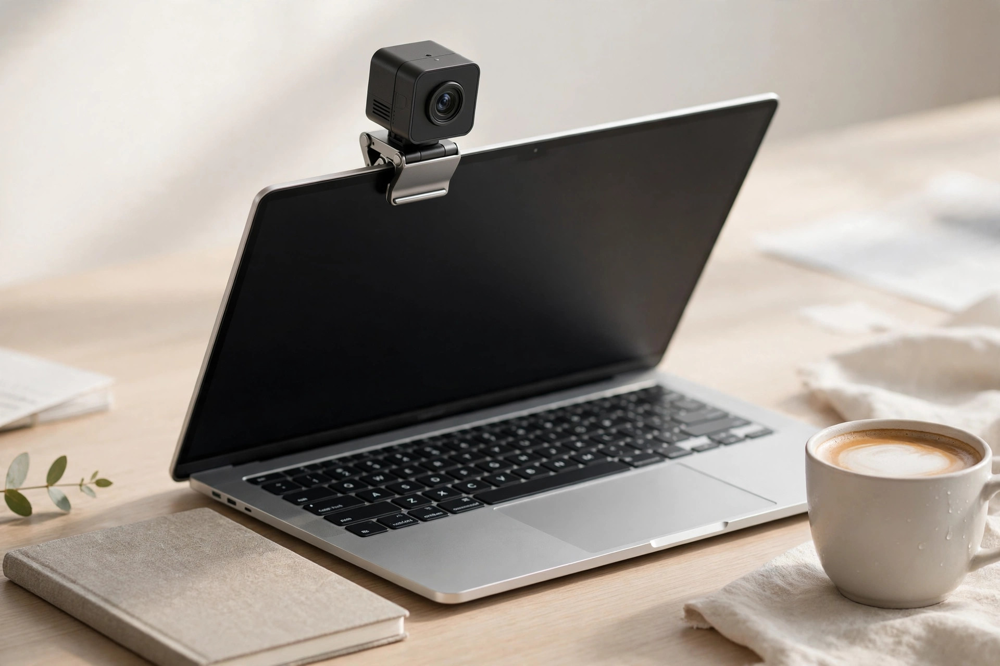
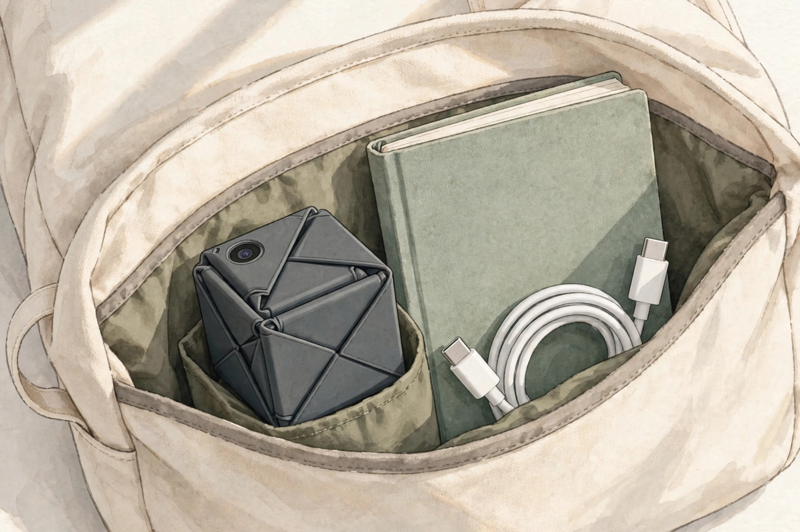
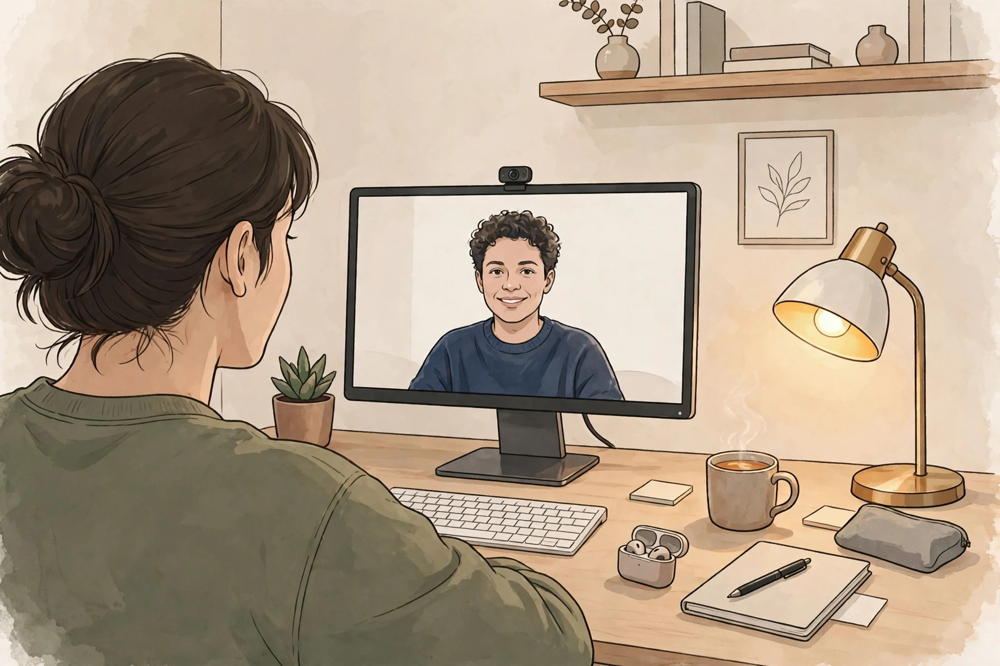

<!-- 본문 시작 -->

Have you ever looked at your laptop screen right before a video call, wondering whether the camera was on? Built-in webcams look flat, and taping over the lens feels wrong. The OBSBOT Meet Flip is a 4K webcam that tries to solve both annoyances with a single folding motion. I checked the official material and independent reviews on November 8, 2026. This is an introduction based on published material, not a hands-on review.

## What Is the Meet Flip?

The Meet Flip is a foldable 4K webcam from OBSBOT. The camera module folds into its own stand: open it and the camera powers on; fold it shut and the lens is physically covered while the device enters sleep mode. It weighs 37.7 g and measures 41.6 × 36.9 × 31.9 mm when open. As a USB-C UVC webcam it is recognized without a driver, and it supports Windows 10 and macOS 11 or later, according to the official blog.

It stays unobtrusive even on a narrow laptop screen. (Illustration)

## Three Things the Fold Solves

First, privacy. When closed, the lens faces inward and is physically covered, and the microphone turns off with it, according to independent reviews. There is no separate cover to keep track of: open means live, closed means dark, so the check before a meeting becomes simple. A status LED is included as well.

Second, image quality. A 1/2-inch stacked CMOS sensor with 48 megapixels and an f/1.8 lens supports 4K at 30 fps and 1080p at 60 fps. A PCWorld review (October 22, 2026) reports sharp detail on faces and clothing in bright light, with phase-detection autofocus locking on quickly from 10 cm. HDR is supported but off by default, so it must be switched on in OBSBOT Center.

Third, AI framing and microphones. Instead of a motor, it crops the 4K image digitally to keep you centered, offers gesture control for tracking and 2x zoom, and includes a dual-microphone system with four audio modes. Separate modes cover solo calls and small group calls.

Folded, it is 18.8 mm thick and slips into a bag pocket. (Illustration)

## Drawbacks and Things to Check Before Buying

First, Windows Hello. There is no infrared camera, so face sign-in is not supported; if you log into Windows with your face, you will need to keep using the built-in camera. The field of view is also a diagonal 72 degrees in 16:9, so it is not meant to cover a long conference table.

Mounting conditions matter too. The official specification allows screens up to 20.5 mm thick, with a recommended tilt range of 0 to 77 degrees, so it may not fit thick or heavily curved monitors, according to PCWorld. A tripod and a carrying case are sold separately. AI Magic Notes, the meeting transcript and summary feature, is free for 120 minutes and then requires a subscription of $4 per month (per PCWorld). 4K tops out at 30 fps, so 1080p at 60 fps suits scenes with more movement, and digital zoom is practical only up to 2x. Noise increases in dark rooms, according to the reviews. A long-term review from RedShark (November 6, 2026) also notes that gesture control can trigger unintentionally.

## Price and Availability in Korea

The official price is $119 (OBSBOT official blog, checked November 8, 2026). PCWorld's price comparison lists $99 at Amazon and Best Buy. In Japan it sells for ¥22,800 including tax. No official Korean retailer or Korean price was confirmed as of November 8, 2026, so check the seller, shipping, customs, and after-sales terms separately before buying.

The lineup makes its position clear. The Meet SE, limited to Full HD, costs $69, while the fixed-mount 4K Meet 2 costs $129. If Full HD is enough, the Meet SE fits; for a fixed desk setup, the Meet 2; for 4K on the move, the Meet Flip. It beats a built-in camera on image quality, autofocus, and privacy, but it cannot replace Windows Hello.

On days when the location changes, the small size and folding design shine. (Illustration)

## My Verdict

The Meet Flip suits people who move between home, the office, and cafes for video calls. The fold-to-off design eases privacy worries, and at 37.7 g it adds little to a bag. If face sign-in is essential, or you plan to clip it onto a thick monitor, check the conditions above one by one first. This is less about buying a 4K webcam than about choosing the webcam that fits how you meet.

> Key line in one sentence
>
> ### **Fold it shut and it turns off, open it and it turns on — a 4K webcam for meetings on the move**

| Item | Details |
|---|---|
| Product | OBSBOT Meet Flip |
| Resolution | 4K 30 fps / 1080p 60 fps |
| Sensor and lens | 1/2-inch CMOS, 48 megapixels, f/1.8 |
| Size and weight | 41.6 × 36.9 × 31.9 mm (open), 37.7 g |
| Connection and OS | USB-C, Windows 10 or later, macOS 11 or later |
| Price | $119 (checked 2026-11-08), Korean price not confirmed |
| Availability | On sale |

## You May Also Like

- [A Keyboard Where Lifting a Typewriter Lever Presses Enter — Epomaker Glyph, What to Check Before Buying](https://aitechnotesen.wordpress.com/2026/11/03/a-keyboard-where-lifting-a-typewriter-lever-presses-enter-epomaker-glyph-what-to-check-before-buying/) — A typewriter-lever keyboard with a surprising mechanism, and the conditions to check before buying.
- [One USB-C Cable Is Not Enough — What to Check Before Buying the ASUS ZenScreen MB16AHV](https://aitechnotesen.wordpress.com/2026/11/03/one-usbc-cable-is-not-enough-what-to-check-before-buying-the-asus-zenscreen-mb16ahv/) — A portable monitor whose single-cable promise needs a closer look before buying.
- [Stop Digging Through Your Bag — MagQuick, a Strap That Snaps On and Pulls Off](https://aitechnotesen.wordpress.com/2026/10/25/stop-digging-through-your-bag-magquick-a-strap-that-snaps-on-and-pulls-off/) — A quick-release strap that keeps small essentials within reach.

## Sources

- [OBSBOT Official Blog — 7 Best Portable Webcams to Buy in 2026](https://www.obsbot.com/blog/webcam/portable-webcam)
- [PCWorld — OBSBOT Meet Flip Review](https://www.pcworld.com/article/3251956/obsbot-meet-flip-review.html)
- [RedShark — OBSBOT Meet Flip Long-Term Review](https://www.redsharknews.com/obsbot-meet-flip-review-foldable-4k-webcam)
- [System5 — OBSBOT Meet Flip Sales Begin in Japan](https://www.mapion.co.jp/news/release/000000264.000024840-all/)

<!-- 본문 끝 -->
