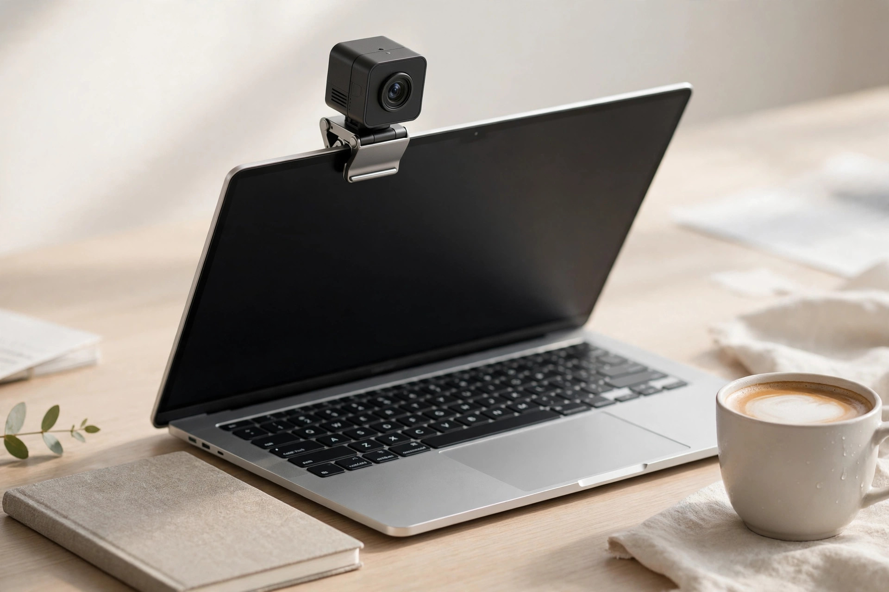
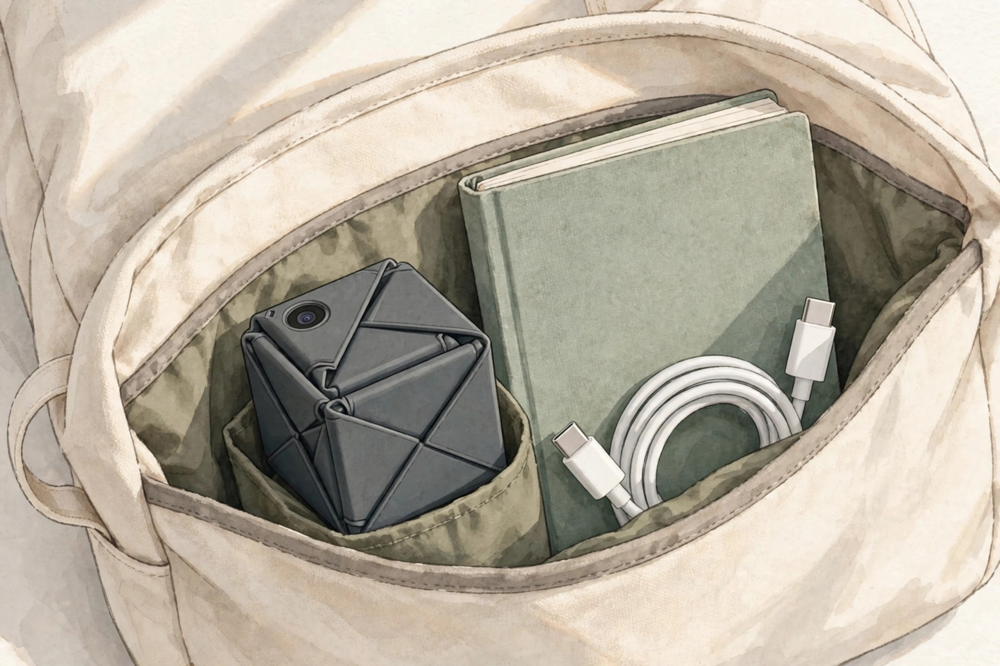
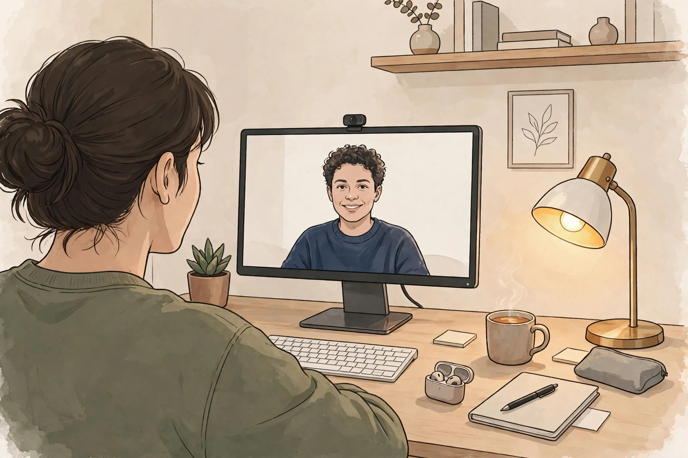

<!-- 본문 시작 -->

화상회의 직전, 노트북 카메라가 켜져 있는지 본 적 있으신가요? 내장 웹캠은 화질이 아쉽고, 렌즈에 테이프를 붙이기도 찝찝합니다. OBSBOT Meet Flip은 이 두 불편을 접는 동작 하나로 해결하려는 4K 웹캠입니다. 공식 자료와 독립 리뷰를 2026년 11월 8일에 확인했습니다. 직접 써본 후기가 아닙니다.

## Meet Flip은 어떤 제품인가

Meet Flip은 OBSBOT이 만든 접이식 4K 웹캠입니다. 카메라 모듈이 스탠드 안으로 접히고, 펼치면 켜지고 접으면 렌즈가 물리적으로 가려지며 절전 모드로 들어갑니다. 무게 37.7g, 펼친 크기 41.6×36.9×31.9mm입니다. USB-C UVC 웹캠이라 드라이버 없이 인식되고, 윈도우 10·macOS 11 이상을 지원합니다(공식 블로그).

좁은 화면 위에서도 거슬리지 않습니다. (일러스트)

## 접는 동작이 해결하는 세 가지

첫째, 프라이버시입니다. 닫으면 렌즈가 안쪽으로 가려지고 마이크도 꺼진다고 독립 리뷰는 전합니다. 덮개를 따로 챙길 필요가 없고, 열리면 켜지고 닫히면 꺼져 회의 전 확인이 단순합니다. 상태 LED도 있습니다.

둘째, 화질입니다. 1/2인치 스택 CMOS 4800만 화소·f/1.8 렌즈로 4K 30fps와 1080p 60fps를 지원합니다. PCWorld 리뷰(2026년 10월 22일)는 밝은 곳에서 얼굴·옷 질감이 또렷하고 자동초점이 10cm부터 빠르다고 전합니다. HDR은 기본값이 꺼져 있어 OBSBOT Center에서 켜야 합니다.

셋째, AI 프레이밍과 마이크입니다. 모터 대신 4K를 디지털로 잘라 사람을 중앙에 두는 자동 프레이밍, 손동작 추적·2배 줌 제스처 조작, 네 가지 음성 모드의 듀얼 마이크가 들어갑니다. 1인 회의와 소규모 회의 모드가 따로 있습니다.

접으면 두께 18.8mm, 가방 주머니에 쏙 들어갑니다. (일러스트)

## 아쉬운 점과 사기 전 확인할 점

먼저 Windows Hello입니다. 적외선 카메라가 없어 얼굴 인식 로그인이 안 되니, 얼굴로 로그인하던 분은 내장 카메라를 써야 합니다. 화각도 16:9 기준 대각 72도라 긴 회의실 테이블용은 아닙니다.

장착 조건도 따져야 합니다. 끼울 수 있는 화면 두께는 최대 20.5mm, 권장 각도 0~77도라 두껍거나 많이 휘어진 모니터에는 맞지 않을 수 있습니다(PCWorld). 삼각대·휴대 케이스는 별도입니다. 회의록 기능 AI Magic Notes는 120분 무료 후 월 4달러 구독이 필요하고(PCWorld 기준), 4K는 30fps까지라 움직임이 많은 장면엔 1080p 60fps가 낫습니다. 디지털 줌은 2배까지만 실용적이고, 어두운 곳에선 노이즈가 는다고 합니다. RedShark 장기 사용기(2026년 11월 6일)는 제스처 조작이 의도치 않게 작동한다고도 전합니다.

## 가격과 국내 이용

공식 가격은 119달러입니다(OBSBOT 공식 블로그, 2026년 11월 8일 확인). PCWorld 가격 비교에는 아마존·베스트바이 99달러 표시가 있습니다. 일본 판매가는 22,800엔(세금 포함)입니다. 국내 공식 판매처·가격은 2026년 11월 8일 기준 미확인이라, 구매 전 판매처·배송비·관세·AS를 따로 확인해야 합니다.

라인업과 비교하면 분명합니다. FHD만 되는 Meet SE는 69달러, 같은 4K 고정형인 Meet 2는 129달러입니다. FHD면 Meet SE, 고정해 쓴다면 Meet 2, 들고 다니며 4K를 쓴다면 Meet Flip이 맞습니다. 내장 카메라보다 화질·자동초점·프라이버시가 낫지만, Windows Hello는 대신하지 못합니다.

장소가 바뀌는 날엔 접는 구조가 빛납니다. (일러스트)

## 나의 판단

Meet Flip은 집·회사·카페를 오가며 화상회의를 자주 하는 사람에게 어울립니다. 접으면 꺼지는 구조가 프라이버시 걱정을 줄여주고, 37.7g이라 가방 부담이 작습니다. 반대로 얼굴 인식 로그인이 필요하거나 두꺼운 모니터에 끼워 쓴다면, 위 조건을 대조해 보는 편이 좋습니다. 4K 웹캠이 아니라 내 회의 습관에 맞는 웹캠을 고르는 일이기 때문입니다.

> 핵심 한 줄
>
> ### **접으면 꺼지고 펼치면 켜지는, 이동하는 회의에 맞는 4K 웹캠**

| 항목 | 내용 |
|---|---|
| 제품명 | OBSBOT Meet Flip |
| 해상도 | 4K 30fps / 1080p 60fps |
| 센서·렌즈 | 1/2인치 CMOS 4800만 화소, f/1.8 |
| 크기·무게 | 41.6×36.9×31.9mm(펼침), 37.7g |
| 연결·OS | USB-C, 윈도우 10 이상·macOS 11 이상 |
| 가격 | 119달러(2026-11-08 확인), 국내 미확인 |
| 판매 단계 | 판매 중 |

## 함께 보면 좋은 글

- [쓰다듬으면 성격이 생긴다 — 카시오 모플린, 사기 전에 확인할 조건](https://blog.naver.com/3700708/224467949470) — 쓰다듬는 교감으로 성격이 바뀌는 로봇, 사기 전 확인할 조건을 정리했습니다.
- [앱을 뺀 폰이 899달러 — Light Phone III, 사기 전에 확인할 조건](https://blog.naver.com/3700708/224467949203) — 앱을 빼고 본질만 남긴 폰, 899달러의 값을 따져봤습니다.
- [AI 브라우저 티어표로 고르기｜읽어주는 브라우저와 대신 클릭하는 브라우저는 다르다](https://blog.naver.com/3700708/224460771206) — AI 브라우저를 목적별로 나눠 고르는 기준을 정리했습니다.

## 출처

- [OBSBOT 공식 블로그 — 2026년 휴대용 웹캠 7선](https://www.obsbot.com/blog/webcam/portable-webcam)
- [PCWorld — OBSBOT Meet Flip 리뷰](https://www.pcworld.com/article/3251956/obsbot-meet-flip-review.html)
- [RedShark — OBSBOT Meet Flip 장기 리뷰](https://www.redsharknews.com/obsbot-meet-flip-review-foldable-4k-webcam)
- [시스템파이브 — OBSBOT Meet Flip 일본 판매 시작](https://www.mapion.co.jp/news/release/000000264.000024840-all/)

<!-- 본문 끝 -->
