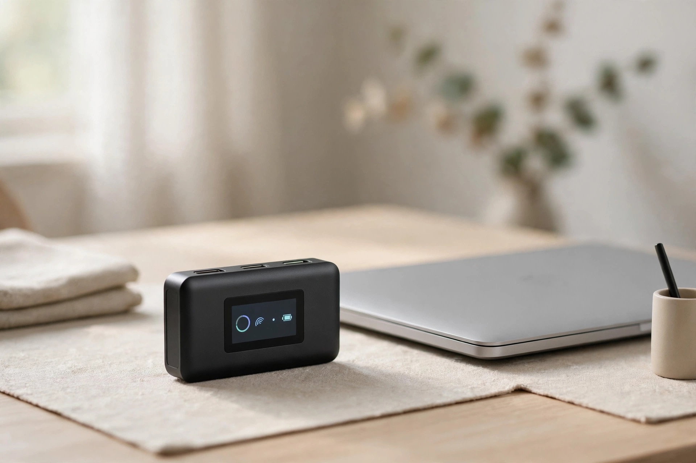
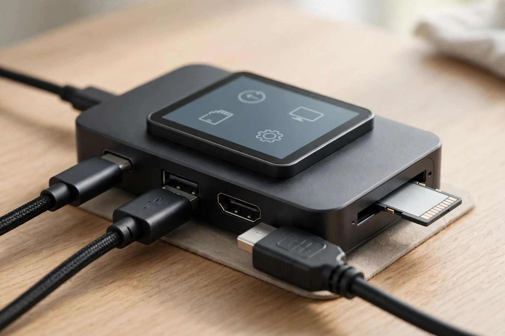
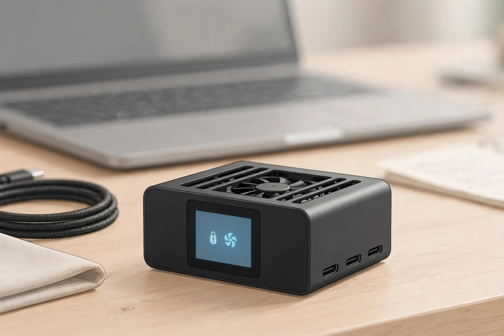

<!-- 본문 시작 -->

113 g, palm-sized — a hub combined with an external SSD. (Illustration)

You have probably plugged in a hub because your laptop ran out of ports. But what if that hub could tell you what it is doing right now — how much of a file transfer is left, and whether the SSD inside is healthy? The Dockcase Smart USB-C Hub 7-in-1 answers those questions with a small touchscreen on its front. It launched on Kickstarter in February 2025, shipping began that May, and it is a Dockcase-brand product from the maker Seesaw (checked 2026-11-08).

> Key line
> ### **The hub is no longer a black box — it is a dashboard showing what is happening right now**

## A hub — with a screen

It is a combination of a USB-C hub and an M.2 SSD enclosure. A palm-sized aluminum body measuring 97.8×55.0×20.9 mm and weighing 113 g carries a 1.9-inch touchscreen on its front, and according to the official specifications the screen shows transfer speed, charging power, connected devices, and SSD status in real time. SSD health monitoring shows the number of unsafe shutdowns and power-on hours, so you can spot signs of failure early. A read-only mode can also be switched on from the screen, and the screen rotates 180 degrees.

## An SSD inside the hub

You can fit an M.2 2230 or 2242 NVMe SSD of up to 2TB inside the hub, so there is no need to carry a separate external SSD. The SSD itself is sold separately, though.

For speed, AppleInsider measured read speeds of about 1,000 MB/s, while Macworld measured 955 MB/s read and 875 MB/s write. The USB 3.2 Gen 2 (10 Gbps) connection is the bottleneck, so a modern PCIe 4 SSD cannot reach its maximum speed. It is far faster than a thumb drive, but a step below a dedicated high-speed external SSD.

HDMI 4K 120Hz, 100W charging, UHS-II slot — connection, charging, and storage in one body. (Illustration)

## Ports and cooling in one body

The port selection is practical, too. USB-C and USB-A each run at 10 Gbps, HDMI 2.1 outputs 4K at 120 Hz, USB-C PD delivers 100W charging, and there are UHS-II SD and microSD slots. A temperature-controlled fan is built in to keep the SSD from overheating, and its speed can be adjusted in four steps or switched off from the screen. The maker says it aims to keep the system at 39°C.

## What to check before buying

First, fan noise. Both the AppleInsider and Macworld reviews note that the fan is not completely quiet. In Macworld's endurance test, more than 30 minutes of intensive use raised the SSD temperature and slowed transfer speeds; a warning appeared at 69°C, and the fan kicked in at 72°C to bring the temperature down.

The port count is not large, either. Macworld's verdict was essentially that this is an SSD enclosure first, a hub second. It is also officially listed as incompatible with the Nintendo Switch, Microsoft Surface, Dell G series, and Alienware gaming laptops, so check compatibility before buying.

The fan can be adjusted in four steps or switched off. Tests found a warning appears at 69°C when it is off. (Illustration)

## Price and availability in Korea

The list price is $179, and the Kickstarter price was $129 (checked 2026-11-08). The lowest official-store price Macworld confirmed on May 19, 2025 was $99.99, but I could not verify the current price as of November 8, 2026. There is also no confirmed official sales channel or Korea shipping. Kickstarter shipping covered the US, UK, and EU, and while an Amazon US listing exists, whether it ships directly to Korea is unconfirmed.

| Item | Details |
|---|---|
| Product | Dockcase Smart USB-C Hub 7-in-1 with M.2 SSD Enclosure |
| Maker | Seesaw (Dockcase) |
| Size · Weight | 97.8×55.0×20.9 mm · 113 g |
| Display | 1.9-inch touchscreen LCD |
| Ports · Storage | USB-C/A 10 Gbps · HDMI 4K@120Hz · 100W PD · UHS-II SD/TF · M.2 up to 2TB (SSD sold separately) |
| Price | List $179 · Kickstarter $129 (2025) |
| In Korea | Korea shipping · official sales channel unconfirmed |

## My take

It suits people who are short on laptop ports and tired of carrying a separate external SSD. If you move photos and video files often, there is also a small pleasure in seeing transfer speed and SSD health with your own eyes. But if you work in a quiet environment, want a hub with many ports, or use a Nintendo Switch or Surface, check compatibility and noise before buying.

## Related Posts

- [A Keyboard Where Lifting a Typewriter Lever Presses Enter — Epomaker Glyph, What to Check Before Buying](https://aitechnotesen.wordpress.com/2026/11/03/a-keyboard-where-lifting-a-typewriter-lever-presses-enter-epomaker-glyph-what-to-check-before-buying/) — A typewriter lever that works as an Enter key, and what that means for everyday typing.
- [One USB-C Cable Is Not Enough — What to Check Before Buying the ASUS ZenScreen MB16AHV](https://aitechnotesen.wordpress.com/2026/11/03/one-usbc-cable-is-not-enough-what-to-check-before-buying-the-asus-zenscreen-mb16ahv/) — A portable monitor that needs more than one USB-C cable, and what to check before buying.
- [Stop Digging Through Your Bag — MagQuick, a Strap That Snaps On and Pulls Off](https://aitechnotesen.wordpress.com/2026/10/25/stop-digging-through-your-bag-magquick-a-strap-that-snaps-on-and-pulls-off/) — A strap that snaps on and pulls off, so you stop digging through your bag.

## Sources

- [Yanko Design — 5 Desk Gadgets & Tools Of August 2026](https://www.yankodesign.com/2026/08/24/5-desk-gadgets-tools-of-august-2026-that-make-working-from-home-feel-like-a-studio/)
- [AppleInsider — Dockcase 7-in-1 USB-C Hub with SSD Enclosure review](https://appleinsider.com/articles/25/02/17/dockcase-7-in-1-usb-c-hub-with-ssd-enclosure-review-best-of-both-worlds/amp/)
- [Macworld — Dockcase Smart USB-C Hub review](https://www.macworld.com/article/2612138/dockcase-smart-usbc-hub-7in1-m2-ssd-enclosure-review.html)
- [WCCFTech — Dockcase Smart USB-C 7-in-1 Hub review](https://wccftech.com/review/dockcase-smart-usb-c-7-in-1-hub-with-m-2-ssd-enclosure-review/)
- [Android Central — Dockcase's latest 7-in-1 USB-C hub doubles as an external M.2 storage drive](https://www.androidcentral.com/accessories/dockcase-smart-7-in-1-usb-c-hub-doubles-as-m2-storage-drive)
- [Notebookcheck — Dockcase: New USB hub boasts a touchscreen, an M.2 slot and support for 4K content at 120Hz](https://www.notebookcheck.net/Dockcase-New-USB-hub-boasts-a-touchscreen-an-M-2-slot-and-support-for-4K-content-at-120Hz.930792.0.html)

<!-- 본문 끝 -->
