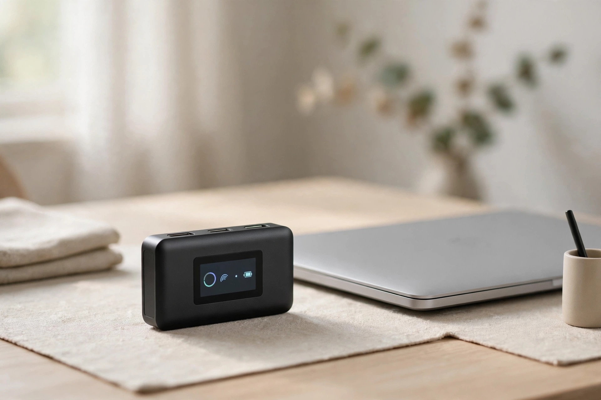
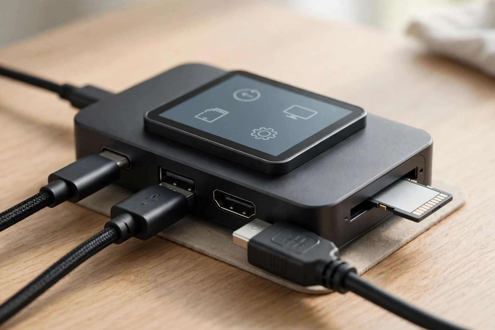
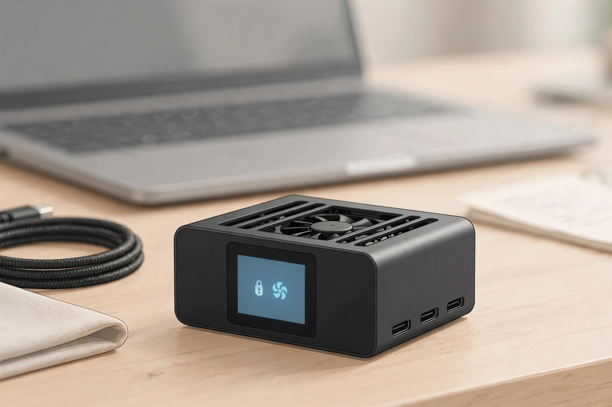

<!-- 본문 시작 -->

113g 손바닥만 한 크기 — 허브와 외장 SSD의 결합이다. (일러스트)

노트북 포트가 모자라 허브를 꽂은 적 있으시죠. 그 허브가 지금 뭘 하고 있는지, 파일 전송이 얼마나 남았는지, 안의 SSD는 건강한지 알려주면 어떨까요. Dockcase Smart USB-C Hub 7-in-1은 앞면의 작은 터치스크린으로 그 궁금증을 바로 보여주는 제품입니다. 2025년 2월 킥스타터로 나와 같은 해 5월부터 배송된 Seesaw의 Dockcase 브랜드 제품입니다(확인일 2026-11-08).

> 핵심 한 줄
> ### **허브가 '검은 상자'가 아니라, 지금 무슨 일이 일어나는지 보여주는 계기판이 됐다**

## 허브인데, 화면이 달렸다

정체는 USB-C 허브와 M.2 SSD 외장 케이스의 결합입니다. 97.8×55.0×20.9mm, 113g의 손바닥만 한 알루미늄 몸체 앞면에 1.9인치 터치스크린이 붙어 있고, 공식 사양에 따르면 전송 속도, 충전 전력, 연결 기기, SSD 상태가 실시간으로 표시됩니다. SSD 건강 모니터링은 비정상 종료 횟수와 가동 시간을 보여줘 고장 징후를 미리 알려줍니다. 읽기 전용 모드도 화면에서 켤 수 있고, 화면은 180도 회전합니다.

## SSD를 허브 안에 넣는다

허브 안에 M.2 2230·2242 규격 NVMe SSD를 최대 2TB까지 넣어 외장 SSD를 따로 들고 다닐 필요가 없어집니다. 다만 SSD는 별도 구매입니다.

속도는 AppleInsider 실측 읽기 약 1,000MB/s, Macworld 실측 읽기 955MB/s·쓰기 875MB/s였습니다. USB 3.2 Gen 2(10Gbps) 연결이 병목이라 PCIe 4 SSD의 최대 속도는 나오지 않습니다. 썸드라이브보다 훨씬 빠르고, 전용 고속 외장 SSD보다 한 단계 아래입니다.

HDMI 4K 120Hz·100W 충전·UHS-II 슬롯 — 연결·충전·저장이 한 몸에 들어간다. (일러스트)

## 포트와 냉각까지 한 몸에

포트 구성도 실속 있습니다. USB-C·USB-A 각각 10Gbps, HDMI 2.1 4K 120Hz 출력, USB-C PD 100W 충전, UHS-II SD카드와 microSD 슬롯까지 갖췹습니다. SSD 발열을 막는 온도 조절 팬이 내장됐고, 팬 속도는 화면에서 4단계로 조절하거나 끌 수 있습니다. 제조사는 시스템 39°C 유지를 목표로 한다고 밝히고 있습니다.

## 사기 전에 확인할 아쉬운 점

팬 소음입니다. AppleInsider와 Macworld 리뷰 모두 팬이 완전히 조용하지는 않다고 지적했습니다. Macworld 내구 테스트에서는 30분 이상 집중 사용 시 SSD 온도가 올라 속도가 떨어졌고, 69°C 경고 뒤 72°C에서 팬이 돌며 온도를 낮췄습니다.

포트 수는 많지 않습니다. Macworld는 '포트보다 SSD 외장 케이스가 본질'이라는 취지로 평가했습니다. 또 닌텐도 스위치, 마이크로소프트 서피스, Dell G 시리즈, Alienware 게이밍 노트북과는 호환되지 않는다고 공식 사양에 명시돼 있어 구매 전 확인이 필요합니다.

팬 4단계 조절·끄기 가능. 끄면 69°C에서 경고가 뜬다는 실측이 있다. (일러스트)

## 가격과 국내 이용

정가 $179, 킥스타터 당시 가격 $129였습니다(확인일 2026-11-08). Macworld가 2025년 5월 19일 확인한 공식 스토어 최저가는 $99.99였으나, 2026년 11월 8일 현재 가격은 확인하지 못했습니다. 국내 정식 판매처와 한국 배송 여부도 미확인입니다. 킥스타터 당시 배송국은 미국·영국·EU였고, Amazon US 목록은 있으나 한국 직배송 여부는 확인되지 않았습니다.

| 항목 | 내용 |
|---|---|
| 제품명 | Dockcase Smart USB-C Hub 7-in-1 with M.2 SSD Enclosure |
| 제조사 | Seesaw (Dockcase) |
| 크기·무게 | 97.8×55.0×20.9mm · 113g |
| 화면 | 1.9인치 터치스크린 LCD |
| 포트·저장 | USB-C/A 10Gbps · HDMI 4K@120Hz · 100W PD · UHS-II SD/TF · M.2 최대 2TB (SSD 별도) |
| 가격 | 정가 $179 · 킥스타터 $129 (2025년) |
| 국내 이용 | 한국 배송·정식 판매처 미확인 |

## 나의 판단

노트북 포트가 부족하고 외장 SSD를 따로 챙기기 번거로웠던 사람에게 어울립니다. 사진·영상 파일을 자주 옮기는 사람이라면 전송 속도와 SSD 건강을 눈으로 확인하는 재미도 있습니다. 다만 조용한 환경에서 쓰는 사람, 포트가 많은 허브를 원하는 사람, 닌텐도 스위치나 서피스 사용자라면 구매 전 호환성과 소음을 확인해야 합니다.

## 함께 보면 좋은 글

- [쓰다듬으면 성격이 생긴다 — 카시오 모플린, 사기 전에 확인할 조건](https://blog.naver.com/3700708/224467949470) — 말을 못 하는 털뭉치 로봇이 왜 429달러인지, 사기 전 확인할 조건을 정리했습니다.
- [앱을 뺀 폰이 899달러 — Light Phone III, 사기 전에 확인할 조건](https://blog.naver.com/3700708/224467949203) — 스마트폰을 내려놓고 싶은 사람을 위한, 앱을 뺀 폰의 실체를 확인했습니다.
- [AI 브라우저 티어표로 고르기｜읽어주는 브라우저와 대신 클릭하는 브라우저는 다르다](https://blog.naver.com/3700708/224460771206) — AI 브라우저를 고르기 전, 읽어주는 것과 대신 클릭하는 것의 차이를 정리했습니다.

## 출처

- [Yanko Design — 5 Desk Gadgets & Tools Of August 2026](https://www.yankodesign.com/2026/08/24/5-desk-gadgets-tools-of-august-2026-that-make-working-from-home-feel-like-a-studio/)
- [AppleInsider — Dockcase 7-in-1 USB-C Hub with SSD Enclosure review](https://appleinsider.com/articles/25/02/17/dockcase-7-in-1-usb-c-hub-with-ssd-enclosure-review-best-of-both-worlds/amp/)
- [Macworld — Dockcase Smart USB-C Hub review](https://www.macworld.com/article/2612138/dockcase-smart-usbc-hub-7in1-m2-ssd-enclosure-review.html)
- [WCCFTech — Dockcase Smart USB-C 7-in-1 Hub review](https://wccftech.com/review/dockcase-smart-usb-c-7-in-1-hub-with-m-2-ssd-enclosure-review/)
- [Android Central — Dockcase's latest 7-in-1 USB-C hub doubles as an external M.2 storage drive](https://www.androidcentral.com/accessories/dockcase-smart-7-in-1-usb-c-hub-doubles-as-m2-storage-drive)
- [Notebookcheck — Dockcase: New USB hub boasts a touchscreen, an M.2 slot and support for 4K content at 120Hz](https://www.notebookcheck.net/Dockcase-New-USB-hub-boasts-a-touchscreen-an-M-2-slot-and-support-for-4K-content-at-120Hz.930792.0.html)

<!-- 본문 끝 -->
